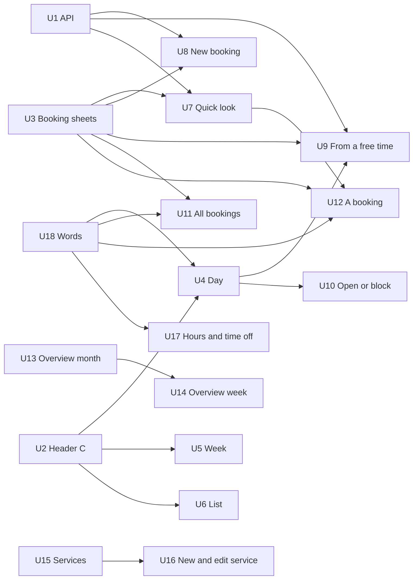

# Bookings on a phone: build the improved journey (#1016)

## Summary

Build the phone layouts of Bookings, the Overview calendar, Services and
Hours and time off exactly as the 15 rows on the canvas page "Bookings on a
phone: improved journey" draw them, one unit per screen or flow, on top of
three shared pieces (the calendar header C with its sheets, the booking sheets
every flow reuses, and three small API changes the boards need). Desktop keeps
working as it is today; the shared pieces are built so the desktop phase
(canvas page 5, `BKN*`) reuses them next.

Code starts only after the owner signs off this plan and answers, or accepts
the drawn default for, the open questions at the end.

---

## Problem Frame

A physio, salon or tutor runs their day from a phone between clients. Walking
the built screens (audit, 36 findings, 5/10) showed they get stuck there:
free time is invisible on touch, the phone week shows one day under a
seven-day count, two New booking sheets ask in different orders, a caller
without an email cannot be booked, cancelling a paid booking from the list
skips the refund question, a Member at the front desk cannot book at all, and
Hours and time off has three different ways to save. The phone boards fix each
of these; this plan turns them into buildable units.

Canvas: https://claude.ai/artifact/6QDguTRfaKdm7NP5NSytNj

---

## Assumptions

*Written without the owner in the loop. Review before code starts.*

- The boards on page 4 are final for the phone (owner, 19 Oct). Where a board
  and the #1016 body disagree, the board wins (for example, New booking now
  asks **who it is for first**, then service, with, when, check; #1016 item 1
  had service first).
- DEC-170 is recorded on `batch-2026-10-18-3`, not yet on `development`. Units
  start from a branch that contains it.
- "Mark arrived" (button) and "Came" / "Didn't come" (status) are the words
  the boards draw; #1016's "They're here" is replaced by them.
- Header C applies to Day, Week and List (agenda) in Bookings and to the
  sheets over them. The Overview calendar keeps its own month/week title (its
  boards draw it that way).

---

## Requirements

- R1. Every phone board on page 4 is matched in fidelity (icons, sizes,
  spacing, colour roles), side by side at 390×844.
- R2. A redesign never removes a capability: each unit lists today's controls
  and where each one lives on the new screen; nothing on the list is lost.
- R3. DEC-170: a caller with a name and phone can be booked (email optional);
  "Awaiting payment" everywhere; a Member books and marks arrivals; Hours and
  time off save each change with Undo and have no Save bar; a hand-made
  booking defaults to "Pays at the visit".
- R4. Every cancel of a paid booking, from any screen, asks the money
  question (refund or keep the deposit), preselected by the policy (BA-01).
- R5. Each screen draws its states: loading, couldn't load ("Nothing has
  changed · Try again"), empty with one next step, a time just taken, no access
  (Reviewer locked out; Calendar-only and Member told why an action is
  missing in one line) (BA-09, BA-27).
- R6. Phone basics: 44px targets, no sideways page scroll at 320 and 390, no
  hover-only action, sheets full width, toasts above an open sheet's foot and
  above the tab bar (BA-22, BA-24, BA-26).
- R7. Desktop at 1440 still works and still passes its specs after each unit;
  shared components are written once for both widths.
- R8. Words follow DEC-113 as amended by DEC-170 and pass `check:copy` and
  `check:words`.

---

## Scope Boundaries

- The phone layout (below 760px) of each screen on page 4, and the shared
  components those screens need.
- Desktop changes only where a shared component or a fixed bug (BA-01 cancel,
  BA-03 year cap, BA-07 save model, words) changes both widths at once.
- No new booking features: no packages, WhatsApp sending by Saroh, group
  bookings, waitlist changes, or changes to the customer booking page.
- Saroh still sends nothing itself after a booking: "Send on WhatsApp" and
  "Send by SMS" open the phone's own app with the message filled in (Q12).

### Backend dependencies the boards require (all in U1)

- **Book with a name and phone only** (DEC-170, BA-02): `BookByHandDto`
  today needs `contactId` or `bookerEmail`
  (`apps/api.saroh.in/src/modules/bookings/bookings.service.ts`, `bookByHand`
  throws "Choose someone from your contacts, or give an email."). The contact
  is kept by phone, as a walk-in is for orders
  (`apps/api.saroh.in/src/modules/orders/walk-in-customer.ts`). `Booking.bookerEmail`
  is already nullable.
- **A Member books, marks arrivals, moves and cancels** (DEC-170 Q3; the
  boards also show Move and Cancel for the front desk, see Q13): Member holds
  only `order:stage` today (`apps/api.saroh.in/src/modules/organizations/organization-policy.ts`,
  `MEMBER_ACTIONS`), and booking writes need `booking:write`.
- **"Paid now" records how** (Cash, UPI, Card; BA-20): `paidWith: "PAID"`
  carries no method today; the desk-payment route does
  (`apps/api.saroh.in/src/modules/bookings/desk-pay.dto.ts`).

### Deferred to Follow-Up Work

- Desktop redesign of every screen (canvas page 5, `BKN*` boards): the next
  phase, one plan after this one ships.
- Waitlist for a full day on a phone (drawn in the references, not on the
  boards): stays with the one-to-one waitlist work.
- Saroh sending booking messages itself: not in this.

---

## Context and Research

### Where each screen lives today

| Screen | Route | Main files |
| --- | --- | --- |
| Day / Week / Agenda | `apps/app.saroh.in/app/(shell)/bookings/page.tsx` | `components/bookings/calendar/calendar-screen.tsx`, `calendar-toolbar.tsx`, `day-by-person.tsx`, `week-view.tsx`, `agenda-month.tsx`, `free-gap.tsx`, `diary-block.tsx`, `now-line.tsx`, `parts.tsx`, `geometry.ts`, `components/bookings/bookings-view-switch.tsx`, `lib/services/diary.ts`, `diary-view.ts`, `diary-lanes.ts`, `calendar-href.ts` |
| Quick look, move, cancel | sheet on `/bookings` | `components/bookings/calendar/booking-quick-look.tsx`, `class-seats.tsx`, `quick-look-types.ts`, `components/bookings/reschedule-booking.tsx`, `cancel-booking-control.tsx`, `outcome-control.tsx`, `take-payment.tsx` |
| New booking | sheet on `/bookings` | `components/bookings/new-booking-dialog.tsx`, `components/customers/customer-picker.tsx`, `picker-forms.tsx`, `lib/customers/picker.ts`, `lib/services/booking-pay.ts`, `components/bookings/pay-link-panel.tsx`, `booking-pack-control.tsx` |
| Book from a free time | sheet on `/bookings` | `components/bookings/calendar/new-booking-from-gap.tsx` |
| Open or block time | sheet on `/bookings` | `components/bookings/calendar/open-hours-dialog.tsx` |
| All bookings | `app/(shell)/bookings/all/page.tsx` | `components/bookings/bookings-view.tsx` |
| A booking | `app/(shell)/bookings/[bookingId]/page.tsx` | `components/bookings/booking-detail.tsx`, `take-payment.tsx`, `take-payment-locked.tsx` |
| Overview month / week | `app/(shell)/calendar/page.tsx` | `components/calendar/business-calendar.tsx`, `business-week.tsx`, `month-grid.tsx`, `day-sheet.tsx`, `day-panel.tsx`, `layer-switches.tsx`, `team-filter.tsx`, `view-switch.tsx`, `week-columns.tsx`, `week-hour-grid.tsx`, `lib/calendar/*` |
| Services | `app/(shell)/services/page.tsx` | `components/services/services-screen.tsx`, `use-taking-bookings.ts`, `also-sell.tsx` |
| New / edit service | `app/(shell)/services/new/page.tsx`, `services/[serviceId]/page.tsx` | `components/services/service-editor/*`, `lib/services/service-editor.ts`, `editor-data.ts` |
| Hours and time off | `app/(shell)/bookings/availability/page.tsx` | `components/bookings/availability/*`, `lib/staff/*`, `lib/services/availability-rules.ts` |
| Tab bar | all | `components/shared/nav-items.tsx`, `tab-bar-sheet.tsx`; toasts `app/providers.tsx` (`mobileOffset`) |

API: `apps/api.saroh.in/src/modules/bookings` (bookings, outcome, move,
cancel, desk pay, pay link), `modules/staff` (hours, extra hours, time off,
closures, booking rules), `modules/calendar` (Overview).

Browser specs today: `e2e/tests/bookings.spec.ts`, `calendar-week.spec.ts`,
`role-member.spec.ts`, `role-calendar-only.spec.ts`, `role-reviewer.spec.ts`,
`phone-reflow.spec.ts`, `four-scenes.spec.ts`.

### Patterns to follow

- `docs/patterns/00-universal.md`, `docs/patterns/saroh-product.md`,
  `PRODUCT.md` (words, states, one message at a time).
- `.agents/skills/saroh-four-scenes/SKILL.md` (320/390/1440, light and dark,
  touch pointer, the `min-width: auto` trap).
- `docs/patterns/frontend-forms.md` (sheets, `OverlayFoot`, discard guard),
  `frontend-error-feedback.md` (toasts with Undo, failed reads),
  `frontend-data-and-state.md` (URL state for day, person and view),
  `frontend-design-system.md` (tokens, no new brand colours),
  `frontend-verification.md` and `.agents/skills/saroh-browser-tests/SKILL.md`.
- Read-first rows with Edit in a side or bottom sheet; finish the task in the
  opened UI, never redirect mid-task.
- Permissions, never role names, decide money (DEC-098).

---

## Key Technical Decisions

- **Phone layout is a branch inside each screen, not a second route.** The
  same route renders the phone layout below 760px (the breakpoint the screens
  use today), so links, URL state and specs stay one set.
- **Three shared pieces come first** (U1 API, U2 header C, U3 booking
  sheets); every screen unit builds on them. Each is written for both widths
  so the desktop phase reuses it.
- **One cancel sheet** (U3) is the only way any screen cancels a booking; the
  list's direct cancel goes away as a code path, not as a capability.
- **One time picker** (U3: With, day strip, Pick a date, times by part of
  day, next free day) serves New booking step 4 and Move.
- **Hours save per control with Undo** through the existing staff endpoints
  (`PUT :staffId/hours`, extra hours, time off); no Save bar and no draft
  state on the page.

---

## Implementation Units

### U1. API: book with a name and phone, the front desk books, "Paid now" says how

**Goal:** The three server changes the boards need, so the phone flows can
be built without workarounds.

**Requirements:** R3, R4.

**Dependencies:** none.

**Boards:** `BKMNewBooking.dc.html` (step 1 "Just a name and phone number",
same-phone check), `BKMNewFromGap.dc.html` (new customer, email optional),
`BKMNewBookingStep5.dc.html` (Member state, Paid now with Cash/UPI/Card),
`BKMBookingDetail.dc.html` and `BKMQuickLook.dc.html` (front desk note).

**Files:**
- Modify: `apps/api.saroh.in/src/modules/bookings/dto.ts` (`BookByHandDto`: a
  name and phone are enough; an optional desk method with `paidWith: "PAID"`)
- Modify: `apps/api.saroh.in/src/modules/bookings/bookings.service.ts`
  (`bookByHand`: find or make the contact by phone like a walk-in; record the
  method in the same transaction)
- Modify: `apps/api.saroh.in/src/modules/organizations/organization-policy.ts`
  (Member: book, mark the outcome, move and cancel; see Q13 for the exact set)
- Reuse: `apps/api.saroh.in/src/modules/orders/walk-in-customer.ts`
- Test: `apps/api.saroh.in/src/modules/bookings/booking-permissions.db.spec.ts`,
  `bookings.service.spec.ts`, `booking-desk-pay.db.spec.ts`,
  `apps/api.saroh.in/src/modules/organizations/organization-policy.spec.ts`

**Approach:**
- Name and phone, no email: match an existing contact by phone in the
  business first (the same normalisation orders use); if none, make one kept
  by phone. A typed email still matches by email first, as today.
- A treatment still needs an email for its bill (DEC-050); keep that check and
  its message.
- Member powers: a narrow set (make a booking, record the outcome, move,
  cancel) rather than the whole `booking:write` if anything else hangs off it;
  money stays with payment permissions (DEC-098). A Member cancelling a paid
  booking follows the policy for the money (Q14).
- "Paid now" with a method writes the booking and its desk payment together,
  so a failure leaves neither.

**Execution note:** Start with failing integration tests for the three
contracts.

**Test scenarios:**
- Happy: book by hand with a name and `+91` phone only → 201; the contact has
  that phone and no email; the booking shows the name.
- Happy: same phone as an existing contact → that contact is booked, not a
  second one.
- Edge: email and phone that belong to two different contacts → the email
  wins, as today; the answer says which contact was used.
- Edge: a treatment with no email → the existing 400 asking for an email.
- Error: neither a contact, an email nor a phone → 400 naming `bookerPhone`.
- Permissions: Member books, records Came / Didn't come, moves and cancels →
  allowed; Member takes a desk payment or sends a pay link → 403; Reviewer →
  403 on all; Calendar-only → 403 on all writes; another business's booking →
  404.
- Integration: `paidWith: "PAID"` with method UPI → the booking is paid, a
  desk payment with UPI exists, both in one transaction; a forced failure on
  the payment leaves no booking.

**Verification:** API unit and integration specs pass; `pnpm prepush --all`
green for the API; no change to the customer booking page's contract.

---

### U2. Calendar header C, with the date, people and options sheets (shared)

**Goal:** One header on Day, Week and List: a tappable date title, the person
chip and one summary line, with three sheets behind them. Built once for both
widths; desktop keeps its current header until the desktop phase.

**Requirements:** R1, R2, R6, R7.

**Dependencies:** none.

**Boards:** `BKMBookingsDay.dc.html` (header), `BKMBookingsDayMonthSheet.dc.html`
(date sheet: this week strip, the month with dots and Closed, Show as Day /
Week / List, Go to today), `BKMBookingsDayPeopleSheet.dc.html` (Whose
bookings: Find someone, Everyone, each person with a count, Add someone who
takes bookings); the options sheet drawn in the same files (Show cancelled
bookings, All bookings, Hours and time off, What the colours mean).
Reference: `BKMReferences.dc.html` (Fresha chip, Amie sheet, Binance Today).

**Files:**
- Create: `apps/app.saroh.in/components/bookings/calendar/header/calendar-header.tsx`,
  `date-sheet.tsx`, `people-sheet.tsx`, `options-sheet.tsx`
- Modify: `apps/app.saroh.in/components/bookings/calendar/calendar-toolbar.tsx`,
  `calendar-screen.tsx`, `apps/app.saroh.in/components/bookings/bookings-view-switch.tsx`,
  `apps/app.saroh.in/lib/services/calendar-href.ts`
- Test: `apps/app.saroh.in/components/bookings/calendar/header/calendar-header.test.tsx`,
  `apps/app.saroh.in/components/bookings/bookings-view-switch.test.tsx`,
  `apps/app.saroh.in/components/bookings/calendar/calendar-screen.test.tsx`

**Approach:**
- The title reads "Today, Mon 19 Oct", "This week · 19 to 25 Oct" or the
  list's day; it opens the date sheet. The chip shows initials and name and
  opens the people sheet. The summary line is one line: "5 booked · 3 free
  times · ₹[AMOUNT]" (amount only with money permission).
- Day, person and view stay in the URL (`calendarHref`) so back, refresh and
  links keep their place. On a phone, "List" is the agenda (Q4).
- Swipe left and right on the calendar body steps the day or week (U4–U6 wire
  it; U2 provides the handler and the Previous / Next buttons for keyboard and
  screen readers).

**Controls kept (today → new):**

| Today | New home |
| --- | --- |
| Breadcrumb Bookings › Calendar | Tab bar Bookings (current) |
| Previous / next day or week | Swipe, plus Previous / Next in the date sheet |
| Today button | "Go to today" in the date sheet |
| Day / Agenda / List switch | "Show as Day · Week · List" in the date sheet |
| Month grid (agenda) | The month in the date sheet, with dots and Closed |
| Person switch (row of names with counts) | Person chip → Whose bookings sheet, counts kept |
| "1 cancelled" toggle | Options sheet: Show cancelled bookings |
| Colour key | Options sheet: What the colours mean |
| Link to All bookings | Options sheet, and the search button |
| Link to Availability | Options sheet: Hours and time off (for the chosen person) |
| + Add someone | People sheet: Add someone who takes bookings |

**Test scenarios:**
- Happy: the title shows today's date and opens the date sheet; picking Thu
  22 moves the calendar and the URL to that day.
- Happy: the chip opens Whose bookings; picking Arjun shows Arjun's day and his
  count matches the day's bookings.
- Happy: Show as Week in the sheet goes to `?layout=week` on the same week.
- Edge: one person in the business → no chip, the title alone; the sheet
  still offers Add someone.
- Edge: a closed day in the month shows "Closed", not a count.
- Edge: Show cancelled on → the summary line adds "· 1 cancelled shown".
- Permissions: a Member and Calendar-only see no amount in the summary;
  Reviewer never reaches the screen (locked page kept).
- Accessibility: the title and chip are buttons with labels ("Whose bookings:
  Meera Iyer. Change"); sheets trap focus and close with Escape.

**Verification:** unit tests pass; phone 390 and 320 have no sideways scroll;
desktop 1440 header unchanged; the board and the build side by side match.

---

### U3. Shared booking sheets: find or add a customer, pick a time, pay, cancel with the money question

**Goal:** The four pieces every booking flow reuses, written once for both
widths: customer step, time picker, payment choice and the cancel sheet;
plus toasts that sit above an open sheet's foot.

**Requirements:** R3, R4, R5, R6.

**Dependencies:** U1 for adding a customer without an email (the piece can
land first behind the old rule and switch when U1 merges).

**Boards:** `BKMNewBooking.dc.html` (customer step and its states: recent,
typed a new name, adding them, same phone as someone, needs attention,
couldn't search), `BKMNewBookingStep4.dc.html` (time picker: With, day strip,
Pick a date, Morning / Afternoon and evening, a time just taken, times
loading, no times that day with "Why isn't a time offered?" and "Next free
day"), `BKMNewBookingStep5.dc.html` (payment: Pays at the visit, Send a
payment link, Paid now with Cash / UPI / Card; class pack), `BKMQuickLookStep2.dc.html`
and `BKMAllBookings.dc.html` (cancel: the deposit, Refund ₹[AMOUNT] or Keep
the deposit preselected by the policy, Cancel booking, Keep booking).

**Files:**
- Create: `apps/app.saroh.in/components/bookings/sheets/customer-step.tsx`,
  `time-picker.tsx`, `pay-choice.tsx`, `cancel-sheet.tsx`
- Modify: `apps/app.saroh.in/components/customers/customer-picker.tsx`,
  `picker-forms.tsx` (email optional), `apps/app.saroh.in/lib/customers/picker.ts`,
  `apps/app.saroh.in/lib/services/booking-pay.ts` (default "Pays at the
  visit", new words), `apps/app.saroh.in/components/bookings/cancel-booking-control.tsx`,
  `apps/app.saroh.in/components/shared/overlay-form.tsx` (refund pair before
  the buttons, BA-23), `apps/app.saroh.in/app/providers.tsx` (toast offset)
- Test: `apps/app.saroh.in/components/bookings/sheets/*.test.tsx`,
  `apps/app.saroh.in/lib/services/booking-pay.test.ts`,
  `apps/app.saroh.in/lib/customers/picker.test.ts`

**Approach:**
- Customer step: search by name or phone, eight recent, "Add “typed” as a new
  customer · Just a name and phone number", inline form (Name, Phone with +91,
  Email optional, "Add it to email them their booking."), same-phone question
  ("Yes, book Rohan Mehta" / "No, add Zara Ahmed"), Needs attention shown once
  picked. Phone keypad on Phone.
- Time picker: offers only free times for the chosen person or "Anyone free"
  (then "· Meera" under each time); class times show places left; a refusal
  because the time was just taken keeps the sheet, refreshes the times and
  says "10:00 am was just booked by someone else. Pick another time."
- Pay choice: default Pays at the visit (DEC-170); Send a payment link only
  where it is offered today (`payLink`); Paid now opens Cash, UPI, Card with
  the board's one-line notes; class pack offered when the customer has one.
- Cancel sheet: says the policy in one sentence, preselects Refund when
  cancelled in time and Keep the deposit when late, both always choosable by
  someone with refund permission; for a booking with nothing paid it is a
  plain "Cancel booking? · Keep booking". Undo toast where the API allows it.

**Controls kept:** add-customer form fields and duplicate-phone choice
(picker); class pack control (`booking-pack-control.tsx`); pay link panel
(`pay-link-panel.tsx`, moved into U8's done step); both refund choices in the
cancel dialog; "Look further ahead" (becomes Pick a date and Next free day).

**Test scenarios:**
- Happy: type "Zara", add with a phone only → picked, the step moves on.
- Happy: phone already saved for Rohan → the question shows; "Yes" picks
  Rohan, "No" adds Zara.
- Edge: email typed that matches an existing customer → that customer is
  picked and the sheet says so.
- Error: customer search fails → "Couldn't search your customers · Nothing has
  changed · Try again"; the typed name stays.
- Time picker: Sunday closed → "No free times on Sun 25 Oct", "Why isn't a
  time offered?", "Next free day: Mon 26 Oct" jumps there.
- Time picker: Anyone free → each time names who; picking one sets With.
- Time picker: a slot taken between load and Book → message, times refreshed,
  sheet stays open.
- Pay: default is Pays at the visit even when a pay link is offered; Paid now
  without a method → the Book button names the gap.
- Cancel: in time → Refund preselected; late → Keep the deposit preselected
  with "You can still refund it."; Member without refund permission → the
  policy's choice is shown, not changeable (Q14).
- Toast: with a sheet open on a phone the toast sits above the sheet foot,
  not over its buttons.

**Verification:** unit tests pass; each piece checked at 390 and 1440 inside
U7/U8/U11 before those units close.

---

### U4. Day calendar on a phone

**Goal:** The day as drawn: header C, green free times you can tap, closed
time that says "tap to open", a now-line, a floating New booking button, the
calendar opened at now, and a first-day state that teaches what to tap.

**Requirements:** R1, R2, R5, R6.

**Dependencies:** U2, U18.

**Boards:** `BKMBookingsDay.dc.html`, `BKMBookingsDayEmpty.dc.html` (props
cover: first day nothing booked, service hours only, nobody takes bookings
yet, Calendar-only role, can't open (Reviewer), couldn't load, loading).
Was: `BKMWasBookingsDay.dc.html`.

**Files:**
- Modify: `apps/app.saroh.in/components/bookings/calendar/day-by-person.tsx`,
  `free-gap.tsx`, `diary-block.tsx`, `now-line.tsx`, `parts.tsx`,
  `geometry.ts`, `calendar-screen.tsx` (phone branch only),
  `apps/app.saroh.in/lib/services/diary.ts`, `diary-view.ts`
- Test: `apps/app.saroh.in/components/bookings/calendar/day-by-person.test.tsx`,
  `calendar-screen.test.tsx`, `apps/app.saroh.in/lib/services/diary.test.ts`,
  `e2e/tests/bookings.spec.ts` (phone project)

**Approach:**
- Free gaps long enough for the shortest service show "Free · 4:00 to 5:00 ·
  Book" in green on touch and desk (BA-04); hover stays a desk shortcut only.
- Closed time reads "Closed · tap to open" and opens U10; time off is shaded
  and not tappable.
- Booking blocks show name, a pill (Awaiting payment, Pays at visit, Didn't
  come, places for a class) and one line; a tap opens U7.
- Opens scrolled to now on today; header and the New booking button stay put
  while the hours scroll (BA-24).
- First day: a card "Meera's day is open" with the three tips, "Change Meera's
  hours" and "Got it" (remembered per viewer).
- Calendar-only: no New booking button; one line "Your role sees the calendar
  only, so you can't book or change bookings. An owner can change this in
  Settings › Team."

**Controls kept:** booking blocks → quick look; press free time to book;
press closed time to open hours; Add who takes bookings; Service hours column
(nobody on the diary) with its explanation; Reviewer locked page with Back to
Home; loading; couldn't load with Try again; Got it help; New booking
(floating button); everything moved to U2's sheets.

**Test scenarios:**
- Happy: a 60-minute gap with a 45-minute service shows a green Free block;
  tapping it opens U9 with the person and time set.
- Edge: a 15-minute gap when the shortest service is 30 minutes → no Free
  block.
- Edge: today opens at the now-line; another day opens at the first opening
  hour.
- Edge: service hours only (nobody takes bookings) → the drawn notice and
  "Add who takes bookings".
- Error: the read fails → "Couldn't load the calendar · Nothing has changed.
  Check your connection and try again. · Try again".
- Permissions: Member sees New booking and Free blocks (DEC-170);
  Calendar-only sees blocks, no Book, the one-line reason; Reviewer sees the
  locked page.
- Phone: no sideways scroll at 320; every block and Free target at least 44px
  tall.

**Verification:** unit tests and the phone and desk projects of
`bookings.spec.ts` pass; board and build match at 390; 1440 day view
unchanged except free-time visibility.

---

### U5. Week on a phone

**Goal:** A real Monday-to-Sunday strip with a count and a fullness bar on
every day, over the chosen day's list with its free times, so the count and
the list agree (BA-10).

**Requirements:** R1, R2, R5, R6.

**Dependencies:** U2, U4 (Free rows and block look).

**Boards:** `BKMBookingsWeek.dc.html` (with the "Closed on Sundays · Open
hours on this day" state). Was: `BKMWasBookingsWeek.dc.html`.

**Files:**
- Modify: `apps/app.saroh.in/components/bookings/calendar/week-view.tsx`,
  `calendar-screen.tsx` (phone branch), `apps/app.saroh.in/lib/services/diary-view.ts`
- Test: `apps/app.saroh.in/components/bookings/calendar/week-view.test.tsx`
  (new), `e2e/tests/bookings.spec.ts` (phone)

**Approach:**
- `?layout=week` on a phone renders the strip and the list; the day picked is
  in the URL. Swipe steps the week.
- Free rows: "Free · Meera until 5:00 pm · Book" open U9; booking rows open U7.
- The list's title names the day and its own count ("Mon 19 Oct · 10
  bookings").

**Controls kept:** previous / next week (swipe and date sheet); week heading
and summary (header C); cancelled toggle (options sheet); Day / Agenda / List
(date sheet; Week now shown as current on a phone); New booking (floating);
colour key (options sheet); rows → quick look.

**Test scenarios:**
- Happy: tapping Wed shows Wed's bookings and the title count equals the
  strip's Wed count.
- Edge: Sunday closed → "Closed on Sundays" and "Open hours on this day" opens
  U10 on that day.
- Edge: a day with no bookings but free time → only Free rows.
- Permissions: Calendar-only sees rows, no Book on Free rows.
- Phone: strip cells 44px wide at 320; no sideways scroll.

**Verification:** unit and phone browser checks pass; the 880px sideways grid
never renders below 760px.

---

### U6. List (agenda) on a phone

**Goal:** A swipeable day strip instead of the tiny month grid, Now and Next
on top, free times as 48px rows, and List as the phone's first view (Q4).

**Requirements:** R1, R2, R5, R6.

**Dependencies:** U2, U4.

**Boards:** `BKMBookingsAgenda.dc.html` (Next card "in 10 min · Open", free
list, empty "The day is open · Book on this day", Proposal · Q4). Was:
`BKMWasBookingsAgenda.dc.html`.

**Files:**
- Modify: `apps/app.saroh.in/components/bookings/calendar/agenda-month.tsx`,
  `calendar-screen.tsx` (phone branch), `apps/app.saroh.in/app/(shell)/bookings/page.tsx`
  (phone default view, if Q4 is yes), `apps/app.saroh.in/lib/services/calendar-href.ts`
- Test: `apps/app.saroh.in/components/bookings/calendar/calendar-screen.test.tsx`,
  `e2e/tests/bookings.spec.ts` (phone)

**Approach:**
- The month moves into U2's date sheet; the body is Next, free times, then
  booked rows.
- The phone default needs no server sniffing: the URL without `layout` keeps
  Day on desk; on a phone the client picks List on first load (Q4), keeping the
  URL honest after.

**Controls kept:** previous / next day and Today (swipe, date sheet); the month
picker with dots (date sheet); free times per person → book (rows); rows →
quick look; empty state; New booking (floating); view switch (date sheet).

**Test scenarios:**
- Happy: a booking starting in 10 minutes shows in the Next card; Open opens U7.
- Edge: nothing booked → "The day is open…" and "Book on this day" opens U8 on
  that day.
- Edge: nobody free → the free section says so in one line.
- Phone: free rows 48px; no sideways scroll at 320.

**Verification:** unit and phone browser checks pass; desk agenda unchanged.

---

### U7. A booking at a glance, and move or cancel

**Goal:** A bottom sheet over the calendar with one big next step (Mark
arrived, then Take payment, then Book their next visit), "Move or cancel" as a
second step, and the rest under More.

**Requirements:** R1, R2, R3, R4, R6.

**Dependencies:** U3, U4; U1 for Member actions.

**Boards:** `BKMQuickLook.dc.html` (states: booked next up, More open, group
class, didn't come), `BKMQuickLookStep2.dc.html` (Change Kabir's booking?,
Move Kabir's booking, Cancel Kabir's booking?). Was: `BKMWasQuickLook.dc.html`.

**Files:**
- Modify: `apps/app.saroh.in/components/bookings/calendar/booking-quick-look.tsx`,
  `class-seats.tsx`, `quick-look-types.ts`,
  `apps/app.saroh.in/components/bookings/outcome-control.tsx`,
  `reschedule-booking.tsx` (uses U3's time picker)
- Test: `apps/app.saroh.in/components/bookings/calendar/booking-quick-look.test.tsx`
  (new), `e2e/tests/bookings.spec.ts`

**Approach:**
- Primary button by state: Mark arrived → (after) Take ₹[AMOUNT] now → Book
  their next visit (same service and person, a week on, opens U8 prefilled,
  BA-31). Undo in the toast.
- Move or cancel: the sheet explains moving keeps the customer and the
  deposit; Move uses U3's picker with "Now: …" and "From … → …"; Cancel uses
  U3's cancel sheet.
- Class: places bar, who's booked with Cancel a place per person, Cancel the
  class, Edit this class (More).

**Controls kept:**

| Today | New home |
| --- | --- |
| Check in | Mark arrived (primary) |
| Undo check-in | Toast Undo; More: Undo, not arrived yet |
| Mark attended instead (after no-show) | More: They came after all |
| (no-show) | More: They didn't come |
| Move with 8 slots, Keep the current time | Move or cancel → Move to another time (picker), Keep it as it is |
| Cancel | Move or cancel → Cancel booking (money question) |
| Undo cancel | More: Undo the cancel; toast Undo |
| Take ₹[AMOUNT] | Primary after arrival; More: Take ₹[AMOUNT] |
| Open customer's page | More: Open Kabir's page |
| The full booking and what happened | More: The full booking and its history |
| Phone, email, Needs attention, paid line, policy line | Kept in the sheet body; Call added |
| Class: seats, per-seat Cancel, Cancel class | Who's booked, Cancel a place, Cancel the class |

**Test scenarios:**
- Happy: Mark arrived → status Came, primary becomes Take ₹[AMOUNT] now, toast
  with Undo restores Booked.
- Happy: Move to Tue 10:00 → toast "Moved Kabir to Tue 20 Oct at 10:00 am.
  Kabir is emailed." and the calendar shows the new time.
- Edge: past the free-cancel time → cancel preselects Keep the deposit.
- Edge: a class that is full → "8 of 8 · full", Cancel a place frees one.
- Error: the move is refused because the time was just taken → message in
  the picker, sheet stays.
- Permissions: Member marks arrived, moves, cancels; no Take payment, one-line
  reason; Calendar-only sees the sheet read-only with its reason.

**Verification:** unit tests and browser specs (desk and phone) pass; every
row of the table above checked by hand at 390.

---

### U8. New booking as a guided journey

**Goal:** One question per screen with a step count, a sticky Next, a check
card and a done screen with what to do next; the same flow from every way in
(BA-05, BA-06, BA-18, BA-20, BA-21).

**Requirements:** R1, R2, R3, R5, R6.

**Dependencies:** U1, U3.

**Boards:** `BKMNewBooking.dc.html` (step 1 who), `BKMNewBookingStep2.dc.html`
(what; "Add a service first" state), `BKMNewBookingStep3.dc.html` (who they'll
see; Anyone free first; only people who do the service), `BKMNewBookingStep4.dc.html`
(day and time), `BKMNewBookingStep5.dc.html` (check and book; paid now; class
pack; missing something; Member), `BKMNewBookingStep6.dc.html` (booked; payment
link made; Send confirmation on WhatsApp, Send it by SMS, View booking, Add
another booking, Done). Journey: `BKMJourneyMap.dc.html`. Was:
`BKMWasNewBooking.dc.html`.

**Files:**
- Modify: `apps/app.saroh.in/components/bookings/new-booking-dialog.tsx` (phone
  becomes the stepped flow; desk keeps one sheet in the same order),
  `apps/app.saroh.in/components/bookings/pay-link-panel.tsx` (inside the done
  step), `booking-pack-control.tsx`
- Create: `apps/app.saroh.in/components/bookings/new-booking/steps.tsx`,
  `done-step.tsx`, `apps/app.saroh.in/lib/services/booking-message.ts`
  (message text for WhatsApp / SMS / copy)
- Test: `apps/app.saroh.in/components/bookings/new-booking/*.test.tsx`,
  `apps/app.saroh.in/lib/services/booking-message.test.ts`, `e2e/tests/bookings.spec.ts`

**Approach:**
- Ways in: the floating New booking, "Book on this day", "Book their next
  visit" (prefilled), Overview "Book", a customer's page. Each prefills what
  it knows and starts at the first unknown step.
- Step 2 picks the last booked service for a known customer; Step 3 is hidden
  when one person does the service; Step 5 names the first missing thing and
  jumps back to it.
- Done step: "Kabir is booked · With Meera on Tue 20 Oct at 10:00 am", the
  payment line, the payment link card when one was made (Copy link, Share),
  and the send options as phone links (Q12).
- "Add a service first" and a New booking button that is never silently
  disabled (BA-18).

**Controls kept:** service list, customer search and add, duplicate-phone
choice, Needs attention, day strip and times, class pack, all three payment
choices, Create booking (now Book), Cancel / Close, pay link panel with Share
and Done, booked toast; added: With, Back, step count.

**Test scenarios:**
- Happy: new customer by name and phone → Physio assessment → Meera → Tue
  10:00 → Pays at the visit → Book → done screen with the right line.
- Happy: Anyone free → the booked person is named on the check card and the
  done screen.
- Edge: from "Book their next visit" → opens at step 4 with customer, service
  and Meera set, a week on.
- Edge: a group class → step 3 shows the teacher, step 4 places left.
- Edge: no services → step 2 "Add a service first · Add a service".
- Error: Book refused (time taken) → back to step 4 with the message.
- Error: closing with typed changes asks "Discard what you typed?".
- Permissions: Member books, sees "You're booking as front desk…", no Paid
  now by card if they lack payment permission; Calendar-only never sees New
  booking; Reviewer locked.
- Done: WhatsApp and SMS links carry the drawn message; Copy link copies the
  payment link.

**Verification:** unit and browser specs pass on desk and phone; each step
matches its board at 390; the desk sheet asks in the same order.

---

### U9. Book from a free time

**Goal:** Person and time are known, so three short steps in a sheet:
service, customer, check and book, with Block and Close behind More.

**Requirements:** R1, R2, R3, R6.

**Dependencies:** U3, U4, U1.

**Boards:** `BKMNewFromGap.dc.html` (states: service, adding a new customer,
missing something, in extra hours with More open, booked toast with Copy
message; Q11 and Q12 notes). Was: `BKMWasNewFromGap.dc.html`.

**Files:**
- Modify: `apps/app.saroh.in/components/bookings/calendar/new-booking-from-gap.tsx`
  (uses U3's customer step and pay choice)
- Test: `apps/app.saroh.in/components/bookings/calendar/new-booking-from-gap.test.tsx`
  (new), `e2e/tests/bookings.spec.ts`

**Approach:** Services that fit say so ("45 min · fits, ends 4:45 pm"), too
long ones are greyed with the reason; "Meera takes no one-to-one services yet
· Open Services" when none fit. More holds "Block this time instead" and
"Close these extra hours" (Q11).

**Controls kept:** service list with greyed too-long rows, customer picker,
payment, Close these extra hours, Block this time instead, Create booking
(Book), Cancel (Close), booked toast.

**Test scenarios:**
- Happy: 4:00 gap → Follow-up session → Kabir → Book → toast with Copy
  message.
- Edge: a 90-minute service in a 60-minute gap is greyed with "too long for
  this 60 min gap".
- Edge: the gap is in extra hours → More offers Close these extra hours;
  bookings already in them are kept.
- Error: the time is taken meanwhile → message, sheet stays, back to the
  calendar refreshes the gap.
- Permissions: Calendar-only cannot open it (no Free tap).

**Verification:** unit and phone browser checks pass; desk gap sheet uses the
same steps.

---

### U10. Open or block one time

**Goal:** A short bottom sheet with what to do (Open for bookings / Block it),
how long, repeat, and one button.

**Requirements:** R1, R2, R6.

**Dependencies:** U4.

**Boards:** `BKMOpenHours.dc.html` (states: open closed time, block a free
time, done with Undo). Was: `BKMWasOpenHours.dc.html`.

**Files:**
- Modify: `apps/app.saroh.in/components/bookings/calendar/open-hours-dialog.tsx`
- Test: `apps/app.saroh.in/components/bookings/calendar/open-hours-dialog.test.tsx`
  (new)

**Approach:** Opens from closed time (Open preselected), from a free time's
More (Block preselected) and from Week's "Open hours on this day". "Every
Monday" adds to weekly hours; "Just Mon 19 Oct" makes extra hours or time off.

**Controls kept:** the range, length choices (For → How long, with "The whole
gap"), Repeat (Just this day / Every Monday), Save (Open / Block …), Cancel;
added: the Open / Block switch and Undo.

**Test scenarios:**
- Happy: closed 5:00 pm → Open 1 hour, just today → extra hours exist and the
  calendar shows Free; Undo removes them.
- Happy: block a free 12:15 gap → time off for that range; customers aren't
  offered it.
- Edge: Every Monday → weekly hours change; the toast says ", every Monday."
- Permissions: Member (if Q13 excludes hours) and Calendar-only cannot open
  it; Reviewer locked.

**Verification:** unit tests pass; phone check at 390.

---

### U11. All bookings

**Goal:** Filter chips you can see, day headings, "Did they come?" on the
row, and every Cancel from a row menu that asks the money question (BA-01).

**Requirements:** R1, R2, R4, R5, R6.

**Dependencies:** U3, U18.

**Boards:** `BKMAllBookings.dc.html` (states: Needs an outcome, nothing
awaiting payment, no bookings yet, row menu open, cancel from a row;
Proposal · Q10). Was: `BKMWasAllBookings.dc.html`.

**Files:**
- Modify: `apps/app.saroh.in/components/bookings/bookings-view.tsx`,
  `apps/app.saroh.in/app/(shell)/bookings/all/page.tsx`
- Test: `apps/app.saroh.in/components/bookings/bookings-view.test.tsx`,
  `e2e/tests/bookings.spec.ts`

**Approach:** Chips (Next 7 days, Needs an outcome, Awaiting payment, …) with
counts; grouped by day ("Today · Mon 19 Oct", "Earlier today"); past rows
not marked show "Did they come? Came · Didn't come"; a row menu holds Mark
arrived, Take ₹[AMOUNT], Move to another time, Open the booking, Open Kabir's
page, Cancel booking (last, red).

**Controls kept:** search bookings (header search button), filter with counts
and Clear (chips, tap again to clear), each row's day, time, service, who,
outcome and status, row Cancel (row menu, now with the money question), empty
states with Share your booking page, Show all bookings, New booking
(floating), Day / Agenda / List switch (Back to the calendar).

**Test scenarios:**
- Happy: cancel a paid booking from the row menu → the money question → Cancel,
  keep the deposit → toast; the row shows Cancelled.
- Happy: Needs an outcome → mark Came on the row → it leaves the filter.
- Edge: "Awaiting payment" with none → "Nothing awaiting payment · Every
  booking made with a payment link has been paid. · Show all bookings".
- Edge: different time zone only on a booking made in one (Q10).
- Permissions: Member sees Came / Didn't come and Cancel, no Take payment;
  Calendar-only sees rows read-only.
- Regression: no Cancel path skips the money question (unit test on every
  cancel entry point).

**Verification:** unit and browser specs pass on desk and phone.

---

### U12. A booking's page

**Goal:** Big date and time, "Did they come?", one main action pinned at the
bottom, everything else under More with Cancel last in red (BA-15).

**Requirements:** R1, R2, R4, R5, R6.

**Dependencies:** U3, U7, U18.

**Boards:** `BKMBookingDetail.dc.html` (states: take payment, past · did they
come?, Member (front desk); take payment sheet with Cash given and change,
Send a payment link instead). Was: `BKMWasBookingDetail.dc.html`.

**Files:**
- Modify: `apps/app.saroh.in/components/bookings/booking-detail.tsx`,
  `take-payment.tsx`, `take-payment-locked.tsx`,
  `apps/app.saroh.in/app/(shell)/bookings/[bookingId]/page.tsx`
- Test: `apps/app.saroh.in/components/bookings/booking-detail.access.test.tsx`,
  `take-payment.test.tsx`, `e2e/tests/bookings.spec.ts`

**Approach:** Back goes to All bookings (not the calendar); cards are the
current Saroh cards; "Moved once · booked by Meera" under the status; Money
card states deposit, what is left and the policy; "What happened" is the
history. Pinned: Take ₹[AMOUNT] (before the visit's payment), Book a new time
(after), Move.

**Controls kept:** All bookings (Back), Move (pinned and More), Cancel (More,
red, money question), They came / They didn't (Came / Didn't come), read-only
note (one line for Member and Calendar-only), When and Moved from (header
lines), status, money line, Take ₹[AMOUNT] with its lock for no permission,
free-cancel policy, Who (Customer card with Call), Open Kabir's page, History
(What happened), move sheet with Look further ahead (U3 picker), take payment
sheet (How are they paying, Cash given, change, Send a payment link instead);
added: See the day, Book their next visit.

**Test scenarios:**
- Happy: past visit not marked → Came → status Came, pinned becomes Book a new
  time.
- Happy: take ₹[AMOUNT] cash with ₹[AMOUNT] given → change shown → recorded,
  invoice marked paid.
- Edge: moved booking shows "Moved from Sat 17 Oct, 10:00 am".
- Error: cancel refused by the API → message in the sheet, nothing changed.
- Permissions: Member marks, moves, cancels; Take payment shows the one-line
  lock; Calendar-only read-only; Reviewer locked.

**Verification:** unit and browser specs pass on desk and phone.

---

### U13. Overview month on a phone

**Goal:** One filter button instead of a wall of toggles, money in one line,
and a day that opens in a bottom sheet.

**Requirements:** R1, R2, R5, R6.

**Dependencies:** none (U18 for the Q9 name, if accepted).

**Boards:** `BKMOverviewMonth.dc.html` (states: a day opened; What to show
sheet: Whose, On the calendar layers with this month's totals, Show; Proposal
· Q9). Was: `BKMWasOverviewMonth.dc.html`.

**Files:**
- Modify: `apps/app.saroh.in/components/calendar/business-calendar.tsx`,
  `month-grid.tsx`, `day-sheet.tsx`, `day-panel.tsx`, `layer-switches.tsx`,
  `team-filter.tsx`, `view-switch.tsx`, `calendar-toolbar.tsx`
- Test: `apps/app.saroh.in/components/calendar/business-calendar.test.tsx`,
  `e2e/tests/calendar-week.spec.ts` (phone)

**Approach:** The filter button reads "Everyone · bookings, classes and
invoices" and opens What to show; the day sheet shows "11 things · In ₹[AMOUNT]
· Out ₹[AMOUNT]", sections per layer, "3 more · open the day in Bookings" and
"Book on this day" (opens U8 on that day).

**Controls kept:** month title and previous / next month, This month, Month /
Week switch, Everyone filter (Whose), layer toggles with totals (On the
calendar), In / Out / Net / Still due (one line), Export the month, grid with
dots, day panel with In / Out, Book, bookings, classes, invoices, 3 more →
Bookings.

**Test scenarios:**
- Happy: tap 19 → the sheet lists 8 bookings, 2 classes, 1 invoice; "3 more"
  opens Bookings on 19 Oct.
- Happy: hide Invoices in What to show → dots and the sheet drop invoices.
- Edge: no money permission → no amounts anywhere on the screen.
- Error: couldn't load → the drawn failed state.

**Verification:** unit and phone browser checks pass; desk month unchanged.

---

### U14. Overview week on a phone

**Goal:** No 880px sideways grid: a Monday-to-Sunday strip with each day's
count and a list of that day with its money.

**Requirements:** R1, R2, R6.

**Dependencies:** U13 (shared filter and day list).

**Boards:** `BKMOverviewWeek.dc.html`. Was: `BKMWasOverviewWeek.dc.html`.

**Files:**
- Modify: `apps/app.saroh.in/components/calendar/business-week.tsx`,
  `week-columns.tsx`, `week-hour-grid.tsx` (desk only),
  `apps/app.saroh.in/lib/calendar/week.ts`
- Test: `apps/app.saroh.in/components/calendar/business-week.test.tsx`,
  `e2e/tests/calendar-week.spec.ts`

**Approach:** Below 760px render strip and list; the week's totals in one line
("This week · 38 bookings · 11 classes · 22 invoices"); "Book" on the day opens
U8.

**Controls kept:** week title and steps, totals, This week, Month / Week,
Everyone and layers (filter line), each day's money in and out (day header),
all-day items (top of the day list), items → open, day sheet with Book (the
day list itself), "Nothing on this day yet" (Closed / Nothing is on this day).

**Test scenarios:**
- Happy: tap Thu → Thu's items and In / Out.
- Edge: Sunday closed → "Closed on Sundays".
- Phone: no sideways scroll at 320 (the old grid never renders).

**Verification:** unit and phone browser checks pass.

---

### U15. Services list

**Goal:** Search, rows that say what their numbers mean, and the on/off named
"Taking bookings" on every row (BA-29).

**Requirements:** R1, R2, R5, R6.

**Dependencies:** none.

**Boards:** `BKMServices.dc.html` (states: nobody takes bookings yet,
read-only (Member), no services yet, toasts). Was: `BKMWasServices.dc.html`.

**Files:**
- Modify: `apps/app.saroh.in/components/services/services-screen.tsx`,
  `use-taking-bookings.ts`, `also-sell.tsx`
- Test: `apps/app.saroh.in/components/services/services-screen.test.tsx`

**Approach:** Search once there are more than 8 services; row line 2 "45 min ·
₹[AMOUNT] · Meera", line 3 "6 booked this week · 9 to come"; tags "Staff
only", "Paused"; the switch's label is read as "Taking bookings, Physio
assessment"; New service as a floating button.

**Controls kept:** count line, New service, read-only note, nobody line and
its link (now "Add who takes bookings" / "Choose who" → Hours and time off),
each row's name, paused, length, price, pack, who, booked, Payments off note
with Turn on Payments, Taking bookings switch with Undo toast, Also sell
(Courses, Class packs), empty state.

**Test scenarios:**
- Happy: turn off Taking bookings → toast "Physio assessment paused. It's off
  your booking page." with Undo.
- Happy: search "mass" → only Sports massage.
- Edge: 6 services → no search box.
- Permissions: Member sees rows read-only with the one-line note; Reviewer
  locked.

**Verification:** unit tests and phone check pass.

---

### U16. New and edit service

**Goal:** New service asks five plain questions on screen one with a live line
saying whether customers can book it, everything else under More details;
edit is summary rows with a pencil that open a sheet, a slim Save bar only when
something changed, Delete last in red (BA-13, BA-14, BA-16, BA-17, BA-25).

**Requirements:** R1, R2, R5, R6.

**Dependencies:** U15; U17 for the shared 12-hour editor if it changes there
first.

**Boards:** `BKMServiceNew.dc.html` (states: filled in group class, pressed Add
with gaps, can't add (Member)), `BKMServiceNewStep2.dc.html` (more details;
own hours), `BKMServiceEdit.dc.html` (states: editing how long, More open,
delete confirm, just saved). Was: `BKMWasServiceNew.dc.html`,
`BKMWasServiceEdit.dc.html`.

**Files:**
- Modify: `apps/app.saroh.in/components/services/service-editor/service-editor.tsx`,
  `editor-sections.tsx`, `fields.tsx`, `length-field.tsx`, `visits-field.tsx`,
  `where-field.tsx`, `deposit-field.tsx`, `gst-fields.tsx`, `more-settings.tsx`,
  `hours-card.tsx`, `hours-field.tsx` (replaced by the shared 12-hour editor
  from `components/bookings/availability/weekly-hours.tsx`), `at-a-glance.tsx`,
  `editor-states.tsx`, `apps/app.saroh.in/lib/services/service-editor.ts`
- Test: `apps/app.saroh.in/components/services/service-editor/service-editor.test.tsx`,
  `apps/app.saroh.in/lib/services/service-editor.test.ts`

**Approach:**
- New: Name, Who comes (One person / A group class with places), How long
  (15 / 30 / 45 / 60 / 90 / Other), Price (0 if free), Who does it; the live
  line ("Customers can book this on your booking page, in Meera's free time,
  as soon as you add it." / "Not bookable yet: …") computed from the same
  rules `service-editor.ts` uses after save today.
- More details keeps every field (see list). GST and SAC only when the
  business has a GSTIN; time zone only when it differs (Q10).
- "Who can book it: Customers and your team · Only your team · Nobody for
  now" replaces the two switches (Q5); stored as today's two fields.
- Edit: rows with a pencil open a sheet per group (What it is, Time and
  place, Money); the Save bar appears only with a change; More: See its
  bookings, Pause, Delete service (confirm offers "Pause it instead").

**Controls kept:** Name, What to tell customers, Kind (Who comes), Each visit
(How long), Gap after (Break after), Buffer before (Break before), Visits
(Visits in a package), Places, Where and Link to join, When it can be booked
(own hours, shared editor; link to Hours and time off), Price, GST rate, SAC
code, At booking they pay (deposit), Who takes it (Who does it), Time zone,
Show on the booking page and Taking bookings (Who can book it, Q5), At a
glance, Price history, Discard, Add service / Save, Delete with its confirm.

**Test scenarios:**
- Happy: fill the five questions → live line says bookable → Add service →
  toast and the list shows it.
- Edge: press Add with gaps → "3 things to fill in…" and focus on the first.
- Edge: nobody does it yet → "Not bookable yet: pick who does it".
- Edge: change How long on a service with bookings → "9 bookings already made
  keep 45 min."
- Error: duplicate name → "You already have Physio assessment · Open it".
- Permissions: Member sees "You can't add services…"; edit is read-only for
  Member.
- Regression: own hours use 12-hour times in 15-minute steps, the same editor
  as Hours and time off.

**Verification:** unit tests pass; the slim Save bar never covers a field at
390; desk editor unchanged in layout.

---

### U17. Hours and time off (V2)

**Goal:** Under the current page header, the "Whose hours" card and a calm
weekly list (one row per day, hours on the right, lunch under), time off on the
same screen, a day sheet, "Change several days", "Add time off", a first-time
state, and every change saving with Undo, no Save bar (DEC-170, BA-03, BA-07,
BA-08, BA-12, BA-35).

**Requirements:** R1, R2, R3, R5, R6.

**Dependencies:** U18 (page name).

**Boards:** `BKMAvailability.dc.html` (states: hours set, whose hours,
everyone's Monday, a day, Sunday closed, change several days, add time off, a
time off item, extra opening hours, what customers see, why isn't a time
offered?, booking rules, add someone, nobody set yet, read-only (Member), just
changed with Undo), `BKMHoursV2Day.dc.html`, `BKMHoursV2Several.dc.html`,
`BKMHoursV2TimeOff.dc.html`, `BKMHoursV2Empty.dc.html`. Was:
`BKMWasAvailability.dc.html`.

**Files:**
- Modify: `apps/app.saroh.in/components/bookings/availability/availability-editor.tsx`
  (drop the draft and Save bar), `weekly-hours.tsx` (list rows + day sheet),
  `add-time-off-sheet.tsx` (kind, quick dates, no year cap, its button saves),
  `time-off-card.tsx`, `booking-rules-card.tsx`, `booking-rule-sheet.tsx`,
  `bookable-preview.tsx` (What customers see + Why isn't a time offered?),
  `add-person-dialog.tsx`, `clock-select.tsx`,
  `apps/app.saroh.in/lib/staff/actions.ts`, `apps/app.saroh.in/lib/staff/time-off.ts`,
  `apps/app.saroh.in/app/(shell)/bookings/availability/page.tsx`
- Create: `apps/app.saroh.in/components/bookings/availability/day-sheet.tsx`,
  `several-days-sheet.tsx`, `extra-hours-sheet.tsx`
- Test: `apps/app.saroh.in/components/bookings/availability/*.test.tsx`,
  `apps/app.saroh.in/lib/staff/time-off.test.ts`, `e2e/tests/bookings.spec.ts`

**Approach:**
- Whose hours card opens a sheet (each person with their week's hours,
  Everyone, Add someone who takes bookings) instead of a chip per person.
- A day row opens the day sheet: Open on Monday switch, opens / closes, lunch
  break, another shift, "Also use these hours on" (the per-day copy), and each
  change saves with a toast and Undo; a booking outside new hours is named
  with "See it" and stays booked.
- Change several days: pick days, open/closed, times, lunch; "Apply to …".
- Time off: "Someone is away" / "The business is closed", who, quick dates,
  From / To with no year cap (BA-03), all day or some hours, reason, clash
  count with "See them"; "Add time off" saves; Remove this time off.
- More: Extra opening hours (list, Close, Add extra hours, and the calendar
  shortcut stays), What customers see (+ Why isn't a time offered?), Booking
  rules (each saves on pick).
- First time: "When can customers book Meera?" with Monday to Saturday 10 am –
  7 pm, Sunday Closed, "Set Meera's hours", "Choose different hours", "Add
  someone else who takes bookings".

**Controls kept:**

| Today | New home |
| --- | --- |
| It's just me / Add my team (first time) | Set Meera's hours / Add someone else who takes bookings |
| What customers can book now (service hours) | "Until then" note in the first-time state |
| Opening hours note, Settings › Hours link | "Why isn't a time offered?" step 2 links Opening hours |
| Person chips, + Add someone | Whose hours card → sheet, Add someone who takes bookings |
| Weekly hours, + Hours per day, add hours inline | Day row → day sheet (times, another shift) |
| Copy Monday to weekdays; Copy Monday's hours to | "Also use these hours on" in the day sheet; Change several days (Q8) |
| Booking outside hours note | Same note with See it |
| What customers see preview | More → What customers see |
| Time off list, Add time off | Time off · Coming up, Add time off |
| One-off extra hours list, close | More → Extra opening hours, Close, Add extra hours |
| Booking rules, Edit each | More → Booking rules, each saves on pick |
| Free cancellation sheet | Booking rules → Free to cancel until |
| New person sheet (Name, What they do) | Add someone sheet, same fields |
| Save bar (Discard, Save) | Removed by DEC-170: each change saves, with Undo |
| Read-only note | Kept, one line |

**Test scenarios:**
- Happy: turn Saturday off → "Saturday is now closed for Meera. Saved." with
  Undo; Undo restores the hours.
- Happy: Change several days Mon–Fri 9 am – 7 pm, lunch 1 – 3 pm → each day
  shows it; one toast.
- Happy: add time off 30 Dec to 2 Jan → accepted (no year cap).
- Edge: time off over 2 bookings → "2 bookings fall in this time. They stay
  booked. · See them".
- Edge: Everyone's Monday shows each person's hours; tapping a person edits
  theirs.
- Error: a save fails → the control returns to its last saved value and a
  toast says nothing changed, with Try again.
- Permissions: Member read-only with the line (unless Q13 says otherwise);
  Reviewer locked; Calendar-only never reaches the page.
- Regression: leaving the page never asks to save (no draft exists).

**Verification:** unit tests and browser specs pass on desk and phone; no Save
bar at any width; the year-cap test covers next January.

---

### U18. Words: one word for each thing (DEC-113 as amended by DEC-170)

**Goal:** The shared word sources change once so every screen above picks
them up, and the word list and checks guard them.

**Requirements:** R3, R8.

**Dependencies:** none; lands in wave 1 so screen units build on it.

**Boards:** every page-4 board; the audit's copy table on `BKAudit.dc.html`.

**Files:**
- Modify: `apps/app.saroh.in/lib/format/status.ts` ("To confirm" → "Awaiting
  payment" for bookings), `apps/app.saroh.in/lib/calendar/layers.ts`,
  `apps/app.saroh.in/lib/services/diary.ts`, `apps/app.saroh.in/lib/services/booking-pay.ts`,
  `apps/app.saroh.in/lib/services/booking-state.ts`,
  `apps/app.saroh.in/components/bookings/outcome-control.tsx`,
  `apps/app.saroh.in/components/shared/nav-items.tsx` (only if Q9 is yes),
  `docs/patterns/saroh-product.md` (word list), `scripts/check-words.mjs`
  (retired words)
- Test: `apps/app.saroh.in/lib/format/status.test.ts`,
  `apps/app.saroh.in/lib/services/diary.test.ts`

**Approach:** Words the boards draw:

| Today | New |
| --- | --- |
| To confirm / Waiting for payment / unpaid | Awaiting payment (DEC-170) |
| Check in / They came / Attended / Checked in | Mark arrived (button), Came (status) |
| No-show / They didn't | Didn't come |
| Not said yet / Nobody has said how this went | Not marked yet |
| Pays at the session | Pays at the visit |
| Pay link / Send a pay link | Payment link / Send a payment link |
| Create booking | Book |
| Day by person | Day |
| Agenda (phone) | List (Q4) |
| Availability | Hours and time off |
| One-off extra hours | Extra opening hours |
| Gap after / Buffer before (min) | Break after / Break before |
| Kind · One-to-one · Class | Who comes · One person · A group class |
| Who takes it | Who does it |
| Overview | Calendar, only if Q9 is yes |

"Booking rules" stays as drawn (see Q9).

**Test scenarios:**
- Happy: a PENDING booking reads "Awaiting payment" in status, the calendar
  pill, the list and quick look.
- Happy: a NO_SHOW booking reads "Didn't come" everywhere.
- Guard: `check:words` fails on "To confirm" for a booking, "No-show",
  "Check in", "Pay link" in app copy.

**Verification:** `check:copy` and `check:words` pass; unit tests pass.

---

## Issues

| Unit | Issue | Title |
| --- | --- | --- |
| U1 | #1017 | book a caller with a name and phone, the front desk books, Paid now says how |
| U2 | #1018 | calendar header with the date, people and options sheets |
| U3 | #1019 | shared booking sheets: customer, time, payment, cancel |
| U4 | #1020 | Day calendar |
| U5 | #1021 | Week |
| U6 | #1022 | List (agenda) |
| U7 | #1023 | a booking at a glance, move or cancel |
| U8 | #1024 | New booking, step by step |
| U9 | #1025 | book a free time |
| U10 | #1026 | open or block a time |
| U11 | #1027 | all bookings |
| U12 | #1028 | a booking's page |
| U13 | #1029 | Overview month |
| U14 | #1030 | Overview week |
| U15 | #1031 | services list |
| U16 | #1032 | new and edit service |
| U17 | #1033 | Hours and time off |
| U18 | #1034 | one word for each thing |

---

## Waves (at most five agents at a time)

| Wave | Units | Why together |
| --- | --- | --- |
| 1 | U1 API, U2 Header C, U3 Booking sheets, U18 Words, U15 Services list | Shared pieces and an independent screen; no file overlap |
| 2 | U4 Day, U5 Week, U6 List, U13 Overview month, U17 Hours and time off | Build on U2 / U18; U2 owns `calendar-screen.tsx`, so U4–U6 touch only its phone branch for their layout |
| 3 | U7 Quick look, U8 New booking, U9 From a free time, U11 All bookings, U14 Overview week | Build on U3 and U4 |
| 4 | U10 Open or block, U12 A booking's page, U16 New and edit service | Build on U4, U7, U15 |

Each unit lands in the day's local `batch-<date>-<n>` branch, gated with
`pnpm prepush --all` before the batch goes up (never a branch or PR per unit).
No agent binds the e2e ports while a gate runs.

---

## Questions for the owner (default = what the boards drew)

- **Q4** Keep both Agenda and List? Default drawn: on a phone the agenda is
  called List and opens first; All bookings stays one tap away from search.
- **Q5** "Taking bookings" and "Show on the booking page" as one choice "Who
  can book it: Customers and your team · Only your team · Nobody for now"?
  Default drawn: yes, on new and edit service; the row switch on Services
  stays "Taking bookings".
- **Q8** Copy Monday: keep both the card-head link and the per-day copy?
  Default drawn: neither as today; the day sheet's "Also use these hours on"
  and "Change several days" replace both.
- **Q9** Words: Overview → "Calendar"; "Booking rules" kept or renamed ("How
  people book you" / "Booking, paying and cancelling")? Default drawn: the tab
  still says Overview with a Proposal tag; "Booking rules" kept.
- **Q10** Hide time zones when everything is in the business's zone? Default
  drawn: yes; a zone shows only on a booking made in another one.
- **Q11** "Block this time" and "Close these extra hours": behind More in the
  free-time sheet, or on the gap tap? Default drawn: behind More.
- **Q12** After booking, open WhatsApp / SMS with the message filled in, and
  Copy message? Default drawn: yes; Saroh itself still sends nothing.
- **Q13 (new)** The front desk (Member): DEC-170 says book and mark arrivals;
  the boards also let them **move and cancel**. Can they also change Hours and
  time off? Default drawn: move and cancel yes; hours read-only.
- **Q14 (new)** When a Member cancels a paid booking, who decides refund or
  keep? Default proposed: the policy's choice is applied and shown; only
  someone with refund permission can change it.
- **Q15 (new)** Phone default view and the desk: should List also open first
  on desk? Default: no, desk stays on Day until the desktop phase.
- **Q16 (new)** "Book their next visit" prefills a week on, same service and
  person. Default drawn: yes.

---

## Risks

- `calendar-screen.tsx` (807 lines) is touched by U2, U4, U5 and U6: U2 lands
  first and splits the phone branch so later units edit separate files.
- Booking by phone could fork a contact when a phone is typed differently:
  reuse the order walk-in normalisation and its tests.
- Autosave on Hours multiplies writes: each control saves once when done, not
  on every keystroke; Undo uses the saved previous value.

---

## Sources and References

- #1016 (17 improvements); audit findings BA-01 … BA-36 and open questions on
  the canvas page "Bookings and Availability: UX audit" (`BKAudit.dc.html`).
- Canvas https://claude.ai/artifact/6QDguTRfaKdm7NP5NSytNj, page "Bookings
  on a phone: improved journey" (`BKM*`, row notes 1–15, `BKMJourneyMap.dc.html`,
  `BKMReferences.dc.html`); page "Bookings and Availability: improved"
  (`BKN*`, for the desktop phase).
- DEC-170, DEC-113, DEC-098 in `docs/architecture/DECISIONS.md`.
