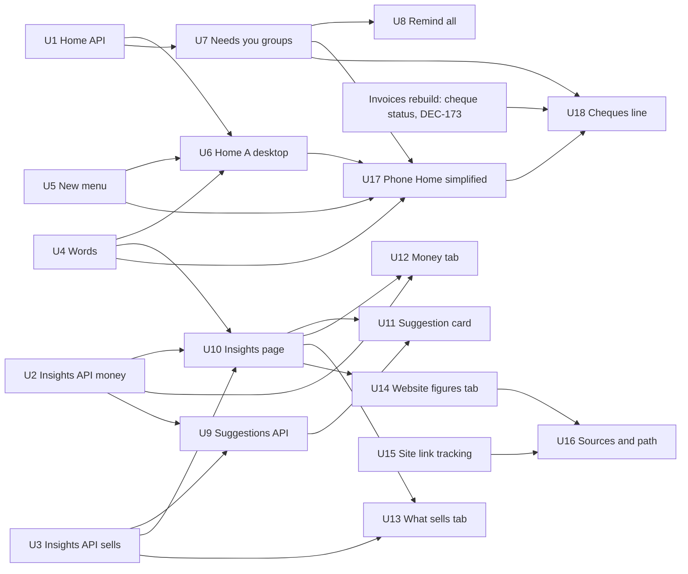

# Home and Insights: Today first and answers with tabs

> **19 Oct, build-ready.** The owner confirmed the full designs of Home A and
> Insights B, the simplified phone Home, and answered the open questions
> (Decisions below). Epic #1077 and one issue per unit are filed (Issues). Units start in waves
> of at most five agents.

## Summary

Rebuild Home as **A, "Today first"** and Insights as **B, "Overview and
tabs"**, exactly as the confirmed boards draw them.

- **Desktop Home** (640px and up): four tiles, Needs you grouped by kind with
  rows opening in place, Today beside it, How it's going with four figures,
  setup in one line (rows "Chosen: A", `HA*D`).
- **Phone Home** (below 640px) is the **simplified** board the owner chose
  after finding every earlier phone variant too cluttered (row "Chosen: A —
  phone, simplified": `HPHome`, `HPSheets`, `HPMore`, `HPStates`): one row of
  three figures, one Next line that opens the day, Needs you as one line per
  group (at most five, then "Show N more") each opening a sheet, How it's
  going as one sentence with an Insights link, a dismissible setup line, and
  a **+** New button. The phone's earlier `HA*P` and `HMAPhone` boards are
  superseded where they differ.
- **Insights** (both sizes, one set of components): one period control for
  the page, an Overview with one suggestion at a time and three answer cards,
  and tabs Money, What sells and Where customers come from.

Four API reads come first (Home's figures and grouped Needs you, Insights'
period and Money, What sells, the suggestion rules); then the screens. "Where
customers come from" ships in two steps: today's website figures move into
its tab now (marked Next), and sources and the path from visit to paid
follow once the merchant site tracks where a visit came from. A **"Cheques
not in the bank"** line joins the money group when the Invoices rebuild
(DEC-173) gives cheques a status.

Canvas: https://claude.ai/artifact/6QDguTRfaKdm7NP5NSytNj · local sources
`~/.saroh-design-drafts/home-insights/` (outside the repo).

---

## Problem Frame

**Home** (audit 5 to 6/10, "In ten seconds I know what today holds and
what only I can do"): Needs you is one long list of single rows (24 on
Rye & Co., 88 on Pulse, 89 on Northwind; the header says 24 while the link
says "See all 17"); there is no today at a glance (no money in today, no
count to pack, nobody arrived); on a phone This week sits about 2,000px
down; every Monday says "0 bookings · 19 fewer than last week" because a
week that just started is compared with a whole one; Home never leads to
Insights; setup at 5 of 6 still lists five ticked steps; the loader is
table-shaped. On a phone, even the improved A stacked too much: the owner
asked for a lighter first screen.

**Insights** (audit 4 to 6/10, "I know whether I'm making more money, why,
and one thing to try"): sentences that cannot be true or do not help
("about 100% below your usual week", "1% by invoice and 0% online");
nothing on what sells or who books; nothing on where customers come from;
two time controls that disagree (sales fixed to 4 and 12 weeks, 7/30/90
days only for the website); the visits chart leaves out empty days;
answers and figures repeat (2,700px desktop, 3,200px phone); no suggestion
of what to try; bars near-black on near-black.

---

## Assumptions

_Bets taken without the owner in the loop, each the designer's or the
plan's recommendation. Review before the unit that relies on it starts._

**Phone Home (the simplified board's open questions)**

- **A1. Three figures on the phone.** Owner and Admin: Money in today,
  Bookings, To pack. A role without `payment:read`: Bookings, Came ("3 of 6
  came"), To pack. Each opens its screen, filtered where that screen already
  has the filter (`HATilesD`); a missing filter opens the screen unfiltered
  and is listed as follow-up, not built here.
- **A2. Needs you shows at most five group lines on a phone**, then "Show N
  more · review, low stock" naming what's folded. Order: anything late first,
  then money, then the rest in the board's order (pack or hand over, unpaid
  bills, bookings awaiting payment, enquiries, payments failed and refunds,
  reviews, low stock, the rest).
- **A3. The + New button is on Home only**, in the phone's top bar
  (`aria-label="New"`); other screens keep their own New buttons and the
  command menu keeps its quick actions.
- **A4. Setup hidden stays hidden.** Hide for now on the setup line keeps
  today's rule (per person, per browser); the way back is a "Show setup on
  Home" link in Settings › Business (new, small, U6).

**Owner questions on the full set (answered with the designer's
recommendation)**

- **A5. Remind all covers overdue bills only**, skips anyone reminded in the
  last 3 days or with no email or phone, holds 10 seconds with Undo, and says
  how many were skipped ("7 reminders go out in 10 seconds. 3 skipped.
  Undo").
- **A6. The Came figure opens today's bookings as a list filtered to Came**
  (`HATilesD`).
- **A7. Turn down sits beside Send payment link** on a booking awaiting
  payment: quiet, held with Undo, through the booking's existing cancel.
- **A8. Send payment link follows DEC-170 as recorded**: it needs
  `booking:write` and `invoice:write`, so a Member sees the booking line and
  Turn down but no Send payment link. The designer recommended letting a
  Member send one without the amount; that changes DEC-170 and DEC-098 and
  is the owner's call, not this plan's.
- **A9. Where customers come from shows today's figures now, with a Next
  banner** (`IBFromD`, `IBFromP`); sources and the path come with U15/U16.

**Insights defaults**

- **A10. Insights opens on Last 4 weeks**; Home's sentence links to
  `/analytics?period=4w`. Each period compares with the same length before it.
- **A11. Suggestion thresholds.** "Nearly always full": a class at 90% or
  more of its seats over its last 4 weeks with at least 4 sessions. "Selling
  less": down by a third or more on the period before, having sold at least
  10 then. "Late bill": more than 21 days past due.
- **A12. Who sees suggestions:** anyone with Insights; the money-based ones
  (late bill, selling less) only with `payment:read`.
- **A13. Link tracking and consent:** sources are counted for every visit
  without identifying anyone (referrer origin and an allowed `ref` or
  `utm_source` value only); a visit is tied to a paid order only through a
  short-lived visit id never stored with the person; #889's banner can widen
  this later. A privacy review happens before U15 merges.
- **A14. Low stock uses each stock level's own alert** (`lowStockAlert` on
  the inventory row), and no row appears for a product with no stock level.
  The row says how fast it sells ("sells about 9 a day") when it sold in
  the last 7 days.

**Cheques (new, owner 19 Oct)**

- **A15. The Invoices rebuild provides the cheque figure.** DEC-173's plan
  (`docs/plans/2026-10-20-001-feat-invoices-rebuild-plan.md`, being written)
  records a cheque as received with a status, "not in the bank", "in the
  bank" or "bounced", and its invoices list already draws "Cheques not in
  the bank · 2 · ₹14,000" as a filter. This plan assumes that work exposes,
  from the invoices module, a read of the business's **cheques not in the
  bank: count, total and the oldest received date**, and a list address
  filtered to them. U18 reads that and adds nothing to the invoices data
  model. If DEC-173 names the field differently, U18 follows its name.
- **A16. The cheques line is money**: shown only with `payment:read` and
  `invoice:read`, counts as one thing in Needs you whatever the number of
  cheques, and opens the filtered invoices list, where "Mark as in the bank"
  and "Bounced" live. Home does not mark cheques.

**Other**

- **A17. Member's New menu follows real permissions, not the nav mirror.**
  The API gives a Member `booking:write` (DEC-170), but the app's
  `navCan` mirror (`REACHABLE.MEMBER` in `nav-items.tsx`) does not list it.
  The board `HANewMemberD` draws "Take an order" too, but a Member holds no
  `order:create` (DEC-024). The New menu shows what the person may really
  do: today a Member sees **Book someone** only, and the "isn't part of
  your role" line names Send an invoice and Take an order.
- **A18. Booking-rule approval requests (#1038) stay in the bell and on
  Hours and time off**; they are not a Needs you group in this plan
  (follow-up below).

---

## Requirements

- R1. Every confirmed board (pages 8 and 9: "Chosen: A" desktop,
  "Chosen: A — phone, simplified", "Chosen: B — full set" desktop and phone,
  every state) is matched in fidelity, side by side at 1440×900 and 390×844.
- R2. **Nothing is taken away**: each unit lists today's controls and where
  each lives on the new screen (tables below). A redesign never removes or
  merges a control.
- R3. Comparisons are **the last 7 days against the 7 before** on Home and
  on Insights' 7-day period; each Insights period compares with the same
  length before it, and says which days it compares.
- R4. A role without `payment:read` sees counts, never amounts, on both
  screens. A role without Insights is denied the page, as today.
- R5. Each screen draws its states: loading in its own shape, one part
  couldn't load (one message, Try again, the rest shown), quiet day, getting
  set up, nothing turned on (Home); no sales yet, first weeks, Member,
  no suggestions, loading, failed (Insights).
- R6. Phone basics: 44px targets, no sideways scroll at 320 and 390, no
  hover-only action, every sheet reachable and closable by touch and
  keyboard, nothing hidden sideways (`expectNothingHiddenSideways`).
- R7. Words: rupees and plain comparisons, no "100% below", no 0% places,
  zero said in words; DEC-170's words (Awaiting payment, Came, Didn't come,
  Payment link, Calendar); pass `check:copy` and `check:words`.
- R8. Merchant sites never load PostHog or any third-party tracker; link
  tracking is Saroh's own server-side beacon (`ERROR_TRACKING_AND_UPTIME.md`
  rule 2, `check:merchant-site-tracking`). No new product event is sent
  (the nine milestones are closed); new screens keep merchant data masked
  in session recordings (`frontend-design-system.md` → Session recordings).
- R9. **The phone Home is the simplified board**: three figures, one Next
  line opening the day sheet, one line per Needs you group opening its
  sheet, one How it's going sentence with an Insights link, one dismissible
  setup line, a + New button. Every action the desktop has stays reachable
  inside the phone's sheets (`cap-map` note on page 8).
- R10. **"Cheques not in the bank"** shows as one line in the Needs you money
  group only while at least one cheque waits, on both sizes.
- R11. Tests: unit tests for words and view logic; API db specs run plain
  and with `TEST_RLS=on`; browser specs run on the `desk` and `phone`
  projects and each new spec starts with a `// @covers` line.

---

## Scope Boundaries

- Home for the business view (owner, admin, Member and custom roles). The
  Reviewer's Home and the staff Home keep their own screens; nothing is
  removed from them.
- Insights for the business. No exports, no custom date ranges beyond the
  three periods, no goals or targets.
- Suggestions: exactly three rules (DEC-171). No AI, no free-text tips.
- Where customers come from: today's figures now (U14); the visit-to-paid
  path and sources after the site's own link tracking (U15, U16).
- Cheques: Home shows the line; recording, marking and bouncing cheques are
  the Invoices rebuild's.

### Deferred to Follow-Up Work

- More suggestion rules, once the three are watched in use.
- Comparing two custom ranges; downloads of Insights figures.
- Home tiles chosen by the merchant.
- Booking-rule approval requests as a Needs you group (A18).
- Missing list filters behind a figure (A1), and an inline Add stock
  quantity on the low-stock sheet (Add stock opens the product's stock).
- Letting a Member send a payment link without seeing the amount (A8).

---

## Context and Research

### Where each screen lives today (checked on development after #1039)

| Screen      | Route                                        | Main files                                                                                                                                                                                                                                                                                                                                              |
| ----------- | -------------------------------------------- | ------------------------------------------------------------------------------------------------------------------------------------------------------------------------------------------------------------------------------------------------------------------------------------------------------------------------------------------------------- |
| Home        | `apps/app.saroh.in/app/(shell)/page.tsx`     | `components/home/home-dashboard.tsx`, `home-header.tsx`, `needs-you.tsx`, `inline-action.tsx`, `use-inline-actions.ts`, `today.tsx`, `this-week.tsx`, `take-money-checklist.tsx`, `first-run-jobs.tsx`, `reviewer-home.tsx`, `staff-home.tsx`, `tone.ts`; `lib/home/service.ts`, `needs.ts`, `today.ts`, `week.ts`, `last-day.ts`, `inline-actions.ts`, `first-run.ts`, `reviews.ts`, `staff.ts` |
| Home loader | `apps/app.saroh.in/app/(shell)/loading.tsx`  | table-shaped today                                                                                                                                                                                                                                                                                                                                      |
| Insights    | `apps/app.saroh.in/app/(shell)/analytics/page.tsx` (+ `layout.tsx`, `loading.tsx`, `error.tsx`) | `components/analytics/takings-section.tsx`, `takings-marks.tsx`, `readout-bars.tsx`, `analytics-dashboard.tsx`; `lib/analytics/service.ts`, `takings.ts`, `takings-figures.ts`, `takings-words.ts`, `summary.ts`, `website-words.ts`                                                                                                     |
| New (today) | command menu                                 | `components/shared/quick-actions.ts` (New order `order:create`, New booking `booking:write`, New invoice `invoice:write`, … each gated by `navCan`), `components/shared/command-menu.tsx`                                                                                                                                                                 |

What the bookings rebuild (#1016, PR #1039) changed underneath this plan:

- **Words** (#1034, DEC-170): "Came" / "Came at 9:32 am" (`lib/home/today.ts`),
  "Payment link" (`lib/home/inline-actions.ts`), "Awaiting payment". Home
  already uses them; new Home and Insights text follows.
- **Navigation**: Home › Overview is now **Calendar** (`/calendar`), and the
  Bookings section's diary row is **Bookings**; "Availability" is **Hours
  and time off** (`components/shared/nav-items.tsx`). No rename is left for
  this plan.
- **Member permissions** (DEC-170): the API's `MEMBER_ACTIONS`
  (`modules/organizations/organization-policy.ts`) now hold `booking:write`,
  `hours:write`, `notification:read-own`; the app's `REACHABLE.MEMBER`
  mirror holds `notification:read-own` but not `booking:write` (see A17).
  Pages decide with `may()` / `permits(organization, …)`, which read the
  real permissions.
- **Held actions**: `components/shared/use-hold.ts` (`useHold`,
  `SENDING_SOON` "Sending in 10 seconds", `HeldResult`) is the shared
  10-second hold with Undo that `today.tsx`, bookings and `invoices/send-dialog.tsx`
  use. Remind all, Turn down and Mark sent use it.
- **Sheets**: phone sheets are built on `components/shared/form-sheet.tsx`
  and `tab-bar-sheet.tsx` (both extended by #1039); bookings' own sheets
  (`components/bookings/sheets/*`) show the pattern of a sheet that reads,
  fails with `FailedRead`, and holds a send.
- **Alerts** (#1038): owners and admins get booking-rule requests in the
  bell (`NOTIFICATIONS_NAV` takes either notification permission). Home
  does not change the bell.
- **Live refresh**: Home (`/`) is in `LIVE_ROUTES` (`lib/live/refresh.ts`);
  it never refreshes while a sheet or dialog is open, so the phone's sheets
  are safe; Insights is not live and stays so.

API:

- `apps/api.saroh.in/src/modules/home` — one `GET organizations/:id/home`
  (`home.controller.ts`, `home.service.ts`, `home-model.ts`) built from
  sources read one by one through `HomeService.attempt()`: `home-needs.ts`
  (flat needs and their order), `home-today.ts`, `home-schedule.ts`,
  `home-week.ts` (calendar week from Monday, takings vs the same days last
  week), `home-last-day.ts`, `home-money-sources.ts` (overdue invoices,
  failed renewals, refunds), `home-refunds-failed.ts`,
  `home-mismatch-refunds.ts`, `home-people-sources.ts` (low-star reviews,
  booking-page notes, unanswered messages), `home-crm-sources.ts`,
  `home-pause-sources.ts`, `home-site-stock-sources.ts` (shelves **short
  for open orders**, website not live), `home-open-orders.ts`,
  `home-order-rows.ts`, `home-uncollected.ts`, `home-inline.ts` and
  `home-inline-words.ts` (inline actions), `home-business-details.ts`,
  `home-email-setup.ts`, `home-staff.ts`, `home-reviewer.ts`. Existing
  specs follow `home.<part>.spec.ts` / `home.<part>.db.spec.ts`
  (`home.week.db.spec.ts`, `home.today.db.spec.ts`, `home.sources.db.spec.ts`
  already exist and are extended, not recreated).
- `apps/api.saroh.in/src/modules/analytics` — `GET analytics/takings`
  (`takings.ts`, `takings.sql.ts`, `takings.service.ts`; `payment:read`) and
  `GET analytics` (daily aggregates by `siteId`, `type`, `from`, `to`;
  `analytics.service.ts`); `POST sites/:siteId/analytics/events` (public
  intake); `analytics-aggregate.handler.ts`, `analytics-rollup.handler.ts`,
  `analytics-retention.handler.ts`; `event-contract.ts`
  (`site.view`, `enquiry.submitted`, `order.paid`, `order.refunded`);
  `product-milestones.ts` (the nine PostHog milestones; not touched).
- Merchant site beacon: `apps/saroh.app/lib/site-view.ts` sends the path only
  (never the query) and the referrer as its origin only.
- Invoices: `POST invoices/:invoiceId/remind` (one a day, 429 with the next
  time; `invoices.controller.ts`, `invoice-send.service.ts`), reminders
  recorded as messages with template `INVOICE_REMINDER`.
- Bookings: `Booking.status` `PENDING → CONFIRMED → CANCELLED`; a PENDING
  booking made to pay now is "Awaiting payment" (DEC-170).
- Stock: inventory rows carry `lowStockAlert` (default 10) beside
  `quantity` and `reserved`; Home today reads only open SHORT checks.

### Which API reads exist and which are new

| Board needs                                                            | Today                                                                  | New / changed (unit) |
| ---------------------------------------------------------------------- | ---------------------------------------------------------------------- | -------------------- |
| Bookings today, next booking, "then 4 more today"                      | `home-today.ts` items, `upcoming`                                      | count + next (U1)    |
| To pack or hand over, due today, late                                  | `home-open-orders.ts` rows                                             | counts (U1)          |
| Money in today, payments, vs the same weekday last week               | none on Home (takings has week so far)                                 | **new** (U1)         |
| Came "3 of 6", who is next                                             | today items carry `outcome`                                            | count (U1)           |
| Needs you grouped by kind: count, total, late count, oldest line       | flat `needs`, `needsTotal`                                             | **new grouping** (U1) |
| Bookings awaiting payment (PENDING), Send payment link, Turn down       | none                                                                   | **new source + inline** (U1) |
| Products running low (below their alert, only with a stock level set) | only "short for orders"                                                | **new source** (U1)  |
| How it's going: last 7 days vs the 7 before, one sentence on a phone   | calendar week vs last week (`home-week.ts`)                            | **changed** (U1, U4) |
| Owed by how late (not due, 1 to 30, more than 30 days)                 | owed total, bills, overdue                                             | **new** (U1, U2)     |
| Reminders' last-sent per bill; Remind all skipping 3 days              | per-invoice remind, one a day                                          | **new** (U8)         |
| Cheques not in the bank (count, total, oldest)                         | none (Invoices rebuild, DEC-173)                                       | **new source** (U18) |
| One period (7 days, 4 weeks, 3 months) vs the same length before       | takings fixed to 12 weeks / 4 weeks                                    | **changed** (U2)     |
| 12 weeks of bars, the 4 before marked, best week, this week so far     | `analytics/takings`                                                    | extend (U2)          |
| Where money comes from, with growth                                    | places shares                                                          | amounts + change (U2) |
| Sales by product (sold, brought in, change, New)                       | none                                                                   | **new** (U3)         |
| Bookings by service and how full                                       | none                                                                   | **new** (U3)         |
| Busiest days and times                                                 | none                                                                   | **new** (U3)         |
| Best customers; came back vs first time                                | none                                                                   | **new** (U3)         |
| Suggestions (three rules), Not now for 7 days                          | none                                                                   | **new** + table (U9) |
| Visits every day including empty days; pages; site picker              | `GET analytics` aggregates (empty days not drawn), `siteId` param      | screen only (U14)    |
| Where a visit came from; viewed, started, paid path                    | referrer origin only; no view/start events; visit not tied to order    | **new tracking** (U15) |

### Capabilities today that must stay (owner rule: nothing is taken away)

**Home**

| Today                                                                                                            | Desktop A                                                         | Phone, simplified                                                   |
| ---------------------------------------------------------------------------------------------------------------- | ----------------------------------------------------------------- | ------------------------------------------------------------------- |
| Greeting, date, business                                                                                         | Header, New button beside it                                      | Header; New is the + in the top bar                                 |
| "Last 24 hours" counts, each a link to its rows                                                                  | Header line, unchanged                                            | Top of the day sheet, "Since yesterday", same links                 |
| First order/booking moment                                                                                       | Under the header, as today                                        | Under the header, as today                                          |
| A part that couldn't load is named (PartialRead)                                                                  | One message with Try again (`HAFailedD`)                          | The line that couldn't be checked says so, with Try again (`HPStates`) |
| Every Needs-you source (open orders, overdue invoices, failed renewals, refunds owed/failed, short for orders, uncollected, low-star reviews, booking notes, unanswered messages, follow-ups, pauses waiting, website not live, setup suggestions) | A group per kind, rows inside it                                  | One line per group (five, then Show N more), each opening its sheet |
| Rows link to the exact record                                                                                    | Kept in every group                                               | Kept in every sheet                                                 |
| Inline actions: Mark sent (Undo), Mark handed over, Send reminder, Reply and Reply to review (inline, length limit), Retry by payment link (copy link), Retry by autopay, Refund; confirm in the row, struck through with what happened | Kept per row inside its group; Remind all on the bills group      | Kept per row inside each sheet (`HPSheets`)                         |
| "and N in progress" link; "See all"                                                                              | "and 1 order on its way"; "4 more orders" in a group              | Orders sheet "3 more · and 1 order on its way", Open all orders      |
| Next booking line when nothing needs you                                                                         | Quiet state (`HAQuietD`)                                          | Next line names the next booking (`HPHome` quiet)                   |
| Today: bookings, classes, pickups in time order; Mark arrived / Didn't come held for Undo; Open the calendar      | Today beside Needs you                                            | Next line opens the day sheet with the same rows and actions (`HPMore`) |
| Came count                                                                                                       | Came tile                                                         | Day sheet; a Member's third figure                                  |
| This week: sales, bookings, orders, owed, each per permission; links to each                                     | How it's going, four figures (7 vs 7), See how the month went     | One sentence and an Insights link; the figures live in Insights      |
| Finish setup: steps, Hide for now (per person, per browser), first/late slot                                     | One line: progress, next step, its button; Show the done steps; Hide for now | One dismissible line opening the setup sheet (all steps, Hide for now) |
| First run: what will you do first, invoice a client, plan held, nothing open to you, nothing turned on            | Unchanged (`HAFirstRunD`)                                         | Unchanged (`HPStates`)                                              |
| Reviewer Home, staff Home                                                                                        | Unchanged screens                                                 | Unchanged screens                                                   |
| Quick actions in the command menu                                                                                 | Kept; New menu reuses them                                        | Kept; + sheet reuses them                                           |

**Insights**

| Today                                                                                       | Where it lives in B                                                |
| ------------------------------------------------------------------------------------------- | ------------------------------------------------------------------ |
| Denied without Insights; payments-less role sees the website and is told why                | Same; Member state (`IBMemberD`, `IBMemberP`)                      |
| A source that couldn't load is named above what did arrive                                   | One message, Try again (`IBFailedD`)                               |
| How is this week going (so far vs the same days last week)                                   | Money: "How is this week going?"                                   |
| Last 4 weeks vs the 4 before; best week with its orders link                                 | Overview answer + Money "Am I making more money?", best week label |
| Where the money comes from, by place                                                         | Money: where it comes from, rupees and growth, 0% places left out  |
| Anything to watch (and its orders link)                                                       | Suggestions (one at a time)                                        |
| How sales are counted                                                                        | "How these are counted" on every tab                               |
| Tiles: sales, orders, best week, average order                                               | Money tiles: Money in, Paid orders and bills, An order is usually, Best week |
| 12-week bars + this week so far; every bar opens its orders by tap, focus or pointer         | Same bars, light for before, dark for now, best labelled; a bar opens that week's orders (sheet on a phone, `IBWeekP`) |
| Other-currency note                                                                          | Kept under the Money chart                                         |
| Website: 7/30/90 days, visits, visitors, enquiries, orders, orders-counted-from note, "updated every hour" | One period control for the page; figures in the Where customers come from tab |
| Visits each day, tappable readout                                                            | Same, every day drawn                                              |
| Pages opened most, with their paths                                                          | "Which pages do people open?", path kept as a second line          |
| `siteId` in the URL                                                                          | Site picker in the tab (sheet on a phone, `IBSiteP`)               |

### Patterns to follow

- `docs/patterns/00-universal.md`, `docs/patterns/saroh-product.md`,
  `PRODUCT.md` (words, one message at a time, states).
- `.agents/skills/saroh-four-scenes/SKILL.md` (320/390/1440, light and dark,
  touch, the `min-width: auto` trap, overlap checks).
- `docs/patterns/frontend-app-structure.md`, `frontend-data-and-state.md`
  (server reads through `lib/<domain>/service.ts`, period and tab in the URL,
  a failed read is not an empty read, Home degrades per source, live refresh
  never under an open sheet), `frontend-error-feedback.md` and
  `.agents/skills/saroh-product-states/SKILL.md`, `frontend-design-system.md`
  (tokens; chart colours; session-recording masks), `frontend-forms.md`
  (reply fields), `frontend-verification.md`,
  `.agents/skills/saroh-browser-tests/SKILL.md` (own data, `@serial`,
  `.filter({ visible: true })`, writes on Northwind only).
- `docs/patterns/backend-nestjs.md`, `backend-auth-and-access.md`
  (`payment:read`, `analytics:read`, DEC-098), `backend-data-and-money.md`
  and `.agents/skills/saroh-migrations/SKILL.md` (U9's table, U15's fields;
  `TEST_RLS=on`), `backend-jobs.md` (U15 aggregation).
- `docs/architecture/ERROR_TRACKING_AND_UPTIME.md`,
  `docs/patterns/devops-observability.md` (no new product events; merchant
  sites report from the server only; nothing identifying).

---

## Key Technical Decisions

- **One read per screen part, failing apart.** Home stays one `GET home`
  with each new source read through `attempt()`, so one failing part is
  named and the rest shows. Insights gets one read per tab
  (`analytics/money`, `analytics/sells`, `analytics/suggestions`, and later
  `analytics/sources`), each taking `period=7d|4w|3m`, so a tab loads only
  what it shows.
- **Rolling windows, never calendar weeks, for comparisons.** "Last 7 days"
  ends today in the business's zone; "the 7 before" is the 7 days before
  that. The 12 weekly bars stay whole weeks (they are a picture, not a
  comparison).
- **Grouping happens in the API.** The API returns `needGroups` (kind, count,
  total, late count, oldest line, first rows, more count) beside today's flat
  `needs` until the screens switch, so counts in the header, the group and
  the link can never disagree again. The phone's five-line cap and its order
  (A2) are applied on the screen from the same groups.
- **One group component, two hosts.** A group's content (its rows, inline
  actions, Remind all) is one component; the desktop opens it in place and
  the phone opens it in a sheet. No action is written twice.
- **Desktop and phone are two layouts over the same parts.** Home's page
  chooses its layout at 640px; tiles/figures, groups, the day list, How it's
  going and setup are shared components with a compact form for the phone.
- **Held actions use `useHold`.** Remind all, Turn down and Mark sent hold
  for 10 seconds with Undo before anything is written; only then does the
  call go.
- **Not now is stored per person on the server** (a small table), so it
  holds across devices for 7 days; browser storage is not reliable enough.
- **Link tracking is first party and server side.** The beacon adds a
  source (from the referrer origin and an allowed `ref`/`utm_source` value
  only) and a short-lived visit id that the checkout carries to the paid
  order; nothing identifying, nothing from PostHog on a merchant site.
- **Cheques come from the invoices module.** Home reads the Invoices
  rebuild's cheque figure through `attempt()` like any source; it owns no
  cheque data (A15).
- **The New menu reads real permissions** (`permits(organization, …)`), not
  the `navCan` mirror, so a Member's booking right shows (A17).

---

## Implementation Units

Every unit's tests follow R11: unit tests beside the code; API db specs pass
plain and with `TEST_RLS=on`; browser specs run on `desk` and `phone`, start
with `// @covers`, own their data (writes on Northwind, reads on Rye), and a
business-wide write is tagged `@serial`. Each screen unit updates its board
on the canvas only if the build had to differ, and says so.

### U1. Home API: figures, Needs you grouped, the last 7 days, awaiting payment, low stock

**Issue:** #1078

**Goal:** Everything Home A and the simplified phone Home read, in the one
Home call.

**Requirements:** R3, R4, R5, R9. **Dependencies:** none. **Boards:**
`HAPageD`, `HAQuietD`, `HAMondayD`, `HATilesD`, `HANeedsD`, `HAMemberD`,
`HAFailedD`, `HPHome`, `HPSheets`, `HPStates`.

**Files:**

- Modify: `apps/api.saroh.in/src/modules/home/home-model.ts` (`tiles`,
  `needGroups`, `going`), `home.service.ts`, `home-needs.ts` (kinds and
  order), `home-week.ts` (rolling 7 vs 7; owed by age), `home-today.ts`
  (counts, next, came, "then N more today"), `home-open-orders.ts` (to pack
  count, due today, late), `home-site-stock-sources.ts` (running low),
  `home-inline.ts` and `home-inline-words.ts` (Send payment link and Turn
  down on an awaiting-payment booking)
- Create: `apps/api.saroh.in/src/modules/home/home-groups.ts` (group,
  count, total, late, oldest line, first rows, more), `home-money-today.ts`,
  `home-pending-bookings.ts`
- Test: `home.groups.spec.ts`, `home.money-today.db.spec.ts`,
  `home.stock-low.db.spec.ts`, `home.pending-bookings.db.spec.ts` (new);
  `home.week.db.spec.ts`, `home-week.spec.ts`, `home.today.db.spec.ts`,
  `home.service.spec.ts`, `home.inline.spec.ts` (extended)

**Approach:**

- Figures: Bookings today (count, next, how many more today), To pack or
  hand over (open orders, due today, late), Money in today (net paid today
  in the business's zone, payments, vs the same weekday last week), Came
  (came of those due by now, who is next). Each only when its module is on
  and the role reads it; Money in today only with `payment:read`. The phone
  picks three (A1) from the same figures.
- Groups: one per Needs-you kind; the group carries its total and late
  count; each row keeps today's `inline` and `href`. The header total is
  the sum of the groups ("24 things"), and "and 1 order on its way" is the
  in-progress count. A failed source makes its group absent and its label
  goes to `unavailable` as today.
- New sources: bookings awaiting payment (PENDING, DEC-170 words) with
  inline Send payment link (needs `booking:write` and `invoice:write`, A8)
  and Turn down (needs `booking:write`, the booking's existing cancel, A7);
  products below their alert **only where a stock level is set**, with
  "sells about N a day" from the last 7 days (A14).
- How it's going: sales, bookings, orders for the last 7 days vs the 7
  before (dates in the answer), and owed now; amounts only with
  `payment:read`. Owed adds buckets: not due, 1 to 30 days late, more than
  30.
- Keep `needs`, `needsTotal`, `week` in the response until U6, U7 and U17
  switch; U17 removes them.

**Patterns to follow:** existing sources through `attempt()` in
`home.service.ts`; `home-open-orders.ts` for a source with first rows and a
more count; `home-inline.ts` for an inline descriptor and its permission.

**Test scenarios:**

- Happy: a Rye-like seed returns figures 6 / 7 / amount / "3 of 6", groups
  in the board's order, and a header total equal to the sum of group
  counts.
- Monday: a busy last week and nothing yet on Monday → "the last 7 days"
  runs Tuesday to Monday; no "0 · 19 fewer".
- Edge: a product with a stock level, alert 10, holding 3 → running low with
  its daily rate; a product with no stock level → nothing; a product that
  sold nothing in 7 days → no rate.
- Edge: nothing due today → Bookings today 0 and the next booking named;
  Came absent.
- Awaiting payment: a PENDING pay-now booking appears with Send payment link
  for the owner; for a Member it appears with Turn down only; a CONFIRMED
  booking does not appear.
- Error: the invoices read fails → no bills group, `unavailable` names
  bills, figures and other groups still return.
- Permissions: a role without `payment:read` gets no amounts anywhere
  (figures, group totals, rows, going) and keeps counts; Reviewer and staff
  views unchanged; another business → 404.
- RLS: every db spec above passes with `TEST_RLS=on` (a second business's
  rows never count).

**Verification:** API unit and db specs green, plain and `TEST_RLS=on`;
response size on Northwind (89 things) stays bounded (first rows per group
only).

### U2. Insights API: one period, Money and who owes

**Issue:** #1079

**Goal:** `GET analytics/money?period=` for the Overview's money card and
the Money tab.

**Requirements:** R3, R4, R5. **Dependencies:** none. **Boards:**
`IBOverviewD`, `IBMoneyD`, `IBWeekD`, `IBOwedD`, `IBThinD`, `IBNoSalesD`,
`IBMemberD` (+ phone).

**Files:**

- Modify: `apps/api.saroh.in/src/modules/analytics/takings.ts`,
  `takings.sql.ts`, `takings.service.ts`, `analytics.controller.ts`, `dto.ts`
- Create: `apps/api.saroh.in/src/modules/analytics/period.ts` (7d, 4w, 3m
  windows and the same length before, in the business's zone),
  `owed-by-age.ts`
- Test: `period.spec.ts`, `owed-by-age.db.spec.ts` (new); `takings.spec.ts`,
  `takings.db.spec.ts` (extended)

**Approach:** money in for the period and the one before, paid orders and
bills, the usual order, best week in 12, 12 weekly bars with which belong
to the period and which to the one before, this week so far and today vs the
same weekday last week, places in rupees with each one's change (no place
at 0), owed by age with bill counts. A business younger than two periods
answers `thin` with its age, so the screen says "nothing earlier to compare
with yet". `payment:read` required, as today. This unit owns the first
edit of `analytics.controller.ts`; U3 adds its route after.

**Test scenarios:** 4w and 7d windows on a Monday and a Sunday; 3m crossing
a month end; a place with nothing is left out; thin business (3 weeks); no
sales → empty with `hasSales: false`; refunds subtract; another currency
kept apart; a role without payments → 403 (the screen shows the Member
state); owed buckets add up to the total; every db spec also under
`TEST_RLS=on`.

**Verification:** specs green; old `GET analytics/takings` kept until U12
switches, then removed.

### U3. Insights API: what sells, who books, busiest times, best customers

**Issue:** #1080

**Goal:** `GET analytics/sells?period=`.

**Requirements:** R4, R5. **Dependencies:** none. **Boards:** `IBSellsD`,
`IBSellsEmptyD`, `IBSellsP`, `IBOverviewD` (card), `IBMemberD`, `IBThinD`.

**Files:**

- Create: `apps/api.saroh.in/src/modules/analytics/sells.ts`, `sells.sql.ts`,
  `sells.service.ts`; Modify: `analytics.controller.ts`, `analytics.module.ts`
- Test: `sells.spec.ts`, `sells.db.spec.ts`

**Approach:**

- Best sellers: per product (variants rolled up), sold and brought in,
  change against the period before, "New" when it had none before; top 5
  plus a count for "See all".
- Booked most: per service, people and sessions; how full = seats taken /
  seats offered for classes; one-to-one services show bookings and no fill.
- Busiest: paid orders and attended bookings by weekday × four parts of
  the day (7 to 10, 10 to 1, 1 to 4, 4 to 8) in the business's zone, plus
  the busiest and quietest cell.
- Best customers: top 5 by money (with order, delivery or class count and
  what they buy), came back vs first time counts.
- Amounts only with `payment:read`; counts with `analytics:read`.

**Test scenarios:** a variant-heavy product rolls up; a cancelled booking
and a refunded order do not count; class fill with an empty session; a
customer who is both trade and walk-in counts once; zone edge at midnight
IST; a role without payments sees counts and no amounts; first weeks →
"too few bookings yet" below a minimum; each section empty on its own
(`IBSellsEmptyD`); db specs plain and `TEST_RLS=on`.

**Verification:** specs green; query time on the biggest seed under the
page budget; index need checked and noted.

### U4. Words: comparisons and money said once, for both screens

**Issue:** #1081

**Goal:** One set of sentence helpers both screens use: "Up 12% on the 7
days before", "4 more than the 7 days before", "About the same", "₹1,090
last week, your lowest in 12 weeks", periods named with their dates, zero
in words, no 0% places, no percentages past what is true; and the phone's
one-sentence How it's going ("Last 7 days: ₹48,250, up 12% on the 7 days
before." / for a role without money: "Last 7 days: 22 bookings and 41
orders, both up on the 7 days before.").

**Requirements:** R3, R7. **Dependencies:** none. **Boards:** every chosen
board (text), `HPHome`, `HPStates`.

**Files:**

- Create: `apps/app.saroh.in/lib/insights/compare-words.ts` (+ `.test.ts`)
- Modify: `apps/app.saroh.in/lib/analytics/takings-words.ts` (uses it;
  "about 100% below" and "0% online" go) (+ `takings-words.test.ts`),
  `docs/patterns/saroh-product.md` (a short "Comparisons" section after the
  word list #1034 added)

**Test scenarios:** up/down/same thresholds; a drop to zero ("nothing came
in", never "100% below"); thin history; a place under 1% left out;
periods spanning months ("28 Sep to 4 Oct"); counts vs money; the phone
sentence with money, without money, with one figure up and one down, and
with nothing earlier.

**Verification:** unit tests; `check:copy`, `check:words`. Test
expectation for e2e: none (helpers only; screens' specs cover the text).

### U5. The New menu: take an order, book someone, send an invoice

**Issue:** #1082

**Goal:** A "New" button by the greeting on desktop (a menu) and the **+**
in the phone's top bar on Home (a bottom sheet), offering only what the
person may do (A3, A17).

**Requirements:** R2, R6, R9. **Dependencies:** none (U6 and U17 place it).
**Boards:** `HANewOwnerD`, `HANewMemberD`, `HPMore` (New sheet, owner and
Member).

**Files:**

- Create: `apps/app.saroh.in/components/home/new-menu.tsx` (+ `.test.tsx`)
- Modify: `apps/app.saroh.in/components/shared/quick-actions.ts` (a
  `homeNew` subset: New order, New booking, New invoice, each with the
  board's second line) (+ `quick-actions.test.ts`)
- Test: `e2e/tests/home-new-menu.spec.ts` (new, `// @covers app:/ api:home`)

**Approach:** each item opens the existing flow in place
(`/commerce/orders?new=1`, `/bookings?new=1` which opens New booking from
#1024, `/billing/invoices/new`). Items are decided by the person's real
permissions (`permits(organization, …)`), not `navCan`. Items the role
lacks are named in one line ("Sending invoices isn't part of your role. An
owner or admin can change it in Settings › Team."). With no allowed item
the button is not drawn. The command menu's quick actions are unchanged.

**Test scenarios:** owner sees three; a Member sees Book someone and the
one line naming the rest (A17); module off → item absent; with nothing
allowed no button; keyboard: Enter opens, arrows move, Escape closes and
focus returns; phone: + opens a sheet with 44px rows; e2e desk opens New
booking from the menu, phone opens the sheet and New order from it.

**Verification:** unit tests; e2e desk and phone; 390 and 1440 side by side
with the board.

### U6. Home A on desktop: tiles, the day beside the work, How it's going, setup in one line, states

**Issue:** #1083

**Goal:** Home's desktop page as A draws it, its states, and the shared
parts the phone reuses (figures, How it's going, setup line).

**Requirements:** R1, R2, R4, R5, R6. **Dependencies:** U1, U4, U5 (U7
builds Needs you inside it). **Boards:** `HAPageD`, `HAQuietD`,
`HAMondayD`, `HATilesD`, `HASchedD`, `HASetupD`, `HAGettingSetUpD`,
`HAFirstRunD`, `HAMemberD`, `HALoadingD`, `HAFailedD`.

**Files:**

- Modify: `apps/app.saroh.in/components/home/home-dashboard.tsx` (owner of
  the layout; a desktop layout from 640px, the phone layout left as today
  until U17), `home-header.tsx` (New slot), `today.tsx` (beside Needs you;
  "3 more later today"), `take-money-checklist.tsx` (one line, Show the
  done steps, Hide for now kept), `apps/app.saroh.in/app/(shell)/loading.tsx`
  (Home's own shape), `apps/app.saroh.in/lib/home/service.ts`,
  `lib/home/week.ts`; Settings › Business
  (`app/(shell)/settings/(sections)/organization`): a "Show setup on Home"
  link (A4)
- Create: `apps/app.saroh.in/components/home/today-tiles.tsx`,
  `how-its-going.tsx` (replaces `this-week.tsx`, link "See how the month
  went" to `/analytics?period=4w`)
- Test: `components/home/today-tiles.test.tsx`, `how-its-going.test.tsx`;
  `e2e/tests/home.spec.ts` (extend), `e2e/tests/home-today.spec.ts` (new,
  `// @covers app:/ app:/analytics api:home`)

**Approach:** order: header with Last 24 hours, tiles, Needs you with Today
beside it, How it's going, setup line (setup leads when fewer than half
done, as today). Each tile opens its screen, filtered where the filter
exists (A1). Zero said in words ("None", "Nothing", "All orders are on
their way"). One failed part: one message at the top naming it with Try
again, its tile showing "—" and why. Every element showing business data
leaves recording masks as they are (no `data-ph-unmask` on data).

**Test scenarios:** every state board at 1440; a role without money (no
Money in today tile, no amounts, three tiles); setup at 1 of 4 leads the
page; at 5 of 6 is one line at the foot with Show the done steps; Hide for
now persists per person per browser and "Show setup on Home" brings it
back; Monday shows the 7-day comparison; the link opens Insights on 4
weeks; Mark arrived and Didn't come still hold with Undo; reviewer and
staff Homes unchanged; first run unchanged; e2e desk: tiles, Today beside,
How it's going link; e2e phone: the page still has no sideways scroll at
320 and 390 (the phone layout itself is U17).

**Verification:** board and build side by side at 1440, light and dark;
`home.spec.ts`, `role-member.spec.ts` (append only), four-scenes.

### U7. Needs you, grouped by kind, rows opening inside each group

**Issue:** #1084

**Goal:** One card per kind with its count, total, late tag and one
action; rows open inside the group with today's inline actions; the group's
content is one component the phone hosts in a sheet (U17).

**Requirements:** R2, R4, R5. **Dependencies:** U1. **Boards:**
`HANeedsD`, `HAInlineD`, `HAPageD`, `HAMemberD`, `HAFailedD`; `HPSheets`
(the same content in a sheet).

**Files:**

- Modify: `apps/app.saroh.in/components/home/needs-you.tsx`,
  `inline-action.tsx`, `use-inline-actions.ts`, `lib/home/needs.ts`,
  `lib/home/inline-actions.ts` (Send payment link, Turn down)
- Create: `apps/app.saroh.in/components/home/need-group.tsx` (header) and
  `need-group-body.tsx` (rows and actions, host-agnostic) (+ `.test.tsx`),
  `apps/app.saroh.in/lib/home/groups.ts` (+ `.test.ts`: order, phone cap of
  five and the "Show N more" names, A2)
- Test: `e2e/tests/home-needs-groups.spec.ts` (new, `// @covers app:/ api:home api:orders api:bookings`)

**Approach:** the open-orders group opens by default with its first three
rows and "4 more orders"; others are one line with their action (See
bills, Send payment link, Reply, Retry by payment link, Add stock) and
open on tap. Every inline action keeps its confirm-in-the-row, its Undo or
hold, and its struck-through result. Send payment link and Turn down hold
through `useHold`. The low-stock group appears only from U1's source; its
"Set stock levels" and Add stock open the product's stock.

**Test scenarios:** header count equals the sum; Mark sent with Undo inside
a group; Reply inline keeps its limit; Retry gives a link to copy; Turn down
held and undone leaves the booking unchanged; a group emptied by actions
folds and the count drops; rows without amounts for a role without money;
failed bills → "13 we could check" with Try again; keyboard: groups are
disclosure buttons with `aria-expanded`; e2e desk on Northwind with its own
order and booking: Mark sent + Undo, Turn down + Undo; e2e phone: the same
actions reachable (through U6's interim layout until U17).

**Verification:** unit tests; board side by side; `home.spec.ts` inline
actions still pass.

### U8. Remind all on the bills group

**Issue:** #1085

**Goal:** One button sends a reminder for every overdue bill not reminded in
the last 3 days, showing who gets it and who is skipped, with Undo before
anything goes (A5).

**Requirements:** R2, R4. **Dependencies:** U7. **Boards:** `HARemindD`,
`HARemindUndoD`, `HPSheets` (Remind all sheet and its Undo).

**Files:**

- Modify: `apps/api.saroh.in/src/modules/invoices/invoices.controller.ts`,
  `invoice-send.service.ts` (`remind-all`), `apps/api.saroh.in/src/modules/home/home-money-sources.ts`
  (each bill's last reminder)
- Create: `apps/app.saroh.in/components/home/remind-all.tsx` (+ `.test.tsx`;
  a dialog on desktop, a sheet on a phone)
- Test: `apps/api.saroh.in/src/modules/invoices/remind-all.db.spec.ts`;
  `e2e/tests/home-remind-all.spec.ts` (new, `@serial`, `// @covers app:/ api:home api:invoices`)

**Approach:** the button says how many will go; the sheet lists who gets
it and who is skipped and why, and the message they get; Send holds 10
seconds with Undo (`useHold`), then one call sends; the server re-checks
the 3-day rule and the one-a-day rule and returns sent and skipped. Bills
with no email or phone to reach are skipped and named. Needs the
permission that sends an invoice reminder today. This unit owns the bills
group's action slot; U17 hosts it, U18 adds a line below it.

**Test scenarios:** 10 overdue, 3 reminded 2 days ago → 7 sent; Undo within
the window → none sent; a reminder sent elsewhere during the hold →
skipped; no email or phone → named in the result; a role without the
permission → no button and 403 from the API; db spec plain and `TEST_RLS=on`
(another business's bills never reminded); e2e desk and phone on Northwind
(business-wide, so `@serial`).

**Verification:** db spec; e2e; owner check on a dev business with real
email off.

### U9. Suggestions API: three rules, one at a time, Not now for 7 days

**Issue:** #1087

**Goal:** `GET analytics/suggestions` and `POST analytics/suggestions/:key/not-now`.

**Requirements:** R4, R5. **Dependencies:** U3 (fill and sales by product),
U2 (owed by age). **Boards:** `IBOverviewD`, `IBNextD`, `IBNotNowD`,
`IBNoSuggD`, `IBNoSalesD`, `IBFailedD`.

**Files:**

- Create: `apps/api.saroh.in/src/modules/analytics/suggestions.ts`,
  `suggestions.service.ts`; a migration
- Modify: `packages/database/prisma/schema.prisma` (a per-person,
  per-business "not now until" table with RLS, per saroh-migrations),
  `analytics.controller.ts`
- Test: `suggestions.spec.ts`, `suggestions.db.spec.ts`

**Approach:** rules, each with its own action link and "Why you're seeing
this": (1) a class nearly always full → "Add a class time"; (2) a bill more
than 3 weeks late → "Remind" / open the bill; (3) something selling less
than before → open the product (thresholds A11). Ranked, one key per
subject so a dismissed one stays dismissed for 7 days for that person.
Money-based rules only for `payment:read` (A12). No sales yet → the
first-sale suggestion (Copy shop link) as drawn.

**Test scenarios:** each rule fires and doesn't at its edges (89% vs 90%,
3 vs 4 sessions, 20 vs 22 days late, 9 vs 10 sold); Not now hides it for 7
days for that person only and returns on day 8; three apply → "1 of 3";
none → empty; a role without money gets only the class rule; db spec plain
and `TEST_RLS=on` (one business's Not now never hides another's).

**Verification:** specs green; migration reviewed per saroh-migrations.

### U10. Insights page: one period, tabs, the overview's three answers, states

**Issue:** #1089

**Goal:** Insights B's frame and Overview, both sizes.

**Requirements:** R1, R3 to R7. **Dependencies:** U2, U3, U4. **Boards:**
`IBOverviewD`, `IBPeriodD`, `IBThinD`, `IBNoSalesD`, `IBMemberD`,
`IBLoadingD`, `IBFailedD` and their phone twins (`IBPeriodP` is a sheet).

**Files:**

- Modify: `apps/app.saroh.in/app/(shell)/analytics/page.tsx`, `loading.tsx`,
  `error.tsx`, `apps/app.saroh.in/lib/analytics/service.ts`
- Create: `apps/app.saroh.in/components/insights/period-control.tsx`,
  `insights-tabs.tsx`, `overview.tsx`, `answer-card.tsx` (+ `.test.tsx`)
- Test: `e2e/tests/insights.spec.ts` (extend), `e2e/tests/insights-overview.spec.ts`
  (new, `// @covers app:/analytics api:analytics`)

**Approach:** `?period=7d|4w|3m&tab=overview|money|sells|from` in the URL;
the line under the title names the days and what they're compared with and
"updated every hour". Three answer cards: Am I making more money? (bars,
See money), What sells, who books? (top 3, See what sells), Where do
customers come from? (until U16: visits and people from today's figures,
"comes next" line, See your website). How these are counted at the foot.
Phone: the period opens a sheet; tabs scroll sideways inside their strip
only (`role=tablist`). A slot for U11's card.

**Test scenarios:** every state at both sizes; a role without money: money
card replaced by the line naming who can change it; no sales: one message
with Take an order / Send an invoice; first weeks: "nothing earlier to
compare with yet"; a tab whose read fails names itself; the period persists
across tabs; back and refresh keep tab and period; e2e desk and phone on
Rye (read only).

**Verification:** side by side at 1440 and 390, light and dark; four-scenes.

### U11. The suggestion card

**Issue:** #1091

**Goal:** "What to do next · 1 of 3", the suggestion, its button, Next
suggestion, Not now, Why you're seeing this.

**Requirements:** R1, R5. **Dependencies:** U9, U10. **Boards:**
`IBOverviewD`, `IBNextD`, `IBNotNowD`, `IBNoSuggD`, `IBNoSalesD`,
`IBFailedD` (+ phone).

**Files:** Create `apps/app.saroh.in/components/insights/suggestion-card.tsx`
(+ `.test.tsx`); Test `e2e/tests/insights-suggestions.spec.ts` (new,
`// @covers app:/analytics api:analytics`).

**Test scenarios:** Next cycles and wraps; Not now removes it with a toast
and Undo; the last one gone → no card (`IBNoSuggD`); no sales → the
first-sale suggestion (Copy shop link); failed read → the card names itself
and the rest of the page shows; keyboard and screen-reader order; e2e desk
and phone: Not now on Northwind with its own late bill, then Undo.

**Verification:** unit tests; e2e; side by side.

### U12. Money tab

**Issue:** #1093

**Goal:** Am I making more (12 weeks of bars, the 4 before light, now dark,
best labelled, each bar opens its week's orders), the four tiles, How is
this week going, Where the money comes from, Who owes me by how late.

**Requirements:** R1, R2, R4. **Dependencies:** U2, U10. **Boards:**
`IBMoneyD`, `IBWeekD`, `IBOwedD`, `IBMoneyP`, `IBWeekP` (sheet), `IBOwedP`
(sheet), `IBMemberD`.

**Files:** Create `apps/app.saroh.in/components/insights/money-tab.tsx`,
`owed-by-age.tsx` (+ tests); Modify `components/analytics/takings-marks.tsx`,
`readout-bars.tsx`, `lib/analytics/takings-figures.ts` (+ test); retire
`takings-section.tsx` once every capability above is carried; Test
`e2e/tests/insights-money.spec.ts` (new, `// @covers app:/analytics api:analytics`).

**Test scenarios:** bars open orders by tap, focus and pointer; best week
labelled; other currency note; owed buckets link to the filtered bills;
7d / 4w / 3m each; a role without payments sees the explanation; e2e desk
and phone (a week's orders as a sheet on a phone).

### U13. What sells tab

**Issue:** #1095

**Goal:** What sells most (table with change and New), What do people book
(how full), When is it busiest (heat grid with Show as a table), Who are my
best customers.

**Requirements:** R1, R4, R6. **Dependencies:** U3, U10. **Boards:**
`IBSellsD`, `IBSellsEmptyD`, `IBSellsP`, `IBSellsEmptyP`, `IBMemberD`,
`IBThinD`.

**Files:** Create `apps/app.saroh.in/components/insights/sells-tab.tsx`,
`busiest-grid.tsx`, `best-customers.tsx` (+ tests); Test
`e2e/tests/insights-sells.spec.ts` (new, `// @covers app:/analytics api:analytics`).

**Test scenarios:** a business with only products (no booked block) and
only services (no sold block); each section empty on its own; Show as a
table for the grid; See all products / services / customers links; a role
without money sees counts; phone table becomes rows with nothing hidden
sideways; e2e desk and phone on Rye.

### U14. Where customers come from, now: today's website figures in the tab

**Issue:** #1097

**Goal:** Move every website figure into this tab with the page's one
period: the site picker, visits, people, enquiries, online orders and
bookings with changes, visits every day **including empty days**, which
pages people open (path kept), and the "Coming next" banner (A9).

**Requirements:** R1, R2, R8. **Dependencies:** U10. **Boards:** `IBFromD`,
`IBSiteD`, `IBFromP`, `IBSiteP` (the parts that exist today), `IBFailedD`.

**Files:** Create `apps/app.saroh.in/components/insights/from-tab.tsx`,
`site-picker.tsx` (+ tests); Modify `components/analytics/analytics-dashboard.tsx`,
`lib/analytics/summary.ts` (fill empty days) (+ `summary.test.ts`),
`website-words.ts` (+ test); Test `e2e/tests/insights-from.spec.ts` (new,
`// @covers app:/analytics api:analytics`).

**Test scenarios:** a day with no visits drawn as a baseline mark; one site
→ no picker; several → picker keeps `siteId`; failed read named; orders
"counted from" note kept; e2e desk and phone (picker as a sheet).

### U15. Site link tracking (next wave)

**Issue:** #1099

**Goal:** Know where a visit came from and follow it to paid, first party.

**Requirements:** R8. **Dependencies:** none in code; ships after What sells
(owner order). **Boards:** `IBFromD` (what it must answer).

**Files:**

- Modify: `apps/saroh.app/lib/site-view.ts` (source from referrer origin
  and an allowed `ref` / `utm_source` value, never the rest of the query;
  a session visit id), the product, class and checkout pages that send
  "looked", "started"; `apps/api.saroh.in/src/modules/analytics/event-contract.ts`
  (new types and fields), `analytics-aggregate.handler.ts` (`source`
  dimension), `analytics-retention.handler.ts`, the checkout/booking creation
  to carry the visit id to `order.paid`; `packages/database/prisma/schema.prisma`
  if a field is needed on the order
- Test: `event-contract.spec.ts`, `analytics-aggregate.handler.spec.ts`,
  `analytics-retention.db.spec.ts`, `apps/saroh.app/lib/site-view.test.ts`,
  `e2e/tests/site-visit-source.spec.ts` (new, a visit with `?ref=` → a paid
  order counted to its source)

**Approach:** sources grouped as Instagram, Google search, WhatsApp links,
Typed your address, Other sites; a shareable link with `?ref=` for the
merchant's own posts; counted from the day it ships (said on the tab);
consent basis per A13. `check:merchant-site-tracking` stays green: no
third-party script.

**Test scenarios:** referrer and ref mapping; query never stored beyond the
allowed value; visit id expires; paid order tied to its visit; a private
`/account` path sends nothing; retention job drops what it should; db specs
plain and `TEST_RLS=on`.

**Verification:** privacy review before merge (Risks).

### U16. Sources and the path from visit to paid (next wave)

**Issue:** #1101

**Goal:** "From visit to paid" (four steps in plain words) and "Where do
visitors come from?" (visitors, paid, how many paid), the Overview's
sources answer, and the tab's Next marker removed.

**Requirements:** R1, R8. **Dependencies:** U15, U14. **Boards:**
`IBFromD`, `IBFromP`, `IBOverviewD` (card).

**Files:** Create `apps/api.saroh.in/src/modules/analytics/sources.ts` (+
`sources.db.spec.ts`), `apps/app.saroh.in/components/insights/visit-path.tsx`,
`sources-table.tsx` (+ tests); Modify `from-tab.tsx`, `overview.tsx`;
extend `e2e/tests/insights-from.spec.ts`.

**Test scenarios:** steps never go up; "1 in 7"; sources below a minimum
grouped as Other; before tracking began → the tab says from when; db spec
plain and `TEST_RLS=on`; e2e desk and phone.

### U17. Home on a phone, simplified

**Issue:** #1103

**Goal:** Build the simplified phone Home the owner chose: one row of three
figures, one Next line opening the day sheet, Needs you as one line per
group (five, then Show N more) each opening its sheet, How it's going as
one sentence with an Insights link, one dismissible setup line opening the
setup sheet, the + New button, and its states.

**Requirements:** R1, R2, R4, R5, R6, R9. **Dependencies:** U1, U4, U5,
U6 (owns `home-dashboard.tsx` first), U7 (group bodies). **Boards:**
`HPHome` (busy, quiet, Monday), `HPSheets` (every group sheet, Remind all,
Undo), `HPMore` (day sheet with Since yesterday, New sheet owner and
Member, setup sheet), `HPStates` (getting set up, Member, nothing turned
on, loading, couldn't load); the `cap-map` note on page 8 is the
nothing-taken-away list.

**Files:**

- Modify: `apps/app.saroh.in/components/home/home-dashboard.tsx` (the phone
  layout below 640px), `today.tsx` (its list reused inside the day sheet),
  `take-money-checklist.tsx` (setup sheet), `home-header.tsx` (+ in the
  phone top bar on Home only), `apps/app.saroh.in/app/(shell)/loading.tsx`
  (phone shape), `apps/app.saroh.in/lib/home/service.ts` (drop `needs`,
  `needsTotal`, `week` once both layouts read the new fields), and the API
  fields' removal in `home-model.ts`
- Create: `apps/app.saroh.in/components/home/phone/phone-figures.tsx`,
  `phone-next-line.tsx`, `phone-needs-list.tsx`, `need-sheet.tsx`,
  `day-sheet.tsx`, `setup-sheet.tsx`, `phone-going-line.tsx` (+ `.test.tsx`
  for the list, figures and sheets)
- Test: `e2e/tests/home-phone.spec.ts` (new, phone project, `// @covers app:/ api:home api:orders api:bookings`),
  `e2e/tests/phone-reflow.spec.ts` and `four-scenes.spec.ts` (append only)

**Approach:** sheets built on the shared sheet (`form-sheet.tsx` /
`tab-bar-sheet.tsx`), each hosting U7's group body unchanged, so every
inline action, hold and Undo is the desktop's. The list applies A2's cap
and order. The day sheet carries "Since yesterday" (Last 24 hours, same
links), the day's rows with Mark arrived / Didn't come and Undo, "N more
later today" and Open the calendar. Figures follow A1. The setup line hides
per A4. A failed source turns its line into "Couldn't check bills just now
· Try again" and the header count says "13 we could check". Live refresh
never runs while a sheet is open (already the rule). Desktop is unchanged.

**Test scenarios:**

- Busy day (owner): three figures ₹ / bookings / to pack; Next line; six
  group lines and "Show 2 more · review, low stock"; Show 2 more reveals
  them.
- Quiet day: "Nothing booked today · Next: Wed 10:00 …"; "Nothing needs you
  right now."
- Member without money: Bookings, Came, To pack; no money lines; How it's
  going in counts; the New sheet shows Book someone and the role line.
- Each sheet: orders (Mark sent + Undo), bills (Send reminder confirm,
  Remind all), awaiting payment (Turn down + Undo; Send payment link for
  the owner only), enquiries (Reply with its limit), failed payment and
  refund, review reply, low stock (Add stock, Set stock levels); closing a
  sheet returns focus to its line.
- Day sheet: Since yesterday links; Mark arrived held and undone.
- Setup line: opens the sheet; Hide for now hides it; Settings link brings
  it back.
- States: getting set up, nothing turned on, loading shape, one part
  couldn't load with Try again.
- Layout: no sideways scroll at 320 and 390; 44px targets; nothing hidden
  sideways; the + exists only on Home.

**Verification:** side by side with `HPHome`, `HPSheets`, `HPMore`,
`HPStates` at 390×844, light and dark; e2e phone; desktop specs unchanged.

### U18. Home: "Cheques not in the bank" in the money group

**Issue:** #1105

**Goal:** One line in the Needs you money group, "2 cheques not in the bank
· ₹14,000", shown only while at least one cheque is waiting, on desktop and
phone, opening the invoices list filtered to those cheques (owner, 19 Oct;
A15, A16).

**Requirements:** R2, R4, R10. **Dependencies:** **the Invoices rebuild
epic's cheque status unit** (plan `docs/plans/2026-10-20-001-feat-invoices-rebuild-plan.md`,
DEC-173), U1, U7, U17 (the phone list), U8 (owns the bills group's action
slot). **Boards:** the Invoices page's `INVRecordPlus` (the cheque words
and the "Cheques not in the bank" filter); Home's money group on
`HAPageD`, `HPHome`, `HPSheets`.

**Files:**

- Create: `apps/api.saroh.in/src/modules/home/home-cheques.ts` (reads the
  invoices module's cheque figure; no query of its own on invoice tables)
- Modify: `apps/api.saroh.in/src/modules/home/home-model.ts` (a
  `chequesWaiting` entry on the money group), `home.service.ts` (through
  `attempt()`), `home-groups.ts` (counts as one thing),
  `apps/app.saroh.in/lib/home/service.ts`, `lib/home/groups.ts`,
  `components/home/need-group-body.tsx` (the line under the bills rows)
- Test: `home.cheques.spec.ts`, `home.cheques.db.spec.ts`;
  `lib/home/groups.test.ts`, `components/home/need-group.test.tsx`
  (extended); `e2e/tests/home-cheques.spec.ts` (new,
  `// @covers app:/ api:home api:invoices`)

**Approach:** the source returns count, total and oldest received date
when count > 0, nothing otherwise. The money group shows it as its last
line; when the business has no unpaid bills, the group's one line is the
cheque line itself (on a phone, the group line reads "2 cheques not in the
bank · ₹14,000"). The line links to the invoices list's "Cheques not in the
bank" filter; marking a cheque in the bank or bounced stays on the invoice
(A16). Only with `payment:read` and `invoice:read`; the invoices module off
→ no source. A failed read names "cheques" in `unavailable`, as every
source does.

**Test scenarios:**

- Happy: two cheques waiting (₹8,400 and ₹5,600) → one line "2 cheques not
  in the bank · ₹14,000"; header total rises by one.
- One cheque: "1 cheque not in the bank · ₹8,400".
- Cleared: both marked in the bank → no line, header total back.
- Bounced: a bounced cheque is not "waiting" → no line for it (the bill is
  owed again and shows in unpaid bills).
- Only cheques, no unpaid bills: the money group's line is the cheque line.
- Permissions: a role without `payment:read` → no line and no count; the
  invoices module off → no source.
- Error: the cheque read fails → "Couldn't check cheques just now · Try
  again", the rest of Home shows.
- RLS: db spec plain and `TEST_RLS=on`; another business's cheques never
  count.
- e2e desk and phone on Northwind with its own invoice paid by cheque:
  the line appears, opens the filtered list; after Mark as in the bank the
  line is gone on return.

**Verification:** specs green; the line matches the board's words;
starts only once the invoices cheque status is in the batch (else it
carries over to the next batch).

---

## Desktop and phone

Every Insights unit builds both sizes in the same components, from the
phone up (tabs in a scrolling strip; tables become rows; the period, a
week's orders, owed by age and the site picker open as sheets). **Home is
two layouts over shared parts**: desktop A (U6, U7) and the simplified
phone Home (U17), both hosting the same group bodies and actions. A desktop
menu is a phone bottom sheet (New). Checks at 1440×900 and 390×844 for
every board, plus 320 for no sideways scroll.

## Collisions and order on the batch

The bookings rebuild (#1016) is merged; what it changed is listed under
Context. Still to respect:

- `apps/api.saroh.in/src/modules/home/home-today.ts` reads bookings and
  their outcome; Home does not edit `organization-policy.ts` or
  `modules/bookings/*`. Turn down calls the booking's existing cancel.
- `apps/app.saroh.in/components/bookings/outcome-control.tsx`: Home keeps
  its own Mark arrived / Didn't come in `today.tsx`.
- `components/shared/nav-items.tsx`: not touched (A17 reads real
  permissions instead).
- `components/home/home-dashboard.tsx`: U6 first (wave 2), U17 after
  (wave 3); never both at once.
- `components/home/need-group-body.tsx`: U7 creates it; U8 owns the bills
  action slot; U18 adds its line after both.
- `apps/api.saroh.in/src/modules/analytics/analytics.controller.ts`: U2
  first, then U3, then U9, U16.
- The Invoices rebuild (DEC-173) edits `modules/invoices/*`; U8 adds
  `remind-all` there in wave 3. Whichever lands second rebases on the
  other; U18 waits for its cheque status.
- e2e: `role-member.spec.ts`, `phone-reflow.spec.ts`, `four-scenes.spec.ts`
  are shared; Home and Insights add their own specs and only append to the
  shared ones.

---

## Issues

Epic **#1077** and one issue per unit (filed 19 Oct), each with what changes in plain words, the
boards, "Nothing is taken away", checks at 1440 and 390, "Needs first", a
"Plan: … U<n>" line and "Part of #<epic>".

| Unit | Issue | Title                                                                    |
| ---- | ----- | ------------------------------------------------------------------------ |
| Epic | #1077 | Home and Insights: Today first and answers with tabs                     |
| U1   | #1078 | Home: figures, Needs you grouped, the last 7 days, awaiting payment, low stock (API) |
| U2   | #1079 | Insights: one period for the page, money and who owes (API)              |
| U3   | #1080 | Insights: what sells, who books, busiest times, best customers (API)     |
| U4   | #1081 | Home and Insights: comparisons and money said plainly                    |
| U5   | #1082 | Home: a New menu for taking an order, booking someone, sending an invoice |
| U6   | #1083 | Home on desktop: today first, the day beside the work, setup in one line |
| U7   | #1084 | Home: Needs you grouped by kind, rows open inside each group             |
| U8   | #1085 | Home: Remind all on unpaid bills, with Undo                              |
| U9   | #1087 | Insights: three suggestions, one at a time, Not now for 7 days (API)     |
| U10  | #1089 | Insights: one period, tabs and the overview's three answers              |
| U11  | #1091 | Insights: the What to do next card                                       |
| U12  | #1093 | Insights: the Money tab                                                  |
| U13  | #1095 | Insights: the What sells tab                                             |
| U14  | #1097 | Insights: website figures in Where customers come from, every day drawn  |
| U15  | #1099 | Websites: know where a visit came from, first party (later)              |
| U16  | #1101 | Insights: sources and the path from visit to paid (later)                |
| U17  | #1103 | Home on a phone: the simplified first screen                             |
| U18  | #1105 | Home: "Cheques not in the bank" in the money group                       |

## Waves (at most five agents at a time)

| Wave | Units                                                            | Why together                                                                                          |
| ---- | ---------------------------------------------------------------- | ----------------------------------------------------------------------------------------------------- |
| 1    | U1 Home API, U2 Insights money API, U3 What sells API, U4 Words, U5 New menu | Independent reads and helpers; no file overlap (U1 `modules/home`, U2/U3 separate files in `modules/analytics`, U2 edits `analytics.controller.ts` first, U3 adds its route after) |
| 2    | U6 Home A desktop, U7 Needs you grouped, U9 Suggestions API, U10 Insights page | U6 owns `home-dashboard.tsx`, U7 owns `needs-you.tsx` and the group files; U9 and U10 separate trees |
| 3    | U17 Phone Home, U8 Remind all, U11 Suggestion card, U12 Money tab, U13 What sells tab | U17 owns `home-dashboard.tsx` after U6; U8 owns `remind-all.tsx` and the bills slot; each tab its own file |
| 4    | U14 Website figures tab, U18 Cheques line, U15 Site link tracking | U18 once the Invoices cheque status is in the batch (else it carries over); U15 after What sells shipped (owner order), touches `apps/saroh.app` and the event contract |
| 5    | U16 Sources and path                                             | Needs a few weeks of U15's data to show anything                                                      |

Each unit lands in the day's local `batch-<date>-<n>` branch, gated with
`pnpm prepush --all` before the batch goes up (never a branch or PR per
unit). No agent binds the e2e ports while a gate runs. The batch that
carries U6 is not pushed without U17, so the phone never ships the interim
layout.

---

## Decisions from the owner, 19 Oct (DEC-171 and after)

- Home = A, Insights = B, both sizes. **The phone Home is the simplified
  board** (owner: every earlier phone variant was too cluttered).
- New menu (take an order, book someone, send an invoice) per role: **yes**.
- Remind all on the bills group, skipping anyone reminded in the last 3
  days, with Undo.
- Low stock only once a product has a stock level set.
- **Comparisons: the last 7 days against the 7 days before.**
- **What sells now; Where customers come from next**, after the site's own
  link tracking.
- **Suggestions: three rules**, one at a time, Not now hides for 7 days.
- **"Cheques not in the bank"**: one line on Home, in the Needs you money
  group, only while cheques are waiting (no bounce charge; DEC-173).
- Nothing is taken away.
- The full designs are confirmed; plan, issues and building may begin.

The remaining open questions are answered under Assumptions with the
designer's and the plan's recommendations; none blocks wave 1.

## Risks

- Home's single call grows: guard with first rows per group and a size
  check on the 89-things seed (U1).
- Busiest-times and best-customers queries on large businesses: index check
  in U3.
- The phone and desktop Home are two layouts: a shared group body (U7) and
  shared figures keep the actions from forking; U17's e2e covers every
  sheet.
- U18 depends on another epic still being planned; its contract (A15) may
  move. U18 is last on Home and carries over if the cheque status isn't in.
- Link tracking touches the public site: privacy review before U15 merges.

## Sources and References

- Canvas pages 8 and 9: audits `HMAudit`, `INAudit`; chosen rows
  `HA*D`, `HA*P` (phone superseded by `HP*`), `HPHome`, `HPSheets`,
  `HPMore`, `HPStates`, the `cap-map` note; `IB*D`, `IB*P`; references
  `HMReferences`, `INReferences`. Invoices page: `INVRecordPlus`.
- DEC-173 (Invoices rebuild, being written), DEC-171, DEC-170, DEC-113,
  DEC-098, DEC-075, DEC-024 in `docs/architecture/DECISIONS.md`.
- Plans `docs/plans/2026-10-19-001-feat-bookings-phone-ux-plan.md` (#1016,
  merged in #1039), `docs/plans/2026-10-20-001-feat-invoices-rebuild-plan.md`
  (DEC-173).
- Related open issues: #357 (setup as one checklist), #124 (cross-module
  insights).
