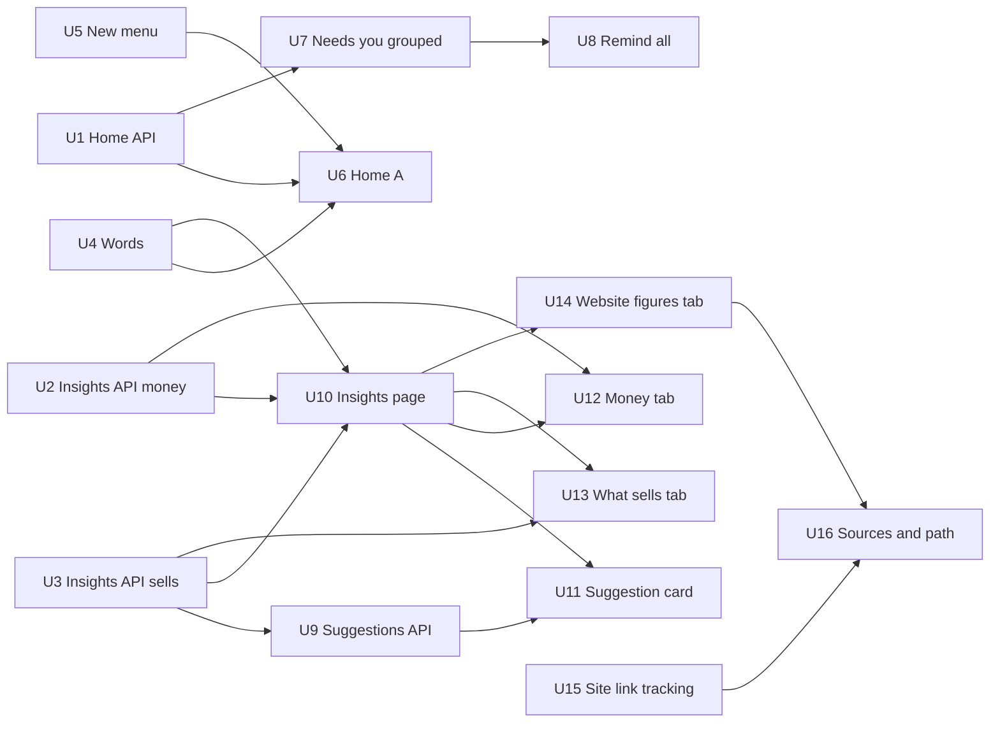

# Home and Insights: Today first and answers with tabs

> **19 Oct, on hold for designs.** The owner chose Home **A** and Insights
> **B** and now wants every screen of both drawn in full (desktop and phone)
> before anything is built. This plan is written against the boards as they
> stand; units are re-checked against the full drawings when the owner
> confirms them, and only then are the epic and issues created (see Issues).

## Summary

Rebuild Home as **A, "Today first"** and Insights as **B, "Overview and
tabs"**, each built once for both sizes (phone below 640px, desktop from
there up, same components), exactly as the boards on canvas pages 8 and 9
draw them. Four API reads come first (Home's today figures and grouped
Needs you, Insights' one period and Money, What sells, the suggestion
rules); then the screens. "Where customers come from" ships in two steps:
today's website figures move into its tab now, and the path from visit to
paid and the sources follow once the merchant site tracks where a visit
came from (a later wave).

Canvas: https://claude.ai/artifact/6QDguTRfaKdm7NP5NSytNj · local sources
`~/.saroh-design-drafts/home-insights/` (outside the repo).

---

## Problem Frame

**Home** (audit 5 to 6/10, "In ten seconds I know what today holds and
what only I can do"): Needs you is one long list of single rows (24 on
Rye & Co., 88 on Pulse, 89 on Northwind; the header says 24 while the link
says "See all 17"); there is no today at a glance (no money in today, no
count to pack, nobody arrived); on a phone This week sits about 2,000px
down; every Monday says "0 bookings · 19 fewer than last week" because a
week that just started is compared with a whole one; Home never leads to
Insights; setup at 5 of 6 still lists five ticked steps; the loader is
table-shaped.

**Insights** (audit 4 to 6/10, "I know whether I'm making more money, why,
and one thing to try"): sentences that cannot be true or do not help
("about 100% below your usual week", "1% by invoice and 0% online");
nothing on what sells or who books; nothing on where customers come from;
two time controls that disagree (sales fixed to 4 and 12 weeks, 7/30/90
days only for the website); the visits chart leaves out empty days;
answers and figures repeat (2,700px desktop, 3,200px phone); no suggestion
of what to try; bars near-black on near-black.

---

## Assumptions

_Written without the owner in the loop. Review before code starts._

- The boards on pages 8 and 9 are the spec until the owner's full drawings
  replace them; where the full drawings differ, they win and this plan is
  updated before any unit starts.
- Home's Today, tiles and grouped Needs you read the same bookings the
  bookings build (plan `2026-10-19-001`, #1016) is changing in this same
  batch. Words follow DEC-170: a booking waiting for its payment reads
  **"Awaiting payment"**, so the boards' "To confirm" chip and "2 bookings
  to confirm" group are built in DEC-170's words (see Q1).
- Insights opens on **Last 4 weeks**, as the boards draw; "Last 7 days"
  compares with the 7 days before, never a calendar week (Q2).
- Money follows permissions (DEC-098): `payment:read` decides every amount;
  `analytics:read` decides the page.

---

## Requirements

- R1. Every board for Home A and Insights B (pages 8 and 9, desktop and
  phone, every state row) is matched in fidelity, side by side at 1440×900
  and 390×844.
- R2. **Nothing is taken away**: each unit lists today's controls and where
  each lives on the new screen (lists below). A redesign never removes or
  merges a control.
- R3. Comparisons are **the last 7 days against the 7 before** on Home and
  on Insights' 7-day period; each period on Insights compares with the same
  length before it, and says which days it compares.
- R4. A Member without money (`payment:read` absent) sees counts, never
  amounts, on both screens (`HMMemberDesk`/`HMMemberPhone`,
  `INMemberDesk`/`INMemberPhone`). A role without Insights is denied the
  page, as today.
- R5. Each screen draws its states: loading in its own shape, one part
  couldn't load (one message, Try again, the rest shown), quiet day, getting
  set up, nothing turned on (Home); no sales yet, first weeks, Member,
  loading, failed (Insights).
- R6. Phone basics: 44px targets, no sideways scroll at 320 and 390, no
  hover-only action, the New menu and row actions reachable by touch.
- R7. Words: rupees and plain comparisons, no "100% below", no 0% places,
  zero said in words; pass `check:copy` and `check:words`.
- R8. Merchant sites never load PostHog or any third-party tracker; link
  tracking for sources is Saroh's own server-side beacon
  (`docs/architecture/ERROR_TRACKING_AND_UPTIME.md` rule 2,
  `check:merchant-site-tracking`).

---

## Scope Boundaries

- Home for the business view (owner, admin, Member and custom roles). The
  Reviewer's Home and the staff Home (storefronts and own diary) keep their
  own screens; they get the new tiles only where their role reads them
  (U6), nothing is removed.
- Insights for the business. No exports, no custom date ranges beyond the
  three periods, no goals or targets.
- Suggestions: exactly three rules (DEC-171). No AI, no free-text tips.
- Where customers come from: today's figures now (U14); the visit-to-paid
  path and sources after the site's own link tracking (U15, U16).

### Deferred to Follow-Up Work

- More suggestion rules, once the three are watched in use.
- Comparing two custom ranges; downloads of Insights figures.
- Home tiles chosen by the merchant.

---

## Context and Research

### Where each screen lives today

| Screen      | Route                                        | Main files                                                                                                                                                                                                                                                                                                                                              |
| ----------- | -------------------------------------------- | ------------------------------------------------------------------------------------------------------------------------------------------------------------------------------------------------------------------------------------------------------------------------------------------------------------------------------------------------------- |
| Home        | `apps/app.saroh.in/app/(shell)/page.tsx`     | `components/home/home-dashboard.tsx`, `home-header.tsx`, `needs-you.tsx`, `inline-action.tsx`, `use-inline-actions.ts`, `today.tsx`, `this-week.tsx`, `take-money-checklist.tsx`, `first-run-jobs.tsx`, `reviewer-home.tsx`, `staff-home.tsx`, `tone.ts`; `lib/home/service.ts`, `needs.ts`, `today.ts`, `week.ts`, `last-day.ts`, `inline-actions.ts`, `first-run.ts`, `reviews.ts`, `staff.ts` |
| Home loader | `apps/app.saroh.in/app/(shell)/loading.tsx`  | table-shaped today                                                                                                                                                                                                                                                                                                                                      |
| Insights    | `apps/app.saroh.in/app/(shell)/analytics/page.tsx` (+ `layout.tsx`, `loading.tsx`, `error.tsx`) | `components/analytics/takings-section.tsx`, `takings-marks.tsx`, `readout-bars.tsx`, `analytics-dashboard.tsx`; `lib/analytics/service.ts`, `takings.ts`, `takings-figures.ts`, `takings-words.ts`, `summary.ts`, `website-words.ts`                                                                                                     |
| New (today) | command menu                                 | `components/shared/quick-actions.ts` (New order, New booking, New invoice … each gated by `navCan`), `components/shared/command-menu.tsx`                                                                                                                                                                                                                |

API:

- `apps/api.saroh.in/src/modules/home` — one `GET organizations/:id/home`
  (`home.controller.ts`, `home.service.ts`, `home-model.ts`) built from
  sources read one by one through `HomeService.attempt()`: `home-needs.ts`,
  `home-today.ts`, `home-week.ts` (calendar week from Monday, takings vs the
  same days last week), `home-last-day.ts`, `home-money-sources.ts` (overdue
  invoices, failed renewals, refunds), `home-people-sources.ts` (low-star
  reviews, booking-page notes, unanswered messages), `home-site-stock-sources.ts`
  (shelves **short for open orders**, website not live), `home-open-orders.ts`,
  `home-uncollected.ts`, `home-inline.ts` (inline actions), `home-staff.ts`,
  `home-reviewer.ts`.
- `apps/api.saroh.in/src/modules/analytics` — `GET analytics/takings` (12 whole
  weeks, places, this week so far; `takings.ts`, `takings.sql.ts`,
  `takings.service.ts`; needs `payment:read`) and `GET analytics` (daily
  aggregates by `siteId`, `type`, `from`, `to`; `analytics.service.ts`);
  `POST sites/:siteId/analytics/events` (public intake); aggregates in
  `AnalyticsDailyAggregate` with a `path` dimension for `site.view`
  (`analytics-aggregate.handler.ts`). Event types: `site.view`,
  `enquiry.submitted`, `order.paid`, `order.refunded` (`event-contract.ts`).
- Merchant site beacon: `apps/saroh.app/lib/site-view.ts` sends the path only
  (never the query) and the referrer as its origin only.
- Invoices: `POST invoices/:invoiceId/remind` (one a day, 429 with the next
  time), reminders recorded as messages with template `INVOICE_REMINDER`
  (`modules/invoices`, `schema.prisma` Message rows).
- Stock: `StockLevel.lowStockAlert` (default 10), `Inventory`,
  `VariantInventory`; Home today reads only open SHORT checks.

### Which API reads exist and which are new

| Board needs                                                            | Today                                                                  | New / changed (unit) |
| ---------------------------------------------------------------------- | ---------------------------------------------------------------------- | -------------------- |
| Bookings today, next booking                                           | `home-today.ts` items, `upcoming`                                      | count + next (U1)    |
| To pack or hand over, due today                                        | `home-open-orders.ts` rows                                             | counts (U1)          |
| Money in today, payments, vs the same weekday last week               | none on Home (takings has week so far)                                 | **new** (U1)         |
| Arrived "3 of 6", who is next                                          | today items carry `outcome`                                            | count (U1)           |
| Needs you grouped by kind: count, total, late count, oldest line       | flat `needs`, `needsTotal`                                             | **new grouping** (U1) |
| Bookings awaiting payment / to confirm (PENDING)                       | none                                                                   | **new source** (U1)  |
| Products running low (below their alert, only with a stock level set) | only "short for orders"                                                | **new source** (U1)  |
| How it's going: last 7 days vs the 7 before                            | calendar week vs last week (`home-week.ts`)                            | **changed** (U1)     |
| Owed by how late (not due, 1 to 30, more than 30 days)                 | owed total, bills, overdue                                             | **new** (U1, U2)     |
| Reminders' last-sent per bill; Remind all skipping 3 days              | per-invoice remind, one a day                                          | **new** (U8)         |
| One period (7 days, 4 weeks, 3 months) vs the same length before       | takings fixed to 12 weeks / 4 weeks                                    | **changed** (U2)     |
| 12 weeks of bars, the 4 before marked, best week, this week so far     | `analytics/takings`                                                    | extend (U2)          |
| Where money comes from, with growth                                    | places shares                                                          | amounts + change (U2) |
| Sales by product (sold, brought in, change, New)                       | none                                                                   | **new** (U3)         |
| Bookings by service and how full                                       | none                                                                   | **new** (U3)         |
| Busiest days and times                                                 | none                                                                   | **new** (U3)         |
| Best customers; came back vs first time                                | none                                                                   | **new** (U3)         |
| Suggestions (three rules), Not now for 7 days                          | none                                                                   | **new** + table (U9) |
| Visits every day including empty days; pages; site picker              | `GET analytics` aggregates (empty days not drawn), `siteId` param      | screen only (U14)    |
| Where a visit came from; viewed, started, paid path                    | referrer origin only; no view/start events; visit not tied to order    | **new tracking** (U15) |

### Capabilities today that must stay (owner rule: nothing is taken away)

**Home**

| Today                                                                                                            | Where it lives in A                                               |
| ---------------------------------------------------------------------------------------------------------------- | ----------------------------------------------------------------- |
| Greeting, date, business; "Last 24 hours" counts, each a link to its rows                                        | Header, unchanged, New menu beside it                             |
| First order/booking moment                                                                                       | Under the header, as today                                        |
| A part that couldn't load is named (PartialRead)                                                                  | One message with Try again (`HMFailedDesk`)                       |
| Every Needs-you source (open orders, overdue invoices, failed renewals, refunds owed/failed, short for orders, uncollected, low-star reviews, booking notes, unanswered messages, follow-ups, pauses waiting, website not live, setup suggestions) | A group per kind, rows inside it                                  |
| Rows link to the exact record                                                                                    | Kept in every group                                               |
| Inline actions: Mark sent (Undo), Mark handed over, Send reminder, Reply and Reply to review (inline, length limit), Retry by payment link (copy link), Retry by autopay, Refund; confirm in the row, struck through with what happened | Kept per row inside its group; Remind all added on the bills group |
| "and N in progress" link; "See all"                                                                              | Header line "and 1 order on its way"; "4 more orders" in a group  |
| Next booking line when nothing needs you                                                                         | Quiet state (`HMQuietDesk`)                                       |
| Today: bookings, classes, pickups in time order; Mark arrived / Didn't come held for Undo; Open the calendar      | Today beside Needs you (desktop), under it (phone)                |
| This week: sales, bookings, orders, owed, each per permission; links to each                                     | How it's going (7 vs 7) with the same four, plus See how the month went |
| Finish setup: steps, Hide for now (per person, per browser), first/late slot                                     | One line: progress, next step, its button; "Show the 5 done steps"; Hide for now |
| First run: what will you do first, invoice a client, plan held, nothing open to you, nothing turned on            | Unchanged (`HMFirstRunDesk`)                                      |
| Reviewer Home, staff Home                                                                                        | Unchanged screens                                                 |
| Quick actions in the command menu                                                                                 | Kept; New menu reuses them                                        |

**Insights**

| Today                                                                                       | Where it lives in B                                                |
| ------------------------------------------------------------------------------------------- | ------------------------------------------------------------------ |
| Denied without Insights; payments-less role sees the website and is told why                | Same; Member state (`INMemberDesk`)                                |
| A source that couldn't load is named above what did arrive                                   | One message, Try again (`INFailedDesk`)                            |
| How is this week going (so far vs the same days last week)                                   | Money: "How is this week going?"                                   |
| Last 4 weeks vs the 4 before; best week with its orders link                                 | Overview answer + Money "Am I making more money?", best week label |
| Where the money comes from, by place                                                         | Money: where it comes from, rupees and growth, 0% places left out  |
| Anything to watch (and its orders link)                                                       | Suggestions (one at a time)                                        |
| How sales are counted                                                                        | "How these are counted" on every tab                               |
| Tiles: sales, orders, best week, average order                                               | Money tiles: Money in, Paid orders and bills, An order is usually, Best week |
| 12-week bars + this week so far; every bar opens its orders by tap, focus or pointer         | Same bars, light for before, dark for now, best labelled; still open their orders |
| Other-currency note                                                                          | Kept under the Money chart                                         |
| Website: 7/30/90 days, visits, visitors, enquiries, orders, orders-counted-from note, "updated every hour" | One period control for the page; figures in the Where customers come from tab |
| Visits each day, tappable readout                                                            | Same, every day drawn                                              |
| Pages opened most, with their paths                                                          | "Which pages do people open?", path kept as a second line          |
| `siteId` in the URL                                                                          | Site picker in the tab                                             |

### Patterns to follow

- `docs/patterns/00-universal.md`, `docs/patterns/saroh-product.md`,
  `PRODUCT.md` (words, one message at a time, states).
- `.agents/skills/saroh-four-scenes/SKILL.md` (320/390/1440, light and dark,
  touch, the `min-width: auto` trap).
- `docs/patterns/frontend-app-structure.md`, `frontend-data-and-state.md`
  (period and tab in the URL), `frontend-error-feedback.md` and
  `.agents/skills/saroh-product-states/SKILL.md`, `frontend-design-system.md`
  (tokens; chart colours), `frontend-verification.md`,
  `.agents/skills/saroh-browser-tests/SKILL.md`.
- `docs/patterns/backend-nestjs.md`, `backend-auth-and-access.md`
  (`payment:read`, `analytics:read`, DEC-098), `backend-data-and-money.md`
  and `.agents/skills/saroh-migrations/SKILL.md` (U9's table, U15's fields),
  `backend-jobs.md` (U15 aggregation).
- `docs/architecture/ERROR_TRACKING_AND_UPTIME.md`,
  `docs/patterns/devops-observability.md` (U15: merchant sites report from
  the server only; nothing identifying).

---

## Key Technical Decisions

- **One read per screen part, failing apart.** Home stays one `GET home`
  with each new source read through `attempt()`, so one failing part is
  named and the rest shows. Insights gets one read per tab
  (`analytics/money`, `analytics/sells`, `analytics/suggestions`, and later
  `analytics/sources`), each taking `period=7d|4w|3m`, so a tab loads only
  what it shows.
- **Rolling windows, never calendar weeks, for comparisons.** "Last 7 days"
  ends today in the business's zone; "the 7 before" is the 7 days before
  that. The 12 weekly bars stay whole weeks (they are a picture, not a
  comparison).
- **Grouping happens in the API.** The API returns `needGroups` (kind, count,
  total, late count, oldest line, rows, more count) beside today's flat
  `needs` until the screen switches, so counts in the header, the group and
  the link can never disagree again.
- **Remind all holds before it sends.** The screen holds the batch for the
  Undo window (as Arrived and Didn't come do today); Undo cancels before
  anything is written. Only then does one `POST invoices/remind-all` send,
  skipping any bill reminded in the last 3 days.
- **Not now is stored per person on the server** (a small table), so it
  holds across devices for 7 days; browser storage is not reliable enough.
- **Link tracking is first party and server side.** The beacon adds a
  source (from the referrer origin and an allowed `ref`/`utm_source` value
  only) and a short-lived visit id that the checkout carries to the paid
  order; nothing identifying, nothing from PostHog on a merchant site.

---

## Implementation Units

### U1. Home API: today's tiles, Needs you grouped, the last 7 days, low stock

**Goal:** Everything Home A reads, in the one Home call.

**Dependencies:** none. **Boards:** `HMADesk`, `HMAPhone`, `HMQuietDesk`,
`HMSetUpDesk`, `HMMemberDesk`, `HMFailedDesk` (+ phone twins).

**Files:**

- Modify: `apps/api.saroh.in/src/modules/home/home-model.ts` (`tiles`,
  `needGroups`, `going`), `home.service.ts`, `home-week.ts` (rolling 7 vs
  7; owed by age), `home-today.ts` (counts, next, arrived), `home-open-orders.ts`
  (to pack count, due today), `home-site-stock-sources.ts` (running low)
- Create: `apps/api.saroh.in/src/modules/home/home-groups.ts` (group,
  count, total, late, oldest line, first rows, more), `home-money-today.ts`,
  `home-pending-bookings.ts`
- Test: `home.groups.spec.ts`, `home.money-today.db.spec.ts`,
  `home.week.db.spec.ts` (rolling), `home.stock-low.db.spec.ts`,
  `home.pending-bookings.db.spec.ts`, `home.service.spec.ts`

**Approach:**

- Tiles: Bookings today (count, next), To pack or hand over (open orders,
  due today), Money in today (net paid today in the business's zone,
  payments, vs the same weekday last week), Arrived (came of those due by
  now, who is next). Each tile only when its module is on and the role
  reads it; Money in today only with `payment:read`.
- Groups: one per Needs-you kind; the group carries its total and late
  count; each row keeps today's `inline` and `href`. The header total is
  the sum of the groups ("23 things"), and "and 1 order on its way" is the
  in-progress count. A failed source makes its group absent and its label
  goes to `unavailable` as today.
- New sources: bookings awaiting payment or confirmation (PENDING), and
  products below their `lowStockAlert` **only where a stock level has been
  set** (no row for a product that never had one).
- How it's going: sales, bookings, orders for the last 7 days vs the 7
  before (dates in the answer), and owed now; amounts only with
  `payment:read`. Owed adds buckets: not due, 1 to 30 days late, more than
  30.
- Keep `needs`, `needsTotal`, `week` in the response until U6/U7 switch,
  then remove them in U6.

**Test scenarios:**

- Happy: Rye-like seed → tiles 6 / 7 / amount / "3 of 6"; groups ordered as
  the board; header total equals the sum of group counts.
- Monday: a business with a busy last week and nothing yet on Monday → "the
  last 7 days" includes Sunday back to Tuesday; no "0 · 19 fewer".
- Edge: a product with stock and alert 10 holding 3 → running low; a
  product with no stock level → nothing.
- Edge: nothing due today → Bookings today "None", next booking named;
  Arrived "—".
- Error: the invoices read fails → no bills group, `unavailable` names
  bills, the tiles and other groups still return.
- Permissions: Member without `payment:read` → no amounts anywhere (tiles,
  group totals, rows, going), counts kept; Reviewer and staff views
  unchanged; another business → 404.

**Verification:** API unit and db specs green; response size checked on
Northwind (89 things) stays bounded (first rows per group only).

### U2. Insights API: one period, Money and who owes

**Goal:** `GET analytics/money?period=` for the Overview's money card and
the Money tab.

**Dependencies:** none. **Boards:** `INBDesk`, `INMoneyDesk`, `INThinDesk`,
`INNoSalesDesk`, `INMemberDesk` (+ phone).

**Files:**

- Modify: `apps/api.saroh.in/src/modules/analytics/takings.ts`,
  `takings.sql.ts`, `takings.service.ts`, `analytics.controller.ts`, `dto.ts`
- Create: `apps/api.saroh.in/src/modules/analytics/period.ts` (7d, 4w, 3m
  windows and the same length before, in the business's zone),
  `owed-by-age.ts`
- Test: `period.spec.ts`, `takings.db.spec.ts`, `owed-by-age.db.spec.ts`

**Approach:** money in for the period and the one before, paid orders and
bills, the usual order, best week in 12, 12 weekly bars with which belong
to the period and which to the one before, this week so far and today vs the
same weekday last week, places in rupees with each one's change (no place
at 0), owed by age with bill counts. A business younger than two periods
answers `thin` with its age, so the screen says "nothing earlier to compare
with yet". `payment:read` required, as today.

**Test scenarios:** 4w and 7d windows on a Monday and a Sunday; a place with
nothing is left out; thin business (3 weeks); no sales → empty with
`hasSales: false`; refunds subtract; another currency kept apart; Member
without payments → 403 (screen shows the Member state); owed buckets add up
to the total.

**Verification:** specs green; old `GET analytics/takings` kept until U12
switches, then removed.

### U3. Insights API: what sells, who books, busiest times, best customers

**Goal:** `GET analytics/sells?period=`.

**Dependencies:** none. **Boards:** `INSellsDesk`, `INSellsPhone`,
`INBDesk` (card), `INMemberDesk`, `INThinDesk`.

**Files:**

- Create: `apps/api.saroh.in/src/modules/analytics/sells.ts`, `sells.sql.ts`,
  `sells.service.ts`; Modify: `analytics.controller.ts`, `analytics.module.ts`
- Test: `sells.spec.ts`, `sells.db.spec.ts`

**Approach:**

- Best sellers: per product (and variant rolled up), sold and brought in,
  change against the period before, "New" when it had none before; top 5
  plus a link count.
- Booked most: per service, people and sessions; how full = seats taken /
  seats offered for classes; one-to-one services show bookings and no fill.
- Busiest: paid orders and attended bookings by weekday × four parts of
  the day (7 to 10, 10 to 1, 1 to 4, 4 to 8) in the business's zone, plus
  the busiest and quietest cell.
- Best customers: top 5 by money (with order, delivery or class count and
  what they buy), came back vs first time counts.
- Amounts only with `payment:read`; counts with `analytics:read`.

**Test scenarios:** a variant-heavy product rolls up; a cancelled booking
and a refunded order do not count; class fill with an empty session; a
customer who is both trade and walk-in; zone edge at midnight IST;
Member sees counts and no amounts; first weeks → "too few bookings yet"
flag below a minimum.

**Verification:** specs green; query time on the biggest seed under the
page budget.

### U4. Words: comparisons and money said once, for both screens

**Goal:** One set of sentence helpers both screens use: "Up 12% on the 7
days before", "4 more than the 7 days before", "About the same", "₹1,090
last week, your lowest in 12 weeks", periods named with their dates, zero
in words, no 0% places, no percentages past what is true.

**Dependencies:** none. **Boards:** every A and B board (text).

**Files:**

- Create: `apps/app.saroh.in/lib/insights/compare-words.ts` (+ `.test.ts`)
- Modify: `apps/app.saroh.in/lib/analytics/takings-words.ts` (uses it;
  "about 100% below" and "0% online" go), `docs/patterns/saroh-product.md`
  (a short "Comparisons" entry)

**Test scenarios:** up/down/same thresholds; a drop to zero ("nothing came
in", never "100% below"); thin history; a place under 1% left out;
periods spanning months ("28 Sep to 4 Oct"); counts vs money.

**Verification:** unit tests; `check:copy`, `check:words`.

### U5. The New menu: take an order, book someone, send an invoice

**Goal:** A small "New" button by the greeting (desktop: a menu; phone: a
bottom sheet), offering only what the role may do.

**Dependencies:** none (U6 places it). **Boards:** `HMADesk`, `HMAPhone`,
`HMMemberDesk` (no New when nothing is allowed).

**Files:**

- Create: `apps/app.saroh.in/components/home/new-menu.tsx` (+ `.test.tsx`)
- Modify: `apps/app.saroh.in/components/shared/quick-actions.ts` (a
  `homeNew` subset: New order, New booking, New invoice, reusing `navCan`)

**Approach:** each item opens the existing flow in place (`/commerce/orders?new=1`,
`/bookings?new=1`, `/billing/invoices/new`); New booking opens the flow the
bookings build ships (#1024), whatever its entry is when this lands. With
one allowed item the button is that item; with none it is not drawn.

**Test scenarios:** owner sees three; Member sees only what their
permissions allow (New booking once bookings U1 gives Members booking, per
DEC-170; no invoice or order without those permissions); module
off → item absent; keyboard: Enter opens, arrows move, Escape closes;
phone: sheet, 44px rows.

**Verification:** unit tests; 390 and 1440 side by side with the board.

### U6. Home A: tiles, the day beside the work, How it's going, setup in one line, states

**Goal:** Home's page as A draws it, both sizes.

**Dependencies:** U1, U4, U5 (U7 builds Needs you inside it).
**Boards:** `HMADesk`, `HMAPhone`, `HMQuietDesk`/`HMQuietPhone`,
`HMSetUpDesk`/`HMSetUpPhone`, `HMMemberDesk`/`HMMemberPhone`,
`HMLoadingDesk`/`HMLoadingPhone`, `HMFailedDesk`/`HMFailedPhone`,
`HMFirstRunDesk`/`HMFirstRunPhone`.

**Files:**

- Modify: `apps/app.saroh.in/components/home/home-dashboard.tsx` (owner of
  the layout), `home-header.tsx` (New menu slot), `today.tsx` (beside on
  desktop, after How it's going on a phone as drawn; "3 more later today"),
  `take-money-checklist.tsx` (one line, Show the done steps, Hide for now
  kept), `apps/app.saroh.in/app/(shell)/loading.tsx` (Home's own shape),
  `apps/app.saroh.in/lib/home/service.ts`, `lib/home/week.ts`
- Create: `apps/app.saroh.in/components/home/today-tiles.tsx`,
  `how-its-going.tsx` (replaces `this-week.tsx`, link "See how the month
  went" to `/analytics?period=4w`)
- Test: `components/home/today-tiles.test.tsx`, `how-its-going.test.tsx`,
  `e2e/tests/home.spec.ts` (extend), new `e2e/tests/home-today.spec.ts`

**Approach:** order on desktop: header, tiles, Needs you with Today beside
it, How it's going, setup line (setup leads when fewer than half done, as
today). On a phone: header, tiles, Needs you, Today, How it's going, setup
(as `HMAPhone`). Zero said in words ("None", "Nothing", "All orders are on
their way"). One failed part: one message at the top naming it with Try
again, its tile showing "—" and why. Remove `needs`/`week` reads once
switched.

**Test scenarios:** every state board at 1440 and 390; Member without
money (no Money in today tile, no amounts, three tiles); setup at 1 of 4
leads the page; at 5 of 6 is one line at the foot; Hide for now persists
per person per browser; Monday shows the 7-day comparison; the link opens
Insights on 4 weeks; reviewer and staff Homes unchanged; first run
unchanged; no sideways scroll at 320.

**Verification:** board and build side by side, desk and phone, light and
dark; `home.spec.ts`, `role-member.spec.ts` (append only), four-scenes.

### U7. Needs you, grouped by kind, rows opening inside each group

**Goal:** One card per kind with its count, total, late tag and one
action; rows open inside the group with today's inline actions.

**Dependencies:** U1. **Boards:** `HMADesk`, `HMAPhone`, `HMMemberDesk`,
`HMFailedDesk` (+ phone).

**Files:**

- Modify: `apps/app.saroh.in/components/home/needs-you.tsx`,
  `inline-action.tsx`, `use-inline-actions.ts`, `lib/home/needs.ts`
- Create: `apps/app.saroh.in/components/home/need-group.tsx` (+ `.test.tsx`),
  `apps/app.saroh.in/lib/home/groups.ts` (+ `.test.ts`)

**Approach:** the open-orders group opens by default with its first three
rows and "4 more orders"; others are one line with their action (See
bills, Confirm, Reply, Retry by payment link, Add stock) and open on tap.
Every inline action keeps its confirm-in-the-row, its Undo or hold, and
its struck-through result. Low stock group appears only from U1's source.

**Test scenarios:** header count equals the sum; Mark sent with Undo inside
a group; Reply inline keeps its limit; Retry gives a link to copy; a group
emptied by actions folds and the count drops; Member rows without
amounts; failed bills → "7 things we could check"; keyboard: groups are
disclosure buttons with `aria-expanded`; phone 44px.

**Verification:** unit tests; board side by side; `home.spec.ts` inline
actions still pass.

### U8. Remind all on the bills group

**Goal:** One button sends a reminder for every overdue bill not reminded in
the last 3 days, with Undo before anything goes.

**Dependencies:** U7. **Boards:** `HMADesk`, `HMAPhone` (bills group; the
button and its toast are to be drawn in the full designs).

**Files:**

- Modify: `apps/api.saroh.in/src/modules/invoices/invoices.controller.ts`,
  the sending service (`remind-all`), `apps/api.saroh.in/src/modules/home/home-money-sources.ts`
  (each bill's last reminder)
- Create: `apps/app.saroh.in/components/home/remind-all.tsx` (+ `.test.tsx`)
- Test: `apps/api.saroh.in/src/modules/invoices/remind-all.db.spec.ts`

**Approach:** the button says how many will go ("Remind 7 · 3 reminded
recently"); the screen holds for the Undo window, then one call sends; the
server re-checks the 3-day rule and the one-a-day rule and returns sent and
skipped. Bills with no email or phone to reach are skipped and named.
Needs the permission that sends an invoice reminder today.

**Test scenarios:** 10 overdue, 3 reminded 2 days ago → 7 sent; Undo within
the window → none sent; a reminder sent elsewhere during the hold →
skipped; no email → named in the result; Member without the permission →
no button; 403 from the API for them.

**Verification:** db spec; owner check on a dev business with real email
off.

### U9. Suggestions API: three rules, one at a time, Not now for 7 days

**Goal:** `GET analytics/suggestions` and `POST analytics/suggestions/:key/not-now`.

**Dependencies:** U3 (fill and sales by product), U2 (owed by age).
**Boards:** `INBDesk`, `INBPhone`, `INFailedDesk`, `INNoSalesDesk`.

**Files:**

- Create: `apps/api.saroh.in/src/modules/analytics/suggestions.ts`,
  `suggestions.service.ts`, `suggestions.db.spec.ts`
- Modify: `packages/database/prisma/schema.prisma` (a per-person, per-business
  "not now until" table; migration per saroh-migrations), `analytics.controller.ts`

**Approach:** rules, each with its own action link: (1) a class nearly
always full (fill at or above the threshold over the last 4 weeks, with a
minimum number of sessions) → "Add a class time"; (2) a bill more than 3
weeks late → "Remind" / open the bill; (3) something selling less than
before (period vs the one before, above a minimum volume) → open the
product. Ranked, one key per subject so a dismissed one stays dismissed for
7 days for that person. Money-based rules only for `payment:read`.

**Test scenarios:** each rule fires and doesn't at its edges; Not now hides
it for 7 days for that person only; three apply → "1 of 3"; none → card
absent; Member gets only the class rule.

### U10. Insights page: one period, tabs, the overview's three answers, states

**Goal:** Insights B's frame and Overview, both sizes.

**Dependencies:** U2, U3, U4. **Boards:** `INBDesk`, `INBPhone`,
`INThinDesk`, `INNoSalesDesk`, `INMemberDesk`, `INLoadingDesk`,
`INFailedDesk` (+ phone).

**Files:**

- Modify: `apps/app.saroh.in/app/(shell)/analytics/page.tsx`, `loading.tsx`,
  `error.tsx`, `apps/app.saroh.in/lib/analytics/service.ts`
- Create: `apps/app.saroh.in/components/insights/period-control.tsx`,
  `insights-tabs.tsx`, `overview.tsx`, `answer-card.tsx`
- Test: `components/insights/*.test.tsx`, `e2e/tests/insights.spec.ts`
  (extend)

**Approach:** `?period=7d|4w|3m&tab=overview|money|sells|from` in the URL;
the line under the title names the days and what they're compared with and
"updated every hour". Three answer cards: Am I making more money? (bars,
See money), What sells, who books? (top 3, See what sells), Where do
customers come from? (until U16: visits and people from today's figures,
See where they come from). How these are counted at the foot. Phone: the
period as one control in the header, tabs scroll sideways inside their
strip only.

**Test scenarios:** every state; Member: money card replaced by the line
naming who can change it; no sales: one message with Take an order / Send
an invoice; first weeks: "nothing earlier to compare with yet"; a tab whose
read fails names itself; the period persists across tabs; back and refresh
keep tab and period.

### U11. The suggestion card

**Goal:** "What to do next · 1 of 3", the suggestion, its button, Next
suggestion, Not now.

**Dependencies:** U9, U10. **Boards:** `INBDesk`, `INBPhone`,
`INNoSalesDesk` (first-sale suggestion), `INFailedDesk`.

**Files:** Create `apps/app.saroh.in/components/insights/suggestion-card.tsx`
(+ `.test.tsx`).

**Test scenarios:** Next cycles; Not now removes it with a toast and Undo;
the last one gone → card gone; no sales → the first-sale suggestion
(Copy shop link) as drawn; keyboard and screen reader order.

### U12. Money tab

**Goal:** Am I making more (12 weeks of bars, the 4 before light, now dark,
best labelled, each bar opens its orders), the four tiles, How is this week
going, Where the money comes from, Who owes me by how late.

**Dependencies:** U2, U10. **Boards:** `INMoneyDesk`, `INMoneyPhone`,
`INMemberDesk` (tab hidden or explained).

**Files:** Create `apps/app.saroh.in/components/insights/money-tab.tsx`,
`owed-by-age.tsx`; Modify `components/analytics/takings-marks.tsx`,
`readout-bars.tsx`, `lib/analytics/takings-figures.ts`; retire
`takings-section.tsx` once every capability above is carried.

**Test scenarios:** bars open orders by tap, focus and pointer; best week
labelled; other currency note; owed buckets link to the filtered bills;
7d / 4w / 3m each; Member without payments sees the explanation.

### U13. What sells tab

**Goal:** What sells most (table with change and New), What do people book
(how full), When is it busiest (heat grid with Show as a table), Who are my
best customers.

**Dependencies:** U3, U10. **Boards:** `INSellsDesk`, `INSellsPhone`,
`INMemberDesk`, `INThinDesk`.

**Files:** Create `apps/app.saroh.in/components/insights/sells-tab.tsx`,
`busiest-grid.tsx`, `best-customers.tsx` (+ tests).

**Test scenarios:** a business with only products (no booked block) and
only services (no sold block); Show as a table for the grid; See all
products / services / customers links; Member sees counts without money;
phone table becomes rows.

### U14. Where customers come from, now: today's website figures in the tab

**Goal:** Move every website figure into this tab with the page's one
period: the site picker, visits, people, enquiries, online orders and
bookings with changes, visits every day **including empty days**, which
pages people open (path kept). No path or sources yet; the tab says they
come once the site tracks them.

**Dependencies:** U10. **Boards:** `INFromDesk`, `INFromPhone` (the parts
that exist today), `INFailedDesk`.

**Files:** Create `apps/app.saroh.in/components/insights/from-tab.tsx`,
`site-picker.tsx`; Modify `components/analytics/analytics-dashboard.tsx`,
`lib/analytics/summary.ts` (fill empty days), `website-words.ts`.

**Test scenarios:** a day with no visits drawn as a baseline mark; one site
→ no picker; several → picker keeps `siteId`; failed read named; orders
"counted from" note kept.

### U15. Site link tracking (next wave)

**Goal:** Know where a visit came from and follow it to paid, first party.

**Dependencies:** none in code; ships after What sells (owner order).
**Boards:** `INFromDesk` (what it must answer).

**Files:**

- Modify: `apps/saroh.app/lib/site-view.ts` (source from referrer origin
  and an allowed `ref` / `utm_source` value, never the rest of the query;
  a session visit id), the product, class and checkout pages that send
  "looked", "started"; `apps/api.saroh.in/src/modules/analytics/event-contract.ts`
  (new types and fields), `analytics-aggregate.handler.ts` (`source`
  dimension), the checkout/booking creation to carry the visit id to
  `order.paid`; `packages/database/prisma/schema.prisma` if a field is
  needed on the order
- Test: `event-contract.spec.ts`, `analytics-aggregate.handler.spec.ts`,
  `apps/saroh.app/lib/site-view.test.ts`, an e2e visit → order

**Approach:** sources grouped as Instagram, Google search, WhatsApp links,
Typed your address, Other sites; a shareable link with `?ref=` for the
merchant's own posts; counted from the day it ships (said on the tab);
consent basis as today (anonymous counts only without consent; #889's
banner decides more). `check:merchant-site-tracking` stays green: no
third-party script.

**Test scenarios:** referrer and ref mapping; query never stored beyond the
allowed value; visit id expires; paid order tied to its visit; a private
`/account` path sends nothing; retention job drops what it should.

### U16. Sources and the path from visit to paid (next wave)

**Goal:** "From visit to paid" (four steps in plain words) and "Where do
visitors come from?" (visitors, paid, how many paid), and the Overview's
sources answer.

**Dependencies:** U15, U14. **Boards:** `INFromDesk`, `INFromPhone`,
`INBDesk` (card).

**Files:** Create `apps/api.saroh.in/src/modules/analytics/sources.ts` (+
db spec), `apps/app.saroh.in/components/insights/visit-path.tsx`,
`sources-table.tsx`; Modify `from-tab.tsx`, `overview.tsx`.

**Test scenarios:** steps never go up; "1 in 7"; sources below a minimum
grouped as Other; before tracking began → the tab says from when.

---

## Desktop and phone

Every unit builds both sizes in the same components, from the phone up: the
phone stacks what desktop sets side by side (Today under Needs you; tiles
two by two; Insights tabs in a scrolling strip; tables become rows), and a
desktop menu is a phone bottom sheet (New menu). Checks at 1440×900 and
390×844 for every board, plus 320 for no sideways scroll.

## Collisions with the bookings build (same batch)

The bookings units (#1016, plan `2026-10-19-001`) are landing on this batch
now. Shared or adjacent files:

- `apps/api.saroh.in/src/modules/home/home-today.ts` reads bookings and
  their outcome; the bookings U1 changes Member booking permissions in
  `organization-policy.ts`. Home does not edit `organization-policy.ts` or
  `modules/bookings/*`; U1 here starts after bookings U1 is in the batch.
- `apps/app.saroh.in/components/bookings/outcome-control.tsx` (bookings U7):
  Home keeps its own Mark arrived / Didn't come in `today.tsx`; it does not
  import or change `outcome-control.tsx`.
- `docs/patterns/saroh-product.md` (bookings U18 word list): U4 adds its
  own "Comparisons" section after bookings U18 lands.
- `apps/app.saroh.in/components/shared/quick-actions.ts`: U5 adds a subset
  only; New booking's entry follows whatever bookings U8 (#1024) ships.
- `apps/app.saroh.in/components/shared/nav-items.tsx`: not touched here
  (bookings U18 renames Overview → Calendar).
- e2e: `role-member.spec.ts`, `phone-reflow.spec.ts`, `four-scenes.spec.ts`
  are edited by both; Home and Insights add their own new specs and only
  append to the shared ones.

Start wave 1 here once the bookings wave in flight finishes, so at most
five agents run in total.

---

## Issues

**To be created after the owner confirms the designs.** The owner wants the
full designs of Home A and Insights B drawn for every screen first (19 Oct).
Once confirmed, one epic and one issue per unit, each with what changes in
plain words, the boards, "Nothing is taken away", checks at 1440 and 390,
and "Part of #<epic>". Titles planned:

| Unit | Issue | Title                                                                    |
| ---- | ----- | ------------------------------------------------------------------------ |
| Epic | —     | Home and Insights: Today first and answers with tabs                     |
| U1   | —     | Home: today's tiles, Needs you grouped, the last 7 days, low stock (API) |
| U2   | —     | Insights: one period for the page, money and who owes (API)              |
| U3   | —     | Insights: what sells, who books, busiest times, best customers (API)     |
| U4   | —     | Home and Insights: comparisons and money said plainly                    |
| U5   | —     | Home: a New menu for taking an order, booking someone, sending an invoice |
| U6   | —     | Home: today first, the day beside the work, setup in one line            |
| U7   | —     | Home: Needs you grouped by kind, rows open inside each group             |
| U8   | —     | Home: Remind all on unpaid bills, with Undo                              |
| U9   | —     | Insights: three suggestions, one at a time, Not now for 7 days (API)     |
| U10  | —     | Insights: one period, tabs and the overview's three answers              |
| U11  | —     | Insights: the What to do next card                                       |
| U12  | —     | Insights: the Money tab                                                  |
| U13  | —     | Insights: the What sells tab                                             |
| U14  | —     | Insights: website figures in Where customers come from, every day drawn  |
| U15  | —     | Websites: know where a visit came from, first party (later)              |
| U16  | —     | Insights: sources and the path from visit to paid (later)                |

## Waves (at most five agents at a time)

| Wave | Units                                                            | Why together                                                                                          |
| ---- | ---------------------------------------------------------------- | ----------------------------------------------------------------------------------------------------- |
| 1    | U1 Home API, U2 Insights money API, U3 What sells API, U4 Words, U5 New menu | Independent reads and helpers; no file overlap (U1 `modules/home`, U2/U3 separate files in `modules/analytics`, U2 owns `analytics.controller.ts` changes first, U3 adds its route after) |
| 2    | U6 Home A, U7 Needs you grouped, U9 Suggestions API, U10 Insights page | U6 owns `home-dashboard.tsx`, U7 owns `needs-you.tsx` and group files; U9 and U10 separate trees     |
| 3    | U8 Remind all, U11 Suggestion card, U12 Money tab, U13 What sells tab, U14 Website figures tab | Build on U7, U9, U10; each tab its own file                                                           |
| 4    | U15 Site link tracking                                           | After What sells ships (owner order); touches `apps/saroh.app` and the event contract                 |
| 5    | U16 Sources and path                                             | Needs a few weeks of U15's data to show anything                                                      |

Each unit lands in the day's local `batch-<date>-<n>` branch, gated with
`pnpm prepush --all` before the batch goes up (never a branch or PR per
unit). No agent binds the e2e ports while a gate runs.

---

## Decisions from the owner, 19 Oct (DEC-171)

- Home = A, Insights = B, both sizes, built once per screen.
- New menu (take an order, book someone, send an invoice) per role.
- Remind all on the bills group, skipping anyone reminded in the last 3
  days, with Undo.
- Low stock only once a product has a stock level set.
- Comparisons: the last 7 days vs the 7 before.
- What sells now; Where customers come from next, after the site's own
  link tracking.
- Three suggestion rules, one at a time, Not now hides for 7 days.
- Nothing is taken away.
- Full designs of every screen first; the owner confirms before issues and
  code.

## Questions for the owner (recommendation first)

- **Q1. "To confirm" or "Awaiting payment" on Home?** The boards say "2
  bookings to confirm" and a "To confirm" chip; DEC-170 says a booking
  waiting for payment reads "Awaiting payment" everywhere. Recommend: follow
  DEC-170 ("2 bookings awaiting payment", button "Send payment link"), and
  keep "to confirm" only if the business approves bookings by hand.
- **Q2. Which period does Insights open on?** Boards: Last 4 weeks.
  Recommend: open on Last 4 weeks (Home's link says "See how the month
  went"); the 7-day choice compares with the 7 days before.
- **Q3. Remind all: Undo window and what gets skipped.** Recommend: a 10
  second hold with Undo before anything sends; skip bills reminded in the
  last 3 days and bills with no way to reach the customer, and say how many
  were skipped.
- **Q4. "Nearly always full" and "selling less" thresholds.** Recommend: a
  class at 90% full or more over its last 4 weeks with at least 4 sessions;
  a product down by a third or more on the period before, having sold at
  least 10 then.
- **Q5. Who sees suggestions?** Recommend: anyone with Insights; the
  money-based ones (late bill, selling less) only with payments.
- **Q6. Link tracking and consent.** Recommend: count sources for every
  visit without identifying anyone (referrer origin and an allowed `ref`
  only); tie a visit to a paid order only through a short-lived visit id
  that is never stored with the person; revisit with #889's banner.
- **Q7. Low stock's alert.** Products already default to an alert of 10
  once stock is set. Recommend: use each stock level's own alert; no Home
  row until a level is set (as decided).

## Risks

- Home's single call grows: guard with first rows per group and a size
  check on the 89-things seed (U1).
- Busiest-times and best-customers queries on large businesses: index check
  in U3.
- Bookings words and permissions are moving underneath Home this week; U1
  and U6 start after the bookings units they read have landed.
- Link tracking touches the public site: privacy review before U15 merges.

## Sources and References

- Canvas pages 8 and 9: `HMAudit`, `HMWas*`, `HMA*`, state boards `HM*`;
  `INAudit`, `INWas*`, `INB*`, `INMoney*`, `INSells*`, `INFrom*`, state
  boards `IN*`; references `HMReferences`, `INReferences`.
- DEC-171, DEC-170, DEC-113, DEC-098, DEC-075 in
  `docs/architecture/DECISIONS.md`.
- Plan `docs/plans/2026-10-19-001-feat-bookings-phone-ux-plan.md` (#1016).
