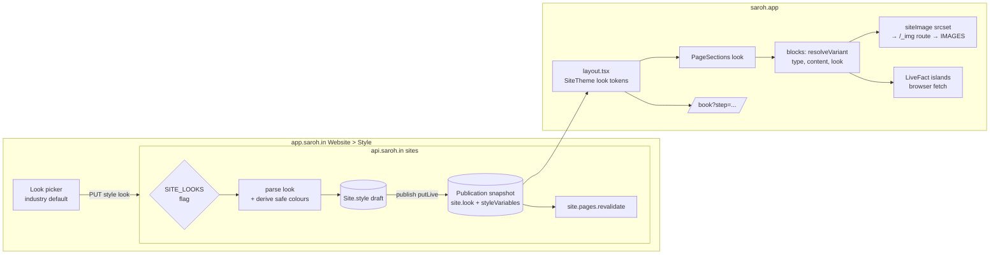

# Site templates v2: Folio, Quiet and Live on one engine

**Epic:** #1076 (Merchant sites: three looks on one engine). Each unit names its issue.

**Target:** `apps/saroh.app`, `packages/site-blocks`, `packages/block-contract`, with smaller changes in `apps/api.saroh.in`, `apps/app.saroh.in` and `packages/database`.

---

## Problem frame

Merchant sites today are a set of industry templates (`packages/templates/src/templates/*`) that seed pages and sections once, plus a style (`Site.style`: colourway, scalars, font pair, palette, type scale). The renderer never learns which template a site uses: a look reaches the page only through `snapshot.site.styleVariables` and each section's `content.variant`.

Three new looks were designed and audited on the Website v2 canvas: **A · Folio** (printed monograph, tinted ground, square corners), **D · Quiet** (warm white, airy, pill buttons, one question per booking screen) and **B · Live** (app-like, cards, live facts, a dock on a phone). The owner chose to build A and D fully and to offer B, built under the motion rule as redrawn, with gyms as its default; C is dropped (DEC-172).

The audits found the boards promise things the product does not have yet (service pages, staff photos, service reviews, public course enrolment, pick-up slots, Order again, automatic WhatsApp messages) and that photographs are served at their upload size. The owner's answer is to **launch on today's data** and make every API gap a later phase, starting with image resizing.

All three looks' boards have since been fixed against their audits. They are the visual source: the Website v2 canvas (https://claude.ai/artifact/DdL6xGn3tR7eoPMbYak6Z7, boards VA\*, VB\* and VD\*). Every VB and VD finding is marked fixed on its audit board; on VA, 27 are fixed, VA-28 (no map) and VA-29 (initials, no service reviews) are fixed for launch on today's data, and VA-03 (image resizing) needs engineering, which is U1.

This plan builds the three looks as one engine: the same blocks, one booking flow with the step in the URL, one customer account, and differences carried only by tokens and a few layout variants per block. It also adds the customer's "Ask to remove my data" request, end to end.

---

## Requirements

| ID  | Requirement (owner decision, DEC-172)                                                                                                                                           |
| --- | ------------------------------------------------------------------------------------------------------------------------------------------------------------------------------- |
| R1  | Folio (A) and Quiet (D) are built fully. Live (B) is built under the motion rule as redrawn (no springs, no number tickers) and is the default for gyms. C is not built.        |
| R2  | One engine: the same blocks, one booking flow for services, classes and courses, and one customer account. The looks differ only by tokens and a few layout variants per block. |
| R3  | The booking step lives in the URL, so Back and deep links work.                                                                                                                 |
| R4  | Phase 1 ships on today's data. Every API gap is Phase 2, and image resizing with srcset comes first.                                                                            |
| R5  | Motion is fade or rise, 200 ms or less, with no bounce and no loops. Reduced motion is respected.                                                                               |
| R6  | The customer account has "Ask to remove my data". The business sees the request and acts on it (API, merchant inbox, account UI).                                               |
| R7  | Live facts ("Next free", "places left", "Open now") are fetched in the browser on cached pages, with loading, unknown and stale states. A stale value is hidden, never shown.   |
| R8  | Every block has a no-photo layout. "No photo yet" shows only in the owner's preview.                                                                                            |
| R9  | Every email gets a sign-in code, with the same words for new and returning customers.                                                                                           |
| R10 | Merchants choose a look per site, with an industry default: Quiet for salons, clinics, studios, bakeries, shops and makers; Folio for classes and yoga; Live for gyms.          |
| R11 | Existing sites keep working (Classic). They are offered the new looks only from the Website › Style row, with no card in the workspace, and Classic is always one choice away.  |
| R12 | Rollout is behind the `SITE_LOOKS` flag, on only in the development environment (saroh.io) until testing is done. It stays off in production until the owner says so.           |

The fix rules from the audits apply to every unit:

- One filled button per view, and one fixed bar on a phone.
- Targets are at least 44 px. Text contrast is at least 4.5:1, and control edges at least 3:1.
- The phone's first screen at 390×844 shows the photo (or the main visual), the next booking or the shop entry, and one proof line.
- Pick-up or delivery is asked once, in checkout.
- Controls are real: radios, tablists and dialogs.
- Every capability is kept.
- Words are the same across looks (the WV2Voice board).
- Automatic customer messages are email only. The business's own WhatsApp chat link stays (see below).

The rules as applied to the boards are in the design drafts' `website-v2/audit-variants/FIX-RULES.md`, and each look's fix status is in its `V*-findings.json` and `WAuditV*` board.

### Owner decisions, 20 Oct 2026 (DEC-172)

- **Booking as a page or a panel.** Both stay, as look variants on one booking route with the step in the URL: Quiet uses a page, Folio a panel, Live sheets (KD7, KD8).
- **Industry defaults.** Quiet for salons, clinics, studios, bakeries, shops and makers. Folio for classes and yoga. Live for gyms (R10, U2, U16).
- **Data removal.**
    - Saroh emails the customer an acknowledgement when they ask, and again when it's done.
    - Anyone who can run a customer removal today can act on a request.
    - Receipts and invoices are kept as the law requires, and the confirmation says so (U13, U14).
- **Existing sites** are offered the new looks only from the Website › Style row, with no card in the workspace. Classic always stays one choice away (R11, U16).
- **Live** is built under the 200 ms motion rule as redrawn. No springs and no number tickers (R1, KD5).
- **The business's own WhatsApp chat link** (`packages/site-blocks/src/site-footer-contact.tsx`, `reach-links.tsx`) is kept in every look. The no-WhatsApp rule applies only to automatic messages, which Saroh doesn't send (U5).
- **The owner's cut-off line** (on the boards, "Order by 9 pm") is optional free text the owner writes, shown only when written. A real cut-off is Phase 2 (U23).
- **Testimonials.** The existing owner-entered testimonials block stands in for service reviews until Phase 2 (U6, U21).
- **Service pages and each person's "next free"** are drawn, but built in Phase 2 (U20, U19). Phase 1 uses the booking page and the existing data (U8).
- **Gallery album tabs** are cut for Phase 1. Photos have no tags (U7).
- **The new looks stay on development until testing is done.** `SITE_LOOKS` is on only in the development environment (saroh.io) and stays off in production until the owner says so (KD12, U2, U18, Rollout).

### Sample facts

Wherever this plan gives an example, it uses one set of facts, the same on all three looks' boards:

- **Business:** Prana Yoga, 3 Hill Road. Teacher **Meera**, customer **Asha**.
- **Class:** Hatha yoga. **Next free:** "Next free: Wed 21 Oct, 7 am".
- **Shop:** "Ready from 7 am" from the business hours. The owner's own cut-off line on the boards reads "Order by 9 pm".

---

## Scope

**In scope (Phase 1):**

- Image resizing and srcset.
- The look model, tokens and fonts, and the renderer plumbing.
- Header, footer and phone chrome per look, and every block's layout variants plus its no-photo layout.
- Live-fact islands.
- The booking flow, rebuilt with the step in the URL and inline code sign-in.
- Shop and account restyled per look.
- States: consent, 404, paused, empty and error.
- The data-removal request, end to end.
- The look picker with industry defaults, and the migration path.
- Quality gates for accessibility and performance, and the flagged rollout.

**In scope (Phase 2, priority order):**

1. Staff photo and bio
2. Service pages
3. Service reviews
4. Online course enrolment
5. Pick-up and delivery slots with a cut-off
6. Order again and Book again
7. Saved addresses
8. Message threads linked to a booking or order
9. WhatsApp (later, not scheduled)

### Non-goals

- Variant C (Corner). Its boards stay on the canvas untouched.
- Instant self-service deletion. The request is acted on by the business.
- Consent categories (a "Choose" view). The banner keeps Accept and Reject until per-kind consent exists (VA-25, B10).
- A map on Visit us. Get directions stays a link to `StoreSettings.mapUrl` (VA-28).
- One-to-one "tell me if a time opens". It waits on the one-to-one waitlist work.
- Arrival facts (landmark, parking, door code), "shop closed until a date", "booking paused until a date" (#1044) and delivery zones.
- Gallery album tabs. Photos have no tags, so Phase 1 has one gallery per block.
- Service pages and each person's "next free" in Phase 1. They are drawn on the boards and built in Phase 2 (U20, U19).
- Any change to Saroh's own brand, or any Saroh token on a merchant page.

### Deferred to follow-up work

- BreadcrumbList structured data (VA gap). It fits with service pages (U20).
- A reminder-channel choice. It waits on WhatsApp (U27).
- Retiring the classic templates. Classic stays for as long as any site uses it.

---

## What the code already says (research, 19 Oct)

**Templates and looks**

- A template seeds pages and sections at creation (`packages/templates/src/registry.ts`, `instantiate.ts`).
- The site keeps `templateId`, `templateVersion` and `templateStyleId` (`packages/database/prisma/schema.prisma` `model Site`) and `style Json`.
- The API publishes `styleVariables: siteStyleVariables(publishedStyle)` into the snapshot (`apps/api.saroh.in/src/modules/sites/sites.service.ts`).
- Token logic is in `packages/block-contract/src/` (`site-style.ts`, `palette.ts`, `type-scale.ts`, `fonts.ts`). Layout variants are `variants.ts` `resolveVariant(type, content)` and `fixtures.ts` `BLOCK_META[type].variants`.
- The renderer is `packages/site-blocks/src/section-renderer.tsx` (20 block types) under `SiteTheme` (`site-theme.tsx`) and the craft layer (`site-craft.ts`). It is mounted in `apps/saroh.app/app/[domain]/layout.tsx`.

**Fonts**

- Loaded only through `next/font` in `apps/saroh.app/lib/site-fonts.ts`, with a twin in `apps/app.saroh.in/lib/sites/site-fonts.ts`, from `FONT_PAIRS` in `packages/block-contract/src/fonts.ts`.
- Newsreader exists. Hanken Grotesk, Cormorant Garamond, Jost, Bricolage Grotesque and Figtree do not.

**Booking**

- `packages/site-blocks/src/booking-flow/booking-flow.tsx` has about 1,620 lines, and `booking-flow/steps/` already holds step components (`service-step.tsx`, `when-step.tsx`, `details-step.tsx`, `pay-step.tsx`, `done-card.tsx` and others). Existing suites (`booking-flow.test.tsx`, `-credit`, `-waitlist`, `-customer`, `booking-look.test.tsx`) pin most flows. Its steps are a React `Phase`, and choices survive a reload through sessionStorage (`booking-draft.ts`). Only the entry params live in the URL (`?service`, `date`, `start`, `move`).
- Sign-in is the last step (`account/sign-in-sheet.tsx`).
- Courses are not bookable. They are read-only in the account.

**Account and sign-in**

- Sign-in is an email code (`apps/saroh.app/lib/sign-in.ts` → `public/site-accounts/codes` and `/sessions`). The API already answers known and unknown emails the same way.
- Account routes are under `apps/saroh.app/app/[domain]/account/`, gated by `SITE_ACCOUNT_AREA`.

**Images**

- `packages/site-blocks/src/lib/site-image.ts` sets loading, decoding and priority only. It has no srcset, because R2 keeps one file per photo.
- `apps/saroh.app/wrangler.jsonc` already has an `IMAGES` (Cloudflare Images) binding, which nothing uses for site photos.

**Page cache**

- `apps/saroh.app/lib/page-cache/` serves anonymous visitors from the Cache API, with a 5-minute TTL by default. Tags are `site:<id>`, `site:<id>:products` and `site:<id>:product:<id>`.
- The API queues `site.pages.revalidate` on publish (`apps/api.saroh.in/src/modules/sites/page-cache-revalidate.ts`).
- Per-visitor pages call `dontCachePage(reason)`.
- Blocks already fetch live data in the browser:
    - `on-today.tsx` → `GET public/sites/:id/today` (served by `bookings/public-bookings.controller.ts` through `bookings/public-today.ts`)
    - `timetable.tsx`
    - `booking.tsx` → `/public/services/:id/days`
    - `plans.tsx`, `packs.tsx` and `product-grid.tsx`

**Data removal**

- Exists only as a merchant action (`apps/api.saroh.in/src/modules/customer-workspace/privacy-removal*.ts`, `GET/POST organizations/:org/customers/:contactId/removal(/preview)`).
- Nothing lets a customer ask for it.

**Flags**

- Per-site product switches follow `SITE_SHOP` in `apps/api.saroh.in/src/modules/feature-flags/flags.ts`. That flag is read by the API, by `apps/saroh.app/lib/header-action.ts` and the shop routes, and by the editor (`apps/app.saroh.in/lib/sites/sells-from.ts`).

---

## Key technical decisions

| #    | Decision                                                                                                                                                                                                                                                                                                                                                                                                                                                                                                                                                                                                                                                                                                                                       | Why                                                                                                                                                                                                                                                                                                                      |
| ---- | ---------------------------------------------------------------------------------------------------------------------------------------------------------------------------------------------------------------------------------------------------------------------------------------------------------------------------------------------------------------------------------------------------------------------------------------------------------------------------------------------------------------------------------------------------------------------------------------------------------------------------------------------------------------------------------------------------------------------------------------------- | ------------------------------------------------------------------------------------------------------------------------------------------------------------------------------------------------------------------------------------------------------------------------------------------------------------------------ |
| KD1  | **A look is a style choice: `Site.style.look` ∈ `folio` \| `quiet` \| `live`, absent meaning `classic`.** It is published into the snapshot as `site.look` beside `styleVariables`.                                                                                                                                                                                                                                                                                                                                                                                                                                                                                                                                                            | It needs no schema migration (`style` is JSON). It goes through draft → publish → `putLive` like every other style change, so the owner previews before customers see it, and the page cache is invalidated on publish as today. A look is independent of the template, so any template's pages can wear any look.       |
| KD2  | **Layout follows the look only where a section has not chosen a variant.** `resolveVariant(type, content, look)` picks the look's default when `content.variant` is unset. A section's own variant always wins.                                                                                                                                                                                                                                                                                                                                                                                                                                                                                                                                | Existing sections keep their variant. A new look changes defaults, not authored choices. This keeps the block contract version unchanged (no breaking section change).                                                                                                                                                   |
| KD3  | **Look tokens are data in `packages/block-contract/src/looks.ts`:** radius scale, page margin, section padding, measure, font pair, type scale and motion durations, plus the new roles (`--site-body`, `--site-surface`, `--site-accent-soft`, `--site-rule`, `--site-footer-muted`, `--site-radius-s`, `--site-radius-photo`).                                                                                                                                                                                                                                                                                                                                                                                                               | Tokens stay the only way a look differs (R2). Colours still come from the business's colourway, which keeps merchant brand separate from Saroh's.                                                                                                                                                                        |
| KD4  | **Colour is derived for safety, never refused** (D-18, D-01): `--site-accent-fg` is ink or white by contrast; the accent is darkened until it reaches 3:1 on the ground; `--site-accent-text` (accent used as text) is darkened until it reaches 4.5:1 on `--site-bg` and `--site-surface`; `--site-rule` reaches 3:1 against both.                                                                                                                                                                                                                                                                                                                                                                                                            | `parsePalette` refuses today. A bright brand colour must still produce a usable site.                                                                                                                                                                                                                                    |
| KD5  | **Motion is the existing scale only:** `duration-fast` (100 ms), `-base` (140 ms) and `-slow` (200 ms), fade or rise of 8 px or less, ease-out.                                                                                                                                                                                                                                                                                                                                                                                                                                                                                                                                                                                                | The boards' 500–700 ms signatures (hero unmask, frame draw, circle draw, ticket spring), parallax, count rolls and B's springs and number tickers are all cut or re-timed to 200 ms or less (R5, resolves B06, VA-11 and D-26). Live is built as redrawn under this rule. Reduced motion becomes an opacity change only. |
| KD6  | **Image resizing happens on request at the renderer, through the `IMAGES` binding.** A route on saroh.app serves a fixed width ladder (320, 480, 780, 1200, 1600, 1920) as AVIF or WebP by `Accept`. The source is read from the merchant's media origin only, and each result is cached by key, width and format. `siteImage()` learns `srcset` and `sizes`.                                                                                                                                                                                                                                                                                                                                                                                  | Upload-time variants would need a backfill of every existing photo and four times the storage. The binding is already provisioned. Media keys are immutable, so results cache for good. A fixed ladder and a source allowlist keep it from being an open proxy.                                                          |
| KD7  | **The booking step is a URL search param** (`/book?service=…&step=what\|who\|when\|details\|pay\|done`), moved with `window.history.pushState` (Back goes to the previous step) and `replaceState` for corrections, read back through `useSearchParams`, so a step change makes no server render of the dynamic `/book` page. `router.push` is kept for leaving `/book`. A deep link to a step whose inputs are missing lands on the earliest unmet step. Choices still survive a reload in sessionStorage, never in the URL (no note, code or phone).                                                                                                                                                                                         | R3. Timetable class booking and services go through this one route (D-03). Courses show "Ask to join", which opens the enquiry (FIX-RULES: enrolment is staff-only).                                                                                                                                                     |
| KD8  | **The booking presentation is a layout variant of the same steps:** `panel` (Folio: a side panel with the sentence picker, a sheet on a phone), `page` (Quiet: one question per screen) and `sheets` (Live: full-height sheets on a phone; What, Who and When together on a desktop, B16).                                                                                                                                                                                                                                                                                                                                                                                                                                                     | One engine (R2). The step machine, the API calls and the words are shared, and only the frame differs. The owner kept both page and panel (20 Oct).                                                                                                                                                                      |
| KD9  | **Sign-in happens in the Details step, inline, with a code for every email** and the same words for everyone: "We sent a code to {email} to confirm it's you." A signed-in customer sees "Booking as {name} · Not you?".                                                                                                                                                                                                                                                                                                                                                                                                                                                                                                                       | R9, VA-04, D-06. The API already behaves this way. Only the UI moves.                                                                                                                                                                                                                                                    |
| KD10 | **Live facts are client islands** (`LiveFact`) with a reserved height and five states: loading, fresh, refreshing, unknown (hidden, with nothing else moving) and failed (hidden). A value older than its freshness window is hidden, keeping its reserved height (the stale state). Polling pauses while the tab is hidden. The cached HTML carries only the stable part.                                                                                                                                                                                                                                                                                                                                                                     | R7, B01, VA-17. No cache bypass: `dontCachePage` is for per-visitor pages only.                                                                                                                                                                                                                                          |
| KD11 | **The removal request is a new tenant-owned row, `CustomerDataRequest`, with RLS.** The customer creates it from Your details. The business sees it as a team alert and in a Customers "Requests" list, and acts through the existing privacy-removal preview and run. Marking it done is recorded on the request.                                                                                                                                                                                                                                                                                                                                                                                                                             | R6. It reuses the removal machinery that exists. Nothing is deleted instantly.                                                                                                                                                                                                                                           |
| KD12 | **The flag is an API flag, `SITE_LOOKS`, following `SITE_SHOP`:** a global row plus per-business overrides in admin → Flags. It is on only in the development environment (saroh.io); in production it stays off, global and per business, until the owner says so. With it off, the API refuses setting or changing a look (a value that differs from the stored draft's) in style writes and site creation, and the editor hides the picker for a site with no look. Keeping the stored look and clearing it (back to Classic) are always accepted, so turning the flag off never locks an owner out of Style. The renderer needs no flag: it draws whatever the publication says, and a publication can only carry a look the API accepted. | R12. The server half is the gate (devops-environments-and-flags.md).                                                                                                                                                                                                                                                     |
| KD13 | **Migration is opt-in per site.** Classic stays the default for every existing site and renders exactly as today, pinned by the existing `*-template.test.tsx` suites. The owner picks a look in Website › Style, sees it in the draft preview, and publishes. That row is the only place existing sites are offered a look: no workspace card. While `SITE_LOOKS` is on, new sites get the industry default.                                                                                                                                                                                                                                                                                                                                  | R10, R11. Nothing changes under a merchant who did nothing.                                                                                                                                                                                                                                                              |

---

## High-level technical design

> This illustrates the intended approach and is directional guidance for review, not implementation specification. The implementing agent should treat it as context, not code to reproduce.

**Block × look matrix (which layout variant each look defaults to; the boards are the visual source):**

| Block                                                                                                      | Folio (VA)                             | Quiet (VD)                          | Live (VB)                      | No-photo layout                   |
| ---------------------------------------------------------------------------------------------------------- | -------------------------------------- | ----------------------------------- | ------------------------------ | --------------------------------- |
| hero                                                                                                       | split, 21:9 wide plus a 4:5 tall photo | centred, words first, 21:9          | card grid with a live strip    | type-led hero; Next free moves up |
| servicesList                                                                                               | index rows                             | hairline rows                       | cards with Book                | rows without a thumbnail          |
| person                                                                                                     | tall portraits (monograms for now)     | round portraits (initials for now)  | round faces (initials for now) | initials in circles (`NamePlate`) |
| testimonials                                                                                               | one pull quote                         | three short quotes                  | cards                          | n/a                               |
| gallery                                                                                                    | full-bleed plates and a lightbox       | a grid with air and a lightbox      | rounded cards and a lightbox   | the section hides (DEC-141)       |
| journal                                                                                                    | lead plus archive                      | lead                                | cards                          | a text card                       |
| timetable                                                                                                  | quiet list                             | rows with price and an outline Book | rail and cards                 | n/a                               |
| productGrid                                                                                                | one per row on a phone                 | two per row on a phone              | quick-add list                 | `NamePlate`                       |
| plans / packs / cta / visitUs / hours / faq / features / projects / enquiry / contact / richText / onToday | restyle by tokens                      | restyle by tokens                   | restyle by tokens              | text only                         |

---

## Implementation units

Every unit follows `docs/patterns/00-universal.md` §15 (keep every capability: list the controls and states before starting) and the fix rules above. Every unit's e2e specs start with `// @covers …` and run in the desk and phone projects. Writes go to Northwind only, and a spec that changes Northwind's site style is tagged `@serial` and puts it back (`.agents/skills/saroh-browser-tests/SKILL.md`). Every per-look spec uses one shared e2e helper (added in U2) that turns on Northwind's `SITE_LOOKS` override through the admin flags API, sets the look, and restores both.

### Phase 1: today's data, all three looks

#### U1. Image resizing and srcset

**Issue:** #1043

**Goal:** Photos are served sized for the screen as AVIF or WebP, and `siteImage()` emits `srcset` and `sizes`. This comes before any look ships (VA-03, D-07, D-04).

**Requirements:** R4.

**Dependencies:** none.

**Files:**

- Create:
    - `apps/saroh.app/lib/images/resize.ts` (the handler's logic, typed and tested, called from `apps/saroh.app/worker.ts`, which answers `/_img/*` before `withPageCache`). Not an app route: App Router leaves `_`-prefixed folders out of routing, and `middleware.ts` rewrites tenant paths to `/[domain]/…`.
    - `apps/saroh.app/lib/images/resize.test.ts`
    - `e2e/tests/site-images.spec.ts`
- Modify:
    - `packages/site-blocks/src/lib/site-image.ts`
    - `packages/site-blocks/src/lib/site-image.test.tsx`
    - `apps/saroh.app/lib/private-paths.ts` (keep `/_img` out of robots, if needed)
    - `apps/saroh.app/worker.ts`
    - `apps/saroh.app/wrangler.jsonc` (comments only, if the binding config stays)
    - `docs/patterns/frontend-design-system.md` (Images)
    - `docs/architecture/DEV_LEARNINGS.md` (only if something surprises)

**Approach:**

- A fixed width ladder. Any other width is refused or snapped to the nearest step.
- The source is fetched only through the public media base URL over HTTPS, never through a bucket binding or a presigned read. The key must sit under the site's own organization (from the domain's publication) and an image purpose (`site-image`, `product-image`, `business-logo`). Anything else, including a `data-export` key, another organization's key or a `..` path, returns 404.
- Format comes from `Accept` (AVIF, then WebP, then the original), with `Vary: Accept`.
- Each result is cached in the Cache API keyed by key, width and format, with a long immutable max-age.
- If the transform fails, the original is served with a short cache only when the source is `image/*`, so a photo is never lost; anything else returns 404.
- `siteImage(place, { src, width, height, sizes })` returns `src` (the middle width), `srcset` and `sizes`, keeping today's loading and priority rules.
- The first hero gets a `<link rel="preload" as="image" imagesrcset imagesizes fetchpriority="high">` in the head.
- Every `` keeps its width and height, or an aspect box.
- Without the binding (`next start` and `next dev`, which the e2e stack uses), `siteImage` emits a plain `src` and nothing is transformed.

**Patterns to follow:** `apps/saroh.app/lib/page-cache/worker.ts` (Cache API use) and `site-image.ts`'s single-place rule.

**Test scenarios:**

- Unit (`resize.test.ts`):
    - A width in the ladder gives that width.
    - A width of 1000 snaps to 1200.
    - A width over the largest gives the largest.
    - A non-media source gives 404, and so do a `data-export` key, another organization's key and a `..` key.
    - `Accept: image/avif` gives AVIF, and no AVIF gives WebP.
    - A transform throwing serves the original with a short cache.
- Unit (`site-image.test.tsx`):
    - `first-hero` gives eager, `fetchPriority=high`, a srcset with every ladder step up to the source width, and the given `sizes`.
    - `below` gives lazy.
    - No source width means no srcset entries wider than the source.
- Unit (`resize.test.ts`, with a fake `IMAGES` binding and Cache): a second request for the same key, width and format is served from the cache.
- e2e (`site-images.spec.ts`, `// @covers site:/ pkg:site-blocks`): markup only, since the e2e stack runs `next start` with no Worker. On Northwind's home, desk and phone, the hero has `srcset`, `sizes`, width and height, and the head has its preload link.

**Verification:** On development (saroh.io, through the Worker) or `cf:preview`, by hand: on a 390 px phone the hero is AVIF or WebP at 1200 px or less, its bytes drop well below the original, and a second load is a cache hit. No layout shift appears when photos load (CLS < 0.1 on the home).

---

#### U2. Look model, safe colours and the `SITE_LOOKS` flag (contract and API)

**Issue:** #1086

**Goal:** A site can carry a look. The API validates it, derives safe colours and publishes it, behind a per-business flag.

**Requirements:** R1, R2, R10, R12.

**Dependencies:** none.

**Files:**

- Create:
    - `packages/block-contract/src/looks.ts`
    - `packages/block-contract/src/looks.test.ts`
    - `packages/block-contract/src/safe-colours.ts`
    - `packages/block-contract/src/safe-colours.test.ts`
- Modify:
    - `packages/block-contract/src/site-style.ts` (and its test), `packages/block-contract/src/variants.ts`, `packages/block-contract/src/index.ts`
    - `apps/api.saroh.in/src/modules/feature-flags/flags.ts` (`SITE_LOOKS` with full `FLAG_METADATA`)
    - `apps/api.saroh.in/src/modules/sites/site-style.ts`, `site-style-offer.ts` and `dto.ts`, plus `sites.service.ts` (snapshot `site.look`), `site-create.ts` (industry default)
    - `apps/api.saroh.in/src/modules/sites/site-style.spec.ts` (or its equivalent)
    - `apps/api.saroh.in/src/modules/sites/site-looks.db.spec.ts` (new)
    - `apps/saroh.app/lib/publication.ts` (type)
    - `e2e/tests/helpers/site-look.ts` (new: the shared set-and-restore helper for look specs)

**Approach:**

- `LOOKS` lists `folio`, `quiet` and `live`, each with:
    - a token set (KD3)
    - a font pair id: `folio`, `quiet` or `live`, the ids U3 adds to `FONT_PAIRS` (U3's sync test checks every look's pair exists)
    - a type scale
    - default variants per block type (the matrix above)
    - a booking presentation (KD8)
    - a motion ceiling (KD5)
- `parseLook` accepts only those ids or absent.
- `LOOKS` ships with default variants limited to ids that already exist in `BLOCK_META`. U6 and U7 each add their new variant ids and switch the matching look defaults in `looks.ts`, so the existence test stays green at every step.
- `defaultLookForTemplate(templateId)` lives in `looks.ts`, so the API (site creation) and the editor's "Suggested for" label (U16) read one mapping.
- `deriveSafeColours(palette, look)` returns the colour roles with the accent darkened to 3:1 on the ground, `accentFg` chosen by contrast, and `rule` lifted to 3:1 on bg and surface. Every text pair is checked at 4.5:1.
- `resolveVariant(type, content, look?)` uses a named known `content.variant` first, then the look's default if the content meets that variant's needs (an image for split or full-bleed heroes), then the block's legacy resolver (`LEGACY_RESOLVERS`), as today.
- The API refuses a `look` (400 with `code: "look-not-available"`) unless `SITE_LOOKS` is on for the business.
- Site creation sets the look from the template id the site starts from (`packages/templates/src/templates/*`), when the flag is on. `KIND_TEMPLATE` keys on the organization kind (BUSINESS, SOLO, WORK), not the industry, so the template id is the industry signal:
    - `gym` → `live`
    - a classes or yoga template → `folio`. There is none today, so the mapping is keyed for one and Folio is reached by choosing it in Website › Style.
    - `salon`, `clinic`, `dietician`, `studio`, `bakery`, `ceramics`, the starter and everything else → `quiet`
- Publishing writes `site.look` into the snapshot. The existing publish revalidation covers the cache.

**Patterns to follow:** `palette.ts` (`parsePalette`), `site-style-offer.ts` (only offered values accepted), `SITE_SHOP` in `flags.ts`, and `docs/patterns/backend-nestjs.md` (DTO classes).

**Test scenarios:**

- Unit (`looks.test.ts`):
    - Every look defines every required token.
    - Every look's default variant exists in `BLOCK_META[type].variants`.
    - An unknown look is rejected.
- Unit (`safe-colours.test.ts`):
    - A bright yellow accent on a white ground darkens to at least 3:1, with ink text on it.
    - A dark green keeps its value, with white text on it.
    - An accent equal to the ink falls back to ink with an outline treatment.
    - The rule reaches 3:1 on bg and on surface.
    - The two sample businesses' colourways from VD00Summary and VA00Summary all pass.
- Unit (`resolveVariant`):
    - A section variant beats the look.
    - The look beats the legacy resolver.
    - A Folio hero with no image resolves to the no-photo layout.
    - No look gives today's behaviour, unchanged.
- db spec (`site-looks.db.spec.ts`):
    - With the flag off, `PUT style {look:"quiet"}` on a Classic site returns 400 `look-not-available`.
    - Flag on, set `quiet`, flag off: a style save with a new colourway and `look:"quiet"` returns 200 and keeps the look, and a save that clears the look returns 200.
    - With a per-business override on, it saves to the draft and a publish carries `site.look`.
    - Another business's site returns 404.
    - With the flag on, a new site from the salon or bakery template gets `quiet`, and from the gym template gets `live`.
    - With the flag off, a new site has no look.
- Integration: publishing a look queues `site.pages.revalidate` for the site (`FakeJobQueue.runOnce()`).

**Verification:** The flag shows in admin → Flags with its metadata, on in development (saroh.io) and off in production. Snapshots of existing sites are unchanged apart from an absent `look`.

---

#### U3. Look fonts

**Issue:** #1088

**Goal:** The six faces the looks need load self-hosted, with only the weights used, and only the active look's display face preloaded.

**Requirements:** R2; performance budget (2 families per look).

**Dependencies:** none.

**Files:**

- Modify:
    - `packages/block-contract/src/fonts.ts` (append new pairs, never edit a shipped entry, DEC-046)
    - `apps/saroh.app/lib/site-fonts.ts`
    - `apps/app.saroh.in/lib/sites/site-fonts.ts`
    - `packages/site-blocks/src/site-fonts.test.tsx`
    - `e2e/tests/site-fonts.spec.ts`

**Approach:**

- New pairs:
    - `folio`: Newsreader 300, 400 and italic 300/400, with Hanken Grotesk 400–600
    - `quiet`: Cormorant Garamond 400 and 500, 300 only at 48 px and up (D-21), italic 400, with Jost 400 and 500
    - `live`: Bricolage Grotesque at one width, 700–800 (B23), with Figtree 400–700
- Latin subset (keep ₹, which may need `latin-ext` or a check), `display: swap`, and fallback metrics adjusted (next/font does this) so text does not move.
- `preload` stays false in the shared list: `next/font` needs literal options at module scope, so preload can't vary per request. Whether the active look's display face can be preloaded (for example a dedicated loader per look with `preload: true` used only by that look's layout branch) is checked when U3 starts; if not, `display: swap` with adjusted fallback metrics is the answer.
- Every loader names its weights, so variable fonts don't load their full range.

**Patterns to follow:** existing `FONT_PAIRS` entries and the three-way sync test.

**Test scenarios:**

- Unit: every `FONT_PAIRS` id has a loader in both apps (the existing sync test, extended).
- Unit: the new pairs list no weights beyond those above.
- e2e (`site-fonts.spec.ts`, extended, `// @covers site:/ pkg:site-blocks`): a Northwind preview with `look=quiet` requests at most two font families, and the ₹ glyph renders in the body face. This spec needs U2 and U4, so it lands with U4.

**Verification:** No Google Fonts CSS link anywhere on a merchant page (G7 scan passes).

---

#### U4. Renderer look plumbing: tokens, craft, motion and owner preview

**Issue:** #1090

**Goal:** The renderer applies a look's tokens, craft rules and motion, passes the look to every block, and knows when it is the owner's preview. Classic stays pixel-identical.

**Requirements:** R2, R5, R8, R11.

**Dependencies:** U2, U3.

**Files:**

- Modify:
    - `packages/site-blocks/src/site-theme.tsx`, `site-craft.ts`, `tailwind-preset.ts`, `section-renderer.tsx` and `index.ts`
    - `apps/saroh.app/app/[domain]/layout.tsx`
    - `apps/saroh.app/app/preview/[token]/[slug]/page.tsx` (owner-preview flag)
- Create:
    - `packages/site-blocks/src/look-context.ts` (a plain module with the look and `isOwnerPreview`, passed as props from the server)
    - `packages/site-blocks/src/look-theme.test.tsx`
- Modify tests: `packages/site-blocks/src/site-craft.test.tsx`, `site-frame.test.tsx`

**Approach:**

- `SiteTheme` takes `look` and writes the look's tokens under the merchant's colour roles.
- It adds `data-site-look` on the scope, so CSS-only differences (radius, rule weight, centring) live in craft rules.
- `PageSections` passes `look` and `isOwnerPreview` to each block as props. Server components need no React context.
- Motion follows KD5 under a look:
    - `site-rise` becomes a 140–200 ms fade and rise for the three looks. Classic keeps today's timing, so it stays pixel- and motion-identical.
    - Content is never hidden before it scrolls in (WV2Tech Accessibility).
    - No parallax.
- Look tokens are new `--site-*` names only, and G2 and G6 still pass. The tailwind preset gains the new colour roles.

**Execution note:** Characterization first. Run the existing `*-template.test.tsx` suites and snapshots with no look and keep them byte-identical before adding look branches.

**Patterns to follow:** `site-craft.ts` `:where()` low-specificity rules, and `heroLevels` and `sitePrimaryAction` as single deciders.

**Test scenarios:**

- Unit: with no look, `SiteTheme` output equals today's snapshot (`__snapshots__`).
- Unit: `look=quiet` emits `--site-radius: 999px`, `--site-radius-photo` and the page margin and section padding per size.
- Unit: `look=folio` gives radius 0.
- Unit: the craft rules contain no duration over 200 ms, no `animation-iteration-count: infinite` and no `cubic-bezier` with a value over 1 (no overshoot). A `prefers-reduced-motion: reduce` block reduces every animation to opacity.
- Unit: `isOwnerPreview` is true in the saroh.app preview route and the editor's previews (U16), and always false in the `[domain]` layout.

**Verification:** `pnpm run check:blocks` passes. Northwind's published site with no look looks the same at 320, 390 and 1440 px.

---

#### U5. Chrome per look: header, phone menu, one fixed bar, footer and dock

**Issue:** #1092

**Goal:** Header, menu, footer and phone bars follow the rules: one filled button per view, one fixed bar on a phone, 44 px targets, and Visit us in every header.

**Requirements:** R2; fix rules; VA-07, D-05, D-08, D-19, D-20, D-23, VA-22, B13.

**Dependencies:** U4.

**Files:**

- Modify:
    - `packages/site-blocks/src/site-chrome.tsx`, `site-header-menu.tsx`, `site-footer.tsx` and `site-primary-action.ts`
    - `apps/saroh.app/lib/header-action.ts`
    - tests: `packages/site-blocks/src/site-header.test.tsx`, `site-footer.test.tsx`, `site-chrome.test.tsx`
- Create:
    - `packages/site-blocks/src/sticky-actions.tsx` (the one-fixed-bar controller)
    - `packages/site-blocks/src/site-dock.tsx` (Live, phone only)
    - `packages/site-blocks/src/footer-session-links.tsx` (client)
    - `e2e/tests/site-looks-chrome.spec.ts`

**Approach:**

- The page marks its own primary action (`data-site-primary`). An IntersectionObserver turns the header's Book into an outline button while the page's primary is on screen.
- Shop, product, bag and checkout pages show Bag (count) only.
- The phone menu is a dialog sheet with a focus trap and an inert background. It lists the pages, Visit us with today's hours, Your account or Sign in, and Call.
- `sticky-actions` keeps one fixed bar at a time: the header Book hides while the bar shows, and the dock hides while a sheet is open. The consent banner counts as the bar while it is open: the Book bar and the dock wait until the visitor chooses. It reserves `--site-consent-offset`, which U15 sets.
- One filled button per page type: on the home and content pages it is the page's `data-site-primary`; on `/book` the header has no Book and the step's action is the filled button; on the shop grid, add-to-bag steppers are outline and the filled button is Check out or, on a product page, Add to bag.
- The Live dock lights a tab only on that tab's page.
- Footer links are 44 px rows. Account links are read client-side from the session, so the cached HTML stays shared.
- The business's own WhatsApp chat link (`site-footer-contact.tsx`, `reach-links.tsx`) stays in every look's footer and contact rows. The no-WhatsApp rule covers only automatic messages, which Saroh doesn't send.
- Phone and desk differences use `max-[699px]:` and `min-[700px]:` classes, never a width read in script.

**Patterns to follow:** `lib/header-action.ts`, the sheet focus handling in `shop/sheet-frame.tsx` and `account/sheet.tsx`, and `form-controls.test.tsx` for 44 px.

**Test scenarios:**

- Unit:
    - With a hero primary on screen, the header Book is outline. With it scrolled away, it is filled.
    - On `/shop`, the header shows Bag only.
    - The menu sheet traps focus, Esc closes it and focus returns to the menu button.
    - The dock shows no lit tab on About.
    - The footer renders no account links in the server HTML.
    - With a WhatsApp number set, each look's footer keeps the chat link.
- e2e (`site-looks-chrome.spec.ts`, `@serial`, `// @covers site:/ site:/shop pkg:site-blocks api:sites`):
    - The cached page fetched with JavaScript off contains no account links and no customer name.
    - For each look on Northwind (set and restored), desk and phone:
        - Count visible filled buttons in the first viewport: exactly 1.
        - On a phone, at most one `position: fixed` bar is visible.
        - The menu opens as a dialog.
        - Every interactive element in the header and footer has a box of at least 44×44 on a phone.

**Verification:** An axe scan of the home has no serious issues on all three looks (added in U17).

---

#### U6. Front-door blocks, part 1: hero, services, people, proof and the call-to-action band

**Issue:** #1094

**Goal:** The blocks on the home and About pages get each look's layout variant and a real no-photo layout. The phone's first screen holds the photo, the next booking and one proof line.

**Requirements:** R2, R8; VA-01, VA-06, VA-12, VA-16, D-02, D-04, D-10, D-17, D-24, B08.

**Dependencies:** U1, U4, U8.

**Files:**

- Modify:
    - `packages/site-blocks/src/blocks/hero.tsx`, `hero-full-bleed.tsx`, `hero-plain.tsx`, `services-list.tsx`, `person.tsx`, `testimonials.tsx`, `cta.tsx` and `features.tsx`
    - `packages/block-contract/src/fixtures.ts` (variants)
    - `packages/site-blocks/src/site-fixtures.ts` (one shared sample source, VA-13)
- Create:
    - `packages/site-blocks/src/blocks/hero-folio.tsx`, `hero-quiet.tsx` and `hero-live.tsx` (only where an existing variant cannot carry the look by tokens)
    - `packages/site-blocks/src/blocks/no-photo.tsx` (`NamePlate` for people and posts, reusing `product/name-plate.tsx`)
    - tests: `packages/site-blocks/src/blocks/looks-front.test.tsx`
    - `e2e/tests/site-looks-home.spec.ts`

**Approach:**

- Every block takes `image?`, and one layout branch per block handles "no image". Never a placeholder image.
- "No photo yet" renders only when `isOwnerPreview`.
- People always show initials or monograms in Phase 1. Staff have a name and title only, and a Person block's own photo is used if the owner set one.
- The phone hero order follows each look's fixed board, all above 844 px:
    - Folio (VA01HomePhone, VA-01): the headline, one line, the sentence card with Next free, then the photo at 3:2.
    - Quiet (VD01HomePhone, D-04): the photo, then the headline, Next free and one proof line.
    - Live (VB01HomePhone): as drawn.
- The hero's second element follows the modules that are on: bookings give Next free (U8); a shop only gives the shop entry; neither gives the site's main page link.
- In a row that is a link, the row's name is the link, stretched over the row; Book is a sibling link of 44 px above it, never nested.
- Phone home length is cut per D-10 and VA-16: teachers in a row, one review with "Read all", and journal and This week sharing a band.
- Section spacing comes from the tokens.
- Words come from the shared word list. "Next free: Wed 21 Oct, 7 am" is the pattern, never "Free today" beside a price (D-17). It is per service: naming the person ("with Meera") is Phase 2 (U19).
- Proof comes from the existing owner-entered testimonials block, which stands in for service reviews until Phase 2 (U21).
- Services link to the booking page with the service chosen. Service pages are Phase 2 (U20).

**Patterns to follow:** `product-grid-lead.tsx` and `product-grid-plates.tsx` (variant files), `opensOverPhoto`, `heroLevels`, and `customer-words.test.tsx`.

**Test scenarios:**

- Unit (per look): with no image, the hero renders no `` and no "No photo yet", and the headline is the `h1`.
- Unit: `isOwnerPreview` with no image shows "No photo yet".
- Unit: a person with no photo renders initials with an `aria-hidden` plate and the name as text.
- Unit: services-list renders a Book per row on a phone, and the whole row is a link through the stretched name, with no nested interactive elements.
- Unit: no fixture fact disagrees across blocks (one shared `site-fixtures.ts` source).
- e2e (`site-looks-home.spec.ts`, `@serial`, `// @covers site:/ site:/[slug] pkg:site-blocks api:sites`):
    - For each look at 390×844, the hero image (or the type-led hero when the site has no photo), the next-booking slot and one proof line are all inside the first viewport.
    - At 1440, the `h1` is unique.
    - A site with photos removed shows no empty frames.
    - A shop-only site shows the shop entry in the first viewport.

**Verification:** Side by side with VA01, VD01 and VB01 (Desk and Phone): spacing, sizes and colour roles match (match design fidelity), except where the motion or data rules override the board.

---

#### U7. Content blocks, part 2: gallery, journal, timetable, plans, packs, visit us and the rest

**Issue:** #1096

**Goal:** The remaining blocks get look variants, real controls, and their no-photo layouts.

**Requirements:** R2, R8; D-11, B07, B12, B15, VA-20, VA-23.

**Dependencies:** U1, U4.

**Files:**

- Modify:
    - `packages/site-blocks/src/blocks/gallery.tsx`, `journal.tsx`, `journal-lead.tsx`, `journal-archive.tsx`, `timetable.tsx`, `plans.tsx`, `packs.tsx`, `visit-us.tsx`, `hours.tsx`, `faq.tsx`, `projects.tsx`, `enquiry.tsx`, `contact.tsx` and `rich-text.tsx`
    - `packages/site-blocks/src/site-icon.ts` (a directions pin, not a refresh icon)
- Create:
    - `packages/site-blocks/src/blocks/lightbox.tsx` (dialog)
    - tests: `packages/site-blocks/src/blocks/looks-content.test.tsx`
    - `e2e/tests/site-looks-pages.spec.ts`

**Approach:**

- The gallery lightbox is a dialog with a focus trap, arrow keys and Esc.
- No album tabs in Phase 1: photos have no tags, so a gallery is one set.
- Timetable rows show the price, or "1 pack class" when signed in with a pack. That is read client-side, so it is not in the cached HTML.
- Book is an outline pill of 44 px. A full class says "Join the waitlist" (classes only).
- Faded rows keep full-strength text and carry a tag instead (B12).
- Labels are at least 12 px (VA-23).
- Plans and packs read their rules from the API (pause of 2, 4 or 8 weeks; membership used before a pack). Rules are never typed into templates (VA-30).
- Visit us keeps Get directions as a link, with no map.

**Patterns to follow:** `packages/site-blocks/src/blocks/list-layout.ts`, `timetable-read.ts` and `plans-read.ts`.

**Test scenarios:**

- Unit:
    - The lightbox opens as `role="dialog"` with `aria-modal`, traps focus and returns it.
    - Arrow keys move between pictures.
    - A timetable row has a price and a 44 px Book.
    - A full class shows Join the waitlist, never on a one-to-one service.
    - A sold-out product row text has 4.5:1 contrast and a tag.
    - Journal with no photo renders a text card.
- e2e (`site-looks-pages.spec.ts`, `@serial`, `// @covers site:/[slug] pkg:site-blocks api:sites`): for each look, open the gallery lightbox by keyboard and close it with Esc. The timetable page shows prices, and the cached HTML (JavaScript off) carries no pack wording.

**Verification:** Side by side with VA02, VA04–VA07 and VA09–VA10 and their VD and VB equivalents.

---

#### U8. Live facts on cached pages

**Issue:** #1042

**Goal:** "Next free", "places left" and "Open now" are fetched in the browser with honest states, and nothing moves when they load or fail.

**Requirements:** R7; B01, B14, B27, VA-05, VA-17, D-19.

**Dependencies:** none for the component. It is placed by U6 and U7.

**Files:**

- Create:
    - `packages/site-blocks/src/live/live-fact.tsx`
    - `packages/site-blocks/src/live/use-live-read.ts`
    - `packages/site-blocks/src/live/live-fact.test.tsx`
    - `e2e/tests/site-live-facts.spec.ts`
- Modify:
    - `packages/site-blocks/src/blocks/on-today.tsx`
    - `packages/site-blocks/src/lib/opening-hours.ts` (Open now from the business's time zone through `lib/clock.ts`)
    - if needed, `apps/api.saroh.in/src/modules/bookings/public-today.ts` and `public-today.db.spec.ts` (and `public-bookings.controller.ts` only if the response type changes), to add next free per listed service to the existing `today` read

**Approach:**

- `useLiveRead(url, { freshFor })` returns `loading | fresh | refreshing | unknown | failed` plus `fetchedAt`.
- It refetches when the tab becomes visible again, and polls (60 s) only while visible.
- `LiveFact` reserves its height from the first render. Unknown and failed hide the value with nothing else moving. A value older than `freshFor` is hidden rather than shown stale.
- Places left shows only when true and 5 or fewer. "Last place" is shown in `--site-accent-text` (4.5:1, KD4). There is no fake urgency.
- Where the slot is the hero's booking path, unknown, failed or a timed-out load falls back to a static "See times" link to `/book` from the cached HTML, so the first screen never shows an empty box.
- Next free for the home reads one call. If `GET public/sites/:id/today` does not carry the next free time per featured service, extend it. That is today's data and no new model. Next free per person is Phase 2 (U19).
- The "good first class" is the owner's chosen service, or the first free-intro service. Per-visitor "your usual" is Phase 2 (U24).

**Patterns to follow:** `on-today.tsx` (an existing no-store browser read), `saroh-product-states` (a failed read is never shown as empty or zero).

**Test scenarios:**

- Unit:
    - Loading renders a reserved box of fixed height with no text.
    - A 200 response renders the value.
    - A 500 hides the value and keeps the height.
    - A value with `fetchedAt` older than `freshFor` renders nothing.
    - A hidden tab stops polling, and showing it refetches once.
    - Places left of 6 renders nothing, and 1 renders "Last place".
    - Open now at 20:59 with closing at 21:00 reads open, and at 21:00 reads closed.
- API (if extended): a db spec proves `today` returns next free per service only for services published on the site, and that another business's service is never included.
- e2e (`site-live-facts.spec.ts`, `// @covers site:/ api:sites pkg:site-blocks`):
    - Route the `today` call to fail. The page still renders, with no layout shift beyond 0.1 and no "0 places", and "See times" is in the first viewport.
    - The cached HTML contains no live value (fetch the page with JavaScript disabled).

**Verification:** Northwind's home served from the page cache shows live values after load. The HTML is the same for two visitors.

---

#### U9. One booking route with the step in the URL (characterization and split)

**Issue:** #1098

**Goal:** `booking-flow.tsx` is split into step components behind a URL-driven step machine. Services and classes share it, Back and deep links work, and today's behaviour is kept.

**Requirements:** R2, R3; D-03, B16, B20.

**Dependencies:** none.

**Files:**

- Create:
    - `packages/site-blocks/src/booking-flow/step-url.ts` (parse, serialize and earliest-unmet-step)
    - a `who` step in `booking-flow/steps/`, only if no existing component covers it
    - `packages/site-blocks/src/booking-flow/step-url.test.ts`
    - `packages/site-blocks/src/booking-flow/booking-steps.test.tsx`
    - `e2e/tests/site-booking-steps.spec.ts`
- Modify:
    - `packages/site-blocks/src/booking-flow/booking-flow.tsx` (to a thin shell), `flow-state.ts`, `initial-start.ts` and `booking-draft.ts`
    - the existing `booking-flow/steps/*` components (extended, not duplicated)
    - `apps/saroh.app/app/[domain]/book/page.tsx`
    - `packages/site-blocks/src/blocks/timetable.tsx` (link into `/book` with the class occurrence)
    - `e2e/tests/public-booking.spec.ts` (kept green)

**Approach:**

- The steps are what, who, when, details, pay and done. Steps that are already known are skipped (one service with no choice of person skips who).
- `step` and the selections that are safe in a URL go in the query:
    - `service`, `staff`, `date`, `start`, `occurrence`, `move` and `ref`
    - never a note, code, phone, email, or a hold or pay token
- Moving forward uses `history.pushState`. Correcting an invalid step uses `replaceState`. Back works natively, with no server render per step.
- A deep link to `step=pay` with no hold falls back to `when`.
- `done` reads the booking ref from the URL and refetches it through the customer-session read (`public/site-accounts/me/bookings/:ref`), so a reload shows the ticket. With no session or someone else's ref it shows "couldn't find this booking". No public read by ref is added.
- `/book` stays `dontCachePage`. It already is per visitor.
- Courses show "Ask to join" linking to the enquiry with the course named.
- A step change moves focus to the new step's heading (`tabindex=-1`), with no extra live-region announcement. In the panel frame the step heading is an `h2` under the dialog's label.
- The When step has honest states: reserved shapes while loading; "Couldn't load times" with Try again on a failed read; days with no times muted and labelled "No times"; Next week and later dates to move on; a fully booked range offers Message us and Call (and Join the waitlist for classes only).

**Execution note:** Characterization first. The existing booking-flow suites are the baseline; before splitting, add pins only for flows they don't cover among today's flows (one-to-one with deposit, class with pack credit, waitlist join, move, hold expired, payment failed, "money may have left"). Then split with them green.

**Patterns to follow:** `flow-state.ts` phases, `booking-draft.ts` (no note stored), and the file-size rule (§6).

**Test scenarios:**

- Unit (`step-url.test.ts`):
    - A round trip of every step.
    - An unknown step falls to the earliest unmet step.
    - `step=pay` without a start gives `when`.
    - `step=who` for a service with one person gives `when`.
    - Query params never include a note, email or hold token, even if passed.
    - `move` and `ref` survive a round trip.
    - A step change makes no server navigation.
- Unit (`booking-steps.test.tsx`): each of the pinned flows above passes after the split. Done with an unknown ref shows the "couldn't find this booking" state, not a blank.
- e2e (`site-booking-steps.spec.ts`, `// @covers site:/book api:bookings api:site-accounts pkg:site-blocks`), desk and phone:
    - Pick service, then person, then time. Browser Back returns to the person step with the service kept.
    - Reload on the time step keeps the choices.
    - Open a copied deep link to the time step in a new visitor context and it lands on that step.
    - A class from the timetable opens `/book` on details with the class chosen.

**Verification:** `booking-flow.tsx` is under 400 lines. `public-booking.spec.ts` and the existing booking-flow suites pass unchanged.

---

#### U10. Booking per look: presentation, inline code, pay states and the booked screen

**Issue:** #1100

**Goal:** The three presentations of the same steps, with sign-in by code inside Details, honest pay outcomes and a calm booked screen.

**Requirements:** R2, R5, R9; VA-02, VA-04, VA-10, VA-19, VA-27, B03, B05, B07, B19, B28, D-06, D-09, D-25.

**Dependencies:** U4, U9.

**Files:**

- Create:
    - `packages/site-blocks/src/booking-flow/frames/panel-frame.tsx` (Folio), `page-frame.tsx` (Quiet) and `sheets-frame.tsx` (Live)
    - `packages/site-blocks/src/booking-flow/sentence-picker.tsx` (Folio)
    - `packages/site-blocks/src/booking-flow/inline-code.tsx`
    - tests: `packages/site-blocks/src/booking-flow/frames.test.tsx`, `sentence-picker.test.tsx` and `inline-code.test.tsx`
    - `e2e/tests/site-booking-looks.spec.ts`
- Modify:
    - `packages/site-blocks/src/booking-flow/steps/*`
    - `packages/site-blocks/src/account/sign-in-sheet.tsx` and `challenge.tsx`
    - `apps/saroh.app/app/[domain]/book/actions.ts`
    - `packages/site-blocks/src/customer-words.test.tsx`

**Approach:**

- The frame comes from `LOOKS[look].booking`, and classic keeps today's single page. Frames own layout only. Steps, API calls and words are shared.
- SentencePicker (Folio) works as follows:
    - Each phrase is a button named "Change class, Hatha yoga" that opens a listbox popover with roving focus.
    - The price is announced in a live region.
    - It is 44 px tall on a phone.
- Close: Esc and the close button on every frame leave `/book` with `router.replace` to the page the visitor came from (same origin, else home), keep the draft in sessionStorage and return focus to the control that opened the flow.
- Inline code:
    - The code is sent when the email field is left (or on Continue) with a complete address, never on each keystroke. The code field then opens under the email.
    - "Change" beside the sent email clears the code field and the timer.
    - It is one input with `autocomplete="one-time-code"`, checked at the sixth digit.
    - "Send a new code" is the timer until it can be used.
    - The words are the same for every email.
- Pay outcomes use only words for what is known: paid; didn't go through ("Try again or pay at the desk"); waiting for the UPI app; hold expired (15 minutes, from `HOLD_MINUTES`).
- The pay button carries the price and follows the payment choice. Whole rupees until the receipt.
- Done:
    - The heading is "You're booked, {name}." with the ticket first, then Add to calendar.
    - Online bookings get a Join link instead of Directions. Multi-visit bookings get "Book visit 2".
    - The cancel deadline is computed from `BookingRules.freeCancelHours`.
    - The motion is a 200 ms fade.

**Patterns to follow:** `use-checkout.ts` outcomes, `prices/` formatter, and Turnstile in `challenge.tsx`.

**Test scenarios:**

- Unit:
    - SentencePicker: Enter opens the listbox, arrow keys move, Enter picks, focus returns to the phrase and the live region announces the new price.
- Unit (inline code):
    - An unknown email and a known email produce identical text.
    - A wrong code shows "That code didn't match. Check the latest email or send a new one." with no shake.
    - Resend is disabled with a countdown for 30 s.
    - Typing an address sends nothing until the field is left; Change clears the code and the timer.
    - A signed-in customer sees "Booking as Asha · Not you?" and no email field.
- Unit (frames): every frame renders the same step content for a given state, and each has one filled button. Esc closes each frame to the entry page with focus returned.
- Unit (done):
    - An online booking has no Directions.
    - The deadline equals start minus `freeCancelHours`.
    - Money shows no paise until the receipt.
- e2e (`site-booking-looks.spec.ts`, `@serial`, `// @covers site:/book api:bookings api:site-accounts api:sites pkg:site-blocks`):
    - For each look on Northwind, a new visitor books a pay-at-desk service: picks a time, types name and email, receives the code (`e2e/tests/site-codes.ts`), enters it and reaches done.
    - Back from details returns to when.
    - On a phone, only one fixed bar shows on each step.

**Verification:** Side by side with VA08a–f, VD08a–f and VB08a–f. The booked screen motion is 200 ms or less.

---

#### U11. Shop per look: grid, product, added, bag and checkout

**Issue:** #1102

**Goal:** The shop wears each look, asks pick-up or delivery once in checkout, and never promises cut-offs or slots that do not exist.

**Requirements:** R2, R4; VA-08, VA-09, VA-19, B02, B11, B17, B21, B25, D-12, D-13, D-25.

**Dependencies:** U1, U4.

**Files:**

- Modify:
    - `packages/site-blocks/src/blocks/product-grid.tsx`, `product-grid-lead.tsx` and `product-grid-plates.tsx`
    - `packages/site-blocks/src/product/*`, `packages/site-blocks/src/shop/*` (bag, add-to-bag and sheets) and `packages/site-blocks/src/lib/shop-facts.ts`
    - `apps/saroh.app/app/[domain]/shop/*` and `apps/saroh.app/app/[domain]/checkout/[orderId]/*`
- Create: tests `packages/site-blocks/src/shop/looks-shop.test.tsx` and `e2e/tests/site-shop-looks.spec.ts`

**Approach:**

- Add to bag becomes a 44 px − 1 + stepper showing what is in the bag.
- The bag is a drawer on a desktop and a sheet on a phone. It shows the total and Check out, with no pick-up question.
- Checkout asks pick-up or delivery once:
    - Delivery is one flat fee with a free-over threshold.
    - Pick-up says "Ready from {opening time}" using the business hours.
- There are no today/tomorrow claims beyond what the hours say, no pre-order, no back-in-stock dates and no notify list.
- The owner's cut-off line (on the boards, "Order by 9 pm") is optional free text the owner writes: a plain-text field on the shop's product-grid section content (block contract, no schema change), shown on the shop where the boards place it, and absent when empty. Saroh never computes or enforces it; a real cut-off is U23.
- The pay button follows the choice ("Place order · pay at pick-up").
- The GST line is recomputed from the lines.

**Patterns to follow:** `shop-facts.ts`, `opening-hours.ts`, and `StoreSettings.offerPayOnHandover`.

**Test scenarios:**

- Unit:
    - The bag renders no pick-up or delivery control.
    - Checkout renders it once.
    - With the store closed now, pick-up reads the next opening time.
    - The pay label changes with the payment choice.
    - The stepper buttons are at least 44 px.
    - No "today" or "pre-order" copy appears anywhere (word test), except inside the owner's own cut-off line.
    - The cut-off line renders only when the owner wrote one.
- e2e (`site-shop-looks.spec.ts`, `@serial`, `// @covers site:/shop site:/checkout api:orders api:sites pkg:site-blocks`): the spec turns on Northwind's `SITE_SHOP` override in setup (as the look helper does), rather than skipping like `site-shop.spec.ts` without `E2E_SITE_SHOP`. For each look, add two items on a phone, open the bag, check out with pick-up and pay at pick-up, and the order is placed.

**Verification:** Side by side with VA12–17, VD12–17 and VB12–17. `site-shop.spec.ts` stays green.

---

#### U12. Customer account per look

**Issue:** #1104

**Goal:** The account (home, bookings, orders, plan, details and messages) wears each look, with tabs that follow modules and status words from one mapping.

**Requirements:** R2; VA-21, VA-24, VA-26, D-14, D-15, B18.

**Dependencies:** U4.

**Files:**

- Modify:
    - `packages/site-blocks/src/account/*` (`account-home.tsx`, `bookings-list.tsx`, `orders-list.tsx`, `plan-tab.tsx`, `me.tsx`, `messages.tsx` and `tab-bar.tsx`)
    - `apps/saroh.app/app/[domain]/account/*`
- Create:
    - `packages/site-blocks/src/account/status-words.ts` (order and booking stage to customer words, shared with messages)
    - tests: `packages/site-blocks/src/account/status-words.test.ts` and `looks-account.test.tsx`
    - `e2e/tests/site-account-looks.spec.ts`

**Approach:**

- Tabs follow the site's enabled modules, not the customer's data.
- "Details" is the tab label and "Your details" the page title.
- Plan opens with the customer's plan, with any comparison as one line under it.
- Quiet uses top tabs that scroll on a phone. Folio uses a bottom bar on a phone; Live uses the dock in its place (A9). Both are a nav of links with `aria-current="page"`, not a tablist: each tab is its own route.
- There is no Book again or Order again in Phase 1 (U24). The existing plain Book link stays.
- With accounts off, the page reads "Sign-in isn't used on this site. Your bookings are in your email."

**Patterns to follow:** `customer-view.ts` serializers (API unchanged), and `account/hrefs.ts`.

**Test scenarios:**

- Unit:
    - An order with stage BAKING and type pick-up reads "Being baked · pick up …", never "on its way".
    - A business with bookings on and no bookings shows the Bookings tab with an empty state.
    - The tab label is "Details".
- e2e (`site-account-looks.spec.ts`, `@serial`, `// @covers site:/account site:/account/me site:/account/bookings api:site-accounts pkg:site-blocks`): for each look, sign in with a code, see home, open Bookings and Details on desk and phone, and confirm one fixed bar on a phone.

**Verification:** Side by side with VA18–24, VD18–24 and VB18–24. `site-account.spec.ts` stays green.

---

#### U13. Data removal request: API

**Issue:** #1106

**Goal:** A signed-in customer can ask a business to remove their data. The business can list the requests and close each one.

**Requirements:** R6.

**Dependencies:** none.

**Files:**

- Modify:
    - `packages/database/prisma/schema.prisma` (`CustomerDataRequest`, `CustomerDataRequestStatus`)
    - `packages/database/src/rls-coverage.test.ts` (if listing is needed)
    - `apps/api.saroh.in/src/modules/site-accounts/customer-view.ts` (and `customer-view.spec.ts`)
    - `apps/api.saroh.in/src/modules/notifications/team-alerts.ts`
    - `apps/api.saroh.in/src/modules/customer-workspace/privacy-removal.service.ts` and `privacy-removal-writes.ts` (mark the open request DONE in the removal transaction), `privacy-removal-plan.ts` (a `kept` rule for `CustomerDataRequest.contactId`) and the contact merge rules (the request moves to the survivor; `merge.relations.spec.ts` fails without one)
    - `apps/api.saroh.in/src/modules/notifications/team-alert.handler.ts` (wording and the switch case) and `alert-preferences.ts` (the event, read only by people with the removal permission), with their specs
    - `apps/api.saroh.in/src/modules/site-accounts/code-delivery.ts` (or a sibling sender) and `packages/emails` (the two customer emails)
    - `apps/api.saroh.in/src/common/guards/test-host-routes.spec.ts`
- Create:
    - `packages/database/prisma/migrations/<YYYYMMDDHHMMSS>_customer_data_requests/migration.sql` (dated after the latest folder, with RLS `org_isolation` ENABLE and FORCE)
    - `apps/api.saroh.in/src/modules/site-accounts/account-data-request.controller.ts` and `.service.ts`
    - `apps/api.saroh.in/src/modules/customer-workspace/data-requests.controller.ts`, `.service.ts` and `.dto.ts`
    - specs:
        - `apps/api.saroh.in/src/modules/site-accounts/account-data-request.db.spec.ts`
        - `apps/api.saroh.in/src/modules/customer-workspace/data-requests.db.spec.ts`
        - `apps/api.saroh.in/src/modules/customer-workspace/data-requests-rls.db.spec.ts`

**Approach:**

- The row holds:
    - `organizationId`, and `customerAccountId` and `contactId`, both nullable with `onDelete: SetNull`, plus the requester's name and email as they were when asked (the existing removal deletes the account and anonymises the contact)
    - `kind` (REMOVAL)
    - `status` (OPEN, DONE or CLOSED_WITHOUT_REMOVAL), with an optional reason
    - `createdAt`, `handledByUserId` and `handledAt`
- At most one OPEN request per account (a partial unique index).
- Customer routes:
    - `GET` and `POST public/site-accounts/me/data-request` sit behind `SiteRelayGuard` and `CustomerSessionGuard`.
    - POST is idempotent: it returns the existing open request.
    - It is rate limited.
    - On test hosts it is allowed: it touches only the requesting customer's own data, and U14's spec runs there.
- Merchant routes:
    - `GET organizations/:org/customer-requests?status=` and `POST …/:id/close {outcome, reason?}`.
    - Both need the permission that runs privacy removal today.
    - The close route takes only `CLOSED_WITHOUT_REMOVAL` with a reason. DONE is recorded by the removal service: when a removal runs for a contact with an open request, the request is marked DONE (`handledByUserId`, `handledAt`) inside the same transaction, before the account is deleted.
    - A request from an account not yet linked to a contact is listed too; the business links or finds the customer, then runs the removal.
- Permission: anyone who can run a customer removal today can see and act on requests (owner decision).
- Emails to the customer, from Saroh's identity email (the sign-in code sender, `site-accounts/code-delivery.ts`):
    - an acknowledgement when the request is made
    - a second email when it's done, or closed without removal (without the business's free-text reason)
    - both say receipts and invoices are kept as the law requires
- Creating and closing a request each write an audit entry through the existing audit service, as `privacy-removal.service.ts` does, with ids only (no email or name in the metadata). The team alert names no customer email or name in its subject.
- Creating a request raises a team alert through the existing notifications path to people with that permission.

**Patterns to follow:**

- `privacy-removal.service.ts` (permission and plan)
- `customer-rls.db.spec.ts` (an RLS probe with `TEST_RLS=on`)
- `docs/patterns/backend-data-and-money.md` (the migration replays, RLS in the same migration)
- `backend-auth-and-access.md` (customer context, and 404 for someone else's row)

**Test scenarios:**

- db spec (customer):
    - A signed-in customer POSTs and gets 201 with an OPEN request.
    - A second POST returns the same request.
    - GET shows it.
    - With no session, the response is 401.
    - A session for business A cannot see business B's request (404).
- db spec (merchant):
    - The list shows OPEN requests with contact name and date.
    - The close route refuses DONE (only removal marks it done).
    - After a removal run, the request survives as DONE with `handledAt` set, though the account is deleted.
    - A request from an unlinked account is listed and can be closed.
    - CLOSED_WITHOUT_REMOVAL needs a reason.
    - A member without the permission gets 403.
- RLS spec: with `TEST_RLS=on`, a probe without an org filter in business A's context reads zero rows of business B.
- Integration: creating a request enqueues one team alert and one acknowledgement email, and writes one audit row; a removal run sends the done email. Replaying the migration on an empty database matches the schema (`db:verify:replay`).

**Verification:** `pnpm prepush --all` integration passes. The RLS coverage test lists the new table.

---

#### U14. Data removal request: account UI and merchant inbox

**Issue:** #1107

**Goal:** The customer asks from Your details with a confirmation and a "request sent" state. The business sees and acts on the request in Customers.

**Requirements:** R6.

**Dependencies:** U13. Restyled later by U12, but it can land on today's account screen.

**Files:**

- Create:
    - `packages/site-blocks/src/account/data-request.tsx` (and `.test.tsx`)
    - `apps/app.saroh.in/components/customers/data-requests/*` (list, row and close dialog)
    - a Requests tab on the Customers list (`apps/app.saroh.in/app/(shell)/commerce/customers/`), following the existing list's tab pattern
    - `e2e/tests/site-account-data-request.spec.ts`
    - `e2e/tests/customers-data-requests.spec.ts`
- Modify:
    - `packages/site-blocks/src/account/me.tsx`
    - `apps/saroh.app/app/[domain]/account/me/*` and `account/actions.ts` (calls `siteOrigin()` first)
    - `apps/app.saroh.in/components/customers/detail/*` (one banner: "Asked to remove their data on {date}", with Review removal opening the existing removal preview)

**Approach:**

- Account copy:
    - "Ask to remove my data" opens a dialog: "We'll ask {business} to remove your details. We'll email you to confirm, and again when it's done. Receipts and invoices are kept as the law requires."
    - Then the Send request and Cancel buttons.
    - The sent state reads "Request sent on {date}. We've emailed you a confirmation."
    - A request closed without removal shows its date, and the button is offered again. After a removal the account no longer exists; the done email is the customer's record.
    - Customer messages are email only.
- The merchant list shows each request with its date and status, and opens the customer.
- The customer page banner leads to the existing removal preview.
- Close without removal asks for a reason.
- One message at a time on the customer page: the banner replaces other notes while it is open.

**Patterns to follow:** `frontend-forms.md` (site-blocks forms own their state; the workspace uses React Hook Form), `frontend-error-feedback.md` (toasts and errors), and the `saroh-four-scenes` and `saroh-product-states` skills: the Requests tab has an empty state ("No requests yet") and a failed state, never an empty list on a failed read.

**Test scenarios:**

- Unit:
    - The dialog has `role="dialog"`, Cancel returns focus to the button, and Send shows the sent state.
    - A failed send shows the error without losing the dialog.
    - An existing open request renders the sent state directly.
- e2e (`site-account-data-request.spec.ts`, `// @covers site:/account/me api:site-accounts pkg:site-blocks`): sign in as a new Northwind customer, send the request, reload, and the sent state stays.
- e2e (`customers-data-requests.spec.ts`, `// @covers app:/commerce/customers api:customer-workspace`): the Northwind owner sees the request, runs the removal from the banner, and the request reads Done.

**Verification:** Every test business's data stays untouched except the spec's own customer.

---

#### U15. States per look: consent, 404, paused, module off, empty, loading and error

**Issue:** #1108

**Goal:** Every state page wears the look and says only what is true.

**Requirements:** R2, R5; VA-24, VA-25, B09, B10, D-16, the WV2Rules screen list (25–28).

**Dependencies:** U4, U5.

**Files:**

- Modify:
    - `packages/site-blocks/src/consent-banner.tsx` and `cookie-notice.tsx`
    - `packages/site-blocks/src/site-page-message.tsx`, `module-page-unavailable.tsx` and `in-page-empty` blocks
    - `apps/saroh.app/app/[domain]/not-found.tsx` and `error.tsx`
    - the booking paused state in `booking-flow/*`
    - tests: `packages/site-blocks/src/consent-banner.test.tsx` and `in-page-empty.test.tsx`
- Create: `e2e/tests/site-states-looks.spec.ts`

**Approach:**

- The consent banner keeps Accept and Reject at equal weight. It is docked so it never covers the hero's main button, using `--site-consent-offset` to lift the page. It says only what runs before a choice.
- 404 gives one way back and Book.
- Paused booking shows Message us and Call as buttons.
- Loading is still shapes after 300 ms, with no shimmer.
- A failed read is never empty or zero.

**Patterns to follow:** `SitePageState` with `NOT_FOR_SEARCH`, and `saroh-product-states`.

**Test scenarios:**

- Unit:
    - Banner buttons have equal size and weight.
    - The banner never overlaps an element with `data-site-primary` at 390×844 (offset applied).
    - Paused booking renders two actions.
- e2e (`site-states-looks.spec.ts`, `@serial`, `// @covers site:/ site:/[...missing] site:/book pkg:site-blocks api:sites`): for each look, a missing path answers 404 in the look, and the consent banner is visible with the hero's Book still clickable on a phone.

**Verification:** Side by side with VA25–28, VD25–28 and VB25–28.

---

#### U16. Look picker, industry default and migration path in the editor

**Issue:** #1109

**Goal:** The owner picks a look per site, previews it, and publishes. New sites get the industry default. Existing sites stay classic until the owner chooses.

**Requirements:** R10, R11, R12.

**Dependencies:** U2 and U4 (its preview e2e and per-look thumbnails need the renderer).

**Files:**

- Modify:
    - `apps/app.saroh.in/components/sites/style-panel.tsx`, `apps/app.saroh.in/lib/sites/style.ts`, `apps/app.saroh.in/components/sites/site-faces.tsx` and `apps/app.saroh.in/components/sites/editor/site-editor-props.ts` (the flag)
    - `apps/app.saroh.in/lib/sites/service.ts`
    - `apps/app.saroh.in/components/sites/section-preview.tsx`, `past-version-preview.tsx` and `block-thumbnail.tsx` (pass the draft's `look` and `isOwnerPreview: true` to `SiteTheme` and `PageSections`, so the editor draws the chosen look)
    - `apps/saroh.app/lib/template-renders/render.ts` and `fixtures.ts` (renders per look for thumbnails)
- Create:
    - `apps/app.saroh.in/components/sites/look-picker.tsx` (and `.test.tsx`)
    - `e2e/tests/site-looks-picker.spec.ts`

**Approach:**

- Website › Style gains "Look":
    - Classic (today's), Quiet, Folio and Live, each with a phone thumbnail and one line on what it suits.
    - The industry default is marked "Suggested for {industry}".
- Choosing a look saves to the draft. The preview shows it, and Publish makes it live. Going back to Classic is always one choice away.
- With `SITE_LOOKS` off for the business, the row is absent for a Classic site. A site whose draft or live style already has a look keeps the row with only that look and Classic, so the owner can always go back.
- This is the only place existing sites are offered a look. There is no card in the workspace.
- All four looks are listed for every site; the suggestion is the only industry signal.
- A failed save shows inline and keeps the previous look selected.
- Thumbnails come from template renders per look (`TEMPLATE_RENDERS`).

**Patterns to follow:** the `SITE_SHOP` editor path (`sells-from.ts`, `site-editor-props.ts`), `style-panel.tsx` colourway choice, `defaultLookForTemplate` from `looks.ts` (U2), and the `saroh-four-scenes` skill.

**Test scenarios:**

- Unit:
    - The salon and bakery templates suggest Quiet and the gym template suggests Live.
    - An unknown template suggests Quiet.
    - With the flag off, the picker renders nothing for a Classic site, and Classic plus the current look for a site that has one.
    - Choosing Folio calls the style save with `look: "folio"` and shows "Not published yet".
- e2e (`site-looks-picker.spec.ts`, `@serial`, `// @covers app:/sites api:sites site:/`): the Northwind owner (flag on through a per-business override set in the spec's setup) picks Quiet, the preview shows Quiet tokens, Publish makes the live site Quiet, and Classic is restored.

**Verification:** An existing site with no look renders unchanged, and the picker shows Classic as current.

---

#### U17. Quality gates: accessibility, performance and the one-button rule

**Issue:** #1110

**Goal:** Checks that stop regressions across the three looks before rollout.

**Requirements:** risks below; WV2Tech budgets.

**Dependencies:** U5–U12, U15, U16.

**Files:**

- Create:
    - `e2e/tests/site-looks-quality.spec.ts`
    - `scripts/check-site-motion.mjs`, or an extension of `scripts/check-blocks.mjs`
- Modify:
    - `scripts/prepush.sh` (if a new check is added)
    - `docs/patterns/frontend-verification.md`

**Approach:**

- Per look, on home, book and shop, desk and phone:
    - axe has no serious or critical issues
    - exactly one visible filled button per viewport
    - at most one fixed bar on a phone
    - every control and standalone link (buttons, nav, rows, header, footer) is at least 44 px; links inside running text are exempt
    - CLS no more than 0.1 under the Playwright 4G profile is a hard gate; LCP (by PerformanceObserver, budget 2.5 s) is reported as a warning, since it varies run to run
    - at most two font families requested
- A static check fails any `--site-*` motion duration over 200 ms, `infinite` iterations, overshooting easing or scroll-linked transforms in site-blocks.
- Pages use `lang="en-IN"` (WV2Tech).

**Test scenarios:** the assertions above as e2e. The static check fails a fixture containing `animation-duration: 600ms`.

**Verification:** `pnpm prepush --all` passes with the new spec.

---

#### U18. Rollout, docs and decisions

**Issue:** #1111

**Goal:** The pattern docs say how looks work, and the runbook holds the flag plan. Only step 1 (development) is carried out; production steps wait for the owner.

**Requirements:** R11, R12.

**Dependencies:** U1–U17.

**Files:**

- Modify:
    - `docs/patterns/frontend-design-system.md` (looks, tokens, motion and images)
    - `docs/patterns/frontend-data-and-state.md` (live facts and the image route)
    - `docs/patterns/frontend-app-structure.md` (the booking step URL)
    - `docs/architecture/ENVIRONMENT.md` (the flag, if listed)
    - `docs/architecture/DECISIONS.md` (DEC-172 "Rules" bullets as built)
- Create: `docs/architecture/runbooks/SITE_LOOKS_ROLLOUT.md`

**Approach:** see Rollout below. Add a "Rules" line to DEC-172 pointing at the files.

**Test expectation:** none (documentation and flag operations).

**Verification:** The runbook's steps match the flag metadata's `removeWhen`.

---

### Phase 2: the API gaps, in priority order

Each Phase 2 unit adds data the looks already have a place for. Until it lands, the Phase 1 fallback stays (initials, no service reviews, "Ask to join", "ready from" the hours, no Book again). Every new table gets RLS in its migration. Every public read sits behind `PublicSiteOnlineGuard`. Every write that changes a published page queues `site.pages.revalidate`.

#### U19. Staff photo and bio (priority 1)

**Issue:** #1041

**Goal:** People blocks and Who steps show real faces and a line on how each person works. "Book with Meera" deep-links the booking.

**Dependencies:** U6, U9, U10.

**Files:**

- `packages/database/prisma/schema.prisma` (`StaffMember.photoKey`, `bio`, `publicOnSite`) plus a migration
- `apps/api.saroh.in/src/modules/staff/*` (fields, DTO and spec) and a public read in `apps/api.saroh.in/src/modules/sites/public-sites.controller.ts` (staff for a site's services)
- `apps/app.saroh.in/components/staff/*` (photo and bio fields)
- `packages/site-blocks/src/blocks/person.tsx`, `booking-flow/steps/who.tsx` and `booking-flow/initial-start.ts` (`staff` param)
- specs: `apps/api.saroh.in/src/modules/staff/staff-public.db.spec.ts`, `e2e/tests/site-staff-faces.spec.ts`

**Approach:** Photos go through U1. Editing a staff member's photo or bio revalidates every site that shows them. Bio is plain text with a length limit.

**Test scenarios:**

- db: a staff member not public on site is absent from the public read; another business's staff never appear.
- e2e: a photo set in the workspace appears on the About page after revalidation; "Book with Meera" opens `/book?staff=…&step=when`.

#### U20. Service pages (priority 2)

**Issue:** #1040

**Goal:** Each service and class has its own page (`/services/<slug>`) with picture, what happens, who, price, next free times, questions and Book.

**Dependencies:** U19 (who), U8 (next free), U9.

**Files:**

- `schema.prisma` (`Service.slug` unique per site, `imageKey`, `steps Json`, `faq Json`) plus a migration with a slug backfill
- `apps/api.saroh.in/src/modules/sites/page-kinds.ts` (`RESERVED_PAGE_PATHS` adds `/services`)
- `apps/api.saroh.in/src/modules/sites/page-cache-revalidate.ts` (a per-service tag `site:<id>:service:<id>`)
- `apps/saroh.app/lib/page-cache/tags.ts`
- `apps/saroh.app/app/[domain]/services/[serviceSlug]/page.tsx`
- `apps/saroh.app/app/[domain]/sitemap.xml/*`
- JSON-LD Service plus BreadcrumbList
- `apps/app.saroh.in/components/services/*`
- specs: `apps/api.saroh.in/src/modules/services/service-pages.db.spec.ts`, `e2e/tests/site-service-pages.spec.ts`

**Test scenarios:**

- db: slugs are unique within a site and may repeat across businesses.
- e2e: a renamed slug answers the old path with a temporary redirect; an unpublished service is 404; the page title reads "{Service} · {Business}".

#### U21. Service reviews (priority 3)

**Issue:** #1045

**Goal:** A review invitation after a completed booking, and reviews with count and average per business and per service, shown on the home and service pages.

**Dependencies:** U20.

**Files:**

- Generalise `apps/api.saroh.in/src/modules/product-reviews/*`, or add `service-reviews/*`, mirroring its token invitation
- `apps/saroh.app/app/review/[token]` (reused)
- `packages/site-blocks/src/blocks/testimonials.tsx` (a reviews source)
- specs: a db spec for invitation only after a completed (arrived) booking, one per booking, plus `e2e/tests/site-service-reviews.spec.ts`

**Approach:** No rating goes into structured data until reviews show on the page (WV2Tech). Counts appear only when true.

#### U22. Online course enrolment (priority 4)

**Issue:** #1046

**Goal:** A customer can enrol in a course online and pay, with capacity respected. This replaces "Ask to join".

**Dependencies:** U9, U10.

**Files:**

- `apps/api.saroh.in/src/modules/courses/*` (a public enrol route with a hold and payment, mirroring bookings' 15-minute hold)
- `packages/site-blocks/src/booking-flow/*` (the course path through the same steps)
- specs: `courses/public-enrol.db.spec.ts` (capacity race, a hold that expires, RLS) and `e2e/tests/site-course-enrol.spec.ts`

#### U23. Pick-up and delivery slots with a cut-off (priority 5)

**Issue:** #1049

**Goal:** "Order by 9 pm, pick up from 7 am tomorrow" is true: an order cut-off, pick-up windows and an earliest-ready date per product.

**Dependencies:** U11.

**Files:**

- `schema.prisma` (cut-off and windows on `StoreSettings`, bake days or lead time on `Product`) plus a migration
- `apps/api.saroh.in/src/modules/orders/*` and `stores/*`
- `apps/app.saroh.in/components/settings/*`
- `packages/site-blocks/src/shop/*` and `lib/shop-facts.ts`
- specs: a db spec for orders after the cut-off taking the next window, plus `e2e/tests/site-shop-slots.spec.ts`

**Approach:** One cut-off drives every surface (B02).

#### U24. Order again and Book again (priority 6)

**Issue:** #1053 (Order again) and #1054 (Book again)

**Goal:** Refill the bag from a past order, and book the same service and person, with an undo.

**Dependencies:** U11, U12.

**Files:**

- `apps/api.saroh.in/src/modules/site-accounts/*` (`me/orders/:ref/reorder` returns bag lines with today's prices and stock; `me/bookings/:ref/again` returns suggested times)
- `packages/site-blocks/src/account/*`
- specs: db specs (a missing product is dropped with a line saying so; prices are today's) plus `e2e/tests/site-account-again.spec.ts`

**Approach:** Book again opens `/book` prefilled. It never books on one tap without a confirm or Undo (B18).

#### U25. Saved addresses (priority 7)

**Issue:** #1052

**Goal:** An address book in Your details, picked at checkout.

**Dependencies:** U11, U12.

**Files:** a `CustomerAddress` model with RLS and a migration, `site-accounts/*` routes, `customer-view.ts` serializers, and `packages/site-blocks/src/account/*` and `shop/bag-address.tsx`. Specs: a db and RLS spec plus e2e.

#### U26. Message threads linked to a booking or order (priority 8)

**Issue:** #1055

**Goal:** A message can name its booking or order, and the account and the merchant's customer page show the link.

**Dependencies:** U12.

**Files:** `schema.prisma` (optional `bookingId` and `orderId` on thread messages) plus a migration, `site-accounts/account-messages.controller.ts`, `customer-workspace/threads.controller.ts`, `packages/site-blocks/src/account/messages.tsx` and `apps/app.saroh.in/components/customers/detail/messages-tab.tsx`. Specs: a db spec (a customer can link only their own booking, 404 otherwise) plus e2e.

#### U27. WhatsApp (later, not scheduled)

**Issue:** #1058

This waits on a WhatsApp sender for customer notifications (DEC-011, DEC-086 history) and the owner's decision. Until then, every customer-facing surface says email.

---

## Waves (at most 5 agents at once)

```mermaid
flowchart TB
  subgraph W1[Wave 1]
    U1 & U2 & U3 & U9 & U13
  end
  subgraph W2[Wave 2]
    U4 & U8 & U14
  end
  subgraph W3[Wave 3]
    U5 & U6 & U7 & U10 & U12
  end
  subgraph W4[Wave 4]
    U11 & U15 & U16
  end
  subgraph W5[Wave 5]
    U17
  end
  subgraph W6[Wave 6]
    U18
  end
  W1 --> W2 --> W3 --> W4 --> W5 --> W6
  subgraph P2a[Wave 7 · Phase 2]
    U19 & U22 & U23 & U24
  end
  subgraph P2b[Wave 8 · Phase 2]
    U20 & U25 & U26
  end
  subgraph P2c[Wave 9 · Phase 2]
    U21
  end
  W6 --> P2a --> P2b --> P2c
```

| Wave | Units                | Why together                                                                                                    |
| ---- | -------------------- | --------------------------------------------------------------------------------------------------------------- |
| 1    | U1, U2, U3, U9, U13  | No dependencies; touch separate areas (image route, contract and API style, fonts, booking split, removal API). |
| 2    | U4, U8, U14          | U4 needs U2 and U3 (U3's look e2e lands here); U14 needs U13; U8 is standalone.                                 |
| 3    | U5, U6, U7, U10, U12 | All need U4; U6 also needs U8; U10 also needs U9. Block files do not overlap.                                   |
| 4    | U11, U15, U16        | U11 needs U1 and U4 (it can move to wave 3 if a slot frees); U15 needs U5; U16 needs U2 and U4.                 |
| 5    | U17                  | Checks everything built in waves 1 to 4.                                                                        |
| 6    | U18                  | Docs and the runbook; development rollout only.                                                                 |
| 7    | U19, U22, U23, U24   | Phase 2 work with no dependency between them, in priority order. Staff photo (priority 1) starts first.         |
| 8    | U20, U25, U26        | U20 needs U19.                                                                                                  |
| 9    | U21                  | Needs U20.                                                                                                      |

**Conflict notes:**

- U6 and U7 both touch `packages/block-contract/src/fixtures.ts` and `looks.ts`. Each adds only its own blocks' variants and switches only those look defaults, merged in order.
- U13 and any Phase 2 migration need distinct timestamps after the latest folder.
- U5 and U15 both touch the consent offset. U15 builds on U5.

---

## Rollout behind a flag

The flag is the API's `SITE_LOOKS` (KD12), with full metadata: `shownAs` "Website looks", `group` feature, `owner`, `reviewBy`, and `removeWhen` "every site has chosen a look or Classic is retired".

**The new looks stay on development until testing is done.** The flag is on only in the development environment (saroh.io). In production it stays off, globally and for every business, until the owner says so. No unit and no agent turns on a production override or the production global flag.

1. **Development (saroh.io):** the global flag is on. Northwind is checked in all three looks, desk and phone, through the e2e matrix and by hand at 320, 390 and 1440 px, in the merchant palette and in the neutral defaults.
2. **Production, per business (only when the owner says so):** overrides are turned on in admin → Flags for businesses the owner picks. Their owners pick a look, preview it and publish. Watch the page cache hit rate, the image route's error rate and the LCP of their homes.
3. **New sites in production (only when the owner says so):** the global flag is turned on. New sites get the industry default, and existing sites stay Classic with the Look row available.
4. **Existing sites** are offered looks only from the Website › Style row. There is no card in the workspace. Classic is always one choice away. Retiring Classic is a separate decision.

Turning the flag off stops new look choices. Already-published looks keep rendering, because the renderer draws the publication, and the owner can still go back to Classic: the API always accepts clearing the look, and the Look row stays for a site that already has one (KD12, U16).

### What reaches production before the flag does

The flag gates choosing a look, not shared code. So that production sites stay as they are while the looks are tested on development:

- **Look-scoped (inert for Classic):** U4's tokens, craft rules and motion, U5's chrome, U6 and U7's variants, U10's frames, U11's shop changes, U12's account layouts and U15's state pages all branch on `look` (or `data-site-look`). With no look, Classic renders and moves exactly as today. Classic's `site-rise` keeps its current timing.
- **Every site, Classic included:** U1 (the image route and srcset), U8 (live-fact islands and the extended `today` read), U9 (the booking split with the step in the URL) and U13 and U14 (the removal request). Each is pinned by characterization tests and ships to production only in a release the owner approves, named as such in the release notes. U1 and U9 can be held on development with the looks if the owner prefers.

---

## System-wide impact

- **Merchants:** a new Look row in Website › Style, a Customers "Requests" list and a banner on a customer's page.
- **Customers:** new layouts, a booking URL that changes per step, sign-in by code within booking, and the removal request.
- **API:** a look in style writes, the `today` read possibly extended, the removal request routes, and one new table.
- **Renderer:** the image route on the Worker, look tokens, and live islands.
- **Ops:** a new flag. Image transforms are billed per use on Cloudflare Images (see Risks).
- **Help and docs:** the Help article for Website › Style and the customer removal request, written when U16 and U14 land.

---

## Risks

| Risk                                                                                                                                       | Mitigation                                                                                                                                                                                                                                                                                                                                                                |
| ------------------------------------------------------------------------------------------------------------------------------------------ | ------------------------------------------------------------------------------------------------------------------------------------------------------------------------------------------------------------------------------------------------------------------------------------------------------------------------------------------------------------------------- |
| **Page cache serves per-visitor or stale data.** Live facts, signed-in footer links and timetable pack prices could leak into cached HTML. | Live and per-visitor parts are client islands only (KD10). An e2e test fetches the cached page with JavaScript off and asserts that no live value or name is in the HTML (U8, U5). Publishing a look rides the existing publish revalidation. Phase 2 adds per-service tags (U20).                                                                                        |
| **Image route as an open proxy, a leak or a cost sink.** The media bucket also holds private objects (data exports).                       | The route fetches only through the public media base URL, only keys under the site's own organization and an image purpose, and serves the original on failure only when it is an image (U1). A fixed width ladder and cached results bound the cost. The Cache API is per data centre, so the transform count is watched from the first release, not only if cost grows. |
| **Performance budget: fonts and LCP.** Two serif display faces and full-bleed heroes.                                                      | Two families per look, trimmed weights, only the display face preloaded, and the hero preloaded with srcset and high priority. The LCP photo is never animated in. CLS is kept by aspect boxes and next/font fallback metrics. Budgets are enforced in U17 (LCP no more than 2.5 s, CLS no more than 0.1, INP under 200 ms by keeping booking code off the home).         |
| **Accessibility.** Look-alike controls, small labels, faint rules, fixed bars covering controls.                                           | Real roles (radio, tablist, dialog), labels of 12 px or more, `--site-rule` at 3:1 or more by derivation (KD4), one fixed bar with content padding, axe in U17, and `lang="en-IN"`. Reduced motion everywhere.                                                                                                                                                            |
| **Merchant brand inheriting Saroh's.**                                                                                                     | Looks are expressed only in `--site-*` tokens. G2, G6 and G7 in `check:blocks` stay green. Colours come from the merchant's colourway, made safe rather than replaced. Saroh's fonts (Space Grotesk, Geist) are never in `FONT_PAIRS` for looks. Template renders are checked in the neutral defaults.                                                                    |
| **Migration of existing sites.** A Classic site changes by accident.                                                                       | Classic is the absent look, and its output is pinned by the existing template snapshots before any look code lands (U4 characterization). Looks are opt-in per site. No template version is edited (DEC-141). Section variants authored by the owner still win (KD2).                                                                                                     |
| **The booking split regresses live flows** (deposits, credits, waitlist, move, payment edge cases).                                        | Characterization tests first (U9). `public-booking.spec.ts` must stay green. The step URL never carries private data.                                                                                                                                                                                                                                                     |
| **Board drift.** The boards could change after this plan.                                                                                  | All three looks' boards were fixed after their audits (20 Oct 2026) and are the visual source by name. Each unit compares against the current board at build time. Where a board conflicts with DEC-172 (motion over 200 ms, automatic WhatsApp messages, Order again, pre-order, per-person next free), DEC-172 wins.                                                    |
| **DEC number collision with parallel batches.**                                                                                            | DEC-171 is taken on batch-2026-10-19-1. This plan uses DEC-172, and the number is rechecked at merge.                                                                                                                                                                                                                                                                     |

---

## Assumptions

Inferred bets made in headless mode, plus the owner's 20 Oct answers. Each bet is cheap to change before U2 or U13 start.

- A1. The look is stored in `Site.style` JSON and published as `snapshot.site.look`, not as a new column (KD1).
- A2. **Owner decision (DEC-172):** Quiet for salons, clinics, studios, bakeries, shops and makers; Folio for classes and yoga; Live for gyms. The default keys on the template id a site starts from (U2).
- A3. Resizing is on request through the existing `IMAGES` binding, not upload-time variants (KD6). The width ladder is 320, 480, 780, 1200, 1600 and 1920, which covers the widths the fixed boards name (VA: 390, 780, 1200, 1920; VD: 480, 960, 1600).
- A4. "Next free" on the home comes from extending the existing `GET public/sites/:id/today` read if it does not already carry it. It is per service; per person is Phase 2.
- A5. The removal request is closed as Done automatically, inside the removal's own transaction, when the existing privacy removal runs for that contact. It can be closed without removal only with a reason.
- A6. **Owner decision (DEC-172):** Saroh emails the customer an acknowledgement when they ask, and again when it's done. Inferred bet: a request closed without removal gets the same second email, saying it was closed and to contact the business, without the business's free-text reason. It goes from Saroh's identity email, the sender of sign-in codes (`site-accounts/code-delivery.ts`, ADR-011), not the business's provider: it is about the customer's own account.
- A7. **Owner decision (DEC-172):** the booking presentation differs per look (panel, page, sheets) as a layout variant of shared steps on one route. Classic keeps today's single page.
- A8. The "good first class" on a new visitor's home is the owner's chosen service, or the first free-intro service. There is no per-visitor guess in Phase 1.
- A9. The Live dock is phone-only and replaces the account bottom bar under Live.

---

## Open questions for the owner

The owner answered questions 1 to 5 and 7 on 20 Oct 2026 (see "Owner decisions" above and DEC-172). One stays open:

1. **Quiet's serif at small sizes for clinics** (Cormorant only at 21 px and up, D-21): keep it, or use a sturdier display face for the clinic industry?
