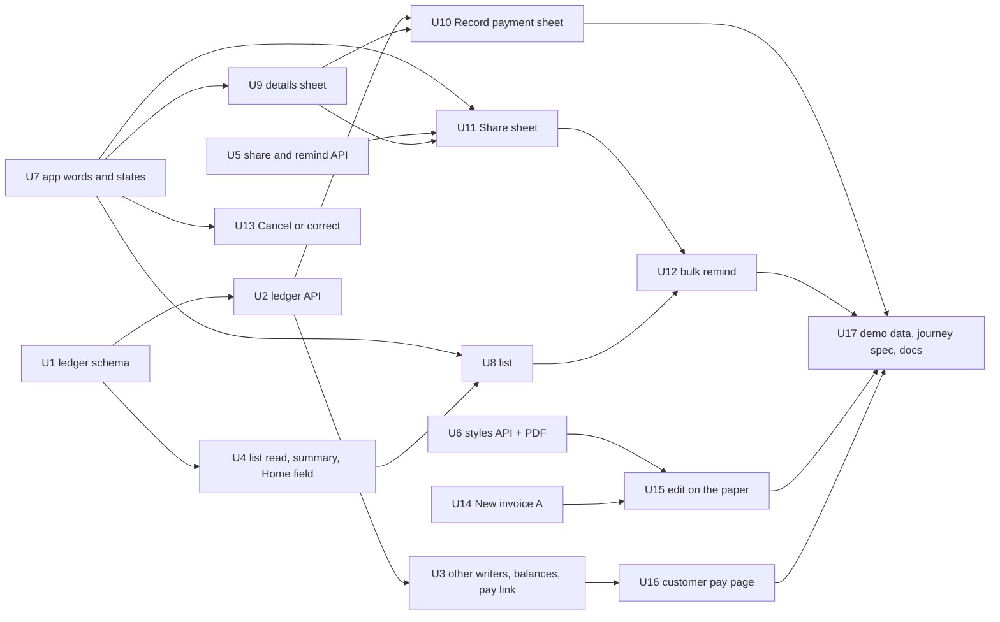

# Invoices rebuild

**Epic:** #1112 (one issue per unit: U1 #1113 … U17 #1129)

**Target:** `apps/app.saroh.in` (Payments › Invoices, routes `/billing/invoices/*`), `apps/api.saroh.in` (`modules/invoices`, `modules/payments`, `modules/home`), `apps/saroh.app` (the customer's pay page), `packages/database`, `packages/block-contract`.

These are the invoices a business sends its own customers. Saroh's own billing of businesses (`SarohInvoice`, Admin Billing) is not touched. Subscriptions are out of scope: the owner hasn't picked their variants yet.

---

## Problem frame

The Payments audit (19 Oct, 5.5/10) walked Invoices on Pulse (502 invoices, not GST-registered) and Rye & Co. (GST-registered, trade invoices by hand). What it found:

- **No search.** The list has no way to find one invoice among 502.
- **Money said three times.** The header's owed figure, a red overdue banner and the GST-rate notice stack on top of each other, and two different rupee figures sit there with no label.
- **The quick look offers no action.** It says "Send it, or mark it paid", but its only button is "Open invoice".
- **Five equal buttons.** The invoice page gives every action the same weight. Its banner says "Send it again" when there is no Send button.
- **One payment, in full.** Record payment takes only the whole amount, and the button is called "Mark paid" while the sheet it opens is called "Record a payment".
- **No cheques and no WhatsApp.** A business can't record a cheque, and can't send or remind on WhatsApp.
- **One customer at a time.** There is no way to remind many customers in one go.
- **The phone is cramped.** Rows are about 130 px tall, and the breadcrumb, title and button take up the top 200 px.

The owner's request: "do the invoice updates, with current functionality and the ones we decided". Every capability that exists today stays (`00-universal.md` §15). A redesign never removes or merges controls.

---

## Requirements

| ID  | Requirement (owner, 19–20 Oct; DEC-173)                                                                                                                                                                                                                                                                   |
| --- | --------------------------------------------------------------------------------------------------------------------------------------------------------------------------------------------------------------------------------------------------------------------------------------------------------- |
| R1  | **List (A+C):** search by name, number and amount; one money strip (Owed / Overdue / Paid this month, plus Drafts as drawn) whose figures are filters; the GST notice is one status line.                                                                                                       |
| R2  | **The list's side sheet:** a row opens the invoice's details in a side sheet, and the action is finished in that sheet. Nothing sends you to another page mid-task.                                                                                                                              |
| R3  | **Invoice details (A):** one main button per state, then Share, then More. More holds Cancel and every other action that exists today.                                                                                                                                                          |
| R4  | **New invoice (A)**, plus an "edit on the paper" mode with three styles (Classic, Band, Compact) in the business's colour with its logo. The Rule 46 GST fields are locked: a style never drops one.                                                                                            |
| R5  | **Share (A and B)** and sending in bulk by channel. Email goes through the merchant's own provider. WhatsApp is click-to-chat (`wa.me` with the message filled in; Saroh sends nothing). Copy link, PDF and print are there too. Automatic WhatsApp sending is later.                         |
| R6  | **Record payment (A)**, with the round-2 sheet. Part payments read "Partly paid ₹1,000 of ₹2,500". Money is counted in integer paise. Payments are a ledger, and the invoice's status is derived from it.                                                                                      |
| R7  | **Cheques** are recorded as received, with a bank status: "Mark as in the bank" or "Bounced". There is no bounce charge.                                                                                                                                                                        |
| R8  | **"Cheques not in the bank"** shows as one line, only while a cheque is waiting: under the money strip, and on Home. The API exposes it, the Home plan (DEC-171) draws it, and this plan names the field.                                                                                        |
| R9  | A payment recorded by mistake can be removed.                                                                                                                                                                                                                                                   |
| R10 | **Cancel or correct (A)** now. The credit note page (B: GST s.34, Rule 53, GSTR-1) is Phase 2, planned here and not built.                                                                                                                                                                      |
| R11 | The audit's quick-look findings: the real action in the sheet; a message said once; pages load inside their shell; phone rows 64–72 px; a compact phone top bar; "Record payment" as the one name; the copy rewrites.                                                                           |
| R12 | Every capability of today's list, quick look, page, form and dialogs is kept (inventory below).                                                                                                                                                                                                 |

---

## Scope

**Phase 1 (this plan, U1–U17):**

- the payment ledger, with part payments, cheques and removal
- the list's search, money strip and cheques line, and the Home field
- the details side sheet and page
- Record payment
- Share and bulk reminders by channel
- Cancel or correct (A)
- New invoice (A) and edit on the paper with the three styles
- the customer's pay page showing what has been paid and what is left
- demo data and a whole-journey spec

**Phase 2 (planned, not built, no issues filed now):**

- **Credit note page (INVCreditNote, INVCreditResearch).** Its own page with its own series (`RCCN/…`), Rule 53(1A) fields, "Take some off" (a credit note for part of an invoice, by line or amount), a block after the s.34(2) deadline (30 Nov after the financial year) with a reason given, and the GSTR-1 9B/CDNUR placement in exports.
- **What a credit note on a paid or partly paid invoice does:** refund the money, or keep it as credit. This is an owner decision still to come.
- **Advances:** keep an overpayment as credit towards the customer's next invoice.
- **Automatic WhatsApp sending** through the WhatsApp Business Platform. It needs per-business numbers, Meta-approved templates and paid messages.
- **Bulk SMS.** Needs DLT registration and a sender ID per business.
- **Custom invoice styles** beyond the three ("on the roadmap", as the board says).

**Not in this plan:**

- Subscriptions screens.
- Saroh's own billing.
- Order invoices' money. The order stays the ledger for its invoice (ADR-008), so order invoices get no ledger rows and no Record payment, as today.

---

## What the code already says (research, 20 Oct)

**API (`apps/api.saroh.in/src/modules/invoices/`)**

- **The `Invoice` model.** Money columns are `Decimal(12,2)`. `status` is a string: DRAFT, ISSUED, PAID, VOID or CREDITED. Overdue is derived (`isPastDue`, `invoice-state.ts`). `kind` is INVOICE, CREDIT_NOTE or SUPPLEMENTARY. The payment lives on the row itself (`paidAt`, `paymentMethod`, `paymentReference`, `paymentNote`). There is no amount paid, no ledger and no cheque anywhere. `PAYMENT_METHODS` = CASH, UPI, BANK_TRANSFER, CARD, OTHER; the webhook alone writes ONLINE.
- **Recording a payment today.** `POST :invoiceId/payments` takes `{ method, reference?, note?, paidAt? }`. It moves ISSUED to PAID with an `updateMany`, always for the full amount, and refuses an order's invoice. There is no way to undo it.
- **Cancelling.** `void` is for an issued invoice of a business that isn't registered. `credit` is a full credit note, on ISSUED or PAID, and ends in CREDITED. `reissue` voids and makes a new draft. Order and booking invoices are refused.
- **Sending.** `invoice-send.service.ts` sends by email only through the business's own provider (template `INVOICE_SENT` or `INVOICE_REMINDER`, with the PDF attached), or to the customer's account thread behind the ACCOUNT_THREAD flag. Every send mints a fresh link that replaces the old one (DEC-110). Reminders are one a day, read from the `Message` rows' template; a second one is a 429 with `retryAt`. A second send is a 409. Its own comment says "there is no WhatsApp share (default 106)".
- **The list.** `GET /` takes `view` (draft, issued, overdue, paid, void), `contactId`, `subscriptionId`, `paidSince`, `source`, `packId`, `courseId` and `orderId`. It has no `q`, no paging and a cap of 500, newest first (`list-filter.ts`). `GET /owed` is per contact or subscription only. There is no business-wide summary.
- **The PDF.** `invoice-pdf.ts` draws with pdfkit and Noto Sans, A4, never stored (DEC-083). Its colours are hard-coded constants. The logo is the live one (`invoice-pdf-logo.ts`). Its data comes from `invoice-paper-view.ts`, which mirrors the app's `invoice-paper.tsx`. There are no styles.
- **Rule 46 fields** are frozen at issue under the row lock (`documentColumns`, DEC-082). Edit and delete work on drafts only.
- **Home** is one `GET organizations/:id/home` (`home/home-model.ts`). `home-week.ts` already serves `owed` and `takings` over `OWED_WHERE`, and so do `home-money-sources.ts` and `customer-detail.service.ts`.
- **RLS.** `Invoice`, `InvoiceLine` and `InvoiceSequence` have the `org_isolation` policy (`20260922120000_subscriptions_invoices_classes`).
- **WhatsApp.** `whatsappLinkFromPhone` in `packages/block-contract/src/social-links.ts` builds `wa.me/<digits>` with no text.

**App (`apps/app.saroh.in`)**

- **Routes:** `app/(shell)/billing/invoices/{page, new, [invoiceId], [invoiceId]/edit}`, each with its own `loading.tsx` and `error.tsx`.
- **Components** are in `components/invoices/`:
  - screens and rows: `invoices-screen.tsx`, `invoice-row.tsx`, `invoice-quick-look.tsx`, `invoice-detail.tsx`
  - dialogs and sending: `invoice-actions.tsx` (issue, delete draft, `RecordPaymentDialog`, `CancelInvoiceDialog`) and `send-dialog.tsx`
  - the form and paper: `invoice-form.tsx` (922 lines, react-hook-form and zod) and `invoice-paper.tsx`
  - panels and notes: `connected-panel.tsx`, `pay-link.tsx`, `offline-pay-hint.tsx`, `unseen-link.tsx`, `source-filter.tsx`, `payments-locked.tsx`
- **`lib/invoices/`** holds `service.ts`, `actions.ts`, `status.ts`, `detail-actions.ts`, `send.ts`, `link-actions.ts`, `minted-links.ts`, `paper-title.ts` and the GST helpers.
- **Data** is read by server components. Writes go through server actions and then `router.refresh()`. There is no react-query.
- **Overlays** are `FormSheet`, `FormDialog`, `ConfirmDialog` and `QuickLook` (`components/shared/`).
- **Tests:**
  - e2e: `e2e/tests/invoices.spec.ts`, `invoices-without-payments.spec.ts`
  - vitest, next to each component: quick look, paper, form, source filter, unseen link, issue dialog
  - lib tests in `lib/invoices/*.test.ts`

### Capability inventory (all kept; R12)

| Today                                                                                                                                                         | Where it lives after the rebuild                                                                                                         |
| ------------------------------------------------------------------------------------------------------------------------------------------------------------- | ---------------------------------------------------------------------------------------------------------------------------------------- |
| Header count, "₹X owed to you · N overdue"                                                                                                                    | The money strip (Owed, Overdue), with labels (U8)                                                                                        |
| New invoice (write only)                                                                                                                                      | Header; the phone's compact top bar (U8)                                                                                                 |
| GST line (registered with its GSTIN, not registered, or the bill-of-supply note) and `MissingRatesNotice` with its sheet                                      | One status line: "GST tax invoices · GSTIN … · 2 plans need a GST rate", where the count opens the same rates sheet (U8)                 |
| Status tabs All / Due / Overdue / Paid / Drafts with counts (`?tab=`)                                                                                         | Kept, beside the strip; the strip's figures set the same filter (U8)                                                                    |
| "What it was for" source filter (`?source=`), the pack or course `ScopeNotice`, Clear                                                                         | Kept: "All sources" in the toolbar (U8)                                                                                                  |
| `SinceNotice` from Home (`?since=`)                                                                                                                           | Kept (U8)                                                                                                                                |
| Overdue banner "Show them"                                                                                                                                    | The strip's Overdue figure; the banner goes, since the message is said once (U8)                                                        |
| Corrections under their parent, local paging, "Showing the newest N", both empty states                                                                       | Kept; server search finds older invoices (U4, U8)                                                                                        |
| Quick look: overdue note, billed to (link, email, GSTIN), the "Cancels / Adds to" chip, source chip, "All of X's invoices", lines and tax with a retry, payment sentence, unseen-link note | The details sheet shows all of it, plus the actions (U9)                                                                                 |
| Copy pay link, Show link again, Make a new link, the link box with copy and QR                                                                                | Share (U11); "Make a new link" in More (U9)                                                                                              |
| Open invoice                                                                                                                                                  | The sheet's "Open full page" quiet link (U9)                                                                                             |
| Draft: Send with pay link or Send invoice, Issue it, Edit, Delete draft                                                                                      | Main: "Issue and share" (or "Issue it" when the business can't send); Edit beside it; More: Delete draft (U9)                           |
| Issued: Send…, Send reminder (one a day, off until the next one is allowed), Copy pay or view link, Mark paid, Print, Download PDF, Cancel invoice              | Main: Record payment. Share (WhatsApp, email send or remind, link, PDF, print). More: Cancel or correct, Make a new link (U9, U11, U13) |
| "Mark paid" shown off, with the reason, for a role without money                                                                                             | "Record payment" off, with the same reason (DEC-098) (U9)                                                                                |
| Paid: Print, Copy view link, Download PDF, Refund… (credit note) or Refund on the order                                                                       | Main: Share receipt; Share holds PDF, print and link; More holds Refund… (U9)                                                           |
| Payment panel: pay sentence, autopay hold, `OfflinePayHint`, when the next reminder can go, email refusal note                                                | The sheet's money card (one message) and Share (U9, U11)                                                                                 |
| `ConnectedPanel`, `HistoryPanel`, `PaymentsToRefund`, the read-only note, printing only the paper                                                            | Kept in the sheet and page; the history gains payment lines (U9)                                                                         |
| Business-details step before a pay link; GST-rate step before issuing                                                                                        | Kept, called from Share and from Issue (U9, U11, U14)                                                                                    |
| Cancel: credit note (registered or refund), Void, Void and write again, reason required, Keep invoice                                                         | Cancel or correct (A) (U13)                                                                                                              |
| Form: contact picker with `AddContactDialog`, lines (description, qty, price, GST rate, HSN), buyer GSTIN, state and address, due chips or the draft's date, running total, Issue (with pay link), Save the draft, leave guard, Cmd+Enter | New invoice (A) and edit on the paper (U14, U15)                                                                                         |

---

## Key technical decisions

1. **Payments become a ledger: one `InvoicePayment` row for each payment.** The invoice keeps its `status` column, and every write that changes the ledger recomputes the status in the same transaction, under the invoice's row lock (`settleFromLedger`):
   - **Live money** is the sum of payments that are not removed and not bounced. A cheque still waiting for the bank counts as received (R7).
   - **Paid in full:** when live money ≥ total, the status is PAID and `paidAt` is the last payment's date.
   - **Not paid in full:** the status is ISSUED.
   - **Partly paid** is derived, like Overdue: ISSUED with paid > 0. It is never stored as a status. So the 60-odd readers of `"PAID"` and `OWED_WHERE` keep their meaning, and nothing new appears in the status string.
2. **Integer paise in the ledger, by the owner's rule.** `InvoicePayment.amountCents` is an `Int`, as `PaymentIntent.amountCents` already is. `Invoice.paidCents Int @default(0)` is a cache, recomputed from the ledger in the same transaction and never written anywhere else. A db spec pins the cache against the ledger. Amounts still travel as Decimal strings on the wire (`toMoneyString`), and the invoice's own money columns stay `Decimal(12,2)`. DEC-173 records this as the ledger's exception to "never Int for currency".
3. **The ledger covers every invoice except an order's.** The order is the ledger for its invoice (ADR-008). Every other writer that marks an invoice paid writes one ledger row through a single helper, `recordLedgerPaymentInTx`, so no PAID invoice is left without one. Those writers are:
   - the hand-recorded payment
   - the online webhook (`ONLINE`)
   - a booking paid at the desk (`booking-desk-pay.ts`)
   - a mandate charge (`mandate-charge-outcome.ts`)
   - pack checkout
   - plan join

   A backfill writes one row for each PAID invoice that isn't an order's: the full total, with its stored method and date. It runs twice in the suite and changes nothing the second time.
4. **The legacy columns stay readable.** `Invoice.paymentMethod`, `paymentReference` and `paymentNote` keep being written with the last payment's values, so the 18 files that read them don't change in this plan. A later plan can move them to the ledger. Removing them is a two-deploy change and is not part of this one.
5. **Owed means what is left to pay.** Every owed sum over `OWED_WHERE` subtracts `paidCents`: the list strip, Home's owed, the customer's Owed, `GET /owed` and the subscription owed reads. One helper in `invoice-state.ts` (`leftToPayCents`) is the only place this is worked out.
6. **No overpayment for now.** An amount over what is left gets a 422 that names both figures. Advances are Phase 2.
7. **A cheque has a bank status.** The method is `CHEQUE`, with a cheque number and a bank. `bankStatus` is `WAITING`, then either `CLEARED` (with `clearedAt`) or `BOUNCED` (with `bouncedAt` and an optional reason). There is no bounce charge.
   - A bounced cheque leaves the live sum, so the invoice reads owed again, and overdue if its due date has passed.
   - "Cheques not in the bank" counts the WAITING cheques that are not removed.
8. **Removing a payment is a soft remove.** It sets `removedAt`, `removedById` and a reason, which is optional in the UI and "Recorded by mistake" by default. It is never a delete, and the history keeps the line.
   - The 10-second Undo after recording calls the same remove.
   - **Assumption:** a payment that came in online (`ONLINE`) can't be removed by hand. Its money goes back through a refund, as today.
9. **Shares are logged in `InvoiceShare`.** Each row records the channel (WHATSAPP, LINK, PDF, PRINT), the kind (NEW, REMINDER, RECEIPT), who shared it and when. It has its own RLS policy.
   - The one-reminder-a-day rule reads the email `Message` rows and the WhatsApp REMINDER shares together, so Tara's "Reminded today. Next one tomorrow" holds whichever way she was reminded.
   - Saroh can only know that WhatsApp was opened, never that the message was sent. The words say "shared on WhatsApp".
10. **WhatsApp is a link, not a sender.** `POST :invoiceId/share` mints the link the way a send does (DEC-110: the old link stops) and returns the message text. The app builds `https://wa.me/<digits>?text=…` with a new `whatsappChatLink(phone, text)` in `packages/block-contract/src/social-links.ts`, beside `whatsappLinkFromPhone`.
    - With no phone, the sheet offers Copy message and an empty number field.
    - The message words come from the API, so the app and the bulk flow say the same thing.
11. **One summary read for the strip.** `GET organizations/:id/invoices/summary` returns figures per currency:
    - `owed` (left to pay) and `overdue`, each with a count
    - `paidThisMonth`: ledger payments received this month in the business's time zone, plus order invoices paid this month, each rupee counted once
    - `drafts`
    - `chequesWaiting { count, totals[] }`

    Each figure carries the filter it applies, so the app never builds one.
12. **The Home field is `chequesWaiting`.** It sits on `GET organizations/:id/home` as `week.chequesWaiting: { count, totals[], href } | null`, built in a new `home/home-cheques.ts` source and typed in `home-model.ts`.
    - It is null when no cheque is waiting, or when the role lacks `payment:read` (DEC-098).
    - Its `href` is `/billing/invoices?view=cheques`.
    - This plan builds the field and its spec. Drawing the line on Home belongs to the Home plan's unit (`docs/plans/2026-10-19-002-feat-home-insights-plan.md`), so Home's screen is not touched here.
13. **Search runs on the server.** The list takes `q`, which matches:
    - the bill-to name or the contact's name, case-insensitively
    - the number, with a contains match
    - the amount, when `q` reads as money: the total or what is left, to the paisa (₹8,400, 8400 or 8,400.00)

    New views: `view=owed` (issued, including overdue) and `view=cheques`; plus `paidFrom` for "Paid this month". With search, the 500 cap no longer hides an older invoice.
14. **The row opens a side sheet; the page stays.** One `InvoiceDetailsView` draws both the sheet (from a row, 512 px wide, full screen on a phone, with Previous / Next inside the current filter) and the page `/billing/invoices/[id]` (deep links, Home, a customer's invoices). The sheet replaces the read-only `invoice-quick-look.tsx`. Every action opens its own sheet or dialog on top and comes back to the details. Nothing navigates away mid-task (frontend-forms: "Nobody is sent away from an overlay").
15. **Styles are frozen on issued paper.**
    - The business's default is `BusinessProfile.invoiceStyle` (CLASSIC, BAND or COMPACT; null means Classic) and `invoiceColour` (a hex from the business's brand; null means ink).
    - A draft can override both. Issuing freezes `Invoice.paperStyle` and `paperColour` through `documentColumns`, as DEC-082 requires. The logo stays the one live part.
    - All three styles keep every Rule 46 field. A shared field list, `RULE_46_FIELDS`, is asserted by the paper's test in the app and by the PDF's spec in the API.
    - Band's colour is checked for contrast. Text on the band goes ink or white, whichever passes 4.5:1, so a merchant's pale colour can't make the number unreadable.
16. **The customer's pay page shows the balance.** The public read adds `paidSoFar` and `leftToPay`. A payment intent is for what is left, worked out by the API from the ledger, never sent by the client. A partly paid invoice still has a working pay link.
17. **Words.** "Record payment" is the only name. The copy rewrites from FINDINGS are applied. Toasts, Undo and the hold follow `frontend-error-feedback.md`: "Sending in 10 seconds", then "Sent to {name}.". A recorded payment gets `showUndo`.

---

## High-level technical design

> This illustrates the intended approach and is directional guidance for review, not implementation specification. The implementing agent should treat it as context, not code to reproduce.

```mermaid
stateDiagram-v2
    [*] --> DRAFT
    DRAFT --> ISSUED: issue (number, Rule 46 frozen, style frozen)
    ISSUED --> ISSUED: part payment (paidCents > 0 → reads "Partly paid")
    ISSUED --> PAID: ledger live sum ≥ total
    PAID --> ISSUED: payment removed / cheque bounced (owed again; Overdue if past due)
    ISSUED --> CREDITED: cancel all (registered, nothing paid)
    ISSUED --> VOID: void (not registered, nothing paid)
    PAID --> CREDITED: Refund… (as today)
    VOID --> DRAFT: write again
```



Ledger write, every path (pseudo):

```
lock invoice FOR NO KEY UPDATE   (status, paidCents, paidAt, payment* are not key columns)
refuse: order invoice · DRAFT/VOID/CREDITED · amount > leftToPay · role lacks money permission
insert InvoicePayment (amountCents, method, receivedAt, cheque fields, bankStatus)
settleFromLedger(tx, invoice):
  live = Σ amountCents where removedAt null and bankStatus != BOUNCED
  paidCents = live; status = live ≥ totalCents ? PAID : ISSUED
  paidAt / paymentMethod / reference / note = last live payment's (legacy readers)
  clear pay token only when PAID (as today)
audit: invoice.payment.recorded | .removed | .cheque_cleared | .cheque_bounced
```

### Unit dependencies



---

## Implementation units

Every unit follows `docs/patterns/00-universal.md`, `frontend-forms.md` (FormSheet, FormDialog and ConfirmDialog only, with the Undo or confirm rule), `frontend-error-feedback.md`, `.agents/skills/saroh-four-scenes/SKILL.md` (320, 390 and 1440 px; light and dark), `.agents/skills/saroh-product-states/SKILL.md`, and `frontend-verification.md`.

- **API units:** `backend-nestjs.md`, `backend-data-and-money.md` and `backend-billing-and-classes.md`; migrations follow `.agents/skills/saroh-migrations/SKILL.md`.
- **Unit-level browser specs:** each new spec starts with `// @covers …`, owns its data (an invoice made through the API with a unique stamp), writes only to Northwind, and reads lists on Rye.
- **Db specs** run plain and under `TEST_RLS=on`.

### U1. Payment ledger: schema, RLS, backfill

**Issue:** #1113

**Goal:** the tables and columns that part payments, cheques and removal need, with every existing paid invoice given its ledger row.

**Requirements:** R6, R7, R9.

**Dependencies:** none.

**Files:**

- Modify: `packages/database/prisma/schema.prisma`:
  - new model `InvoicePayment`, with these columns:
    - `id`, `organizationId` and `invoiceId`
    - `amountCents Int`, `currency` and `method`
    - `reference`, `note` and `receivedAt`
    - `chequeNumber`, `chequeBank`, `bankStatus` (WAITING, CLEARED or BOUNCED; null for anything but a cheque), `clearedAt`, `bouncedAt` and `bounceReason`
    - `removedAt`, `removedById`, `removedReason`
    - `recordedById`, `paymentIntentId?` and `createdAt`
    - a composite key `(invoiceId, organizationId)` to the invoice, and indexes `[organizationId, receivedAt]` and `[organizationId, bankStatus]`
  - `Invoice.paidCents Int @default(0)` and `Invoice.payments InvoicePayment[]`
- Create: `packages/database/prisma/migrations/<ts>_invoice_payments_ledger/migration.sql`: the table, ENABLE and FORCE RLS, the `org_isolation` policy with the empty-string-safe predicate, and the column. Put `paidCents` in the `Invoice` CHECK `0 ≤ paidCents`. The cap `paidCents ≤ total × 100` is held in code, because a bounced or removed payment can't break it.
- Create: `packages/database/src/backfill/invoice-payments.ts`. For each PAID invoice that isn't an order's and has no ledger row, write one row: total × 100, the method from `paymentMethod` (ONLINE stays ONLINE; null becomes OTHER), `receivedAt` from `paidAt` or `issuedAt`, then `paidCents`. Also create `invoice-payments.cli.ts [--dry-run]`.
- Modify: `apps/api.saroh.in/src/modules/invoices/invoice-state.ts`. Add `CHEQUE` to `PAYMENT_METHODS`, plus `BANK_STATUSES` (as const), `leftToPayCents(invoice)` and `isPartlyPaid(invoice)`.
- Modify: the personal-data, merge and removal rule files:
  - `personal-data.ts`: the cheque bank, reference and note are "kept". These are invoice records under ADR-008, so the matching entry in `admin/retention-erase-plan.ts` is also "kept".
  - `merge-plan.ts` and `privacy-removal-plan.ts`: only if a relation to Contact is added. There isn't one: the ledger hangs off Invoice.
- Test:
  - `packages/database/src/rls-coverage.test.ts` (passes with the new policy)
  - `packages/database/src/backfill/invoice-payments.db.spec.ts`
  - `apps/api.saroh.in/src/modules/invoices/invoice-state.spec.ts`

**Approach:** the migration is additive only. The backfill is the TypeScript-script pattern (`catalogue-settings.ts`), exported for the suite, and it is also called from the showcase seed after the invoices are written. Seeds that write PAID invoices get their rows through the same function. `db:verify:replay` must pass.

**Test scenarios:**

- **Backfill:**
  - A PAID manual invoice of ₹8,400 by UPI gets one row: 840000, UPI, `receivedAt` = `paidAt`; `paidCents` = 840000.
  - A second run writes nothing.
  - An order's PAID invoice gets no row. A DRAFT, VOID or CREDITED invoice gets no row.
  - A PAID invoice with a null method gets OTHER.
- **State helpers:** `leftToPayCents` on total 2500.00 with paidCents 100000 → 150000. `isPartlyPaid` is false at 0 and at the full total.
- **RLS:** under `TEST_RLS=on`, business A's context can't read business B's `InvoicePayment`. The coverage test lists the table.

**Verification:** the migration replays and matches the schema; both db spec modes are green; the showcase check passes.

### U2. Ledger API: record part payments and cheques, remove, clear, bounce

**Issue:** #1114

**Goal:** the endpoints and one write path for the ledger, with the status derived from it.

**Requirements:** R6, R7, R9.

**Dependencies:** U1.

**Files:**

- Create:
  - `apps/api.saroh.in/src/modules/invoices/invoice-ledger.ts`: `recordLedgerPaymentInTx`, `settleFromLedger` and `lockInvoiceForLedger`
  - `invoice-payments.service.ts`: record, remove, cleared, bounced and list
  - `invoice-payments.dto.ts`
- Modify:
  - `invoices.controller.ts`. `POST :invoiceId/payments` gains `amount` (a Decimal string; default is what is left), `CHEQUE`, `chequeNumber`, `chequeBank` and `receivedAt`. New routes:
    - `DELETE :invoiceId/payments/:paymentId` (body `{ reason? }`)
    - `POST :invoiceId/payments/:paymentId/cleared` (`{ clearedAt }`)
    - `POST :invoiceId/payments/:paymentId/bounced` (`{ bouncedAt?, reason? }`)
  - `invoices.service.ts`: `recordPayment` delegates to the ledger
  - `serialize.ts`: the invoice read serves `paidSoFar`, `leftToPay`, `partlyPaid`, a `payments[]` list (each with `canRemove`, `bankStatus` and `removed`) and `chequeWaiting`
  - `dto.ts`
- Test:
  - `invoice-ledger.spec.ts` (pure settle rules)
  - `invoice-payments.db.spec.ts`
  - `invoices.db.spec.ts` (updated for the amount field)

**Approach:**

- **Lock and money.** Lock the invoice row FOR NO KEY UPDATE, since none of the writes touch a key column. Amounts are parsed with `toCents`. The overpay refusal is a 422 with `details: { leftToPay }`.
- **What is refused:** an order invoice, a non-ISSUED invoice for a record (PAID can't take more), a removed payment, an ONLINE payment's remove, clear or bounce on a non-cheque, and clear or bounce on a removed or already settled cheque.
- **Permission:** the same check `recordPayment` makes today, the money permission under DEC-098, for every route.
- **Audit:** each write writes an audit event, which the history panel reads.
- **Repeats:** a repeat of the same record (same amount, method and reference within ten minutes) answers as it did, the desk-take rule, so a double tap can't record twice.
- **Docs:** add a "Payments on an invoice are a ledger" section to `docs/patterns/backend-billing-and-classes.md` and amend the "States" bullet.

**Test scenarios:**

- **Recording:**
  - ₹1,000 cash on a ₹2,500 invoice → ISSUED, paidCents 100000, `partlyPaid` true, `leftToPay` "1500.00".
  - Then ₹1,500 UPI → PAID, `paidAt` = the second payment's date, `paymentMethod` UPI.
  - Omitted amount → records what is left.
  - ₹9,000 on ₹8,400 left → 422 with `leftToPay` "8400.00", and nothing is written.
  - 0 or a negative amount → 400. A 3-decimal amount → 400.
- **Cheques:**
  - A ₹8,400 cheque → PAID, `bankStatus` WAITING, `chequeWaiting` true.
  - Cleared → CLEARED, still PAID.
  - Bounced → the payment leaves the live sum, the status is ISSUED and it reads Overdue when past due. Bouncing again → 409.
- **Removing:**
  - Removing the only payment → ISSUED, paidCents 0. The line stays, with `removed`.
  - Removing an ONLINE payment → 409 "Refund it instead".
- **Refusals and repeats:**
  - An order invoice → 409, as today. A VOID or DRAFT invoice → 409.
  - The same record twice within ten minutes → one row.
  - A role without the money permission → 403, for record, remove, clear and bounce alike.
- **Concurrency:** two concurrent part payments that together exceed the total → one succeeds and the other gets the 422, serialised by the row lock.
- **Both modes:** every db scenario passes plain and under `TEST_RLS=on`.

**Verification:** specs green in both modes. The pattern doc is updated.

### U3. Every other path that pays an invoice writes the ledger; owed sums use what is left; the pay link pays the balance

**Issue:** #1115

**Goal:** no invoice is paid outside the ledger, and every figure of money owed is what is left to pay.

**Requirements:** R6, R8 (the figures behind it), R11.

**Dependencies:** U2.

**Files:**

- Modify the writers:
  - `apps/api.saroh.in/src/modules/webhooks/webhooks.service.ts` (an online success on an invoice → `recordLedgerPaymentInTx` ONLINE for the intent's amount, linked by `paymentIntentId`)
  - `bookings/booking-desk-pay.ts`
  - `payments/mandate-charge-outcome.ts`
  - `class-packs/pack-checkout.ts`
  - `subscriptions/plan-join.ts`
- Modify the owed and pay-link reads:
  - `invoices/invoice-state.ts`
  - `home/home-week.ts`, `home/home-money-sources.ts`
  - `customer-workspace/customer-detail.service.ts`, `customer-workspace/spent.sql.ts` (spent stays money in; it is unchanged unless it reads `total` for PAID only)
  - `invoices/invoices.service.ts` (`owed`)
  - `payments/public-invoices.service.ts` (the public read adds `paidSoFar` and `leftToPay`; the intent amount is what is left)
  - `invoices/pay-online.ts`
- Test:
  - `payments/public-invoices.service.db.spec.ts`
  - `home/home.week.db.spec.ts`
  - `invoices/owed-balance.db.spec.ts` (new)
  - `payments/invoice-pay-link*.db.spec.ts`
  - `webhooks` invoice specs

**Approach:**

- **Online money:** an online payment on a partly paid invoice records the intent's amount. Success that would overpay, because the invoice was settled by hand while the payment was in flight, keeps today's `CAPTURED_NEEDS_REFUND` route.
- **Status changes:** none of these writers change status any more except through `settleFromLedger`.
- **Owed sums:** replace `total` with `total − paidCents` wherever money is owed (one SQL expression, `leftToPaySql`, beside `OWED_WHERE`).
- **Allow-list:** the public read is an allow-list, so the two new fields go into it by name.
- **Docs:** update "Paying an invoice from a link" (the amount is what is left) in the billing pattern.

**Test scenarios:**

- **Desk and online writers:**
  - A booking paid at the desk → one ledger row, CASH, the invoice PAID. The booking's `paidAtDeskCents` is unchanged.
  - A webhook success on an ISSUED invoice → one ONLINE row and PAID.
  - A webhook on an invoice with ₹1,000 already paid by hand → the intent for ₹1,500 records ₹1,500 → PAID.
  - A webhook arriving after a hand payment settled it → `CAPTURED_NEEDS_REFUND`, with no second row.
- **Pay link and public read:**
  - The pay-link intent on a ₹2,500 invoice with ₹1,000 paid → `amountCents` 150000.
  - The public read shows `paidSoFar` "1000.00" and `leftToPay` "1500.00", and nothing else is new.
- **Owed sums:**
  - Home owed with one ₹2,500 invoice partly paid ₹1,000 → owed ₹1,500.
  - The customer's Owed and `GET /owed` → ₹1,500.
  - Order invoices are still excluded (`OWED_WHERE`).
- **Other writers:** a mandate charge success and pack checkout each write one ledger row.
- **Both modes:** all scenarios plain and under `TEST_RLS=on`.

**Verification:** specs green. No writer outside `invoice-ledger.ts` sets `status: "PAID"` on a non-order invoice. Grep this and add a lint or spec guard: `invoice-ledger.guard.spec.ts` reads the sources.

### U4. List read: search, owed and cheques views, summary, and Home's `chequesWaiting`

**Issue:** #1116

**Goal:** the API behind the money strip, search and the cheques line, and the field the Home plan draws.

**Requirements:** R1, R8.

**Dependencies:** U1. It reads `paidCents` and the ledger; U2 and U3 make the figures live, but the read can land first.

**Files:**

- Modify:
  - `apps/api.saroh.in/src/modules/invoices/list-filter.ts` (`q`, `view=owed|cheques`, `paidFrom`)
  - `dto.ts` (`ListInvoicesQueryDto`)
  - `invoices.controller.ts` (`GET summary`, declared before `:invoiceId`)
  - `home/home-model.ts` (`week.chequesWaiting`)
  - `home/home-week.ts` (calls the new source)
- Create:
  - `invoices/invoice-summary.service.ts`
  - `invoices/money-query.ts`: parses "₹8,400", "8400" and "8,400.00" to cents; anything else is not an amount
  - `home/home-cheques.ts`
- Test:
  - `list-filter.spec.ts`, `list-filter.db.spec.ts`
  - `money-query.spec.ts`
  - `invoice-summary.db.spec.ts`
  - `home/home.cheques.db.spec.ts`

**Approach:**

- **Search:** `q` is trimmed and at most 80 characters. A name match uses `contains` with `mode: insensitive` on `billToName` and the contact's name. A number match is `contains` on `number`. An amount match is an equality on `total` or on what is left. These are ORed together.
- **Summary:** money is summed per currency, in paise, from the same where-clauses the views use. Each figure carries its `filter` (`{ view: "owed" }`, `{ view: "paid", paidFrom: "2026-10-01" }`), and the month starts in the business's time zone.
- **Access:**
  - `invoice:read` reads the list and its counts.
  - Amounts need `payment:read`; without it, the strip is counts only (DEC-098).
  - Home's field follows the same rule: null without `payment:read`.

**Test scenarios:**

- **Search:**
  - "vivek" finds Vivek Nair's invoices. "0106" finds RC/26-27/0106.
  - "8400" and "₹8,400" find the ₹8,400 invoice, and also a ₹10,000 invoice with ₹8,400 left.
  - "8,40" is not treated as an amount and matches nothing by number.
  - Search finds an invoice older than the newest 500.
- **Views:**
  - `view=owed` lists ISSUED invoices, overdue ones included, never PAID or DRAFT.
  - `view=cheques` lists only invoices with a waiting cheque.
- **Summary:**
  - With 2 waiting cheques (₹8,400 and ₹5,600) → `chequesWaiting` `{ count: 2, totals: [{ INR, "14000.00" }] }`.
  - A bounced or cleared cheque isn't counted. A removed one isn't either.
  - Paid this month counts ledger payments received from the 1st in IST (a payment at 00:30 IST on the 1st counts), plus order invoices paid this month, each once.
  - Overdue uses `isPastDue`.
- **Home:**
  - `chequesWaiting` is null with no waiting cheques, and null for a role without `payment:read`.
  - Its `href` is `/billing/invoices?view=cheques`.
- **Both modes:** all scenarios plain and under `TEST_RLS=on` (the summary under RLS sees only its own business).

**Verification:** specs green. The plan's named field exists in `home-model.ts`, ready for the Home plan's unit.

### U5. Share and remind API: WhatsApp message, share log, bulk reminders, receipts

**Issue:** #1117

**Goal:** everything Share and the bulk flow need from the API.

**Requirements:** R5.

**Dependencies:** none for the table and routes. U2 is needed only for the receipt kind's figures, so take the receipt last.

**Files:**

- Modify `packages/database/prisma/schema.prisma`: new model `InvoiceShare` (`organizationId`, `invoiceId`, `channel`, `kind`, `byUserId`, `createdAt`; index `[invoiceId, createdAt]`), with its own migration and RLS policy.
- Create:
  - `apps/api.saroh.in/src/modules/invoices/invoice-share.service.ts`
  - `invoice-share-words.ts`: the message per kind (NEW, REMINDER, RECEIPT), in the business's voice, matching the INVShareA and INVBulkSend boards
  - `invoice-reminders.service.ts` (bulk)
- Modify:
  - `invoice-send.service.ts`: the one-a-day rule also reads WhatsApp REMINDER shares; it exposes `channelsFor(invoice)` (email possible? why not; phone?)
  - `invoices.controller.ts`. New routes:
    - `POST :invoiceId/share` (`{ channel: WHATSAPP|LINK|PDF|PRINT, kind }`) → `{ url, text, phone }`, logged
    - `POST reminders/preview` (`{ invoiceIds }`) → per invoice `{ way: EMAIL|WHATSAPP|WAIT|NONE, reason, retryAt?, email?, phone? }`
    - `POST reminders` (`{ invoiceIds }`) → sends the EMAIL ones, each as `remind` does, and returns a result per invoice
  - Communications: add a receipt template `INVOICE_PAYMENT_RECEIVED` (amount, method, paid so far and left to pay; PDF attached), sent only through the business's own provider (DEC-086/091), and an `email` kind on `POST :invoiceId/share` for RECEIPT.
- Modify `packages/block-contract/src/social-links.ts`: add `whatsappChatLink(phone, text)`, which returns null for a number that can't be dialled.
- Test:
  - `invoice-share.db.spec.ts`
  - `invoice-reminders.db.spec.ts`
  - `invoice-share-words.spec.ts`
  - `packages/block-contract/src/social-links.test.ts`

**Approach:**

- **Locks and links:** sharing takes the invoice's lock, like a send. LINK and WHATSAPP mint a link as `send` does: a pay link when `invoicePayOnline` allows, otherwise a view link, and the old one stops (DEC-110). PDF and PRINT mint nothing and are only logged.
- **Channel order for bulk:** email when it's possible (a provider is connected, there is an address and the customer hasn't turned email off), otherwise WhatsApp when there is a phone, otherwise NONE with a reason. A customer reminded today is WAIT, with `retryAt`.
- **Caps:** bulk is at most 100 invoices per call. It refuses drafts, paid invoices and order invoices with a reason each, never a failure for the lot.
- **Who can:** the same check as `remind` today (`invoice:write`).

**Test scenarios:**

- **Share:**
  - Sharing on WhatsApp returns text like "Hi Vivek, this is Rye & Co. Your invoice RC/26-27/0106 for ₹8,400 was due on 7 Oct. You can see it and pay here: <link> Thank you.", with the URL on the business's own domain. The previous link's token stops working, and one `InvoiceShare` row is written.
  - A WhatsApp REMINDER today, then an email remind → 429 with `retryAt`.
  - A partly paid invoice's reminder says "₹1,500 left of ₹2,500".
- **Bulk preview:** 6 picked → 3 EMAIL, 2 WHATSAPP (one has no email, one turned email off), 1 WAIT (reminded today).
- **Bulk send:**
  - Sends 3 emails, and each invoice has its reminder `Message`.
  - Invoice ids from another business → refused, never sent (RLS on too).
  - No email provider → every row is WHATSAPP or NONE, and nothing is sent from Saroh's address.
- **Receipt:** the receipt email goes only with a connected provider. Without one, the share returns only the WhatsApp text.
- **`whatsappChatLink`:** "+91 98450 11234" with "Hi Vivek" gives `https://wa.me/919845011234?text=Hi%20Vivek`, and "abc" gives null.

**Verification:** specs green in both modes. The `invoice-send.service.ts` comment about there being no WhatsApp is replaced.

### U6. Invoice styles in the API and the PDF: Classic, Band, Compact, colour, logo

**Issue:** #1118

**Goal:** the three styles saved, frozen at issue and drawn by the PDF, keeping every Rule 46 field.

**Requirements:** R4.

**Dependencies:** none.

**Files:**

- Modify `packages/database/prisma/schema.prisma`: `BusinessProfile.invoiceStyle String?`, `BusinessProfile.invoiceColour String?`, and `Invoice.paperStyle String?` and `Invoice.paperColour String?`, with a migration. This is a separate migration from U1, with a later timestamp, merged after it.
- Modify:
  - `invoices/invoices.service.ts` (the draft DTO accepts `paperStyle` and `paperColour`; issuing freezes them through `documentColumns`)
  - `serialize.ts`
  - `invoice-paper-view.ts` (style, colour and the band text tone)
  - `invoice-pdf.ts` (three layouts)
  - the business tax-settings write (`business-tax-settings.ts`), for the defaults: Owner or Admin only, as tax settings are
- Create:
  - `invoices/paper-styles.ts`: `PAPER_STYLES`, `RULE_46_FIELDS` and `bandTextTone(hex)`, using the contrast rule shared with the app's mirror
  - `packages/block-contract/src/invoice-paper.ts` if a shared constant is the cleaner home for `RULE_46_FIELDS`; decide when building
- Test:
  - `paper-styles.spec.ts`
  - `invoice-pdf.spec.ts` (each style draws every Rule 46 field)
  - `invoice-pdf.db.spec.ts` (frozen style on issued paper; a draft uses today's default)

**Approach:**

- **Defaults:** null means Classic in ink, so every existing invoice reads as it does today and needs no backfill.
- **Validation:** a colour is validated as `#RRGGBB`.
- **Band:** the band's text tone is worked out, never typed.
- **Compact:** smaller row height and two-column parties, for long trade orders, still on A4.
- **Logo:** stays the live logo, per DEC-082.

**Test scenarios:**

- Each of Classic, Band and Compact on a registered invoice draws the seller's GSTIN, the number, the date, the buyer's GSTIN, place of supply, HSN, the taxable value, the rate and the CGST/SGST or IGST split, and the signature line.
- Band with `#F5E6A8` (pale) → ink text. Band with `#1F3A5F` → white text.
- The business default changes after issue → the issued PDF keeps its frozen style and colour.
- An invalid colour gets a 400. A non-owner can't change the defaults (403).
- An unregistered business's receipt in Band shows no GST anywhere.

**Verification:** specs green. Render the three PDFs locally and check them by eye (attach them to the PR).

### U7. App: the words, the states and the action rules the new screens share

**Issue:** #1119

**Goal:** one place for what each state says and offers, so the sheet, the page, the list and the phone agree.

**Requirements:** R3, R11.

**Dependencies:** none. U2's fields are optional here, so reads tolerate their absence.

**Files:**

- Modify:
  - `apps/app.saroh.in/lib/invoices/status.ts` ("Partly paid", "Paid · cheque not in the bank", "₹8,400 unpaid · 13 days late", the when line)
  - `lib/invoices/detail-actions.ts` (rewritten as `actionsFor(invoice, can)` → `{ main, share[], more[] }`, keeping every action in the inventory)
  - `lib/invoices/service.ts` (types: `payments[]`, `paidSoFar`, `leftToPay`, `chequeWaiting`)
- Create: `lib/invoices/words.ts`, which holds the copy rewrites:
  - "Record payment"
  - "Not paid yet. When the money comes in, record it."
  - "Overdue ₹2,79,268 · 77"
  - "1 day late. Share it on WhatsApp or call Vinay."
- Test:
  - `lib/invoices/detail-actions.test.ts` (rewritten)
  - `lib/invoices/status.test.ts`
  - `lib/invoices/words.test.ts`

**Approach:** the main action per state comes from INVPageA, INVPageA2 and INVRecordPlus:

| State                         | Main                                         | Beside                         | More                                                                |
| ----------------------------- | -------------------------------------------- | ------------------------------ | ------------------------------------------------------------------- |
| Draft                         | Issue and share (or Issue it)                | Edit                           | Delete draft                                                        |
| Due or Overdue                | Record payment                               | Share on WhatsApp (or Send by email when there's no phone), Share | Cancel or correct, Make a new link, Print, Download PDF |
| Partly paid                   | Record the rest                              | Share                          | the same                                                            |
| Paid, cheque waiting          | Mark as in the bank                          | Bounced, Share                 | Refund…, Remove payment                                             |
| Paid                          | Share receipt                                | Download PDF                   | Refund… or Refund on the order, Copy view link, Print               |
| Void, Credited or credit note | Download PDF                                 | Share                          | Write again (void)                                                  |

Copy-check scripts (`check:copy`, `check:words`) must pass.

**Test scenarios:**

- Each row of the table above, for an Owner. For a role without money, the main button is Record payment, off, with the DEC-098 reason.
- An order's invoice never offers Record payment ("Refund on the order", as today).
- With autopay in progress, Share's send items are off, with the reason.
- An inventory test lists every action in today's `detail-actions.ts` and asserts each appears in some state's main, share or more list (§15 guard).

**Verification:** the vitest tests are green, and so are `check:copy` and `check:words`.

### U8. The list: money strip, search, one GST line, cheques line, phone rows

**Issue:** #1120

**Goal:** INVListAC and INVListACPhone, built.

**Requirements:** R1, R8 (the list's line), R11, R12.

**Dependencies:** U4, U7. Rows open the U9 sheet once it lands; until then they open today's quick look.

**Files:**

- Modify:
  - `apps/app.saroh.in/components/invoices/invoices-screen.tsx` (split into parts as it grows past 400 lines)
  - `invoice-row.tsx`
  - `app/(shell)/billing/invoices/page.tsx` (reads the summary and passes `q`, `view` and `paidFrom`)
  - `loading.tsx` (the page's own shape inside the shell)
- Create:
  - `components/invoices/money-strip.tsx`
  - `invoice-search.tsx` (debounced, in the URL as `?q=`, `/` focuses it on the desk)
  - `gst-status-line.tsx` (the GST line and the missing-rates count as one line, opening the existing `gst-rates-sheet.tsx`)
  - `cheques-line.tsx`
  - `phone-top-bar.tsx`, or reuse the shell's compact bar if one exists (search first)
- Modify `lib/invoices/service.ts` (`readInvoiceSummary`).
- Test:
  - `components/invoices/money-strip.test.tsx`, `gst-status-line.test.tsx`
  - `e2e/tests/invoices-list.spec.ts`, which starts `// @covers accounts:/login app:/open app:/billing/invoices api:invoices`

**Approach:**

- **The strip** has four figures. Each figure is a link setting the filter, with `aria-pressed` on the active one. The status tabs and "All sources" stay.
- **The overdue banner** is removed, because the strip says it.
- **"Remind all N"** shows on the Overdue filter and opens U12's flow. Until U12 lands, it isn't drawn.
- **Each row** has a Remind button on Overdue, which opens U11's share sheet on the reminder message.
- **Phone:** rows are cards at 64–72 px (name, number, status, amount). The top bar is the title, the count and a New icon button with a label for screen readers, with no breadcrumb. Search sits under the bar, and the strip scrolls sideways in `ScrollX`.
- **Kept:** `SinceNotice`, `ScopeNotice`, corrections nested under their invoice, paging, "Showing the newest N", and both empty states.

**Test scenarios:**

- **Desk, Rye, read only:**
  - The strip shows Owed, Overdue, Paid in October and Drafts with labels.
  - Clicking Overdue lists only overdue invoices and marks the figure pressed.
  - Searching "0106" shows one row.
  - The GST line reads as one line, and its "N need a GST rate" opens the rates sheet.
- **Cheques line:** an invoice with a waiting cheque (own data, Northwind) → the line "Cheques not in the bank · 1 · ₹…" shows, filters to that invoice, and is gone after Mark as in the bank.
- **Phone 390:**
  - Rows are between 64 and 72 px tall (measured).
  - There's no breadcrumb, and `expectNothingHiddenSideways` passes.
  - The 320 px floor has no overflow.
- **States:**
  - Empty business → "No invoices yet" with New invoice.
  - A failed summary read → the list still loads, and the strip says "Couldn't load totals" with Try again, never ₹0.
- **No money permission:** counts with no amounts.

**Verification:** specs green on desk and phone. Check by hand at 320, 390 and 1440 px, light and dark.

### U9. Invoice details: one view for the side sheet and the page

**Issue:** #1121

**Goal:** INVPageA, INVPageA2 and the right side of INVListAC. A row opens the details in a side sheet where every action finishes. The page shows the same view.

**Requirements:** R2, R3, R11, R12.

**Dependencies:** U7.

**Files:**

- Create:
  - `apps/app.saroh.in/components/invoices/details/invoice-details-view.tsx`
  - `details/money-card.tsx` (one message per state: "₹8,400 to collect · 13 days late · due 7 Oct", or "Paid ₹4,000 of ₹8,400 · cash on 12 Oct", or the cheque card)
  - `details/action-bar.tsx` (main, Share, More)
  - `details/invoice-details-sheet.tsx` (Previous and Next inside the current filter, "Open full page")
  - `details/history.tsx` (`HistoryPanel` plus payment lines, each with Remove this payment for a live one)
- Modify:
  - `invoice-detail.tsx` (the page renders the view)
  - `invoices-screen.tsx` (a row opens the sheet; `?invoice=<id>` keeps it open on reload)
  - `app/(shell)/billing/invoices/[invoiceId]/loading.tsx` (skeleton in the page's shape, inside the shell)
- Retire: `invoice-quick-look.tsx`. Its `ShownLink`, `LineRow` and `TaxRows` move to `details/`. Its test is moved, not dropped.
- Test:
  - `components/invoices/details/invoice-details-view.test.tsx`
  - `e2e/tests/invoices-details.spec.ts` (`// @covers app:/billing/invoices app:/billing/invoices/[invoiceId] api:invoices`)

**Approach:**

- **The frame:** the sheet is `QuickLook`'s frame widened to 512 px, a non-form overlay already on the short list in `overlay-frames.test.ts`. Add the sheet there with its reason. On a phone it is full screen, and its action bar sits at the bottom within thumb reach.
- **Actions inside the sheet:**
  - Record payment (U10), Share (U11) and Cancel or correct (U13) open over the sheet. After a write the sheet refreshes in place, and the row's status updates.
  - Issue, the GST-rate step, the business-details step, Delete draft (`ConfirmDialog`), Make a new link (`NewLinkConfirm`) and Refund… are the existing flows, mounted here.
- **Kept on the view:** `ConnectedPanel`, `PaymentsToRefund`, the autopay hold, `OfflinePayHint`, the next-reminder time, the email refusal note ("No email provider yet, so Saroh can't email it." with Connect email) and the read-only note.
- **Print:** prints only the paper, as today.
- **Removing a payment:** "Remove this payment" opens a `FormDialog` with one optional "Why" field. It is reversible by recording again, so there is no confirm; it shows Undo.

**Test scenarios:**

- **Opening the sheet:**
  - Desk: clicking an overdue row opens the sheet with the paper, "₹… to collect", Record payment and Share on WhatsApp. Escape returns focus to the row.
  - Next overdue moves to the next row's invoice without closing.
  - A deep link to `/billing/invoices/<id>` renders the same view as a page, inside the shell (loading skeleton included).
- **Draft:** shows "Issue and share", Edit and More › Delete draft. Deleting asks the one confirm and, on success, the row is gone.
- **Paid:** Share receipt and Download PDF are visible, and More holds Refund….
- **Removing a payment:** removing one (own data) → the money card returns to "to collect" and the history shows the removed line struck through, with the reason.
- **Phone 390:** the sheet is full screen with the action bar at the bottom, nothing hidden sideways, and 44 px targets.
- **States:** a failed details read → "Couldn't load this invoice. Nothing has changed." with Try again, inside the sheet. A role without `invoice:read` never sees a row (layout gate).

**Verification:** specs green on desk and phone. The capability inventory is checked off by hand against the running stack, and the result is listed in the PR.

### U10. Record payment: amounts, part payments, cheques, Undo, receipt

**Issue:** #1122

**Goal:** INVRecordPlus and INVRecordPlusPhone.

**Requirements:** R6, R7, R9, R11.

**Dependencies:** U2, U7. It is mounted by U9; on its own it can be opened from today's detail page.

**Files:**

- Create:
  - `apps/app.saroh.in/components/invoices/record-payment-sheet.tsx`
  - `components/invoices/cheque-dialogs.tsx` ("Cheque 004512 is in the bank" with the date it cleared; "Cheque 004512 bounced?" with Why and "Tell Vivek on WhatsApp after")
- Modify:
  - `invoice-actions.tsx` (`RecordPaymentDialog` is replaced and its export removed, with callers moved)
  - `lib/invoices/actions.ts` (`recordPayment` with `amount`, `removePayment`, `chequeCleared`, `chequeBounced`)
- Test:
  - `components/invoices/record-payment-sheet.test.tsx`
  - `e2e/tests/invoices-record-payment.spec.ts` (`// @covers app:/billing/invoices app:/billing/invoices/[invoiceId] api:invoices`)

**Approach:**

- **The sheet** is a `FormSheet` titled "Record payment", with the sub-line "RC/26-27/0106 · Vivek Nair · ₹8,400 left of ₹8,400". Its fields:
  - **Amount:** a choice strip of "All ₹8,400" or "Another amount", with `MoneyInput` and the line "₹4,400 stays to pay. The invoice reads 'Partly paid'."
  - **How:** Cash, UPI, Card, Bank transfer, Cheque or Other, as a choice strip with UPI first, as today.
  - **Reference:** labelled by method ("UPI reference", "optional, helps when matching your bank").
  - **Cheque only:** cheque number and bank.
  - **Received on:** Today, Yesterday or Pick.
  - **Note:** "only you see this".
  - **Share a receipt:** "On WhatsApp after, or email if connected".
- **The button** reads "Record ₹4,000".
- **Overpaying** says so when Record is pressed. The 422's line is "₹9,000 is ₹600 more than what's left (₹8,400). Record ₹8,400." The advance wording is left out, since advances are Phase 2.
- **After recording:** `showUndo("₹4,000 recorded on RC/26-27/0106. ₹4,400 left.")`. Undo calls remove. If a receipt was asked for, WhatsApp opens through U11's share call after the Undo window, or the email receipt is sent with `useHold().send`.
- **Cheque dialogs:** both are `FormDialog`s. Bounced is not reversible by Undo in the API, so it is the one confirm, worded as on the board: "Keep the payment", then "Mark as bounced".

**Test scenarios:**

- **Part payment:** ₹4,000 cash on ₹8,400 → the toast with Undo; the details read "Partly paid · ₹4,400 left to pay"; the list row says "Partly paid".
- **Undo:** within 10 s → back to "₹8,400 to collect", and the history shows nothing live.
- **Cheque:**
  - Cheque 004512, HDFC Bank, ₹8,400 → "Paid · cheque not in the bank", and the cheques line appears.
  - Mark as in the bank → "Paid", and the line is gone.
  - Bounced (another invoice) → "₹8,400 is owed again", Overdue, and the history reads "Cheque 004512 bounced · ₹8,400 owed again".
- **Overpay:** ₹9,000 → the message, the sheet stays open with what was typed, and nothing is written.
- **Phone 390:** the sheet is full screen with the button on top of the stacked foot, the amount field opens the decimal pad (`inputmode`), and targets are 44 px.
- **Keyboard:** Cmd+Enter records. Escape drops the draft.

**Verification:** specs green on desk and phone. The vitest test covers the amount words and the cheque fields showing only for Cheque.

### U11. Share: one invoice, by WhatsApp, email, link, PDF or print

**Issue:** #1123

**Goal:** INVShareA (with INVChannels' rules) for one invoice.

**Requirements:** R5, R12.

**Dependencies:** U5, U7.

**Files:**

- Create: `apps/app.saroh.in/components/invoices/share-sheet.tsx`.
- Modify:
  - `send-dialog.tsx` (email send and remind are kept, and called from the Email tab)
  - `lib/invoices/actions.ts` (`shareInvoice`)
  - `lib/invoices/link-actions.ts`
- Test:
  - `components/invoices/share-sheet.test.tsx`
  - `e2e/tests/invoices-share.spec.ts` (`// @covers app:/billing/invoices api:invoices`)

**Approach:**

- **The sheet** is a `FormSheet` titled "Share RC/26-27/0106", with the line "Vivek Nair · ₹8,400 · 13 days late".
- **Tabs:**
  - **WhatsApp:** the message choice New invoice / Reminder / Thank you, paid (defaulting to the state's), the preview, the "To" number (editable when missing), Copy message and Open WhatsApp.
  - **Email:** the existing send or remind, held 10 s with Undo. With no provider it says "Saroh sends invoices from your own email. Until you connect it, share them on WhatsApp or as a link." with Connect email.
  - **Link:** the existing link box with copy and QR, the unseen-link note and Make a new link.
  - **PDF:** Download and Print.
- **WhatsApp links:** Open WhatsApp calls `shareInvoice`, which logs the share and mints the link, then opens `whatsappChatLink(...)` in a new tab. A copy is acknowledged by its button, not a toast.
- **Business details:** the business-details step runs before any link is minted, as today.

**Test scenarios:**

- **WhatsApp:**
  - Reminder → the preview names the amount and due date, and Open WhatsApp has an `href` starting `https://wa.me/91` with the text encoded. The test stubs `window.open` and checks the URL.
  - With no phone, Open WhatsApp stays on with a reason, until a number is typed.
- **Link:** copy link → the button says "Copied". The old link (own data) stops working.
- **Email:** with no provider → the one message and Connect email. Send reminder twice in a day → the second is off, with "The next can go after …".
- **Phone 390:** the tabs fit without sideways scroll (tablist allowed).

**Verification:** specs green on desk and phone.

### U12. Remind many, by channel

**Issue:** #1124

**Goal:** INVBulkSend, the three steps, with INVShareB's one-glance summary as step 2's head.

**Requirements:** R5.

**Dependencies:** U5, U8, U11.

**Files:**

- Create: `apps/app.saroh.in/components/invoices/bulk-remind-sheet.tsx`, splitting `bulk-remind-steps.tsx` out if it passes 400 lines.
- Modify: `invoices-screen.tsx` ("Remind all N" on the Overdue filter, and a selection mode on desk rows, which reuses the list's bulk-bar pattern from the catalogue screen; search first).
- Test:
  - `components/invoices/bulk-remind-sheet.test.tsx`
  - `e2e/tests/invoices-bulk-remind.spec.ts` (`// @covers app:/billing/invoices api:invoices`), tagged `@serial` only if it must change a business-wide setting (it shouldn't)

**Approach:** one `FormSheet` with three steps.

1. **Pick who.** Every overdue invoice is ticked, with "7 overdue shown. Ticked: 6 · ₹13,440."
2. **How each one goes.** The preview groups "Email, sent for you" (from the merchant's own address), "WhatsApp, one tap each" and "Can't reach now" (with the reason and the date). The button reads "Send 3 emails, then WhatsApp 2".
3. **Send.** The emails go with `useHold().send` (10 s, Undo). Then the sheet walks the WhatsApp ones one at a time: "Open WhatsApp for Vivek", then "Skip Vivek", with the message preview. It ends on "Reminders done" with the tally, and each invoice reads "Reminded today", saying how.

Leaving midway keeps what was sent. Each email is logged on its own invoice.

**Test scenarios:**

- **Full run** on own invoices (Northwind; one with email, one phone-only, one reminded today):
  - Step 2 groups them 1/1/1.
  - Send → after the hold, 1 email is sent, then WhatsApp opens for the phone-only one (stubbed `window.open`).
  - Done shows "1 emailed · 1 shared on WhatsApp · 1 waits until tomorrow".
- **Undo:** inside the hold → nothing is sent, and the sheet reopens at step 2.
- **No email provider:** step 2 has no email group, and the button reads "WhatsApp 2".
- **Phone 390:** the steps are full screen, with the button at the bottom.

**Verification:** specs green on desk and phone.

### U13. Cancel or correct (variant A)

**Issue:** #1125

**Goal:** INVCancelA and INVCancelAPhone, replacing `CancelInvoiceDialog` and keeping its every path.

**Requirements:** R10, R12.

**Dependencies:** U7.

**Files:**

- Create: `apps/app.saroh.in/components/invoices/cancel-or-correct-sheet.tsx`.
- Modify: `invoice-actions.tsx` (remove `CancelInvoiceDialog`, and move its callers).
- Test:
  - `components/invoices/cancel-or-correct-sheet.test.tsx`
  - `e2e/tests/invoices-cancel.spec.ts` (`// @covers app:/billing/invoices app:/billing/invoices/[invoiceId] api:invoices`)

**Approach:** a `FormSheet` titled "Cancel or correct RC/26-27/0106", with the line "₹8,400 · Vivek Nair · not paid". The choices:

- **GST-registered:**
  - "Cancel all of it": a credit note for the full amount (existing `POST :id/credit`).
  - "Cancel and write a correct one": the credit note, then a new draft with the same lines. This is a new composition in the app: `credit`, then `createDraft` from the original's lines. Or add `POST :id/credit?rewrite=1` to the API in this unit if one transaction is needed. Prefer the API route, so a failure can't leave a credit note with no draft.
- **Not registered:**
  - "Void it"
  - "Void and write again" (existing `reissue`)
- **Reason:** required, as today ("Wrong amount, wrong person, returned…", printed on the credit note).
- **Preview:** "Credit note · RCCN/26-27/0002 −₹8,400".
- **Foot:** "Keep invoice" on the left and quiet, then one destructive main button: "Issue credit note ₹8,400" or "Void invoice". This fixes audit finding 9.
- **Not here:** "Take some off" is not offered (Phase 2, with the credit note page). The sheet's line says "To take part off, a credit note page is coming." only if the owner wants it said. **Assumption:** not shown.
- **Partly paid invoices:** cancel is refused with "Remove its payments first. Credit notes for money already paid are coming." (Assumption A3).
- **Paid invoices:** keep "Refund…" exactly as today.

**Test scenarios:**

- Registered, unpaid (own Northwind invoice, GST on) → Cancel all of it, with a reason → the status is Cancelled and the credit note sits under it in the list.
- Cancel and write a correct one → the credit note is issued and the new draft opens, with the same lines.
- Not registered (own invoice) → Void, and Void and write again, both work.
- A partly paid invoice → the sheet explains, and the main button is off with the reason.
- A missing reason → said when the button is pressed, with the focus on Why.
- Phone 390: full screen, with "Keep invoice" stacked under the main button.

**Verification:** specs green on desk and phone. Every path of the old dialog is exercised once.

### U14. New invoice (variant A)

**Issue:** #1126

**Goal:** INVNewA and INVNewAPhone: the form with a live preview of the paper, keeping every field of today's form.

**Requirements:** R4, R12.

**Dependencies:** none. It uses today's API.

**Files:**

- Modify `apps/app.saroh.in/components/invoices/invoice-form.tsx`, splitting along its seams into:
  - `new-invoice/customer-block.tsx`
  - `new-invoice/lines-table.tsx`
  - `new-invoice/product-pick.tsx`
  - `new-invoice/due-strip.tsx`
  - `new-invoice/paper-preview.tsx`
  - `new-invoice/use-invoice-draft.ts`
- Modify:
  - `app/(shell)/billing/invoices/new/page.tsx`
  - `[invoiceId]/edit/page.tsx`
  - `loading.tsx` (a form-shaped skeleton inside the shell)
- Test:
  - `components/invoices/invoice-form.test.tsx` and `invoice-form.enter.test.tsx` (kept, updated)
  - `e2e/tests/invoices.spec.ts` (updated for the new labels)

**Approach:**

- **Layout:** the left column is the customer (picker, plus Change, AddContactDialog, the buyer's GSTIN, state and address, and "GSTIN … · Karnataka: CGST + SGST"), the lines, and Due (On receipt / 7 / 14 / 30 days, or the draft's own date). The right column is "How it will look", the paper at reduced size.
- **Saving:** the draft saves as you type, using the editor's autosave once a draft exists (`frontend-forms.md`, published-record autosave). The button row is "Save draft" and "Issue and share" ("Issue it" when the business can't send). The line under it reads: "Saved as you type. Issuing gives it the next number, RC/26-27/0145, and locks the lines."
- **Products:** "+ Pick from your products" searches the catalogue (the existing products search read, through `lib/products/service.ts`) and fills the description, price, GST and HSN.
- **Before issuing:** the GST-rate step is unchanged.
- **Phone:** one column, the preview behind a "See it" toggle, and the main button at the bottom.

**Test scenarios:**

- Write one by hand (the existing spec's journey) → issue → the list shows it.
- Pick a product → the line is filled with its price, GST rate and HSN.
- Due 14 days → the preview reads "Due 2 Nov" (fixed clock).
- A line with no GST rate on a registered business → Issue asks for the rate in place (existing step).
- Leaving with typed work → the one leave guard. Cmd+Enter → issues.
- Phone 390: no overflow, and targets are 44 px.

**Verification:** specs green. Every field in the inventory row for the form is present.

### U15. Edit on the paper, with the three styles

**Issue:** #1127

**Goal:** INVNewEdit and INVNewEditPhone: the same draft, edited by clicking the paper, with the style panel.

**Requirements:** R4.

**Dependencies:** U6, U14.

**Files:**

- Create:
  - `apps/app.saroh.in/components/invoices/paper-editor/paper-editor.tsx`
  - `paper-editor/part-popover.tsx` (one editor per part: billed to, line, due, notes)
  - `paper-editor/style-panel.tsx` (Classic "Plain and printable", Band "Your colour across the top", Compact "Fits long trade orders"; Your colour; Logo with Change)
  - `paper-editor/see-as-customer.tsx`
- Modify:
  - `invoice-paper.tsx` (draws the three styles and the colour, with the band tone mirrored from U6, and marks the locked Rule 46 parts in edit mode: "Required", "Set from the customer", "Next in series")
  - `new/page.tsx` (a mode switch, "Form" / "On the paper", kept in `?mode=`)
- Test:
  - `components/invoices/paper-editor/paper-editor.test.tsx`
  - `invoice-paper.test.tsx` (each style renders every `RULE_46_FIELDS` entry)
  - `e2e/tests/invoices-paper-editor.spec.ts` (`// @covers app:/billing/invoices/new api:invoices`)

**Approach:**

- **Editing:** clicking a part opens its popover (a `FormDialog`-sized editor anchored to the part on the desk; a bottom sheet on a phone). Rule 46 parts can be edited where the source allows (billed to, place of supply following the customer) but never removed. The seller block and the number are read-only, with a line saying where they come from ("Next in series"; Settings › Business).
- **Style and colour:** the style and colour are saved on the draft. "Make this my default" sets the business default, for Owner and Admin only. "Custom styles: on the roadmap" is said as on the board.
- **Logo:** Change opens the existing business-logo upload (presigned PUT). It never stores a copy.
- **See it as Vivek will:** the paper exactly as the PDF and the pay page draw it.

**Test scenarios:**

- Clicking the Butter croissant line → change quantity to 24 → the totals and tax update. Clicking "Add a line", typing "focac" and picking Focaccia → a line with its price and GST.
- Band with the business colour → the band uses it. Switching to Compact → the layout changes, and every Rule 46 field is still present (vitest).
- The GSTIN, number and "Tax invoice under section 31" parts can't be removed, and each is labelled with its source.
- Switching between Form and On the paper keeps the draft.
- Phone 390: tapping a part opens a bottom sheet, with no overflow.

**Verification:** specs green. The issued invoice's PDF matches the chosen style (check by hand; attach a screenshot).

### U16. The customer's pay page: paid so far, left to pay, receipts

**Issue:** #1128

**Goal:** what Vivek sees (INVRecordPlus "What Vivek sees" and the cheque receipt) on `saroh.app/pay/<token>`.

**Requirements:** R6, R7.

**Dependencies:** U3.

**Files:**

- Modify:
  - `apps/saroh.app/app/pay/[token]/page.tsx` and its components (search under `apps/saroh.app` and `packages/site-blocks` for the pay page parts)
  - `lib` types for the public read
- Test:
  - the pay page's component test
  - `e2e/tests/pay-on-site.spec.ts` (updated: part paid, then the rest paid online)

**Approach:**

- **Partly paid:** the page shows "₹4,000 received", the method and date, and the rows Invoice total / Paid so far / Left to pay. "Pay ₹4,400" shows only when `payOnline` is true.
- **Waiting cheque:** "Cheque for ₹8,400 received · Cheque 004512 · HDFC Bank · 19 Oct 2026. This invoice is settled once the cheque clears. If it's returned by the bank, the amount is due again."
- **Tokens:** `--site-*` tokens only. Merchant sites never take Saroh's brand.
- **Older API:** an older API without the new fields reads as before.

**Test scenarios:**

- A part-paid invoice (own data) → the page shows paid so far and left to pay, and paying online charges ₹4,400 (test provider) → the invoice is PAID with two ledger rows.
- A waiting cheque → the cheque words show, and there is no Pay button.
- A view-only business (Payments off) → no Pay button, with "Print or save as PDF", as today.

**Verification:** specs green on desk and phone. Checked on a seeded site in the merchant palette and on the neutral defaults.

### U17. Demo data, the whole journey, and the docs

**Issue:** #1129

**Goal:** Rye and Pulse show every new state for films and owner review, one journey spec covers the lot, and the patterns say what was built.

**Requirements:** R1–R11 (demo and docs).

**Dependencies:** U10, U12, U15, U16.

**Files:**

- Modify:
  - `packages/database/src/seed/showcase/bakery.ts` (Rye): one partly paid invoice, two waiting cheques (₹8,400 and ₹5,600), one bounced cheque in the history, and a default style of Band in Rye's colour
  - `packages/database/src/seed/showcase/billing.ts` (Pulse): part payments on two renewals
  - `packages/database/src/seed/showcase/check.ts` (sums over the ledger: `paidCents` equals the live ledger sum on every invoice)
- Create: `e2e/tests/invoices-journey.spec.ts`, starting `// @covers accounts:/login app:/open app:/billing/invoices app:/billing/invoices/new app:/billing/invoices/[invoiceId] site:/pay/[token] api:invoices api:payments`.
- Docs:
  - `docs/patterns/backend-billing-and-classes.md` (ledger, cheques, share log, styles)
  - `docs/patterns/frontend-forms.md` (the details sheet as the list's overlay, if it becomes a pattern)
  - `docs/architecture/DECISIONS.md` (DEC-173's "Rules" line filled in)
  - `docs/architecture/DEV_LEARNINGS.md` (anything the units hit)

**Approach:** the Rye data is read only in specs. Its demo stores are film sets: keep them resettable and never written to by browser checks.

**Journey (Northwind, own data):** new invoice on the paper in Band → issue and share on WhatsApp (stubbed) → record ₹1,000 cash → the list strip's Owed drops by ₹1,000 → record the rest by cheque → the cheques line appears → mark it in the bank → Paid → share the receipt.

**Test scenarios:**

- The journey above, desk and phone.
- The showcase check fails if any invoice's `paidCents` differs from its live ledger sum.

**Verification:** `pnpm prepush --all` green. Owner review screenshots of the 10 states (desk and phone) are attached to the epic.

---

## Waves (at most 5 agents at once)

| Wave | Units                                                                                                 | Why together                                                                                                              |
| ---- | ----------------------------------------------------------------------------------------------------- | ------------------------------------------------------------------------------------------------------------------------- |
| 1    | U1 ledger schema (#1113) · U6 styles API and PDF (#1118) · U7 app words and states (#1119) · U13 Cancel or correct (#1125) · U14 New invoice A (#1126) | No dependencies. U1 and U6 each add a migration: U1 merges first and U6 rebases its timestamp after it.                 |
| 2    | U2 ledger API (#1114) · U4 list read and summary (#1116) · U5 share API (#1117) · U9 details sheet (#1121) · U15 edit on the paper (#1127)    | U2 and U4 need U1. U5 has its own migration (merged after U1 and U6). U9 needs U7. U15 needs U6 and U14.                |
| 3    | U3 other writers and balances (#1115) · U8 list (#1120) · U10 Record payment (#1122) · U11 Share sheet (#1123)                       | Need U2, U4, U5, U7 and U9.                                                                                               |
| 4    | U12 bulk remind (#1124) · U16 pay page (#1128) · U17 demo data and journey (#1129)                                            | Need U8, U11 and U3. U17 waits for U10, U12, U15 and U16, so it runs last in the wave.                                   |

The units land on the day's local `batch-<date>-<n>` branch, squashed in, with one push per batch (`devops-tooling-and-deploy.md`). Wave 1's three API and schema units must be on the batch before wave 2 starts. No agent binds e2e ports while `prepush --all` runs.

---

## System-wide impact

- **Money figures.** The owed sums change from the total to what is left to pay, on Home, customer detail, subscriptions owed and `GET /owed`. Partly paid invoices are the only ones whose figures move. Before U3, none exist.
- **Webhooks and desk pay.** These are hot paths. Writing the ledger joins their transactions under the invoice lock they already take, so the lock order is unchanged: order, intent, invoice, and the ledger rows last.
- **Public pay page.** The public read gains two allow-listed fields. A payment intent's amount is now what is left.
- **Home.** `week.chequesWaiting` is new and nullable, so the Home plan's unit draws it. Today's Home renders nothing for it.
- **Exports.** "Download your data" files: the ledger is a new table, so add an `invoice-payments.csv` with a README line if the export lists invoice tables (check `data-export`). Otherwise defer it and record a Gap.
- **Permissions.** No new action. Recording, removing, clearing and bouncing use the existing money check (DEC-098). The permission suite (`e2e/permissions/`) gets the Record payment off-state for a Member.

---

## Risks

| Risk                                                                          | Mitigation                                                                                                                         |
| ----------------------------------------------------------------------------- | ---------------------------------------------------------------------------------------------------------------------------------- |
| A writer sets PAID outside the ledger and `paidCents` drifts                  | One helper; the guard spec in U3 that reads the sources; the showcase check in U17                                                |
| An owed sum misses the balance and counts a partly paid invoice in full       | One SQL expression beside `OWED_WHERE`; a db spec per reader (U3)                                                                  |
| A pay link charges the full total after a part payment                        | The intent amount comes from the ledger in the API (U3), with a spec                                                               |
| WhatsApp: Saroh can't know a message went                                     | The words say "shared" or "opened", never "sent"; the log names the channel                                                        |
| The details sheet drops a control the page had                                | The capability inventory, U7's inventory test and the hand check in U9                                                             |
| Band colour unreadable                                                        | The text tone is worked out for contrast, in the API and the app                                                                   |
| Three migrations in two waves                                                 | Merge order U1 → U6 → U5, each rebased on the last; `db:verify:replay` on the batch                                               |

---

## Assumptions

These are inferred bets, made without asking. Each is recorded in DEC-173 and open for the owner to overturn.

- **A1.** An overpayment is blocked for now (the owner's default). Advances are Phase 2.
- **A2.** The three styles, the business colour and the logo are in (the owner's default). Styles are frozen on issued paper, and the logo stays live (DEC-082).
- **A3.**
  - A credit note on a paid invoice is a later decision, refund or credit (the owner's default). Until then, today's "Refund…" on a PAID invoice stays as it is.
  - Cancel on a **partly paid** invoice is refused with "Remove its payments first", because a credit note for money already paid is that later decision.
- **A4.** Corrections after 30 Nov are not touched (the owner's default). Today's full credit note keeps working as it does, and the s.34(2) block comes with Phase 2's credit note page.
- **A5.** "Take some off" (a credit note for part of an invoice) is Phase 2, with the credit note page. Cancel or correct (A) now offers Cancel all of it and Cancel and write a correct one, or, for an unregistered business, Void and Void and write again.
- **A6.** Partly paid is derived, as Overdue is, and never stored as a status. A waiting cheque counts as received, so the invoice reads "Paid · cheque not in the bank".
- **A7.** The ledger stores integer paise (`amountCents Int`), following the owner's rule and `PaymentIntent`. The invoice's own Decimal columns stay. This is the ledger's documented exception to "never Int for currency".
- **A8.** An online payment can't be removed by hand; it is refunded instead.
- **A9.** Share variant A is the one-invoice sheet. Variant B's one-glance summary is the head of step 2 in the three-step bulk flow (INVBulkSend), so both are built as one flow.
- **A10.** A WhatsApp reminder counts towards one reminder a day, the same as an email.
- **A11.** "Paid this month" is money received this calendar month in the business's time zone, from the ledger plus order invoices paid that month.
- **A12.** The money strip shows Drafts as a fourth figure, as drawn on INVListAC, beside the three the owner named.
- **A13.** Without `payment:read`, the strip shows counts only, and the Home field is null.
- **A14.** The detail page stays for deep links, and draws the same view as the sheet.

---

## Open questions for the owner (not blocking)

- Should "Take some off" appear in Cancel or correct as "coming", or stay hidden until Phase 2? The plan hides it.
- Should the receipt email go automatically when a payment is recorded and email is connected, or only when ticked? The plan only sends it when ticked.
