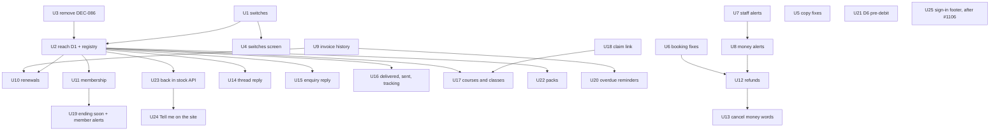

# Automatic notices

**Epic:** #1131 (one issue per unit: U1 #1132 … U25 #1156)

**Target:**

- `apps/api.saroh.in`: `site-accounts` (customer notices), `notifications` (team alerts), `communications`, `bookings`, `orders`, `payments`, `webhooks`, `subscriptions`, `class-packs`, `courses`, `invoices`, `enquiry`, `stock`, `staff`
- `apps/app.saroh.in`: Settings › Providers, Settings › Your profile, the kitchen, the courier panel, the stock quick look, an invoice's history
- `apps/saroh.app`: a sold-out product's "Tell me", the waitlist offer's claim page
- `packages/database`: four migrations (U1, U6, U9, U23)

These are messages from a business to its own customers, and from Saroh to the business's own team. Saroh's own billing emails to businesses are not touched.

---

## Problem frame

The audit walked every place a customer or a team member should hear about something. What it found:

- **Most customers hear nothing.** Booking and order emails go only to customers with a live site account (`site-accounts/notice-reach.ts:107-120`), even when the business has its own email provider connected. A customer booked at the desk, on the phone or as a guest gets no email at all.
- **Money moves silently.**
    - A renewal invoice is made and never sent.
    - A failed autopay charge tells nobody but the team.
    - A refund is never announced.
    - A cancel notice doesn't say what happened to the money.
    - The team isn't told when an order payment fails, when the money captured doesn't match, or when a refund fails.
- **Memberships change silently.** Joining, pausing, resuming, changing plan and cancelling are all silent. So is a member cancelling autopay at their bank.
- **The person doing the work isn't told.** The staff member a booking is with gets no alert of their own.
- **Ten messages say something untrue** (listed under U5 and the units that own them), and the waitlist offer names a hold time with no way to claim it.
- **Bugs:**
    - a booking still awaiting payment gets "has moved";
    - a lapsed unpaid hold reads as the customer cancelling;
    - an online pack purchase writes no "sold" row;
    - the rule-request bell is shown to every member and never cleared;
    - tracking added after hand-over is never sent.
- **Invoices have no history** of who issued, sent, reminded, voided or credited them.

The owner decided D1–D10 on 20 Oct 2026 (DEC-174). This plan builds them, the fixes that need no decision, and one investigation (D6).

---

## Requirements

| ID  | Requirement (owner, 20 Oct 2026; DEC-174)                                                                                                                                                                                                                                                                                     |
| --- | ----------------------------------------------------------------------------------------------------------------------------------------------------------------------------------------------------------------------------------------------------------------------------------------------------------------------------- |
| R1  | **D1.** Booking and order notices go to the contact's own email through the business's own provider when one is connected, not only to live site-account holders. Consent is still checked.                                                                                                                                   |
| R2  | **Every new default-on notice has a switch the business can turn off,** kept with the existing alert and notice preferences, and starting on.                                                                                                                                                                                 |
| R3  | **Renewals:** the renewal invoice is sent automatically (hand-made invoices keep their Send button). A failed autopay charge tells the customer, with the payment link.                                                                                                                                                       |
| R4  | **Membership emails** (one switch): joined, paused, resumed, plan changed, cancelled, ending in 7 days. Team alerts when a member cancels or pauses themselves, or cancels autopay at their bank.                                                                                                                             |
| R5  | **Refunds:** an online refund is told automatically; a cash refund at the counter sends nothing by default. Cancel notices say whether the money was refunded, kept, or the credit returned. The team is alerted when a refund fails or an automatic refund is refused. Booking refunds are written to the booking's history. |
| R6  | **Staff and replies:** the person a booking is with gets their own alerts for new, moved and cancelled bookings, bell and email by default. A team reply in the customer's Messages thread is emailed to the customer through the provider.                                                                                   |
| R7  | **D3, overdue reminders:** opt-in. At most 2 automatic reminders per invoice, 3 and 10 days after the due date, inside the one-a-day rule.                                                                                                                                                                                    |
| R8  | **Enquiry auto-reply** ("we got your message") through the provider, on by default where a provider is connected.                                                                                                                                                                                                             |
| R9  | **Delivered and Sent** notices for shipped and digital orders. Collected stays off.                                                                                                                                                                                                                                           |
| R10 | **Pack credits:** a receipt when bought online, a note at 1 credit left, a note 7 days before expiry.                                                                                                                                                                                                                         |
| R11 | **Back-in-stock "Tell me":** a customer opts in on a sold-out product and is emailed once when it is back. Largest unit, last.                                                                                                                                                                                                |
| R12 | **Invoice payment receipts are DEC-173's** (invoices U5, #1117). Depend on them, never duplicate them.                                                                                                                                                                                                                        |
| R13 | **Fixes:** the 10 untrue messages and the waitlist offer's claim link; the five bugs above; invoice history; team alerts for money events; course enrolment and cancel notices, class-cancelled wording, the waitlist told when its class is cancelled.                                                                       |
| R14 | **The dead DEC-086 path** is removed, or a check fails if it is ever on. The plan picks one and says why.                                                                                                                                                                                                                     |
| R15 | **The sign-in code email's footer** is updated once data-removal emails exist (#1106).                                                                                                                                                                                                                                        |
| R16 | **D6, investigate only:** confirm in Razorpay test mode whether Razorpay sends the RBI pre-debit notice 24 hours before each debit for card and eMandate. If not, say what Saroh must send; card autopay stays off until then. Needs the owner's CA.                                                                          |
| R17 | **Rules:** customer notices go only through the business's own provider (DEC-086 reversal); Saroh's own email sends only what DEC-011 and its amendments allow; WhatsApp only after #1058, click-to-chat until then; every event is noted on the record's history; delayed jobs with a hold where an Undo exists.             |

---

## Scope

**In this plan (U1–U25):** everything in R1–R17.

**Not in this plan (already planned elsewhere):**

- #1057 booking reminders to customers
- #1058 automatic WhatsApp messages (and #179 for the hand-off)
- the invoices rebuild #1112, units #1113–#1129, including receipts (#1117), cheques (#1116) and the bulk reminder (#1124)
- #1105 "Cheques not in the bank" on Home (a bounced cheque's team alert stays with the cheques work)
- #1106 and #1107 data removal
- #1044 pause until a date
- #1078 low stock on Home
- #174, #967, #954, #1045, #1085, #1123 as listed in the audit

### Deferred to follow-up work

- **An invoice the customer holds is cancelled:** telling the customer (audit gap 12). The history in U9 records it; the email is a later unit.
- **The waitlist offer expiring:** telling the customer it lapsed (audit gap 14). U18 adds only the claim link.
- **Treatment visits cancelled with their order** (`bookings/treatment-cancel.ts:66`) stay silent.
- **The deposit confirmation saying the balance due.**
- **Enquiry team emails are fire-and-forget** (`common/email.ts:406`, `void transporter.sendMail`), never retried, and quote the customer. This needs a change to every `send*` in `common/email.ts`, so it gets its own issue.
- **A per-contact "no emails about X" choice** on the customer's side. Consent stays per channel.

---

## What the code already says (research, 20 Oct)

All API paths are under `apps/api.saroh.in/src/modules/`.

**Customer notices**

- **Reach.** `site-accounts/notice-reach.ts`:
    - `noticeChannels` (82-105) and `reachOf` (108-117) return `EMAIL_AND_ACCOUNT | EMAIL | ACCOUNT | ON_SIGN_IN | NONE`.
    - Email reaches only a contact with an `ACTIVE` `CustomerAccount` (`hasLiveAccount`, 120-129).
    - `contactReach` (137-161) follows merges and reads `Consent` (EMAIL `REVOKED` means no email).
- **The job.** `site-accounts/customer-notify.handler.ts` (`customer.notify`):
    1. decides the `emailRoute` once;
    2. claims a `CustomerNotice` on `(organizationId, eventKey)` with `createMany({ skipDuplicates })`;
    3. re-reads the subject (`loadSubject`, 233-253: booking, order, waitlist entry);
    4. posts to the thread when it is live;
    5. emails with `comms.queueTransactional` and recipient `{ kind: "SITE_ACCOUNT" }`.
- **Producers.** `site-accounts/customer-notify-queue.ts`:
    - `enqueueCustomerNotice(tx, org, payload, runAt?)`;
    - `enqueueOrderStepNotice` (held 10 s, `ORDER_NOTICE_DELAY_MS`);
    - `cancelOrderStepNotice` (deletes the PENDING job by `payload.eventKey`).
- **Templates.**
    - `communications/transactional.ts`: `NOTICE_TEMPLATES` (25-35) are BOOKING_CONFIRMED / MOVED / CANCELLED, ORDER_PLACED / READY / HANDED_OVER and WAITLIST_OFFER, beside `INVOICE_TEMPLATES`, `AUTOPAY_TEMPLATES` and `REVIEW_TEMPLATES`.
    - `site-accounts/notify-templates.ts`: `noticeSentence`, `renderNotice`, `noticeSubject` and `backLink` (261-273, a link only for ORDER_PLACED, BOOKING_CONFIRMED and BOOKING_MOVED).
- **The provider.** `communications/communications.service.ts` `queueTransactional` (846-973):
    - refuses with no address, or with no route (409);
    - writes a `SUPPRESSED` `Message` on revoked consent;
    - otherwise writes `Message` + `Delivery` + a `message.send` job.

**Settings today**

- **The business:** one switch, `BusinessProfile.accountUpdates` ("Updates in Messages", `communications/account-updates.ts`, `account-thread.ts` `accountThreadOn`). The route is `customer-notices/account-updates`. The app draws it in `components/providers/account-updates-row.tsx` on `app/(shell)/settings/(sections)/providers/page.tsx`.
- **Each person:** `NotificationPreference` (`organizationId, userId, event, channel, enabled`; a row only when it differs from the default). The rows are in `notifications/alert-preferences.ts`: `ALERT_EVENTS` is order, booking, failed, team and site; `defaultOn` turns the bell on for all and email on for failed and site. The app draws them in `components/settings/alerts-grid.tsx` (in `your-profile.tsx`) and `lib/notifications/preferences.ts`.
- There are no per-kind customer-notice switches.

**Team alerts**

- `notifications/team-alerts.ts` `enqueueTeamAlert(tx, org, payload, runAt?)` and `team-alert.handler.ts` `tellTeam`:
    - a `CustomerNotice` claim `TEAM_TOLD`;
    - one business-wide `Notification`, or a personal one when `userId` is set (`20261204120000_notification_for_one_person`);
    - email from Saroh after commit (`sendTeamAlertEmail`), in fixed words.
- The payload union is `order | failed | team | booking | uncollected | provider | review | domain | site | ask`.
- The "failed" wording (533-538) says "They can try again from the same link".

**Jobs**

- Outbox `Job` rows with `runAt` for a delay. An Undo deletes the PENDING job by `eventKey`.
- Handlers are registered in `onModuleInit`. `jobs/job-consumers.spec.ts` pins every producer to a handler.
- Recurring work is a self-rescheduling chain (`subscription.renew`, `billing/renewal-reminder.ts` is the closest "days before" sweep).

**History**

- `BookingEvent.type` is a string (BOOKED, RESCHEDULED, CANCELLED, ATTENDED, NO_SHOW, PAID_AT_DESK), with no data column.
- `OrderEvent` (STAGE, UNDO, STATUS, EDIT, REFUND).
- `SubscriptionEvent` (`recordSubscriptionEvent`), `PackEvent` (`recordPackEvent`).
- **Invoices have none.** `AuditEvent` has `invoice.payment.*` rows, but its `actorUserId` is required, so it can't hold a job's action.

**DEC-086 code (reversed 7 Oct, flag never on)**

- The flag `SAROH_BUSINESS_EMAIL` (`feature-flags/flags.ts:120,269`) and the env `SAROH_BUSINESS_EMAIL_FROM`, `_CONFIG_SET`, `_STOP` and `_DAILY_CEILING` (`env.ts:94-119`, `.env.example`, `docs/architecture/ENVIRONMENT.md`).
- `communications/`: `saroh-may-send.ts` (`emailRoute` is also the live provider check), `saroh-queue.ts`, `saroh-send.ts`, `saroh-delivery.ts` (also used by `billing/metering.ts`), `saroh-email-state.ts`, and `providers/saroh-email.sender.ts`.
- `site-accounts/saroh-notice.ts`.
- In the app: `lib/providers/booking-emails.ts` and its block.
- Seeds and the catalogue: `packages/database/src/seed/saroh-email.ts`, and `packages/pricing-catalog` `sarohEmailsPerMonth`.
- About ten specs, and `e2e/tests/providers-saroh-email.spec.ts`.

**Where each gap lives**

| Area       | Where                                                                                                                                                                                                                                                                                                                                                                                                                                                                                   |
| ---------- | --------------------------------------------------------------------------------------------------------------------------------------------------------------------------------------------------------------------------------------------------------------------------------------------------------------------------------------------------------------------------------------------------------------------------------------------------------------------------------------- |
| Renewals   | `subscriptions/subscriptions.service.ts` `renewOne` (1854-1996), `invoicePeriod` (2339) and `renewEarlyOne` (2007) issue and never send. `payments/mandate-charge-outcome.ts` `failMandateChargeInTx` (88-121) tells only the team. `payments/mandate-events.ts:164-186` (cancelled at the bank) tells nobody. `transactional.ts:220,229-248` promises invoices.                                                                                                                        |
| Membership | `subscribe` 696, `pause`/`pauseForCustomer` 841/861, `resume`/`resumeForCustomer` 911/939, `resumeLocked` 991, `cancel`/`cancelForCustomer` 1117/1169, `keep` 1224, `changePlan` 1438. The customer's own routes are in `site-accounts/account-plan.controller.ts`.                                                                                                                                                                                                                     |
| Bookings   | Move: `bookings.service.ts:983` → `booking-move.ts:268` → `booking-notify.handler.ts` `noticeKind` (83-96), which never reads the status. A lapse: `booking-hold.ts` `releaseHoldInTx` (242) writes CANCELLED with a null actor (null means "by the customer"). Refunds: `booking-cancel.ts` → `payments/booking-refund.ts`, then `sendCancelRefund` (281) → SENT / CONFIRMING / REFUSED, with no history. Staff: `Booking.staffId` → `StaffMember.membershipId` → `Membership.userId`. |
| Orders     | Cancel: `order-cancel.service.ts:197-223` and `order-customer-note.ts:136-162`. `order-fulfilment-change.service.ts:375-408` says "coming back" after a failed refund. Courier after hand-over: `order-kitchen.service.ts:1044` `saveCourier`, with no notice. Stages: `orderNoticeKind` (`notify-templates.ts:94`) gives none for DELIVERED, SENT or COLLECTED.                                                                                                                        |
| Payments   | `webhooks/webhooks.service.ts`: `applyFailure` 832 (order FAILED, silent), `applyCaptureMismatch` 497 (alert only for invoices), `applySuccess` 644 (a staff order paid by link is silent). Refunds: `payments/payments.service.ts` `failRefund` 1650, `sendAutomaticRefund` 1027; `webhooks.service.ts` `failProviderRefund` 1217 and `settleRefund` 1118.                                                                                                                             |
| Waitlist   | `bookings/waitlist-offer.ts` `offerSessionInTx` 97, `waitlist-rules.ts` (2 h hold). There is no claim route. A class closed by the business: `booking-cancel.ts:207` `closeSessionWaitlistInTx` closes the line silently.                                                                                                                                                                                                                                                               |
| Courses    | `courses/courses.service.ts` `enrol` 650 and `cancelEnrollment` 803 notify nobody. A course's sessions are never told one by one (`reservation.ts:661`).                                                                                                                                                                                                                                                                                                                                |
| Packs      | `class-packs/pack-checkout.ts:~322` writes no SOLD (the desk does, `class-packs.service.ts:722`). `redeem-pack.ts` `creditsLeft` 77 and `redeemPackInTx` 99. `PackPurchase.expiresAt`.                                                                                                                                                                                                                                                                                                  |
| Stock      | `StockLevel.onHand`, `ProductListing.soldOutAt`. Stock goes up in `stock/stock-writes.service.ts` `adjust` 241 and `counts` 133, `stock.service.ts:646,846,1084`, `products/inventory.service.ts:436` and `variants.service.ts:464`. The storefront is `packages/site-blocks/src/product/product-page.tsx` (Sold out 182).                                                                                                                                                              |
| Enquiries  | `enquiry/enquiry.service.ts:101` `submit` queues `enquiry.notify` and `automation.run`. There is no auto-reply.                                                                                                                                                                                                                                                                                                                                                                         |
| Threads    | `site-accounts/threads.service.ts` `reply` (261-295) only appends.                                                                                                                                                                                                                                                                                                                                                                                                                      |
| Rule bell  | `staff/staff-rules.service.ts:425-432` writes `hours.rule-request` with `userId` null and never clears it.                                                                                                                                                                                                                                                                                                                                                                              |
| Pre-debit  | `payments/providers/razorpay-mandates.ts:79` `PRE_DEBIT_METHODS = {"UPI"}`. `prepare` (359-379) sends Razorpay's notification only for UPI.                                                                                                                                                                                                                                                                                                                                             |

---

## Key technical decisions

- **One switch registry for the business's customer notices (U1).**
    - A pure module, `communications/notice-settings.ts`, lists each kind, its default, the module it belongs to, and the words.
    - A new `CustomerNoticeSetting` table (`organizationId, kind, enabled`, unique on the pair) holds a row only when the business's choice differs from the default, as `NotificationPreference` does.
    - Every sender asks one function, `noticeOn(tx, organizationId, kind)`, the way every thread post asks `accountThreadOn`. Never a gate of a sender's own.
- **The kinds and their defaults:**

    | Kind                | Default | Covers                                     |
    | ------------------- | ------- | ------------------------------------------ |
    | `RENEWAL_INVOICE`   | on      | U10                                        |
    | `AUTOPAY_FAILED`    | on      | U10                                        |
    | `MEMBERSHIP`        | on      | U11, U19                                   |
    | `REFUND`            | on      | U12, online only                           |
    | `TEAM_REPLY`        | on      | U14                                        |
    | `ENQUIRY_REPLY`     | on      | U15, only offered with a provider          |
    | `ORDER_DELIVERY`    | on      | U16: Delivered, Sent, tracking added later |
    | `COURSE`            | on      | U17                                        |
    | `PACK_CREDITS`      | on      | U22                                        |
    | `BACK_IN_STOCK`     | on      | U23, U24                                   |
    | `OVERDUE_REMINDERS` | **off** | U20 (D3 is opt-in)                         |

    Fixes and existing notices (booking, order steps, cancel wording, the lapse notice) get no new switch.

- **Customer notices reach a contact's own email (U2, D1).** The recipient becomes the contact's address, with consent read as today. A live site account is no longer needed for email. The reach words stay the same set; `EMAIL` now also means "by email, no account". The email goes only through the business's own provider. With none, it goes only to the thread, or nowhere.
- **The notice job grows by registry, not by switch statement (U2).** `loadSubject` and the templates move to one file per subject under `site-accounts/notices/`, with an index, so the later units each add a file instead of all editing `customer-notify.handler.ts` and `notify-templates.ts`. This keeps waves 3–5 from colliding.
- **Held notices where an Undo exists (U2).** `enqueueHeldCustomerNotice` (10 s, as order steps) and `cancelHeldCustomerNotice(eventKey)` generalise today's order-step pair. Membership pause and cancel, a recorded cash refund, and a stock count use them wherever the workspace shows an Undo.
- **DEC-086: delete it, don't fence it (U3).** The decision was reversed on 7 Oct and the flag has never been on in any environment.
    - Keeping it means every notice this plan adds (about fifteen) carries the Saroh route, the plan-meter lock and the per-booking cap in its reach and its tests.
    - A check that fails if the flag is on guards only the flag. It doesn't stop new code reaching for `sendSarohBusinessEmail` or `queueSarohInTx`.
    - Deleting it makes `emailRoute` "the business's provider, or null", which is what U2 needs.
    - The env names, the flag, the catalogue limit `sarohEmailsPerMonth`, the app's "Booking emails" block and their specs go too.
    - A guard spec fails if a customer-notice path imports anything that sends from Saroh's address.
- **Staff alerts are personal notices (U7).** A new alert row, `mine` ("Bookings with you"), defaults to bell and email on. It writes a `Notification` with `userId` set to the staff member's user, so only they see it. It is told only when the staff member has a login (`StaffMember.membershipId`) and didn't make the change themselves.
- **Money alerts join the existing `failed` row (U8, U12).** New notice types: `order.payment_failed`, `payment.mismatch`, `order.paid_by_link`, `refund.failed` and `refund.refused`. Email stays from Saroh, in fixed words (DEC-011 amended).
- **Invoice history is its own table (U9).** `InvoiceEvent` (`invoiceId, kind, actorKind USER|JOB|CUSTOMER, actorUserId?, channel?, data, createdAt`), because `AuditEvent` needs a user and automatic sends have none. The history read merges it with the ledger's `AuditEvent` rows and the `InvoiceShare` log from #1117, so nothing is written twice.
- **Renewal invoices go out through the invoice send path (U10).** A `invoice.auto-send` job is queued on the renewal's transaction and runs `send` as the business (actor JOB). The one-a-day rule, consent, the provider check and DEC-110's link minting all apply. A renewal with live autopay is not sent as a pay request: the invoice send already refuses `AUTOPAY_PENDING`, and the receipt (DEC-173) tells the customer once the charge succeeds.
- **Pack receipts ride on DEC-173's receipt (U22).** An online pack purchase pays an invoice through the ledger (#1115), so #1117 sends the receipt. This plan adds the pack's credits and expiry as a line on that receipt and sends no second email.
- **Overdue reminders reuse `remind` (U20).** A daily self-rescheduling sweep (`invoice.overdue-remind`) sends at most two per invoice, at due + 3 and due + 10 days in the business's zone. Each is claimed as `CustomerNotice` `invoice-overdue:<invoiceId>:<1|2>`. A manual reminder that day pushes the automatic one to the next day.
- **Back-in-stock is a watch list (U23).** `StockWatch` (`organizationId, productId, variantId?, email, contactId?, createdAt, toldAt?`, unique on product, variant and email while untold). It is offered only when the business has a connected email provider and the `BACK_IN_STOCK` switch is on. A watch is told once, when sellable stock goes from none to some, through a job held 10 minutes so an Undo or a wrong count doesn't send.

---

## High-level technical design

_This illustrates the intended approach and is directional guidance for review, not implementation specification. The implementing agent should treat it as context, not code to reproduce._

```mermaid
flowchart LR
  subgraph producers[Producers, inside their own transaction]
    B[booking / order / subscription / refund / pack / enquiry / thread / stock write]
  end
  B -->|record history row| H[(BookingEvent / OrderEvent / SubscriptionEvent / PackEvent / InvoiceEvent)]
  B -->|noticeOn? kind| S{{notice-settings}}
  S -- on --> Q[enqueueCustomerNotice / enqueueHeldCustomerNotice<br/>runAt = now or now+hold]
  B -->|money or staff event| T[enqueueTeamAlert]
  Q --> J[customer.notify job]
  J -->|claim CustomerNotice eventKey| J2[re-read subject from registry]
  J2 --> TH[account thread when accountThreadOn]
  J2 --> EM[queueTransactional to contact email<br/>only the business's provider, consent checked]
  T --> TA[team.alert job → bell (org or personal) + Saroh email in fixed words]
  U[Undo in the workspace] -->|cancelHeldCustomerNotice eventKey| Q
```

### Unit dependencies



---

## Implementation units

Test conventions, for every unit:

- API database specs (`*.db.spec.ts`) run plain and with `TEST_RLS=on`.
- Vitest sits next to app components.
- A browser spec is written only where a screen changes. It starts with `// @covers …`, owns its data, and is tagged `@serial` for a business-wide change.
- Writes go on Northwind, never on the Rye or Pulse demo stores.

### U1. Customer notice switches: the registry, the table and the API

**Issue:** #1132

**Goal:** one place that says whether a business sends each automatic notice, with defaults in code.

**Requirements:** R2.

**Dependencies:** none.

**Files:**

- Modify `packages/database/prisma/schema.prisma`: model `CustomerNoticeSetting` (`id`, `organizationId`, `kind String`, `enabled Boolean`, `updatedByUserId?`, `updatedAt`; `@@unique([organizationId, kind])`), with a new migration and the `org_isolation` RLS policy.
- Create in `apps/api.saroh.in/src/modules/communications/`:
    - `notice-settings.ts`: `NOTICE_KINDS`, `defaultOn(kind)`, `NOTICE_MODULE` (MEMBERSHIP → SUBSCRIPTIONS, COURSE → CLASSES and so on; DEC-057: a module that is off has no row), `noticeOn(tx, organizationId, kind)`
    - `notice-settings.service.ts`: read and write
    - `notice-settings.spec.ts`, `notice-settings.db.spec.ts`
- Modify `communications.controller.ts`: `GET` and `PATCH organizations/:id/customer-notices/settings`. The read returns each offered kind with `on`, `default`, `offered` and `why` (for example, `ENQUIRY_REPLY` with no provider is not offered, with a reason). Writing needs `comms:manage`.
- Modify `docs/patterns/saroh-product.md` → Communications: a **Current** bullet for the switches, added when built.

**Approach:**

- The pattern is `notifications/alert-preferences.ts`: pure defaults, rows only for differences. A write equal to the default deletes the row.
- `noticeOn` reads inside the caller's transaction, so a switch turned off before commit stops the notice.
- An audit row (`AuditService.record`, `customer-notices.setting`) for each change.

**Patterns to follow:** `notifications/alert-preferences.ts`, `notification-preferences.service.ts`, `communications/account-updates.ts`.

**Test scenarios:**

- A fresh business reads every kind at its default: on, except `OVERDUE_REMINDERS` off.
- Turning `MEMBERSHIP` off writes one row; turning it back on deletes it.
- A business with Subscriptions off is not offered `MEMBERSHIP`.
- With no email provider, `ENQUIRY_REPLY` is not offered, with the reason "Connect your email first".
- A Member without `comms:manage` → 403 on PATCH.
- Another business's id → 404, and with RLS on, no row is visible across businesses.
- `noticeOn` inside a transaction that has just turned the kind off returns false.

**Verification:** specs green in both modes; the migration replays (`db:verify:replay`).

### U2. Booking and order notices reach the contact's own email (D1), and the notice job grows by registry

**Issue:** #1133

**Goal:** a desk, phone or guest customer with an email gets booking and order notices through the business's own provider. The notice job is ready for the new kinds.

**Requirements:** R1, R17.

**Dependencies:** U1 (for `noticeOn` in the registry); U3 (so `emailRoute` is provider-only first).

**Files:**

- Modify `apps/api.saroh.in/src/modules/site-accounts/`:
    - `notice-reach.ts`: email reaches the contact's own address when the provider is connected and consent isn't revoked; a live account is no longer required.
    - `customer-notify.handler.ts`: the recipient is `{ kind: "CONTACT" }` (or the account's verified address when the contact has one and it differs; the account wins); `loadSubject` and the templates move behind a registry.
    - `customer-notify-queue.ts`: add `enqueueHeldCustomerNotice` and `cancelHeldCustomerNotice(eventKey)`; `enqueueOrderStepNotice` and `cancelOrderStepNotice` become thin callers.
- Create `site-accounts/notices/index.ts` (the registry: kind → subject loader, sentence, subject line, email body, back link, settings kind) and move today's booking, order and waitlist subjects into `notices/booking.ts`, `notices/order.ts` and `notices/waitlist.ts`.
- Modify `communications/communications.service.ts` `queueTransactional` to accept a contact recipient (address from the resolved contact).
- Modify `apps/app.saroh.in/lib/messages/notice-reach.ts` and its words: "Emailed to ‹email›" for `EMAIL`.
- Test:
    - `notice-reach.spec.ts`
    - `customer-notify.db.spec.ts`
    - `customer-notify.handler.spec.ts`
    - `notices/index.spec.ts` (every `NOTICE_TEMPLATES` kind has an entry; every entry's settings kind is a `NOTICE_KINDS` value or none)
    - app `lib/messages/notice-reach.test.ts`

**Approach:**

- **Re-read, then decide**, as today: a merged contact lands on the survivor, a removed one hears nothing, and revoked consent writes `SUPPRESSED`.
- **Once per event** is unchanged (`CustomerNotice` keys).
- The reach read used by the booking and order screens returns the new meaning, so "Saroh doesn't message ‹First›" shows only when there is truly no way.

**Execution note:** start with a failing db spec in which a desk booking for a contact with an email, at a business with a connected provider, writes a `Message`.

**Patterns to follow:** `backend-jobs.md` → Customer notices; `account-thread.ts` (one gate).

**Test scenarios:**

- A desk booking for "Asha, asha@example.com", provider connected, no site account → a BOOKING_CONFIRMED `Message` to asha@example.com through the provider; reach `EMAIL`.
- The same with a live site account and the thread on → `EMAIL_AND_ACCOUNT`, one email, one thread post.
- No provider → thread only (`ACCOUNT`) or `NONE`; no `Message`, nothing from Saroh.
- Consent EMAIL revoked → `SUPPRESSED`, no `Delivery`.
- A contact with no email → `NONE` without a site account.
- A contact merged into another → the survivor's address.
- Held: `enqueueHeldCustomerNotice` with a 10 s hold and then `cancelHeldCustomerNotice` → the job is gone and `told` is false; after the run → `told` true.
- The job delivered twice → one `Message`.

**Verification:** specs green in both modes. `backend-jobs.md` → Customer notices and `saroh-product.md` → Communications say "the contact's email" instead of "a verified site account".

### U3. Remove the DEC-086 path (Saroh sending booking notices)

**Issue:** #1134

**Goal:** no code left that can send a business's customer notice from Saroh's address.

**Requirements:** R14, R17.

**Dependencies:** none. Merge before U2.

**Files:**

- Delete:
    - in `apps/api.saroh.in/src/modules/communications/`: `saroh-queue.ts`, `saroh-send.ts`, `saroh-email-state.ts` and `providers/saroh-email.sender.ts`, and their specs (`saroh-may-send.spec.ts`, `saroh-email-state{,.db}.spec.ts`, `saroh-email-allowance.db.spec.ts`, `saroh-booking-email.db.spec.ts`, `saroh-booking-cap.db.spec.ts`, `queue-transactional.saroh.spec.ts`, `message-send.saroh.spec.ts`, `providers/saroh-email.sender.spec.ts`)
    - `site-accounts/saroh-notice.ts` and its spec
    - `apps/api.saroh.in/test/fixtures/saroh-email.ts`
    - `apps/app.saroh.in/lib/providers/booking-emails.ts`, its block and tests
    - `e2e/tests/providers-saroh-email.spec.ts`
    - `packages/database/src/seed/saroh-email.ts`
- Reduce `communications/saroh-may-send.ts` to `communications/email-route.ts`, with `emailRoute(organizationId)` → the provider or null, and update its importers (`notice-reach.ts`, `customer-notify.handler.ts`, `communications.service.ts`).
- Modify:
    - `message-send.handler.ts`: drop the SAROH delivery branch
    - `saroh-delivery.ts` and `billing/metering.ts`: keep only what Saroh's own billing still meters
    - `feature-flags/flags.ts` (drop `SAROH_BUSINESS_EMAIL`)
    - `env.ts`, `.env.example` and `docs/architecture/ENVIRONMENT.md` (drop the four `SAROH_BUSINESS_EMAIL_*` names)
    - `packages/pricing-catalog` (drop `sarohEmailsPerMonth` from `limit-words.ts` and `module-map.ts` and their tests)
- Create `apps/api.saroh.in/src/modules/communications/no-saroh-customer-mail.spec.ts`: a source scan that fails if anything under `site-accounts/`, `bookings/`, `orders/`, `subscriptions/`, `class-packs/`, `courses/`, `enquiry/` or `stock/` imports `common/email` senders other than the team-alert and sign-in ones.
- Modify `docs/architecture/DECISIONS.md`: DEC-086's Status line says the code was removed (U3). `backend-jobs.md` → Customer notices: remove the DEC-086 paragraph.

**Approach:**

- **Why delete, not fence:** see Key technical decisions.
- **Stored catalogues:** check that the catalogue reader ignores an unknown limit key, since stored catalogues (local, dev and production) may still carry `sarohEmailsPerMonth`. If it doesn't, make it tolerant in this unit, with a spec.
- Remove the env names from Coolify only after deploy. Say so in the PR body; never print values.
- `Message.status` values only DEC-086 wrote (`ALLOWANCE_USED`, `BOOKING_LIMIT`, `STOPPED`) stay readable for old rows.

**Test scenarios:**

- The scan spec fails on a planted import of the Saroh sender from `site-accounts/` (assert on a fixture string, not by editing source).
- `emailRoute` returns the provider when connected, and null otherwise (the existing provider cases of the old spec move over).
- A stored catalogue JSON carrying `sarohEmailsPerMonth` still parses.
- `job-consumers.spec.ts` and the flag list specs pass with the flag gone.

**Verification:**

- `pnpm prepush` green, with no reference to `SAROH_BUSINESS_EMAIL` left outside `DECISIONS.md` and `DEV_LEARNINGS.md`.
- The Providers page renders without the Booking emails block.

### U4. Settings › Providers: "Emails to your customers"

**Issue:** #1135

**Goal:** the business sees and changes each automatic notice in one place, beside "Updates in Messages".

**Requirements:** R2.

**Dependencies:** U1.

**Files:**

- Create:
    - `apps/app.saroh.in/components/providers/customer-emails-row.tsx`: a read row, "Emails to your customers: 10 on, 1 off", with Edit
    - `customer-emails-sheet.tsx`: one switch per offered kind, each with a one-line "what the customer gets", saved with Undo
    - tests next to both
- Create `apps/app.saroh.in/lib/communications/customer-emails.ts` and `customer-emails-actions.ts` (read and write).
- Modify `app/(shell)/settings/(sections)/providers/page.tsx` to place the row under "Updates in Messages".
- Test: `e2e/tests/providers-customer-emails.spec.ts` (`// @covers apps/app.saroh.in/components/providers/customer-emails-row.tsx`).

**Approach:**

- Follow `account-updates-row.tsx`: a read row with Edit, a `FormSheet`, Undo in the toast (`frontend-forms.md`, `frontend-error-feedback.md`).
- **One message at a time** (owner, 13 Oct). With no email provider, the row says once "Your customers get no emails from you" and offers Connect (`comms:manage`) or See plans, and the switches stay readable but say "Sends once your email is connected". Never stacked notes.
- Without `comms:manage`, the row is read-only, with the reason.
- **Words** say what the customer gets, in the business's voice: "Renewal invoices: sent on the renewal day, with a link to pay". Never "notification" or "template".

**Test scenarios:**

- An Owner with a provider sees 11 rows (Subscriptions, Classes and Commerce on), turns off Membership emails, and Undo restores it.
- A Member sees the rows read-only, with the reason.
- With no provider, one message and Connect; the switches still save.
- A business with Subscriptions off has no Membership row.
- Phone width: the sheet fits, with no horizontal scroll (desk and phone in the e2e).

**Verification:** vitest and e2e green; a hand check desk and phone on the local stack.

### U5. Untrue messages: the copy fixes that need no new sending

**Issue:** #1136

**Goal:** every message that says something false today says what happens.

**Requirements:** R13.

**Dependencies:** none.

**Files and fixes:**

1. `apps/app.saroh.in/.../use-kitchen.ts:152-156`, "Marked ready. Nothing was sent": the toast reads the reach. "‹First› will be told in 10 seconds", "‹First› sees it in their account", or "‹First› isn't told: no email connected". Undo inside the 10 s says "Not sent".
2. `apps/api.saroh.in/src/modules/orders/order-fulfilment-change.service.ts:375-408`: when the refund failed (`moneyError`), the note says "We'll refund ₹X; it hasn't gone through yet", not "is coming back to you". The sheet's result says the refund failed and where to retry.
3. `apps/api.saroh.in/src/modules/communications/email-setup.ts:73-75` and the app's mirror `apps/app.saroh.in/lib/communications/email-setup.ts`: `EMAIL_SETUP_MISSED` names only what is true. With the account area on for the business: "…aren't emailed. Customers with an account on your site see them there." With it off: "…aren't emailed, and your customers don't hear about them."
4. `apps/app.saroh.in/components/stores/catalogue/quick-look-stock.tsx:116-117`, "tell the customers their order will be late": names how, which is "Open each order to tell them" with a link to the orders waiting on this product, or drops the instruction where no such list exists.

The rest of the ten are fixed by the unit that makes them true. Each unit's issue names its line.

| #   | Message                                            | Fixed in |
| --- | -------------------------------------------------- | -------- |
| 2   | Courier hint "Nothing is sent"                     | U16      |
| 3   | Autopay cancelled "sends you an invoice"           | U10      |
| 4   | Team "failed" alert "try again from the same link" | U8       |
| 7   | Order placed "We'll tell you when it's on its way" | U16      |
| 8   | Waitlist hold time with no way to claim            | U18      |
| 10  | Sign-in code footer                                | U25      |

- Test: `use-kitchen.test.ts`, `order-fulfilment-change.service.spec.ts`, `email-setup.spec.ts` and the app mirror's test, `quick-look-stock.test.tsx`.

**Approach:** `saroh-product.md` → Saying what is true. The API and the app mirror of `email-setup` change together; the existing mirror test pins them.

**Test scenarios:**

- Kitchen: reach `EMAIL` → "Asha will be told in 10 seconds"; reach `NONE` → "Asha isn't told: no email connected"; Undo → "Not sent".
- Fulfilment change with a failing refund → the customer's note has no "coming back"; with a working one → it does.
- Email setup with the account area off → no "see them in their account".
- Stock quick look → no instruction that can't be carried out.

**Verification:** vitest and specs green; the kitchen hand check on Northwind.

### U6. Bookings: no "has moved" while awaiting payment, a lapsed hold is a lapse, refunds in the history

**Issue:** #1137

**Goal:** three booking bugs fixed, and the customer told when their unpaid hold lapses.

**Requirements:** R5 (booking refunds in history), R13.

**Dependencies:** none.

**Files:**

- Modify `packages/database/prisma/schema.prisma`: `BookingEvent.data Json?` (amount, refund id, outcome), with a migration. No new RLS policy: the table has one.
- Modify `apps/api.saroh.in/src/modules/bookings/`:
    - `booking-notify.handler.ts` (`noticeKind`): a booking still PENDING payment gets no BOOKING_MOVED; its later confirmation says the new time.
    - `booking-hold.ts` `releaseHoldInTx`: writes BookingEvent `LAPSED` (not CANCELLED with a null actor) and queues a `BOOKING_LAPSED` customer notice, "Your hold on ‹service›, ‹time› has lapsed because it wasn't paid. Book again: ‹link›".
    - `booking-event-type.ts`: add `LAPSED`, `REFUNDED`, `REFUND_FAILED`.
    - `booking-cancel.ts` and `payments/booking-refund.ts`: on the refund's outcome (SENT or CONFIRMING → `REFUNDED`; REFUSED → `REFUND_FAILED`), write a BookingEvent with `data: { amountCents, refundId, outcome }`. The webhook settle and fail write the final state (`webhooks.service.ts` `settleRefund` and `failProviderRefund`, booking refunds only).
    - The readers of "cancelled by the customer" (`booking-notify.handler.ts:162`, the team notice, and Insights' cancel counts if they read the event type) treat `LAPSED` as neither customer nor business.
- Modify `site-accounts/notices/booking.ts` (from U2, or `notify-templates.ts` if U2 hasn't merged): the `BOOKING_LAPSED` sentence and email. Add `BOOKING_LAPSED` to `NOTICE_TEMPLATES`.
- Modify the app's booking history list (`apps/app.saroh.in/components/bookings/...history`): lines for Lapsed, Refunded ₹X and Refund failed.
- Test: `booking-hold.db.spec.ts`, `booking-move.db.spec.ts`, `booking-cancel.db.spec.ts`, `booking-notify.handler.spec.ts`, and the app history component test.

**Approach:**

- A lapse is not the customer's choice, so the team gets no "customer cancelled" bell.
- The lapse notice is queued only for a hold made online with a reachable contact ("never enqueue a job the handler will no-op on").
- If U2 hasn't merged yet, the lapse notice goes through today's handler, and U2 moves it.

**Test scenarios:**

- Move a PENDING-payment booking → no BOOKING_MOVED job. Pay it → BOOKING_CONFIRMED with the new time.
- A hold lapses → BookingEvent `LAPSED` (not CANCELLED), the slot is freed, the waitlist is offered, one `BOOKING_LAPSED` notice, and no team "customer cancelled" notice.
- Cancel a paid booking in time → `REFUNDED` with ₹ amount. A refused automatic refund → `REFUND_FAILED`. A webhook failing a sent refund later → `REFUND_FAILED` appended.
- The history shows "Refunded ₹500 to how they paid" and "Refund failed".
- RLS on: the events are visible only to their business.

**Verification:** specs green in both modes; the migration replays.

### U7. Staff alerts: the person a booking is with hears about it; the rule-request bell

**Issue:** #1138

**Goal:** a staff member with a login hears about bookings with them by bell and email by default; the rule-request bell reaches only who can answer, and clears when answered.

**Requirements:** R6, R13.

**Dependencies:** none.

**Files:**

- Modify `apps/api.saroh.in/src/modules/notifications/`:
    - `alert-preferences.ts`: new event `mine` ("Bookings with you"); `defaultOn("mine", "bell" | "email")` is true; `ALERT_READS.mine` is `["booking:read", "booking:read-own"]` (or the own-diary scope); `ALERT_MODULE.mine` is APPOINTMENTS; the notice types are `booking.mine.new`, `booking.mine.moved` and `booking.mine.cancelled`.
    - `team-alerts.ts` and `team-alert.handler.ts`: a `booking-mine` payload, writing a personal `Notification` (`userId`) and an email to that one person.
    - `notice-target.ts`: the new kinds.
- Modify `bookings/booking-notify.handler.ts`: on booked, moved (to or from a staff member: both are told) and cancelled, queue `booking-mine` for the staff member's user, unless that user is the actor.
- Modify `staff/staff-rules.service.ts` (425-432):
    - the rule-request notice goes to the people who may answer (`service:write`), as personal notices, or one business notice hidden for the rest through `ALERT_READS`;
    - deciding or withdrawing the request marks it read (`readAt`) or deletes it, in the same transaction.
- Modify `apps/app.saroh.in/lib/notifications/preferences.ts` and `href.ts`: the row's words and the address.
- Test:
    - `alert-preferences.spec.ts`
    - `team-alert.handler.spec.ts`
    - `booking-notify.db.spec.ts` (new cases)
    - `staff-rules.db.spec.ts`
    - app `alerts-grid.test.tsx`

**Approach:**

- The bell for `mine` is personal, so the business-wide `booking.*` bell stays as it is.
- A staff member without a login is not told (there is no address to use).
- Email from Saroh in fixed words (DEC-011 amended): "A booking with you: ‹service›, ‹date time›". The customer's name goes in the bell only, as other team alerts do.
- Claim `team:booking-mine:<BookingEvent id>:<userId>`.

**Test scenarios:**

- Asha books with Ravi (who has a login) → Ravi gets a personal bell and an email; the owner sees no `mine` notice.
- The owner moves the booking from Ravi to Meera → both are told: Ravi "moved away", Meera "new".
- Ravi cancels his own booking → Ravi isn't told.
- Ravi turned off email for "Bookings with you" → bell only.
- A staff member with no login → nothing queued.
- Rule request: only members with `service:write` see the bell. When it is approved, the notice is gone from the bell. Withdrawn → gone.
- RLS on: personal notices stay inside the business.

**Verification:** specs green in both modes; the Your profile grid shows the new row; a hand check.

### U8. Team alerts for money events

**Issue:** #1139

**Goal:** the team hears when an order's payment fails, when captured money doesn't match, and when a staff-made order is paid by link; and the "failed" alert says what is true.

**Requirements:** R13.

**Dependencies:** U7 (both edit `alert-preferences.ts`; take U7 first).

**Files:**

- Modify `notifications/alert-preferences.ts`: add `order.payment_failed`, `payment.mismatch` and `order.paid_by_link` to the `failed` row's notice types. Paid by link goes on the `order` row (it is good news).
- Modify `notifications/team-alerts.ts`, `team-alert.handler.ts` (the words) and `notice-target.ts`.
- Modify `webhooks/webhooks.service.ts`: `applyFailure` (832) queues `order.payment_failed`; `applyCaptureMismatch` (497) queues `payment.mismatch` for orders and bookings, as it does for invoices; `applySuccess` (644) queues `order.paid_by_link` for an order made by the team.
- Modify `team-alert.handler.ts` `wordFailed` (533-538): "They'll need a new link: open the invoice to share one" (DEC-110: every send replaces the link). Don't fire for an invoice since paid or credited (re-read: paid since says nothing).
- Test: `team-alert.handler.spec.ts`, `webhooks.service.db.spec.ts` (new cases), `notice-target.spec.ts`.

**Approach:**

- Re-read before telling: a payment that went through after all says nothing.
- Claim `team:<type>:<paymentIntentId>`.
- Email from Saroh in fixed words, with amounts allowed and the customer's name in the bell only (as `failed` today).

**Test scenarios:**

- An order's online payment fails → a bell "Payment for order #1042 didn't go through" and an email to those with email on for Failed.
- Captured ₹1,180 against ₹1,200 due → `payment.mismatch` with both figures.
- A team order paid by its link → `order.paid_by_link` on the bell.
- A failed invoice payment that was paid by cash before the job ran → nothing.
- The failed-invoice words no longer say "same link".
- The webhook redelivered → one alert.

**Verification:** specs green in both modes.

### U9. Invoice history: who issued, sent, reminded, voided or credited, and when

**Issue:** #1140

**Goal:** an invoice's history lists every event, with who did it and when, including automatic ones.

**Requirements:** R13, R17.

**Dependencies:** none for the API. The app's list lands after #1121 (invoices U9, the details sheet) if that is still open.

**Files:**

- Modify `packages/database/prisma/schema.prisma`: model `InvoiceEvent` (`id`, `organizationId`, `invoiceId`, `kind` ISSUED | SENT | REMINDED | AUTO_SENT | AUTO_REMINDED | SEND_FAILED | VOIDED | CREDITED | REISSUED | PAY_ATTEMPT_FAILED | LINK_MADE, `actorKind` USER | JOB | CUSTOMER, `actorUserId?`, `channel?`, `messageId?`, `data Json?`, `createdAt`; index `[invoiceId, createdAt]`), with a migration and the `org_isolation` RLS policy.
- Create `apps/api.saroh.in/src/modules/invoices/invoice-events.ts`: `recordInvoiceEvent(tx, …)` and `readInvoiceHistory(invoiceId)`. The read merges `InvoiceEvent`, the ledger's `AuditEvent` rows (`invoice.payment.*`) and `InvoiceShare` (#1117) when it exists.
- Modify:
    - `invoices.service.ts`: issue, void, credit, reissue
    - `invoice-send.service.ts`: send and remind; a delivery that fails is recorded by the `message.send` handler when the `Message` has an `invoiceId`
    - `webhooks.service.ts` `applyInvoiceFailure` (863): PAY_ATTEMPT_FAILED
- Modify `invoices.controller.ts`: `GET :invoiceId/history`.
- Modify the app's `components/invoices/` history panel to draw the lines: "Sent by Ravi to asha@example.com · 7 Oct, 10:42", "Reminder sent automatically · 10 Oct".
- Test: `invoice-events.db.spec.ts`, `invoices.service.db.spec.ts` (new cases), and the app history panel test.

**Approach:**

- Write the event in the same transaction as the change.
- Backfill: none. The history starts when this ships, and the read also shows `issuedAt`, `paidAt` and `voidedAt` from the row for older invoices ("Issued · 2 Oct" with no name).

**Test scenarios:**

- Issue, send, remind, void → four rows with Ravi's name, in order.
- An automatic send (actor JOB) reads "sent automatically".
- A provider bounce on the sent `Message` → SEND_FAILED.
- A failed pay attempt from the webhook → PAY_ATTEMPT_FAILED.
- An old invoice with no rows → the lines from its timestamps.
- Another business's invoice → 404; RLS on hides rows.

**Verification:** specs green in both modes; the migration replays; the history is checked by hand in the sheet.

### U10. Renewals: the renewal invoice is sent, a failed autopay charge tells the customer

**Issue:** #1141

**Goal:** a member gets their renewal invoice without anyone pressing Send, and hears when an autopay charge fails, with a link to pay.

**Requirements:** R3, R13 (untrue message 3).

**Dependencies:** U1, U2, U9.

**Files:**

- Create `apps/api.saroh.in/src/modules/invoices/invoice-auto-send.handler.ts`: job `invoice.auto-send` (`{ invoiceId, reason: "RENEWAL" }`). It re-reads the invoice (still ISSUED and owed, not autopay-pending), checks `noticeOn(RENEWAL_INVOICE)`, calls `InvoiceSendService.send` as the business, and records `AUTO_SENT` (U9). Register it in `invoices.module.ts`.
- Modify `subscriptions/subscriptions.service.ts`: `invoicePeriod` (2339) and `renewEarlyOne` (2007) queue `invoice.auto-send` on the renewal's transaction, unless live autopay will charge it.
- Modify `payments/mandate-charge-outcome.ts` `failMandateChargeInTx`: queue an `AUTOPAY_FAILED` customer notice, "We couldn't take ₹X for ‹plan›. Pay here: ‹link›". The link is minted at send time (DEC-110), gated by `noticeOn(AUTOPAY_FAILED)`, and written as a SubscriptionEvent note.
- Create `site-accounts/notices/autopay-failed.ts`, and add `AUTOPAY_FAILED` to `transactional.ts`.
- Modify `communications/transactional.ts` (220, 229-248): the autopay-cancelled words follow the switch. On: "From your next renewal, ‹Business› emails you an invoice with a link to pay." Off: "…‹Business› will tell you how to pay."
- Test:
    - `invoice-auto-send.handler.db.spec.ts`
    - `subscriptions.renew.db.spec.ts` (new cases)
    - `mandate-charge-outcome.db.spec.ts`
    - `transactional.spec.ts`

**Approach:**

- Hand-made invoices keep their Send button; only `source: SUBSCRIPTION` is auto-sent.
- The send's own refusals (no provider, no address, the one-a-day rule) are recorded as SEND_FAILED with the reason, never thrown.
- With no provider, the invoice is posted to the thread when `accountThreadOn`, as `send` already does.

**Test scenarios:**

- A renewal with no autopay, provider connected → `invoice.auto-send` queued; the run sends INVOICE_SENT with the PDF; InvoiceEvent AUTO_SENT; `alreadySent` true afterwards (a manual Send then says "already sent").
- `RENEWAL_INVOICE` off → issued, not sent, and no job queued.
- A renewal with live autopay → no auto-send.
- An autopay charge fails → RENEWAL_FAILED, the team alert as today, and an `AUTOPAY_FAILED` email with a working pay link; with the switch off, the team alert only.
- The early renewal (`ON_RENEWAL_DATE`) → auto-sent on its early day.
- An invoice paid at the desk before the job runs → nothing sent.
- The autopay-cancelled email's words match the switch.

**Verification:** specs green in both modes.

### U11. Membership emails: joined, paused, resumed, plan changed, cancelled

**Issue:** #1142

**Goal:** the member hears about every change to their membership, under one switch.

**Requirements:** R4.

**Dependencies:** U1, U2.

**Files:**

- Create `site-accounts/notices/membership.ts`: kinds `MEMBERSHIP_JOINED`, `MEMBERSHIP_PAUSED`, `MEMBERSHIP_RESUMED`, `MEMBERSHIP_PLAN_CHANGED`, `MEMBERSHIP_CANCELLED` (now, or at the period end with the date), `MEMBERSHIP_KEPT` (a cancel undone), each keyed to its `SubscriptionEvent` id. Add them to `transactional.ts`.
- Modify `subscriptions/subscriptions.service.ts` (`subscribe`, `pause`, `pauseForCustomer`, `resume`, `resumeForCustomer`, `resumeLocked`, `cancel`, `cancelForCustomer`, `keep`, `changePlan` and the renewal applying a booked change): queue the notice with `recordSubscriptionEvent`, gated by `noticeOn(MEMBERSHIP)`. Where the workspace offers an Undo (pause, cancel), use `enqueueHeldCustomerNotice`, and have the Undo call `cancelHeldCustomerNotice`.
- Test: `membership-notices.db.spec.ts` and `notices/membership.spec.ts`.

**Approach:**

- The words say what happens to money and classes. Paused: "No charges until ‹date›; your classes are on hold". Cancelled at the period end: "You keep your classes until ‹date›".
- A member's own action from the site also gets the email (a record of what they did).

**Test scenarios:**

- Join → MEMBERSHIP_JOINED with the plan, the price and the next renewal date.
- Pause from the workspace, then Undo within 10 s → nothing sent; without Undo → MEMBERSHIP_PAUSED.
- Resume by the date arriving (`resumeLocked`) → MEMBERSHIP_RESUMED.
- Plan change booked for the renewal → told when it applies, not when booked (the booking says "From ‹date›" in a PLAN_CHANGED "booked" variant).
- Cancel at the period end → "until ‹date›"; Keep → MEMBERSHIP_KEPT.
- Switch off → nothing; the SubscriptionEvent still written.
- RLS on.

**Verification:** specs green in both modes.

### U12. Refunds: the customer is told of an online refund; the team hears of a failed or refused one

**Issue:** #1143

**Goal:** money going back is announced, and money that didn't go back is noticed.

**Requirements:** R5.

**Dependencies:** U1, U2, U6 (booking refund outcomes), U8 (the `failed` row's types).

**Files:**

- Create `site-accounts/notices/refund.ts`: `REFUND_SENT`, "₹X is on its way back to how you paid (‹method›). It usually takes 5–7 working days." Keyed `refund:<PaymentRefund id>`. Add it to `transactional.ts`.
- Modify `payments/payments.service.ts`: on SENT (`sendRefund` 1457, `sendAutomaticRefund` 1027, `sendQueuedRefund` 1079), queue `REFUND_SENT` gated by `noticeOn(REFUND)`. `recordRefundTaken` (1554) and the hand refunds (`orders/hand-refund.ts`, `hand-payments.ts`) queue nothing.
- Modify `payments/payments.service.ts` `failRefund` (1650), `webhooks.service.ts` `failProviderRefund` (1217), and the booking cancel's REFUSED: queue `team.alert` `refund.failed` or `refund.refused`, with the amount and the record it belongs to.
- Modify `notifications/alert-preferences.ts` (the `failed` row's types), `team-alert.handler.ts` and `notice-target.ts`.
- Test: `refund-notices.db.spec.ts` and `team-alert.handler.spec.ts`.

**Approach:**

- The refund is told once, when the provider accepts it. A later webhook failure tells the team, not the customer, and the team chooses what to say ("Tell the customer" stays a choice).
- The order's or booking's history already has the refund (`OrderEvent` REFUND; U6 for bookings).

**Test scenarios:**

- An order cancelled with an online refund → REFUND_SENT to the customer through the provider.
- A cash refund recorded at the counter → nothing to the customer.
- Switch off → nothing; the history is unchanged.
- An automatic booking refund refused → `refund.refused` on the bell and by email for Failed; the booking history says REFUND_FAILED.
- A refund that fails at the provider later → `refund.failed`, once, even if the webhook is redelivered.
- A part-refused order refund → REFUND_SENT for the part sent, `refund.refused` for the rest.

**Verification:** specs green in both modes.

### U13. Cancel notices say what happens to the money

**Issue:** #1144

**Goal:** every cancel notice says whether the money was refunded, kept, or the credit returned, and an order cancel tells the customer by default.

**Requirements:** R5.

**Dependencies:** U12.

**Files:**

- Modify `orders/order-customer-note.ts` `cancelNote` (153-162): the refunded part, the refused or by-hand part ("₹500 will be refunded by the shop"), or "No payment was taken".
- Modify `order-cancel.service.ts` (197-223): pass the refund summary (`beingConfirmed`, `partlyRefused`, `byHand`).
- Modify `site-accounts/notices/booking.ts`: BOOKING_CANCELLED carries `money`: REFUNDED ₹X, KEPT (outside the cancel window, "As the cancel was within ‹N› hours, the ₹X is kept"), CREDIT_RETURNED ("Your class credit is back: ‹n› left"), or NONE.
- Modify `booking-cancel.ts` and `booking-notify.handler.ts`: the outcome rides on the job payload, set at cancel time (pack reversal in `reversePackInTx`; refund outcome from U6).
- Modify the order cancel sheet in the app (`components/commerce/order-detail/...cancel`): "Tell the customer" starts ticked.
- Test: `order-customer-note.spec.ts`, `booking-cancel.db.spec.ts` (notice payload), `notices/booking.spec.ts`, and the cancel sheet's vitest.

**Approach:** the words come from the same outcome the API returns to the workspace, so the sheet and the email never disagree.

**Test scenarios:**

- Order cancelled, ₹1,200 refunded online → "₹1,200 is being refunded to how you paid".
- Part refused → "₹700 is being refunded to how you paid; the shop will return the other ₹500".
- Nothing was paid → "No payment was taken".
- Booking cancelled late, money kept → the kept wording.
- A pack-paid booking cancelled → "Your class credit is back: 4 left".
- The order cancel sheet opens with "Tell the customer" ticked.

**Verification:** specs and vitest green.

### U14. A team reply in Messages is emailed to the customer

**Issue:** #1145

**Goal:** the customer learns the business replied, even when they aren't signed in.

**Requirements:** R6.

**Dependencies:** U1, U2.

**Files:**

- Modify `site-accounts/threads.service.ts` `reply` (261-295): queue `THREAD_REPLY` with the reply's id, gated by `noticeOn(TEAM_REPLY)`.
- Create `site-accounts/notices/thread-reply.ts`: "‹Business› replied to your message", the reply's text, and a link to the thread on the business's site. Add it to `transactional.ts`.
- Test: `threads.service.db.spec.ts` (new cases) and `notices/thread-reply.spec.ts`.

**Approach:**

- Held 60 s (`enqueueHeldCustomerNotice`) and coalesced: the run sends one email for every reply in that turn not yet emailed, so three quick replies are one email.
- Sent only through the provider; with none, the thread holds the reply as today.
- The reply text is the team's own words, so it goes into the business's email, never Saroh's.

**Test scenarios:**

- One reply → one email after the hold, with the text and the link.
- Three replies within the hold → one email with all three.
- The customer wrote again before the run → still sent (the reply is unread by them).
- No provider → no email; switch off → no email.
- Revoked consent → SUPPRESSED.

**Verification:** specs green in both modes.

### U15. Enquiry auto-reply: "we got your message"

**Issue:** #1146

**Goal:** someone who sends an enquiry hears straight back from the business.

**Requirements:** R8.

**Dependencies:** U1, U2.

**Files:**

- Modify `enquiry/enquiry.service.ts` `submit` (101): queue `ENQUIRY_RECEIVED` (keyed to the submission), gated by `noticeOn(ENQUIRY_REPLY)` and a connected provider. This is its own job, not part of `enquiry.notify` (two independent things are two jobs).
- Create `site-accounts/notices/enquiry-received.ts`: "Thanks, ‹First›. ‹Business› got your message and will reply soon." It includes their message quoted back, and no promise of a time unless the business has one. Add it to `transactional.ts`.
- Test: `enquiry.service.db.spec.ts` (new cases) and `notices/enquiry-received.spec.ts`.

**Approach:**

- At most one auto-reply per address per business in 24 hours (counted from `CustomerNotice`), so a form spammed with one address sends one.
- Submissions the spam check flags send nothing.
- A merchant automation on `lead.created` that already sends a message: the auto-reply still goes, and the switch says so. The Settings words note it.

**Test scenarios:**

- An enquiry with an email, provider connected → one ENQUIRY_RECEIVED.
- No provider → nothing (and the switch isn't offered).
- Two enquiries from one address within an hour → one auto-reply.
- A spam-flagged submission → nothing.
- Switch off → nothing; the team's notice unchanged.

**Verification:** specs green in both modes.

### U16. Orders: Delivered and Sent notices, tracking added after hand-over, and the copy that promised them

**Issue:** #1147

**Goal:** a shipped order's customer hears it was delivered, a digital order's customer hears it was sent, and tracking added later reaches them.

**Requirements:** R9, R13 (untrue messages 2 and 7, the tracking bug).

**Dependencies:** U1, U2.

**Files:**

- Modify `site-accounts/notices/order.ts` (`orderNoticeKind`, formerly `notify-templates.ts:94`):
    - DELIVERED → `ORDER_DELIVERED`
    - SENT (digital) → `ORDER_SENT`, with the download or access words
    - COLLECTED → none
    - Both gated by `noticeOn(ORDER_DELIVERY)`, held 10 s like other steps.
- Modify `orders/order-kitchen.service.ts` `saveCourier` (1044): when the order is already handed over and tracking is new or changed, queue `ORDER_TRACKING` ("Track your parcel: ‹link›"), keyed to the EDIT `OrderEvent`, also gated by `ORDER_DELIVERY`.
- Modify `orders/treatment-fulfil.ts:65`: a treatment's DELIVERED is not a parcel, so no notice.
- Modify `apps/app.saroh.in/components/commerce/order-detail/courier-panel.tsx` (55, 186): the hint reads the reach. "‹First› gets the tracking link by email", or "Nothing is sent to ‹First›: no email connected".
- Modify the ORDER_PLACED words: "We'll email you when it's on its way" only when the business can email (provider connected and `ORDER_DELIVERY` on). Otherwise "‹Business› will be in touch".
- Test: `order-stage-write.db.spec.ts` (new cases), `order-kitchen.service.db.spec.ts` (`saveCourier`), `notices/order.spec.ts`, and `courier-panel.test.tsx`.

**Test scenarios:**

- Shipped order moved to Delivered → ORDER_DELIVERED after 10 s; Undo within 10 s → nothing.
- A digital order Sent → ORDER_SENT.
- Collected → nothing.
- Tracking added after hand-over → ORDER_TRACKING once; the same tracking saved again → nothing; changed → told again.
- Courier hint with no provider → the "Nothing is sent" wording, true now.
- Order placed with no provider → no "we'll email you".

**Verification:** specs and vitest green.

### U17. Courses and classes: enrolment and cancel notices, class-cancelled wording, the waitlist told

**Issue:** #1148

**Goal:** a course's student hears they're enrolled or cancelled; a class cancelled by the business says why and what happens to the money; the waitlist hears the class is off.

**Requirements:** R13.

**Dependencies:** U2, U18 (both touch the waitlist notices).

**Files:**

- Create `site-accounts/notices/course.ts`: `COURSE_ENROLLED` (the course, every session's date and time, where) and `COURSE_CANCELLED` (what is refunded or kept), gated by `noticeOn(COURSE)`. Add them to `transactional.ts`.
- Modify `courses/courses.service.ts` `enrol` (650) and `cancelEnrollment` (803): queue them, keyed to the enrolment.
- Modify `bookings/booking-cancel.ts` (207, `closesClass`): BOOKING_CANCELLED gets `byBusiness: CLASS_CANCELLED`, with the business's reason (the cancel sheet's existing reason field, if there is one; otherwise "‹Business› cancelled this class") and U13's money line. `closeSessionWaitlistInTx` queues `WAITLIST_CLASS_CANCELLED` for each waiting entry ("The ‹class› on ‹date› you were waiting for is cancelled").
- Test: `courses.service.db.spec.ts` (new cases), `booking-cancel.db.spec.ts` (class close) and `notices/course.spec.ts`.

**Approach:**

- A course's sessions are still never told one by one. The enrolment carries the whole schedule.
- The waitlist notice is not gated by a switch: it is a fix to an existing notice family.

**Test scenarios:**

- Enrol in an 8-session course → one COURSE_ENROLLED listing all 8.
- Cancel the enrolment with a refund → COURSE_CANCELLED with the refund line.
- The business cancels a class with 6 booked and 3 waiting → 6 BOOKING_CANCELLED with "‹Business› cancelled this class", and 3 WAITLIST_CLASS_CANCELLED.
- Switch off → no course emails; class cancel notices still go.

**Verification:** specs green in both modes.

### U18. The waitlist offer can be claimed from the email

**Issue:** #1149

**Goal:** the offer's hold time comes with a link that books the spot.

**Requirements:** R13 (untrue message 8).

**Dependencies:** none.

**Files:**

- Modify `site-accounts/notify-templates.ts` `backLink` (261-273), or `notices/waitlist.ts` after U2: WAITLIST_OFFER links to `book/claim/<token>` on the business's site.
- Create `apps/api.saroh.in/src/modules/site-accounts/waitlist-claim.ts`: a signed, single-use token for the entry, valid until `offeredUntil`, and `GET public/waitlist/claim/:token` returning the class, the time and the hold's end.
- Create `apps/saroh.app/app/[domain]/book/claim/[token]/page.tsx`: shows the class with "Book my spot", which goes through the normal booking path with the session preselected. `acceptWaitlistInTx` already marks the entry ACCEPTED. An expired or taken offer says so, with "Join the waitlist again".
- Test:
    - `waitlist-claim.spec.ts` and `waitlist-claim.db.spec.ts`
    - `notify-templates.spec.ts`
    - `e2e/tests/site-waitlist-claim.spec.ts` (`// @covers apps/saroh.app/app/[domain]/book/claim/[token]/page.tsx`)

**Approach:**

- The token follows the existing notice-link pattern (`site-accounts/notice-link.ts`), with no sign-in needed to see the offer.
- Booking still needs whatever the normal path asks (sign-in or guest details).

**Test scenarios:**

- The offer email has a claim link. Opening it shows the class and "Book my spot until 6:30 pm". Booking it → the entry is ACCEPTED.
- After `offeredUntil` → "This offer has ended", with join again.
- The spot taken by someone else in the meantime → "This spot has gone".
- A token for another business's domain → not found.

**Verification:** specs and e2e green, desk and phone.

### U19. Membership ending in 7 days, and team alerts for a member's own cancel or pause and autopay cancelled at the bank

**Issue:** #1150

**Goal:** a member hears a week before their membership ends; the team hears when a member leaves, pauses, or stops autopay at their bank.

**Requirements:** R4.

**Dependencies:** U11; U7 and U8 (`alert-preferences.ts`).

**Files:**

- Create `subscriptions/membership-ending.handler.ts`: a self-rescheduling daily sweep, `membership.ending-notice`. It finds subscriptions with `cancelAtPeriodEnd` (or a fixed-term end) whose end is 7 days away in the business's zone, and queues `MEMBERSHIP_ENDING` keyed `membership-ending:<subscriptionId>:<periodEnd>`, gated by `MEMBERSHIP`. It has a partial unique index for the one pending run, or the advisory-lock variant (registry row) if no migration is wanted.
- Modify `site-accounts/notices/membership.ts`: MEMBERSHIP_ENDING ("Your ‹plan› ends on ‹date›. To keep it: ‹link›").
- Modify `notifications/alert-preferences.ts`: new event `member` ("Members"), bell on and email off by default, reads `subscription:read`, module SUBSCRIPTIONS, types `member.cancelled`, `member.paused` and `member.autopay_off`.
- Modify `subscriptions/subscriptions.service.ts` (`cancelForCustomer` 1169, `pauseForCustomer` 861) and `payments/mandate-events.ts` (164-186): queue `team.alert` for these.
- Modify the app's `lib/notifications/preferences.ts` and `href.ts`.
- Test: `membership-ending.handler.db.spec.ts`, `team-alert.handler.spec.ts` and `mandate-events.db.spec.ts`.

**Approach:**

- The sweep follows `billing/renewal-reminder.ts`: claimed once per subscription and end date, re-checked at send (kept since says nothing).
- A sweep run that fails one item logs and carries on. It throws only if it can't schedule the next run.

**Test scenarios:**

- Cancel-at-period-end with the end in 7 days → one MEMBERSHIP_ENDING; the next day's run → nothing more.
- Kept after the notice was queued → the run re-reads and says nothing.
- A member cancels from the site → `member.cancelled` on the bell.
- Autopay cancelled at the bank (the `PROVIDER` reason) → `member.autopay_off`, once per mandate.
- Staff cancelling → no team alert (they did it).
- The chain: a run with no `ensureScheduled` restarts.

**Verification:** specs green in both modes; `job-consumers.spec.ts` passes.

### U20. Overdue reminders, opt-in (D3)

**Issue:** #1151

**Goal:** a business that turns it on has overdue invoices reminded automatically, at most twice.

**Requirements:** R7.

**Dependencies:** U1, U9; #1117 (the one-a-day rule reading WhatsApp shares).

**Files:**

- Create `invoices/overdue-remind.handler.ts`: a daily self-rescheduling sweep, `invoice.overdue-remind`. For each business with `OVERDUE_REMINDERS` on, it takes ISSUED invoices (not order invoices, not autopay-pending, with something left to pay) whose due date + 3 or + 10 days is today in the business's zone. It claims `invoice-overdue:<invoiceId>:<1|2>`, calls `InvoiceSendService.remind` as the business, and records `AUTO_REMINDED` (U9). Register it in `invoices.module.ts`.
- Test: `overdue-remind.handler.db.spec.ts`.

**Approach:**

- **The one-a-day rule:** a manual reminder (email or WhatsApp) today → today's automatic one moves to tomorrow (a 429 from `remind` is rescheduled, never counted).
- **At most 2 automatic reminders.** Manual ones don't count towards them.
- **A partly paid invoice** says what is left (`remind` already does after #1117).
- **No provider:** nothing (Saroh never sends).

**Test scenarios:**

- Turned on; an invoice due 3 days ago → one reminder; 10 days → a second; 17 days → nothing more.
- Off → nothing.
- Reminded by hand this morning → the automatic one goes tomorrow.
- Paid between the sweep and the send → nothing.
- An order invoice → never.
- Two businesses in different zones → each reminded on its own day.

**Verification:** specs green in both modes.

### U21. D6: does Razorpay send the pre-debit notice for card and eMandate? (investigate)

**Issue:** #1152

**Goal:** know, from Razorpay test mode, whether customers on card and eMandate autopay get the RBI pre-debit notice 24 hours before each debit, and act on the answer.

**Requirements:** R16.

**Dependencies:** none. **Needs the owner's CA** for what the rule requires.

**Files:**

- Create `docs/architecture/research/2026-10-pre-debit-notice.md`, recording:
    - what was tried in test mode (card and eMandate subscriptions on the dev Razorpay account, with `notification` on and off);
    - what Razorpay sent (email or SMS, its timing and content, from the test-mode dashboard and webhook `payment.downtime` or `token.*` events);
    - what the RBI e-mandate framework requires (24 h before, the amount, the date, an opt-out);
    - the answer.
- If Razorpay doesn't send it:
    - Modify `payments/providers/razorpay-mandates.ts`: card is refused as an autopay method (`PRE_DEBIT_METHODS` is the allow list for now, and the setup page offers UPI only), with a spec.
    - Write the follow-up unit (a Saroh-side pre-debit email through the business's provider, 24 h before `debitAfter`) as a new issue.
- Modify `docs/architecture/DECISIONS.md` DEC-174: the finding, and "card autopay off until …" if it applies.

**Approach:**

- Test-mode keys only, from the dev environment's configured Razorpay account. Never print a key.
- Ask the owner to take the finding to their CA before card is turned back on.

**Test scenarios:**

- If card is turned off: a mandate setup with method card → refused with "Card autopay isn't available yet; use UPI". UPI is unchanged.
- Test expectation for the research itself: none, it is a finding.

**Verification:** the research note exists with evidence (screenshots or event ids, no keys), and DEC-174 is updated. If card is off, the spec is green.

### U22. Packs: the "sold" row, the receipt's credits, one credit left, expiring in 7 days

**Issue:** #1153

**Goal:** an online pack purchase is in the pack's history and its receipt says what was bought; the customer hears when they're down to one credit and a week before the pack expires.

**Requirements:** R10, R13 (the SOLD bug).

**Dependencies:** U1, U2; #1115 and #1117 (the online purchase writes the ledger, and the receipt exists).

**Files:**

- Modify `class-packs/pack-checkout.ts` (~322-351): `recordPackEvent(SOLD)` with the actor CUSTOMER, as the desk does.
- Modify the receipt template from #1117 (`INVOICE_PAYMENT_RECEIVED`): when the invoice's source is a pack, add "‹n› classes, use them by ‹date›". No second email.
- Modify `class-packs/redeem-pack.ts` `redeemPackInTx` (99): when `creditsLeft` goes from 2 to 1, queue `PACK_LOW` keyed `pack-low:<purchaseId>:<redemption count>`, gated by `PACK_CREDITS`.
- Create `class-packs/pack-expiring.handler.ts`: a daily sweep that queues `PACK_EXPIRING` for purchases with credits left whose `expiresAt` is 7 days away (an extension moves it, so the key is `pack-expiring:<purchaseId>:<expiresAt>`).
- Create `site-accounts/notices/pack.ts`, and add `PACK_LOW` and `PACK_EXPIRING` to `transactional.ts`.
- Test: `pack-checkout.db.spec.ts`, `redeem-pack.db.spec.ts`, `pack-expiring.handler.db.spec.ts` and `notices/pack.spec.ts`.

**Approach:** a redemption reversed and then used again doesn't tell twice (the key carries the count; re-read at send: back above 1 says nothing).

**Test scenarios:**

- An online pack purchase → a PackEvent SOLD; the receipt mentions 10 classes and the expiry.
- Down to 1 credit → PACK_LOW once.
- A booking cancelled that returns a credit, then used again → no second PACK_LOW unless it reaches 1 again by a new redemption.
- Expiry in 7 days with 3 left → PACK_EXPIRING. Extended by 30 days → a new notice 7 days before the new date. No credits left → nothing.
- Switch off → nothing; SOLD still written.

**Verification:** specs green in both modes.

### U23. Back in stock: the watch list and the email (API)

**Issue:** #1154

**Goal:** a customer can ask to be told when a sold-out product is back, and is emailed once when it is.

**Requirements:** R11.

**Dependencies:** U1, U2.

**Files:**

- Modify `packages/database/prisma/schema.prisma`: model `StockWatch` (`id`, `organizationId`, `productId`, `variantId?`, `email`, `contactId?`, `consentAt`, `createdAt`, `toldAt?`, `cancelledAt?`; a unique index on `(organizationId, productId, variantId, email)` where `toldAt` and `cancelledAt` are null, as a partial index in SQL), with a migration and the `org_isolation` RLS policy (the public write goes through the API's site-scoped path, as other public writes do).
- Create in `apps/api.saroh.in/src/modules/stock/`:
    - `stock-watch.service.ts`: `watch` (public: email and consent, rate-limited per IP and per email, offered only when `noticeOn(BACK_IN_STOCK)` and a provider is connected and the product is sold out); `cancel` by a signed link in the email; `countFor(productId)` for the workspace
    - `stock-watch.controller.ts`: `POST public/sites/:siteId/products/:productId/watch` and `GET public/stock-watch/cancel/:token`
    - `back-in-stock.handler.ts`: job `stock.back-in-stock`, held 10 minutes after stock becomes sellable. The run re-reads the stock (sold out again says nothing and stays waiting), then queues `BACK_IN_STOCK` for each open watch (at most 500 per run, re-queuing for the rest), and sets `toldAt`.
- Modify every place stock goes up (`stock/stock-writes.service.ts` `adjust` and `counts`, `stock.service.ts:646,846,1084`, `products/inventory.service.ts:436`, `variants.service.ts:464`) and the sold-out flag cleared (`products/sold-out.service.ts`): call one helper, `onSellableAgain(tx, productId, variantId)`, which queues the job when the product was sold out and now isn't. One helper; a guard spec reads the sources for `stockEntry.create` with a positive kind not going through it.
- Create `site-accounts/notices/back-in-stock.ts`: "‹Product› is back at ‹Business›", with a link to the product and the cancel link. Add it to `transactional.ts`.
- Test:
    - `stock-watch.service.db.spec.ts`
    - `back-in-stock.handler.db.spec.ts`
    - `stock-watch.controller.spec.ts` (rate limits, offered or not)
    - `on-sellable-again.guard.spec.ts`

**Approach:**

- **Consent:** the opt-in is the consent for this one email. The address doesn't become a marketing contact, and the `Contact` is matched only if one exists with that email (no new contact is made). This is an assumption.
- **Once:** each watch is told once, and a new sell-out needs a new "Tell me".
- **Abuse:** the public endpoint uses the same rate limit and bot check as the enquiry form.

**Test scenarios:**

- Sold-out product, provider connected → watch accepted. Stock counted from 0 to 5 → after 10 minutes one email per watcher, `toldAt` set.
- Stock back then sold out again within 10 minutes → nothing sent, the watches still open.
- A variant watch → only that variant's stock tells it.
- The same email twice → one watch.
- No provider or switch off → `POST` refused with a reason (the site hides the button anyway).
- The cancel link → `cancelledAt`, never told.
- The 501st watcher → told on the next run.
- Another business's product id on this site → 404; RLS on.

**Verification:** specs green in both modes; the migration replays.

### U24. Back in stock: "Tell me" on the site, the waiting count in the workspace

**Issue:** #1155

**Goal:** a customer sees "Tell me when it's back" on a sold-out product; the business sees how many are waiting.

**Requirements:** R11.

**Dependencies:** U23.

**Files:**

- Modify `packages/site-blocks/src/product/product-page.tsx` (sold-out state, 182 and 394-627), `apps/saroh.app/app/[domain]/shop/add-to-bag.tsx` (158-164), and the site's action file: when the site read says `backInStockOffered`, the sold-out button area shows an email field, "Tell me when it's back", and the consent line ("‹Business› will email you once. Nothing else."). The done state is "We'll email you at ‹email›".
- Modify the site's product read to carry `backInStockOffered` (API side: the public product read in U23's module).
- Modify `apps/app.saroh.in/components/stores/catalogue/quick-look-stock.tsx` and the product page's stock card: "3 people waiting for it", shown only when more than 0.
- Use the `--site-*` tokens only (merchant sites never inherit Saroh's brand).
- Test:
    - `packages/site-blocks/src/product/product-page.test.tsx`
    - `quick-look-stock.test.tsx`
    - `e2e/tests/site-back-in-stock.spec.ts` (`// @covers packages/site-blocks/src/product/product-page.tsx`)

**Approach:**

- The page cache: a product page's sold-out state is already cached per `frontend-data-and-state.md` → page cache. The offer flag joins the same read, and turning the switch on or off invalidates the site's product pages (`backend-jobs.md` → Site page cache).
- Each of the three looks (Folio, Quiet, Live, DEC-172) shows the block in its own style.

**Test scenarios:**

- Sold-out product on a business with a provider → the form shows. Submitting a valid email → done state. An invalid one → an inline error.
- Product in stock → no form.
- Switch off → no form after the cache refresh.
- The workspace shows "3 people waiting" for a product with 3 open watches.
- Phone width: the form fits under the price.

**Verification:** vitest and e2e green, desk and phone; checked by hand in each look.

### U25. The sign-in code email's footer, once data-removal emails exist

**Issue:** #1156

**Goal:** the footer stays true when the site's customer accounts also send data-removal emails.

**Requirements:** R15 (untrue message 10).

**Dependencies:** #1106.

**Files:**

- Modify `apps/api.saroh.in/src/common/email.ts` `siteCodeEmail` (1110, the footer at 1121) and the email-changed variant (1179): "This address sends only sign-in codes and notices about your account on ‹site›: a changed email, or a request to remove your data."
- Modify `docs/patterns/saroh-product.md` → Communications: the list of what Saroh's own email sends for a site's customer accounts gains the removal emails. Update DEC-011's amendment line if #1106 didn't.
- Test: `common/email.spec.ts` (the footer text).

**Test scenarios:** the footer names the removal emails; both variants share one footer constant.

**Verification:** spec green; the email checked in the dev renderer (`<address>.saroh.dev`).

---

## Waves (at most 5 agents at once)

| Wave | Units                                                                                                                                                       | Why together                                                                                                             |
| ---- | ----------------------------------------------------------------------------------------------------------------------------------------------------------- | ------------------------------------------------------------------------------------------------------------------------ |
| 1    | U1 switches (#1132) · U3 remove DEC-086 (#1134) · U5 copy fixes (#1136) · U6 booking fixes (#1137) · U21 D6 pre-debit (#1152)                               | No dependencies. U1 and U6 each add a migration: U1 merges first, and U6 rebases its timestamp after it.                 |
| 2    | U2 reach D1 + registry (#1133) · U4 switches screen (#1135) · U7 staff alerts (#1138) · U9 invoice history (#1140) · U18 claim link (#1149)                 | U2 needs U1 and U3. U4 needs U1. U9 has a migration (after U6). U18 touches `notify-templates.ts`, so merge it after U2. |
| 3    | U8 money alerts (#1139) · U10 renewals (#1141) · U11 membership (#1142) · U14 thread reply (#1145) · U15 enquiry reply (#1146)                              | Need U2, U7 and U9. Each adds its own file under `notices/`.                                                             |
| 4    | U12 refunds (#1143) · U16 delivered, sent, tracking (#1147) · U17 courses and classes (#1148) · U19 ending soon + member alerts (#1150) · U22 packs (#1153) | Need U6, U8, U11 and U18. U22 also needs invoices #1115 and #1117 merged.                                                |
| 5    | U13 cancel money words (#1144) · U20 overdue reminders (#1151) · U23 back-in-stock API (#1154) · U25 sign-in footer (#1156)                                 | U13 needs U12. U20 needs U9 and #1117. U23 has the fourth migration. U25 waits for #1106.                                |
| 6    | U24 Tell me on the site (#1155)                                                                                                                             | Needs U23. Last, as the owner asked.                                                                                     |

- The units land on the day's local `batch-<date>-<n>` branch, squashed in, with one push per batch (`devops-tooling-and-deploy.md`).
- The four migrations merge in the order U1 → U6 → U9 → U23, each rebased on the last, and on top of the invoices plan's migrations if those land first.
- No agent binds e2e ports while `prepush --all` runs.

---

## System-wide impact

- **More customer email through the business's provider.** D1 widens booking and order notices from account holders to every contact with an email, and fifteen new kinds follow. A business on a provider with a low daily limit (Gmail SMTP) may hit it. `message.send` already records a provider refusal; Home's provider row shows it (#555). Nothing is sent from Saroh.
- **No Saroh-sent customer email at all** after U3. The `Message` statuses DEC-086 wrote stay readable.
- **Team email volume.** `mine` (U7) defaults email on, so staff with logins get an email per booking change. They can turn it off in Your profile.
- **Permissions.**
    - The switches need `comms:manage` (existing).
    - `mine` is read by own-diary staff (DEC-074 scopes).
    - `member` needs `subscription:read`.
    - The permission suite (`e2e/permissions/`) gets the switches' read-only state for a Member.
- **Page cache.** U24's flag rides on the product page read. Switching `BACK_IN_STOCK` invalidates the site's product pages.
- **Data export and removal.** `StockWatch` holds emails, so add it to the business's data export (`data-export`) with a README line, and to #1106's removal of a customer's data (a note on #1106 if it has shipped). `InvoiceEvent` goes in the export beside invoices.
- **Insights.** A lapse no longer counts as a customer cancel (U6). Check `analytics` rollups that count `BookingEvent` CANCELLED by actor.

---

## Risks

| Risk                                                                                  | Mitigation                                                                                                                                                    |
| ------------------------------------------------------------------------------------- | ------------------------------------------------------------------------------------------------------------------------------------------------------------- |
| A business's customers get email they didn't get yesterday (D1)                       | The owner chose it. The reach copy on each screen says what is sent, and the switches (U4) are one place to stop the new kinds.                               |
| Two senders for one event (a receipt and a pack note, an auto-send and a manual Send) | One template per payment (U22 adds a line to #1117's receipt); the auto-send marks `alreadySent`; `CustomerNotice` keys per event.                            |
| Waves 3–5 all editing `customer-notify.handler.ts` and `notify-templates.ts`          | U2's registry: each unit adds a file under `notices/`.                                                                                                        |
| `alert-preferences.ts` edited by U7, U8, U12 and U19                                  | Across waves 2–4 in that order; each adds lines only.                                                                                                         |
| Back-in-stock flapping counts send early                                              | 10-minute hold, re-read at the run, told once per watch.                                                                                                      |
| The public "Tell me" endpoint used for spam                                           | Rate limits per IP and email, the enquiry form's bot check, and one email per watch.                                                                          |
| Card autopay customers debited without a pre-debit notice today                       | U21 runs in wave 1; if Razorpay doesn't send it, card is refused for new mandates until Saroh sends its own. Existing card mandates are listed for the owner. |
| Deleting DEC-086 breaks a stored catalogue                                            | U3 checks the reader ignores unknown keys, with a spec.                                                                                                       |

---

## Assumptions

These are inferred bets, made without asking. Each is recorded in DEC-174 and open for the owner to overturn.

- **A1.** D1 has no switch of its own. It widens existing notices rather than adding one. The business's provider connection and "Updates in Messages" stay the controls.
- **A2.** When a contact has a site account whose verified email differs from the contact's email, the account's address wins.
- **A3.** A renewal with live autopay is not auto-sent as a pay request. The charge's receipt (DEC-173) tells the customer, and a failed charge sends AUTOPAY_FAILED with the link.
- **A4.** Membership notices are held 10 s only where the workspace shows an Undo (pause, cancel). Joining and changing plan send at once.
- **A5.** The online refund notice goes when the provider accepts the refund, not when it settles.
- **A6.** "Tell the customer" in the order cancel sheet starts ticked. It stays a choice per cancel, with no business switch.
- **A7.** A team reply is held 60 s and coalesced, so quick follow-ups are one email.
- **A8.** The enquiry auto-reply goes at most once per address per business per 24 hours.
- **A9.** Delivered and Sent share one switch (`ORDER_DELIVERY`) with tracking added later. Collected sends nothing.
- **A10.** The pack "receipt when bought online" is #1117's invoice receipt with a pack line, not a second email.
- **A11.** Staff alerts (`mine`) reach only staff with a login. "Bell and email by default" applies to them; others are not told.
- **A12.** The new team rows (`member`, and the money types on `failed`) follow today's defaults: bell on, email on for Failed only. "Members" is bell only by default.
- **A13.** Overdue reminders count only automatic ones towards the 2. A manual reminder that day moves the automatic one to the next day.
- **A14.** A back-in-stock opt-in makes no new `Contact` and is not marketing consent. It is offered only with a connected provider and the switch on.
- **A15.** DEC-086 is deleted, not fenced, including the `sarohEmailsPerMonth` catalogue limit.
- **A16.** Invoice history starts when U9 ships. Older invoices show their timestamps without names.
- **A17.** If Razorpay doesn't send card pre-debit notices, card is refused for new mandates. eMandate follows the same answer for eMandate.

---

## Open questions for the owner (not blocking)

- **D6:** the CA's reading of the pre-debit rule for card and eMandate (U21 brings the evidence).
- Should a customer be told when an invoice they hold is cancelled? Deferred; U9 records it in the history.
- Should the waitlist offer's expiry tell the customer? Deferred; U18 adds only the claim link.
